# Core ML Diagnostics

Runtime failures of your own Core ML models (`MLModel`, `.mlpackage` compiled to `.mlmodelc`). Diagnose here; fixes live in `coreml-deployment.md` (load, prewarm, concurrency, state), `coreml-ref.md` (API), `coreml-conversion.md` (convert, parity), `coreml-compression.md` (PTQ → calibration → QAT). `.aimodel` / `AIModel` → `core-ai.md`.

## Red Flags

- Branching on `MLModelError.Code.io` for load failures. Core ML's own load errors arrive as `.generic` (code 0); the cause is only in `localizedDescription`. Measured, macOS 27.2: missing file and `.mlpackage` URL both `.generic`.
- Timing or compute-unit placement taken from the Simulator. iOS 27.0 Simulator: `availableComputeDevices` = simulator GPU + CPU, **no Neural Engine** (measured).
- `computeUnits = .cpuOnly` shipped as the fix. It is an isolation probe; it forfeits GPU and NE.
- `.mlpackage` URL passed to `MLModel.load` or `MLComputePlan.load`. Both take `.mlmodelc`. `MLComputePlan.load` on an `.mlpackage` **aborts the process** (uncaught C++ `ios_base::failure`: "It is not a valid .mlmodelc file") instead of throwing (measured, macOS 27.2).
- `MLModelAsset.modelDescription(of:)` with a name not in `functionNames` — including `"main"` on a single-function model (`functionNames` = `[]`) — **aborts the process** (uncaught `NSInvalidArgumentException`: "The specified function name: X is not among the available function names: [...]") instead of throwing (measured, macOS 27.2). Check `functionNames` first.
- "NE never used" on a model converted with `compute_precision=ct.precision.FLOAT32`. Float32-typed ML Programs are barred from the Neural Engine.
- `.all` read as "runs on NE". Core ML picks per op: a small linear model on M1 Max preferred CPU for every op under `.all` though NE supported them (measured). Read `preferred`, not `supported`.
- "Smaller on disk = smaller in RAM." Backend-dependent; some backends decompress weights fully before running.

## First Steps

1. Load threw → log `error.localizedDescription`, match **Load Failures**.
2. Profile on a device. Xcode 27.1 ships the Core ML instrument but **no Core ML template**; add it by name:

```bash
xcrun xctrace record --template 'Time Profiler' --instrument 'Core ML' --instrument 'Neural Engine' --instrument 'GPU' --device <UDID> --attach <AppName>
```

3. Separate `Load` intervals from `Prediction` intervals before optimizing either.
4. Per-op placement on the device (compiled `.mlmodelc` URL):

```swift
import CoreML

func logComputePlan(compiledModelURL: URL, computeUnits: MLComputeUnits = .all) async throws {
    print("Core ML devices:", MLModel.availableComputeDevices)
    let configuration = MLModelConfiguration()
    configuration.computeUnits = computeUnits
    let plan = try await MLComputePlan.load(contentsOf: compiledModelURL, configuration: configuration)
    guard case let .program(program) = plan.modelStructure,
          let main = program.functions["main"] else { return }
    for operation in main.block.operations {
        guard let usage = plan.deviceUsage(for: operation) else { continue }
        let cost = plan.estimatedCost(of: operation)?.weight ?? 0
        print(operation.operatorName, "preferred:", usage.preferred, "supported:", usage.supported, "cost:", cost)
    }
}
```

`cost` = share of total model work, 0–1. No-code equivalent: Xcode → open model → Performance tab → **+** → device → compute units → Run Test. Per op: filled check = ran there, empty diamond = unsupported there; hover an unsupported op for the reason. Same plan from Python: `ct.models.compute_plan.MLComputePlan.load_from_path(path, compute_units)` — reflects the Mac's hardware, not the phone's.

## Decision Tree

```dot
digraph coreml_diag {
    "Symptom?" [shape=diamond];
    "Wrong output?" [shape=diamond];
    "Symptom?" -> "Load Failures" [label="load throws"];
    "Symptom?" -> "Slow First Load" [label="first load slow,\nlater fast"];
    "Symptom?" -> "Slow Every Prediction" [label="every prediction slow"];
    "Symptom?" -> "Device or Simulator Differences" [label="differs on one device\nor in Simulator"];
    "Symptom?" -> "Memory Grows During Predictions" [label="memory climbs\nwhile predicting"];
    "Symptom?" -> "Memory Spike at Load" [label="spike or jetsam\nat load"];
    "Symptom?" -> "Wrong output?" [label="wrong output"];
    "Wrong output?" -> "Wrong Output on One Compute Unit" [label="CPU_ONLY right,\nGPU/NE wrong"];
    "Wrong output?" -> "Accuracy Loss After Compression" [label="only after\ncompression"];
    "Wrong output?" -> "coreml-conversion.md parity" [label="wrong on every unit"];
    "Symptom?" -> "Accuracy Loss After Compression" [label="compression didn't\nshrink or apply"];
    "Symptom?" -> "coreml-conversion.md failure modes" [label="ct.convert fails"];
    "Symptom?" -> "core-ai.md" [label=".aimodel / AIModel"];
}
```



## Load Failures

| `localizedDescription` | Cause | Fix |
|---|---|---|
| ``Unable to load model: <url>. Compile the model with Xcode or `MLModel.compileModel(at:)`.`` | URL is `.mlpackage`/`.mlmodel`; loaders take `.mlmodelc` | Bundle via Xcode (compiles at build), or `compileModel(at:)` → `coreml-deployment.md` |
| `The model is not found at URL: <url>` | Wrong URL; or a `compileModel(at:)` result left where it was written (a temporary location; measured `NSTemporaryDirectory()`) and later gone | Apple: save the compiled model to a permanent location such as Application Support; reload that path |
| `The specification version for compiled model is X and is more recent than the supported version Y.` / `The compiler version for compiled model is X and is more recent than this framework major version Y.` | `.mlmodelc` compiled by a newer toolchain/OS than the device | Ship `.mlpackage` and `compileModel(at:)` on device, or compile with an older deployment target |
| `The model specification version (N) is greater than the maximum supported version (M)` | Model spec newer than the OS's Core ML | Re-convert with `minimum_deployment_target` ≤ oldest supported OS |
| `Failed to build the model execution plan using a model architecture file '<path>' with error code: N.` / `Failed to configure the model to use CPU and NeuralEngine due to error code: N.` | Device-side plan build failed for this configuration; codes undocumented | Isolate: reload with `.cpuOnly`. Loads → a GPU/NE backend rejects an op: Performance report hover hint or compute plan `supported`. Still fails → re-convert with current coremltools |
| `` `MLModelConfiguration`'s `.functionName` property must be `nil` unless the model type is ML Program. `` | `functionName` not among the model's functions; same message for single- and multifunction models, from `load(contentsOf:)`, `load(asset:)`, `MLComputePlan.load` (measured, macOS 27.2). Single-function ML Program: only `nil` or `"main"`; NeuralNetwork: only `nil`; multifunction: no `"main"` unless merged under that name | Check `try await MLModelAsset(url:).functionNames` first (`[]` = single-function); `nil` → default function |
| `.featureType` | Input type differs from model input (e.g. image to `MLMultiArray` input) | Match `modelDescription.inputDescriptionsByName` |
| `.modelDecryptionKeyFetch` / `.modelDecryption` | Key-server network failure / key-server configuration | Retry on network; configuration is server-side |
| `.predictionCancelled` | Async prediction honored `Task` cancellation | Expected; don't surface as an error |

Version checks:
- Package: `ct.utils.load_spec("Model.mlpackage").specificationVersion`. `ct.target.iOS26` = 10, the newest coremltools 9.0 emits. A 26+ app loads any spec ≤ 10; version errors mean a newer toolchain's model reached an older OS (usually a downloaded model).
- Compiled: `jq '.[0].specificationVersion, .[0].availability' Model.mlmodelc/metadata.json`.
- Pre-rename numbers (measured, Xcode 27.1, spec-10 model): `metadata.json` `availability` reads `"iOS": "19.0"`, and the build-time check prints `This model is not supported on specified deployment target of iOS 18.0. It requires 19.0 or greater`. 19.0 = iOS 26. That check is a **warning**; the build succeeds and the load fails on the older OS.

## Slow First Load

Load labels (`Load (prepare and cache)` / `Load (cached)` / `Load`), cache key and invalidation → `coreml-deployment.md` (Load, Cache, Pre-Warm).

| Symptom | Cause | Fix |
|---|---|---|
| `prepare and cache` every launch | Path or configuration changes between loads (e.g. recompiling to a fresh temp path each launch) | Compile once, permanent path, same `MLModelConfiguration` → `coreml-deployment.md` |
| `prepare and cache` after OS update or low disk | Expected invalidation | Prewarm before the user needs the model |
| Launch hang | Synchronous load at launch on the main thread | Apple: never load at launch on the UI thread; async `MLModel.load(contentsOf:configuration:)` or lazy load → `coreml-deployment.md` |
| Every prediction call shows a `Load` | Model reloaded per prediction | Keep one instance → `coreml-deployment.md` |

## Slow Every Prediction

| Cause | Evidence | Fix |
|---|---|---|
| `computeUnits` pinned narrow | Configuration | Default `.all` (measured); narrow only after measuring |
| Op unsupported on NE/GPU → CPU fallback | Compute plan `preferred`; report hover hint | Apple's example hint was the data type: re-convert `compute_precision=ct.precision.FLOAT16` → `coreml-conversion.md` |
| Float32-typed model | `metadata.json` `computePrecision` = `"Float32"`; anything else is not Float32-typed (FP16 strings vary: `"Mixed (Float16, Float32)"`, `"Mixed (Float16, Float32, Int32)"`) → match on "not `Float32`" | Float32 bars NE; convert FLOAT16 |
| Compute-unit handoffs | `Neural Engine - Data Copy`, `Input Copy` intervals; NE→GPU handoff in NE instrument | IOSurface-backed buffers move data between units without copies → `coreml-ref.md` (`outputBackings`) |
| Input shape changes per call | Variable shapes; `optimizationHints.reshapeFrequency` default `.frequent` skips shape-specific optimization | Stable shapes → `.infrequent`; else `ct.EnumeratedShapes` at conversion. API → `coreml-ref.md` Part 1 |
| Latency-bound, load time affordable | — | `optimizationHints.specializationStrategy = .fastPrediction`; costs specialization time, memory, disk |
| Prediction or load on the main actor | Main-thread time in Time Profiler | Move into the actor or `@concurrent` job that owns the model (`MLModel` isn't Sendable) → `coreml-deployment.md` |
| Transformer decode re-feeds full history | Latency grows per token | Stateful KV-cache → `coreml-deployment.md`; LLM-scale → `core-ai.md` |
| Timing includes load | `Load` interval inside the measured span | Measure after load completes |

## Device or Simulator Differences

- Available units differ by hardware: `MLModel.availableComputeDevices` (subset of `MLComputeDevice.allComputeDevices` usable by Core ML). Simulator has no NE (measured) and the sample ML Program's ops were CPU-only there → profile on target devices; Performance reports run on any connected device.
- Scheme by unit: per-grouped-channel palettization suits the NE; int4 per-block quantization is optimized for Mac GPUs; W8A8 (int8 activations) gains latency on the NE with A17 Pro / M4. Gains are model- and hardware-dependent: measure on the target → `coreml-compression.md`.

## Memory Grows During Predictions

- Cause: unbounded concurrent async predictions keep many input/output sets alive; peak memory grows with in-flight count.
- Evidence: `xcrun xctrace record --template 'Allocations' --instrument 'Core ML' ...` → overlapping `Prediction` intervals tracking allocation growth.
- Fix: cap in-flight predictions; defer extra work, or drop it for live streams (Apple's example allows 2) → `coreml-deployment.md`.
- Don't: spin on `Task.yield()` waiting for a slot; pass `MLModel` / `MLFeatureProvider` into another actor (not `Sendable`; Swift 6 rejects with `sending 'model' risks causing data races`).

## Memory Spike at Load

- Weight size: `du -sh Model.mlpackage/Data/com.apple.CoreML/weights`.
- Compression shrinks disk; runtime memory depends on backend: some decompress fully before running (fp16 latency and footprint), others decompress on the fly. Measure with Allocations / VM Tracker.
- Palettization is typically best on the NE for runtime memory and latency.
- vs Float16 weights: 8-bit ≈ ½ (Apple: Stable Diffusion 8-bit palettized ≈ half), 4-bit ≈ ¼, plus lookup-table/scale overhead → `coreml-compression.md`.
- LLM-scale models → `core-ai.md`.

## Wrong Output on One Compute Unit

- Same model; CPU_ONLY correct, GPU/NE wrong → numeric precision in one op. Locate the first failing op with `MLModelComparator` (below; target = same model with `CPU_AND_NE`).
- Fix: keep that op in Float32 at conversion: `compute_precision=ct.transform.FP16ComputePrecision(op_selector=lambda op: op.op_type != "softmax")`. Selector returning `False` keeps the op FP32. Use a fresh source model per `ct.convert`: a MIL program reused after one conversion stays fp16 (measured). → `coreml-conversion.md`
- `allowLowPrecisionAccumulationOnGPU` defaults to `false`; if set `true`, unset it first.

## Accuracy Loss After Compression

Locate the damage first. Same tool for compute-unit bugs: swap `target`.

```python
import asyncio, numpy as np, coremltools as ct
from coremltools.models.ml_program.experimental.debugging_utils import MLModelComparator, compute_snr_and_psnr

reference = ct.models.MLModel("Model.mlpackage", compute_units=ct.ComputeUnit.CPU_ONLY)
target = ct.models.MLModel("Model_4bit.mlpackage", compute_units=ct.ComputeUnit.CPU_ONLY)
inputs = {"x": np.load("real_input.npy")}  # real sample, not noise
failing = asyncio.run(MLModelComparator(reference, target).find_failing_ops(
    inputs=inputs, compare_outputs=lambda op, ref, tgt: compute_snr_and_psnr(tgt.ravel(), ref.ravel())[1] >= 40.0))
print([(op.type, op.outputs[0].name) for op in failing])
```

- `compute_snr_and_psnr(noisy, reference)` → `(snr, psnr)`. **Flatten first**: it averages over `len()` (first axis), so a `(1, N)` output understates PSNR by 10·log10(N) dB (measured: 16.4 vs 40.5 dB at N=256) and flags healthy ops. SNR is unaffected.
- 40 dB is coremltools' own example threshold, not a standard; set it from your accuracy budget.
- Experimental module. Its docstring examples use `compute_unit=` and `compare_output=` with a two-argument callback; the real parameters are `compute_units=` and `compare_outputs=`, and the callback takes `(op, reference, target)`.

| Symptom | Cause | Fix |
|---|---|---|
| 4-bit per-tensor palettization degrades | One 16-entry table for the whole tensor | `granularity="per_grouped_channel", group_size=16` (Apple's Stable Diffusion: most accuracy back, 1.29 → 1.3 GB) |
| Still degraded | Too few bits | More bits. Apple example (data-free): 8-bit quantization and 6-bit palettization preserved output, 4-bit showed artifacts, 2-bit failed |
| int4 quantization degrades | Per-channel scales too coarse | `granularity="per_block", block_size=32` |
| Data-free pruning degrades | Sparsity too high for data-free | Apple example: artifacts at 30%, broken at 40%; training-time pruning held through 75%. Next: SparseGPT calibration (`optimize.torch.layerwise_compression.LayerwiseCompressor` + `ModuleSparseGPTConfig`) or training-time |
| Fails at every granularity | Data-free limit at this bit-width | Calibration → QAT → `coreml-compression.md` |
| Size barely shrank | Tensors ≤ `weight_threshold` (default 2048 elements) are skipped silently (measured); `per_block` skips ops whose dim isn't divisible by `block_size` | List what qualifies: `cto.coreml.get_weights_metadata(model, weight_threshold=2048)` |
| Stacked compression didn't apply: size unchanged after a second pass (prune → quantize/palettize, palettize → quantize, quantize → prune) | The second `optimize.coreml` pass skips already-compressed weights unless `joint_compression=True`; no error, no warning (measured, coremltools 9.0: prune → `linear_quantize_weights` leaves only `constexpr_sparse_to_dense`) | Re-run the second pass with `joint_compression=True` (resulting ops per combination → `coreml-ref.md` Part 6) |
| `ValueError: … supported since iOS18 …` | Model converted below iOS 18 | → `coreml-compression.md` (Deployment target) |

Palettize / int4 / joint compression code → `coreml-ref.md` Part 6.

## Resources

**WWDC**: 2022-10027, 2023-10047, 2023-10049, 2024-10159, 2024-10161

**Docs**: /coreml/mlmodel, /coreml/mlcomputeplan-1w21n, /coreml/mlmodelconfiguration, /coreml/mloptimizationhints-swift.struct, /coreml/mlmodelerror-swift.struct, /coreml/downloading-and-compiling-a-model-on-the-user-s-device; coremltools guide (`opt-overview`, `typed-execution`, `flexible-inputs`)

**Skills**: coreml-deployment, coreml-ref, coreml-conversion, coreml-compression, core-ai, `skills/ios-ml.md` (hub)
