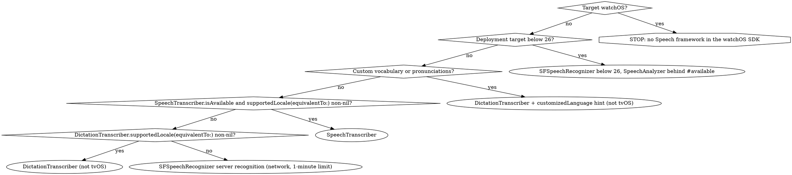

# Speech-to-Text (SpeechAnalyzer)

On-device speech-to-text, OS26. ML/AI routing → `skills/ios-ml.md`. Summarize or title a transcript → `foundation-models.md`.

## Overview

- `SpeechAnalyzer` = session holding **modules**. Input: `AsyncSequence` of `AnalyzerInput`. Output: each module's own results `AsyncSequence`. All correlated by audio time-codes → input, results, control run in separate tasks.
- Powers Notes, Voice Memos, Journal; + Apple Intelligence → Call Summarization (WWDC 2025-277). New model: faster than `SFSpeechRecognizer`'s, built for long-form and distant audio (lectures, meetings, conversations).
- Model: downloaded via `AssetInventory` into system storage, shared across apps, auto-updated, runs outside your process → no app-size or memory cost.
- **Analyzer never converts audio** (keeps time-codes sample-accurate) → deliver `bestAvailableAudioFormat`.
- **watchOS**: the watchOS SDK ships no Speech framework → neither API exists there.
- **Permissions**: live audio → `NSMicrophoneUsageDescription`. Apple: the `SFSpeechRecognizer` authorization flow "only applies to speech recognition using `SFSpeechRecognizer`"; SpeechAnalyzer transcribers send no audio to Apple. Shipping an `SFSpeechRecognizer` fallback → `NSSpeechRecognitionUsageDescription` mandatory (missing key → crash on the authorization request).

| Module | Use | Platforms |
|--------|-----|-----------|
| `SpeechTranscriber` | General purpose, new model. `isAvailable` false / `supportedLocales` empty on unsupported hardware | OS26, not watchOS |
| `DictationTranscriber` | Same model, locales, devices as on-device `SFSpeechRecognizer`; users needn't enable Siri/dictation in Settings; custom vocabulary | OS26, not tvOS/watchOS |
| `SpeechDetector` | Voice-activity gate for a transcriber → skips silence, saves power. No effect alone | OS26, not watchOS |

## Decision Tree — SpeechAnalyzer vs SFSpeechRecognizer



Short commands → either transcriber. Long-form, conversational, across-the-room → `SpeechTranscriber`.

## Red Flags

- Live transcription, transcribe audio/video, captions, Notes/Voice Memos-like features
- `SpeechAnalyzer`, `SpeechTranscriber`, `DictationTranscriber`, `AssetInventory`, `AnalyzerInput`
- Volatile results, `isFinal`, transcript duplicates or drops its last words
- `SFSpeechError`, `insufficientResources`, a second analyzer that throws
- `AVAudioEngine` tap feeding a transcriber; crash inside an `installTap` closure under Swift 6

## Pattern 1 — File Transcription

Shared error type for all patterns.

```swift
import AVFoundation
import Speech

enum TranscriptionError: Error {
    case unsupportedLocale(Locale)
    case assetsNotInstalled(Locale)
    case microphoneAccessDenied
    case noMicrophone
    case captureOutputRejected
    case noConverter(from: AVAudioFormat, to: AVAudioFormat)
    case conversionFailed(NSError?)
}

func transcribe(fileAt url: URL, locale: Locale) async throws -> AttributedString {
    guard let supported = await SpeechTranscriber.supportedLocale(equivalentTo: locale) else {
        throw TranscriptionError.unsupportedLocale(locale)
    }
    let transcriber = SpeechTranscriber(locale: supported, preset: .transcription)
    if let request = try await AssetInventory.assetInstallationRequest(supporting: [transcriber]) {
        try await request.downloadAndInstall()
    }

    async let transcript = transcriber.results.reduce(into: AttributedString()) { $0 += $1.text }

    let analyzer = SpeechAnalyzer(modules: [transcriber])
    let file = try AVAudioFile(forReading: url)
    if let lastSample = try await analyzer.analyzeSequence(from: file) {
        try await analyzer.finalizeAndFinish(through: lastSample)
    } else {
        await analyzer.cancelAndFinishNow()
    }
    return try await transcript
}
```

- `supportedLocale(equivalentTo:)`, not `supportedLocales.contains(_:)`: equivalent ≠ equal. No exact match → same language, other region ("color"/"colour") → let users correct it.
- `analyzeSequence(from:)` takes an `AVAudioFile` opened for reading, not a `URL`. Returns last sample's time-code, `nil` for an empty file.
- No `finish` call → result streams stay open waiting for audio → `reduce` never returns.
- Time-coded text → `.timeIndexedTranscriptionWithAlternatives`.
- **Video's audio track** `OS27`: `AVURLAsset.loadTracks(withMediaType: .audio).first` → `AssetInputSequenceProvider.provider(from:track:compatibleWith:)` → `analyzeSequence(provider.analyzerInputs)` → finish as above. Pass `track:` — the other overload reads "the first track", which in a movie may be video.

## Pattern 2 — Live Session: Setup → Merge → Runner

```swift
import AVFoundation
import Observation
import Speech

struct LiveAnalysis: Sendable {
    let transcriber: SpeechTranscriber
    let analyzer: SpeechAnalyzer
    let analyzerFormat: AVAudioFormat
}

func prepareLiveAnalysis(locale: Locale) async throws -> LiveAnalysis {
    guard let supported = await SpeechTranscriber.supportedLocale(equivalentTo: locale) else {
        throw TranscriptionError.unsupportedLocale(locale)
    }
    let transcriber = SpeechTranscriber(locale: supported, preset: .timeIndexedProgressiveTranscription)

    if let request = try await AssetInventory.assetInstallationRequest(supporting: [transcriber]) {
        try await request.downloadAndInstall()
    }
    guard let format = await SpeechAnalyzer.bestAvailableAudioFormat(compatibleWith: [transcriber]) else {
        throw TranscriptionError.assetsNotInstalled(supported)
    }

    let analyzer = SpeechAnalyzer(modules: [transcriber])
    try await analyzer.prepareToAnalyze(in: format)
    return LiveAnalysis(transcriber: transcriber, analyzer: analyzer, analyzerFormat: format)
}

@MainActor
@Observable
final class LiveTranscript {
    private(set) var text = AttributedString()

    func apply(_ result: SpeechTranscriber.Result) {
        if let replaced = text.rangeOfAudioTimeRangeAttributes(intersecting: result.range) {
            text.replaceSubrange(replaced, with: result.text)
        } else {
            text += result.text
        }
    }
}

nonisolated func transcribeLive(
    inputs: some AsyncSequence<AnalyzerInput, any Error> & Sendable,
    analysis: LiveAnalysis,
    into transcript: LiveTranscript
) async throws {
    let reader = Task {
        for try await result in analysis.transcriber.results {
            await transcript.apply(result)
        }
    }
    if let lastSample = try await analysis.analyzer.analyzeSequence(inputs) {
        try await analysis.analyzer.finalizeAndFinish(through: lastSample)
    } else {
        await analysis.analyzer.cancelAndFinishNow()
    }
    try await reader.value
}
```

| Step | Rule |
|------|------|
| Order | Assets → format → analyzer. `bestAvailableAudioFormat` = `nil` until assets installed. WWDC 2025-277 sample asks first → `nil` on a fresh device |
| Download | `downloadAndInstall()` returns after the *first attempt*; system retries later on its own → the `nil`-format guard catches "not installed yet" |
| Preheat | `prepareToAnalyze(in:)` loads the model now → faster first words |
| Preset | `.timeIndexedProgressiveTranscription` = `.volatileResults` + `.fastResults` + `.audioTimeRange` |
| Merge | Volatile results re-report a range; later replaces earlier. Merge by time range (Apple's 27 sample; `rangeOfAudioTimeRangeAttributes(intersecting:)` is documented for this). Needs `.audioTimeRange` — without it the lookup is always `nil` → every refinement appended → duplicates |
| Revocation | Empty volatile `text` = earlier text for that range revoked → replacing with it deletes it (correct) |
| Reader | Unstructured `Task` on purpose: stop = cancel the caller (Pattern 4); a reader in the same task tree dies before final results. 27-only alternative: `withThrowingDiscardingTaskGroup`, reader inside `withTaskCancellationShield` (`OS27`) |
| Isolation | `nonisolated` runner → reader closure compiles `@concurrent` even under default `MainActor` isolation; only `apply` hops to main |

Two-transcript alternative (WWDC 2025-277): `isFinal` → append to `finalized`, **clear** `volatile` (else duplicates); volatile → replace `volatile`. Caveat (`isFinal` doc): "no guarantee that this result will be reissued with this property set to true"; a result is also final once a later result's `resultsFinalizationTime` ≥ its `range.end` → after finalization, commit leftover `volatile` instead of dropping it.

## Pattern 3 — Audio Recording and Streaming

| Source | 26 | `OS27` |
|--------|----|--------|
| Mic | 3b: `AVAudioEngine` tap + `AVAudioConverter` → own stream | 3a: `CaptureInputSequenceProvider.analyzerInputs` |
| File | `analyzeSequence(from: AVAudioFile)`, `SpeechAnalyzer(inputAudioFile:…)` | Same + `AssetInputSequenceProvider` (any `AVAsset` track) |
| Arbitrary buffers | Own `AVAudioConverter` → `bestAvailableAudioFormat` | `AnalyzerInputConverter` |

27 types are additions, not drop-in replacements → keep the 26 path as fallback. Gate as the SDK does: `@available(anyAppleOS 27, *)` + `@available(watchOS, unavailable)`. An iOS-only gate doesn't gate the other platforms → their builds below 27 fail (`'CaptureInputSequenceProvider' is only available in macOS 27 or newer`): `@available(iOS 27, *)` on macOS/tvOS; `#available(iOS 27, *)` on macOS/tvOS/visionOS (visionOS inherits only the declaration attribute).

### 3a — Mic via CaptureInputSequenceProvider `OS27`

```swift
import AVFoundation
import Speech

@available(anyAppleOS 27, *)
@available(watchOS, unavailable)
@concurrent
func transcribeMicrophone(analysis: LiveAnalysis, into transcript: LiveTranscript) async throws {
    guard await AVCaptureDevice.requestAccess(for: .audio) else {
        throw TranscriptionError.microphoneAccessDenied
    }
    guard let microphone = AVCaptureDevice.default(for: .audio) else {
        throw TranscriptionError.noMicrophone
    }
    let provider = try await CaptureInputSequenceProvider.providerWithSession(
        from: microphone, compatibleWith: [analysis.transcriber]
    )
    let session = provider.captureSession
    session.startRunning()
    defer { session.stopRunning() }
    try await transcribeLive(inputs: provider.analyzerInputs, analysis: analysis, into: transcript)
}
```

- `@concurrent` → off the main actor. Apple: session init "can take some time; you should call this method in a background task"; `startRunning()` blocks. Plain `nonisolated async` runs on the caller's actor under `NonisolatedNonsendingByDefault`.
- `analyzerInputs` = only newly captured audio; ends only when the output deallocates (with session + provider).
- Don't modify `captureAudioDataOutput`'s sample-buffer delegate or callback queue.

| Entry point | Behavior |
|-------------|----------|
| `providerWithSession(from:compatibleWith:)` | New `AVCaptureSession`, output added, **also configures your app's default `AVAudioSession`** on iOS/tvOS/visionOS. Only option on visionOS |
| `provider(from:in:compatibleWith:)` | Joins your session, **doesn't reconfigure it**. You add `captureAudioDataOutput` yourself, or silence. Not visionOS |
| `init(session:analyzerFormat:priority:)` | Synchronous `throws`. No device parameter → session must already hold the mic input. Joins your session, doesn't reconfigure it; you add `captureAudioDataOutput`. Callable inside the actor that owns the session. Not visionOS |

App manages its own audio session (playback, VoIP, recording) → `providerWithSession` stomps it → `provider(from:in:)` or the init (both join your session). Session half → `axiom-media`.

**Swift 6 trap, `provider(from:in:)`**: nonisolated async; `AVCaptureDevice`/`AVCaptureSession` non-`Sendable` → passing an actor's stored session or device → `sending 'self.session' risks causing data races`. A wrapper taking `sending` parameters fails identically; only fresh locals pass, and with those the direct call compiles too. `swiftc -typecheck` exits 0 on the racy call — region isolation is checked in SIL → only a real build / `-emit-sil` shows it. Actor owns the session → synchronous init inside that actor:

```swift
import AVFoundation
import Speech

@available(anyAppleOS 27, *)
@available(watchOS, unavailable)
@available(visionOS, unavailable)
actor CaptureController {
    let session = AVCaptureSession()

    func transcriptionInputs(
        analyzerFormat: AVAudioFormat
    ) throws -> some AsyncSequence<AnalyzerInput, any Error> & Sendable {
        let provider = try CaptureInputSequenceProvider(
            session: session, analyzerFormat: analyzerFormat, priority: nil
        )
        session.beginConfiguration()
        defer { session.commitConfiguration() }
        guard session.canAddOutput(provider.captureAudioDataOutput) else {
            throw TranscriptionError.captureOutputRejected
        }
        session.addOutput(provider.captureAudioDataOutput)
        return provider.analyzerInputs
    }
}
```

- `analyzerFormat` = `LiveAnalysis.analyzerFormat` (Pattern 2) → result → `transcribeLive(inputs:…)`.
- Return the `Sendable` `analyzerInputs`, not the non-`Sendable` provider. Apple: provider may be released once you have the sequence. Session retains the output → sequence never ends on its own → stop = cancel the transcription task (Pattern 4).

### 3b — Mic via AVAudioEngine tap (26 path)

```swift
import AVFoundation
import os
import Speech

nonisolated private let audioSessionLog = Logger(subsystem: "Transcription", category: "AudioSession")

nonisolated func startMicrophone(
    _ engine: AVAudioEngine,
    convertingTo analyzerFormat: AVAudioFormat
) throws -> AsyncThrowingStream<AnalyzerInput, any Error> {
    let input = engine.inputNode
    let micFormat = input.outputFormat(forBus: 0)
    guard let converter = AVAudioConverter(from: micFormat, to: analyzerFormat) else {
        throw TranscriptionError.noConverter(from: micFormat, to: analyzerFormat)
    }
    converter.primeMethod = .none
    let rateRatio = analyzerFormat.sampleRate / micFormat.sampleRate
    let (inputs, continuation) = AsyncThrowingStream.makeStream(of: AnalyzerInput.self)

    input.installTap(onBus: 0, bufferSize: AVAudioFrameCount(micFormat.sampleRate / 10), format: micFormat) { buffer, _ in
        let capacity = AVAudioFrameCount((Double(buffer.frameLength) * rateRatio).rounded(.up))
        guard let converted = AVAudioPCMBuffer(pcmFormat: analyzerFormat, frameCapacity: capacity) else {
            continuation.finish(throwing: TranscriptionError.conversionFailed(nil))
            return
        }
        var handedOver = false
        var error: NSError?
        let status = converter.convert(to: converted, error: &error) { _, inputStatus in
            if handedOver {
                inputStatus.pointee = .noDataNow
                return nil
            }
            handedOver = true
            inputStatus.pointee = .haveData
            return buffer
        }
        guard status != .error else {
            continuation.finish(throwing: TranscriptionError.conversionFailed(error))
            return
        }
        if converted.frameLength > 0 {
            continuation.yield(AnalyzerInput(buffer: converted))
        }
    }

    engine.prepare()
    do {
        try engine.start()
    } catch {
        input.removeTap(onBus: 0)
        throw error
    }
    return inputs
}

@concurrent
func transcribeMicrophone(
    using engine: AVAudioEngine,
    analysis: LiveAnalysis,
    into transcript: LiveTranscript
) async throws {
    guard await AVAudioApplication.requestRecordPermission() else {
        throw TranscriptionError.microphoneAccessDenied
    }
    #if os(iOS) || os(visionOS)
    let audioSession = AVAudioSession.sharedInstance()
    try audioSession.setCategory(.playAndRecord, mode: .spokenAudio)
    try audioSession.setActive(true)
    defer {
        do {
            try audioSession.setActive(false, options: .notifyOthersOnDeactivation)
        } catch {
            audioSessionLog.error("Audio session deactivation failed: \(error)")
        }
    }
    #endif
    let inputs = try startMicrophone(engine, convertingTo: analysis.analyzerFormat)
    defer {
        engine.stop()
        engine.inputNode.removeTap(onBus: 0)
    }
    try await transcribeLive(inputs: inputs, analysis: analysis, into: transcript)
}
```

**Audio session.** `.notifyOthersOnDeactivation` is "only valid on session deactivation" → activate with no options, pass it when deactivating. Defers run in reverse → engine stops before deactivation (header: stop all I/O first). Deactivation error → log it; `try?` hides why other apps never resume.

**Tap isolation — the Swift 6 crash.** Tap block "may be invoked on a thread other than the main thread"; its type is `NS_SWIFT_NONSENDABLE` → a closure written in a `@MainActor` context (`@MainActor` class, SwiftUI view, any un-annotated code under default `MainActor` isolation) **inherits the main actor**. Compiles with no diagnostic; SIL carries a main-actor check (`swift_task_isCurrentExecutor` → `swift_task_reportUnexpectedExecutor`) that fires on the first buffer. Closure formed in a `nonisolated` function → no check. From the tap, touch no actor state; hand off through the `Sendable` continuation.

| Conversion rule | Why |
|-----------------|-----|
| `convert(to:error:withInputFrom:)`, not `convert(to:from:)` | The latter doesn't resample; mic (often 48 kHz) ≠ analyzer format |
| `frameCapacity` = input frames × rate ratio | Input `frameLength` is wrong whenever rates differ |
| `.noDataNow` after the one buffer, not `.endOfStream` | End-of-stream flushes and ends the converter; the next callback needs it |
| `primeMethod = .none` | `AnalyzerInput(buffer:)` assumes contiguous buffers; priming shifts audio into a later buffer |
| `bufferSize` = `sampleRate / 10` | A request; header's supported range is 100–400 ms |

27 AVFAudio: `installTap(onBus:bufferSize:format:block:)` deprecated → throwing `installAudioTap(onBus:bufferSize:format:tapProvider:)`, closure `@Sendable`, receives `Sendable` `AVReadOnlyAudioPCMBuffer` → compiler enforces isolation. On 27 prefer 3a anyway.

### AnalyzerInputConverter `OS27`

Audio you already hold (own engine graph, network stream): `try await AnalyzerInputConverter.converter(compatibleWith: modules)` → per buffer `convert(_:at:)` → yield each returned `AnalyzerInput` → `flush()` → yield → `finish()` the continuation. `convert` may hold audio back for a later call → always `flush()` before finishing. Never reuse or modify a buffer after passing it in (may be retained).

### AnalyzerInput.buffer deprecated `OS27`

Each `.buffer` read returns "a new copy of the audio data for this input" → allocation per access. Input may be backed by `CMReadySampleBuffer` (new 27 init). Read `bufferDuration` / `bufferFormat` (`OS27`) instead. 26 deployment target → `.buffer` is the only path (deprecated, functional) → gate, don't blindly migrate.

## Pattern 4 — Stopping Transcription

**Stop = cancel the task running the session.**

```swift
import AVFoundation
import Observation
import Speech

@MainActor
@Observable
final class DictationModel {
    let transcript = LiveTranscript()
    private(set) var failure: (any Error)?
    private let engine = AVAudioEngine()
    private var recording: Task<Void, Never>?

    func start(locale: Locale) {
        let previous = recording
        previous?.cancel()
        recording = Task {
            await previous?.value
            do {
                let analysis = try await prepareLiveAnalysis(locale: locale)
                if #available(anyAppleOS 27, *) {
                    try await transcribeMicrophone(analysis: analysis, into: transcript)
                } else {
                    try await transcribeMicrophone(using: engine, analysis: analysis, into: transcript)
                }
            } catch {
                failure = error
            }
        }
    }

    func stop() {
        recording?.cancel()
    }
}
```

- `start` cancels **and awaits** the previous run → its `defer`s (engine stop, `removeTap`, session teardown) finish before the next tap installs. `AVAudioNode.h`: "Only one tap may be installed on any bus" → double tap, or stop + quick start, must not overlap runs. `stop()` only cancels; clearing `recording` there lets the next `start` skip the wait.
- Cancelled `analyzeSequence(_:)` → stops consuming, returns last consumed sample's time-code, doesn't throw `CancellationError` → runner calls `finalizeAndFinish(through:)` → pending volatile results become final, result streams end → reader drains → `defer`s stop session/engine.
- This `Task` inherits the main actor — fine, it only awaits. Work runs in the `SpeechAnalyzer` actor, the system's model process, and the `@concurrent` functions. `async` alone would not move `startRunning()` off main.
- Capture input: cancellation is Apple's choice — a capture session can restart many times, its sequence ends only on deallocation, "it's easy to overlook a stray reference". Sequences you own (`AsyncStream`, `AssetInputSequenceProvider`) → finishing them works too (`analyzeSequence` returns normally).
- `finalizeAndFinishThroughEndOfInput()` → autonomous mode only (`start(inputSequence:)` / input-taking inits). "Waits until the input sequence has been terminated and fully consumed" → never `finish()` the analyzer's input continuation → waits forever. Finishing an *upstream* stream doesn't count.
- `cancelAnalysis(before:)` → drop results you no longer need (scene change in captions); best-effort. `finalize(through:)` → wait for them instead.

## Pattern 5 — Model Asset Management

```swift
import Observation
import Speech

@MainActor
@Observable
final class SpeechAssets {
    private(set) var downloadProgress: Progress?

    func install(for modules: [any SpeechModule]) async throws {
        guard let request = try await AssetInventory.assetInstallationRequest(supporting: modules) else {
            return
        }
        downloadProgress = request.progress
        defer { downloadProgress = nil }
        try await request.downloadAndInstall()
    }

    func isReady(_ modules: [any SpeechModule]) async -> Bool {
        await AssetInventory.status(forModules: modules) == .installed
    }

    func releaseReservation(_ reserved: Locale) async {
        await AssetInventory.release(reservedLocale: reserved)
    }
}
```

| API | Behavior |
|-----|----------|
| `assetInstallationRequest(supporting:)` | `nil` = all installed. **Auto-reserves** needed locales; throws if that exceeds `maximumReservedLocales` or config unsupported |
| `downloadAndInstall()` | Requests consolidate → repeat calls never re-download |
| `status(forModules:)` | `.unsupported` < `.downloading` < `.supported` (downloadable) < `.installed`; mixed modules → lowest |
| `maximumReservedLocales` | Per-app cap; "may vary between devices according to storage space" |
| `reservedLocales` / `release(reservedLocale:)` | Release only what the user removed, passing a value from `reservedLocales` (may be "variants" of what you reserved). Releasing all → unsubscribes locales in use → system removes assets later |
| `reserve(locale:)` | Manual reservation; throws past the cap or for an unsupported locale |
| `Options(priority:modelRetention:)` | `.whileInUse` (released with analyzer), `.lingering` (kept a while for a compatible analyzer), `.processLifetime` |
| `SpeechModels.endRetention()` | Releases cached models now; returns when done |

WWDC 2025-277's `AssetInventory.allocatedLocales` / `deallocate(locale:)` are beta-era names, absent from the shipping SDK. "Allocate" survives only in error codes.

## Simultaneous Analyses Are Capped

Over the limit → **throws `SFSpeechError.Code.insufficientResources`**. True from 26, not a 27 change.

| Platform | Limit (SDK doc comment) |
|----------|-------------------------|
| iOS / visionOS | ~2 ongoing recognition instances (or 2 incompatible modules at once) |
| macOS | No limit currently |

- Similarly configured transcribers **share** engines and models → the cap counts *incompatible* work → same locale + settings is the cheap fix; a third alike analyzer may not throw.
- `SpeechAnalyzer.Options.ignoresResourceLimits` `OS27` → unlimited analyzers. Stops the **counting**, not the hardware ceiling → past real capacity, an **unpredictable error** replaces the early `insufficientResources`. Apple's safe cases: analyzers sharing language + settings, or receiving audio on an interleaved schedule. Apple's warning: test across devices; have a recovery path.
- Property is `let` → settable only via the 27-only init → 26 deployment target needs both branches:

```swift
import Speech

func makeAnalyzerOptions() -> SpeechAnalyzer.Options {
    let options: SpeechAnalyzer.Options
    if #available(anyAppleOS 27, *) {
        options = .init(priority: .userInitiated, modelRetention: .lingering, ignoresResourceLimits: true)
    } else {
        options = .init(priority: .userInitiated, modelRetention: .lingering)
    }
    return options
}
```

## Pattern 6 — Displaying Results with Timing

`.audioTimeRange` → every run carries a `CMTimeRange` into the source audio.

```swift
import CoreMedia
import Speech
import SwiftUI

struct TranscriptPlaybackView: View {
    let transcript: AttributedString
    let playbackTime: CMTime

    var body: some View {
        Text(highlighted)
    }

    private var highlighted: AttributedString {
        var text = transcript
        for run in transcript.runs {
            if let spoken = run.audioTimeRange, spoken.containsTime(playbackTime) {
                text[run.range].backgroundColor = .yellow
            }
        }
        return text
    }
}
```

- `transcript.runs` yields `Run`, not `(range, run)` tuples → range is `run.range`.
- Time → text: `rangeOfAudioTimeRangeAttributes(intersecting:)`.
- `.transcriptionConfidence` → per-run `transcriptionConfidence` (0–1).

## Errors

Codes are **Swift-only `static var`s** on `SFSpeechError.Code` (`SFErrors.h` declares 6 ObjC cases, none of these) → no shorthand member on `SFSpeechError`.

| Catch form | Result |
|------------|--------|
| `catch SFSpeechError.insufficientResources` | ❌ `type 'SFSpeechError' has no member 'insufficientResources'` |
| `catch SFSpeechError.Code.insufficientResources` | ✅ |
| `catch let error as SFSpeechError where error.code == .insufficientResources` | ✅ |

| Code | SDK meaning → usual cause |
|------|---------------------------|
| `insufficientResources` | Not enough on-device resources → over the cap |
| `unexpectedAudioFormat` | Input in unexpected format → not converted to `bestAvailableAudioFormat` |
| `incompatibleAudioFormats` | Modules share no format |
| `audioDisordered` | Input time-code overlaps/precedes prior input → wrong `bufferStartTime`, converter priming |
| `noModel` | No model available or downloadable for locale/options |
| `assetLocaleNotAllocated` | Module needs an unreserved locale → skipped `AssetInventory` |
| `tooManyAssetLocalesAllocated` | Too many reserved → release one (Pattern 5) |
| `cannotAllocateUnsupportedLocale` | Locale unsupported → `supportedLocale(equivalentTo:)` first |
| `moduleOutputFailed` | Module's result task failed |
| `cannotConfigureAudioSystem` `OS27` | Audio source couldn't be configured → handle wherever capture providers are used |

Any analyzer/result-stream error → session finished; same error (or `CancellationError`) thrown from every waiting method and stream → new analyzer to continue.

## Anti-Patterns

| Thought | Reality |
|---------|---------|
| "Install the tap in my `@MainActor` recorder" | Closure inherits main actor → isolation check fires on the audio thread. Form it in a `nonisolated` function (3b) |
| "Format mismatch fails silently; skip conversion" | Analyzer never converts; the documented error for it is `unexpectedAudioFormat`, and any error finishes the session |
| "`convert(to:from:)` is enough" | No resampling → `convert(to:error:withInputFrom:)` + ratio-sized output, or `AnalyzerInputConverter` on 27 |
| "Get the format, then download the model" | `bestAvailableAudioFormat` is `nil` until assets install |
| "Stop the engine, then `finalizeAndFinishThroughEndOfInput()`" | Waits for the analyzer's own input stream to finish → forever. Cancel the session task (Pattern 4) |
| "`try?` the finalize call" | Swallows the one error explaining a lost transcript → propagate |
| "Every volatile result is reissued with `isFinal == true`" | Not guaranteed → merge by time range, or commit leftover volatile after finalization |
| "Two concurrent transcribers is fine" | iOS/visionOS cap ≈ 2; a third *incompatible* one throws → configure alike or handle the throw |
| "`ignoresResourceLimits` removes the limit" | Removes the counting, not the hardware ceiling → unpredictable error later |
| "`providerWithSession` is the easy one" | Reconfigures your default `AVAudioSession` → own session? `init(session:analyzerFormat:priority:)` inside the owning actor (or `provider(from:in:)` with locals) + add its output |
| "Wrap `provider(from:in:)` in a `sending` helper" | Still `sending 'self.session' risks causing data races` for actor-held values → synchronous init inside the actor |
| "Deallocate every reserved locale to free space" | Drops locales still in use → release only what the user removed |

## Presets Reference

`SpeechTranscriber.Preset` — WWDC 2025-277's `.offlineTranscription` / `.progressiveLiveTranscription` are beta-era names, absent from the shipping SDK.

| Preset | volatileResults | fastResults | alternativeTranscriptions | audioTimeRange | Use |
|--------|-----------------|-------------|---------------------------|----------------|-----|
| `.transcription` | — | — | — | — | Files, accurate text |
| `.transcriptionWithAlternatives` | — | — | Yes | — | Editing suggestions |
| `.timeIndexedTranscriptionWithAlternatives` | — | — | Yes | Yes | Editing + audio sync |
| `.progressiveTranscription` | Yes | Yes | — | — | Live |
| `.timeIndexedProgressiveTranscription` | Yes | Yes | — | Yes | Live + time-range merge/sync |

`DictationTranscriber.Preset`:

| Preset | shortForm hint | volatileResults | frequentFinalization | audioTimeRange | punctuation |
|--------|----------------|-----------------|----------------------|----------------|-------------|
| `.phrase` | Yes | — | — | — | — |
| `.shortDictation` | Yes | — | — | — | Yes |
| `.progressiveShortDictation` | Yes | Yes | Yes | — | Yes |
| `.longDictation` | — | — | — | — | Yes |
| `.progressiveLongDictation` | — | Yes | — | — | Yes |
| `.timeIndexedLongDictation` | — | — | — | Yes | Yes |

Customize: preset's `transcriptionOptions` / `reportingOptions` / `attributeOptions` (+ `contentHints` for dictation) → modify sets → designated init.

## Options Reference

| Option | Speech | Dictation | Effect |
|--------|--------|-----------|--------|
| `.etiquetteReplacements` (transcription) | Yes | Yes | Expletives → asterisks |
| `.punctuation` (transcription) | — | Yes | Auto punctuation; else only spoken ("comma") |
| `.emoji` (transcription) | — | Yes | "smiling emoji" → 🙂 |
| `.volatileResults` (reporting) | Yes | Yes | Tentative results, later replaced |
| `.alternativeTranscriptions` (reporting) | Yes | Yes | Fills `alternatives`, most likely first |
| `.fastResults` (reporting) | Yes | — | Smaller context window → lower latency, less accurate |
| `.frequentFinalization` (reporting) | — | Yes | Finalizes more often, less accurately |
| `.audioTimeRange` (attribute) | Yes | Yes | `CMTimeRange` per run |
| `.transcriptionConfidence` (attribute) | Yes | Yes | Confidence 0–1 per run |

| Other | Detail |
|-------|--------|
| `DictationTranscriber.ContentHint` | `.shortForm` (~1 min audio), `.farField` (distant speaker), `.atypicalSpeech` (heavy accent, lisp), `.customizedLanguage(modelConfiguration:)` (`SFSpeechLanguageModel` vocabulary/pronunciations) |
| `AnalysisContext.contextualStrings[.general]` | Bias toward app-specific words; documented for `DictationTranscriber`; 1–2-word phrases, ≤100 total. Pass via analyzer init or `setContext(_:)` |
| `SpeechAnalyzer.Options` | `priority` (most processing — also call from a task at that priority), `modelRetention` (Pattern 5), `ignoresResourceLimits` `OS27` |
| `SpeechDetector(detectionOptions:reportResults:)` | Add beside a transcriber. `SensitivityLevel` `.low`/`.medium`/`.high`; Apple recommends `.medium`; dropping real speech costs accuracy |

## SFSpeechRecognizer — Pre-26 and the Gaps

- **Below 26**: `requestAuthorization` (`NSSpeechRecognitionUsageDescription` required). Check `supportsOnDeviceRecognition`, then set `requiresOnDeviceRecognition` — honored only when supported.
- **Server-only locales**: `DictationTranscriber` excludes locales `SFSpeechRecognizer` supports only over the network. Server recognition: tasks >1 minute stopped; rate-limited per device and per app.
- Unavailable on tvOS (there `SpeechTranscriber` is the only option); absent on watchOS.

## Resources

**WWDC**: 2025-277

**Docs**: /speech, /speech/speechanalyzer, /speech/speechtranscriber, /speech/dictationtranscriber, /speech/assetinventory, /speech/analyzerinput, /speech/analyzerinputconverter, /speech/captureinputsequenceprovider, /speech/assetinputsequenceprovider, /speech/speechanalyzer/options, /speech/recognizing-speech-in-live-audio, /speech/asking-permission-to-use-speech-recognition, /speech/sfspeechrecognizer

**Skills**: `skills/ios-ml.md` (hub), foundation-models, axiom-media (AVAudioSession, AVCaptureSession), axiom-concurrency (isolation, `@concurrent`, `sending`)
