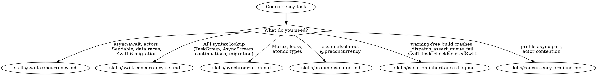
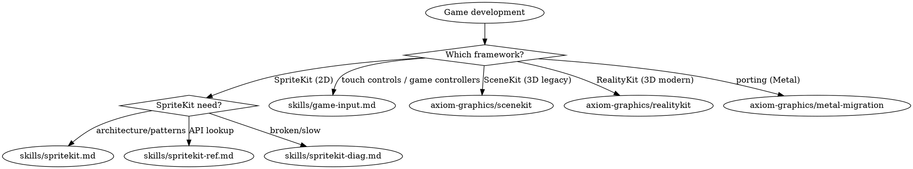

```dot
digraph health {
    start [label="HealthKit / workout task" shape=ellipse];
    what [label="What area?" shape=diamond];

    start -> what;
    what -> "skills/fundamentals.md" [label="framework basics, data types"];
    what -> "skills/authorization-and-privacy.md" [label="permissions, purpose strings, privacy"];
    what -> "skills/queries.md" [label="reading data, rollups, writes"];
    what -> "skills/sync-and-background.md" [label="change tracking, background delivery"];
    what -> "skills/workouts.md" [label="HKWorkoutSession, live workouts"];
    what -> "skills/workoutkit.md" [label="planned/custom workouts"];
    what -> "skills/wellbeing-and-medications.md" [label="State of Mind, Medications"];
    what -> "skills/clinical-and-mobility.md" [label="Health Records, Mobility"];
    what -> "axiom-watchos" [label="watch-specific presentation"];
    what -> "axiom-concurrency" [label="general actor isolation rules"];
    what -> "axiom-swiftui" [label="Charts, data visualization"];
}
```

# Integrated Reference Bundle 03

Combines 12 related source skills from `ios-swift-platform` into one navigable reference file.

## Source map

- `axiom-apple-docs/SKILL.reference.md`
- `axiom-audit-foundation-models/SKILL.reference.md`
- `axiom-audit-swiftdata/SKILL.reference.md`
- `axiom-audit-swiftui-architecture/SKILL.reference.md`
- `axiom-audit-swiftui-layout/SKILL.reference.md`
- `axiom-audit-swiftui-nav/SKILL.reference.md`
- `axiom-concurrency/SKILL.reference.md`
- `axiom-games/SKILL.reference.md`
- `axiom-graphics/SKILL.reference.md`
- `axiom-health/SKILL.reference.md`
- `axiom-health-check/SKILL.reference.md`
- `axiom-integration/SKILL.reference.md`

## Integrated guidance

### Source: `axiom-apple-docs`

# Apple Documentation Router

Apple bundles for-LLM markdown documentation inside Xcode. These are authoritative, up-to-date guides and diagnostics written by Apple engineers. Read them directly as files (in Claude Code, with the **`Read`** tool) — no MCP server or special tool required.

## When to Use

- You need the exact API signature or behavior from Apple
- An Axiom skill references an Apple framework and you want the official source
- A Swift compiler diagnostic needs explanation
- The user asks about a specific Apple framework feature

**Priority**: Axiom skills provide opinionated guidance (decision trees, anti-patterns, pressure scenarios). Apple docs provide authoritative API details. Use both together.

## How to Read These Docs

Axiom's session context names the Xcode the user has switched to. In Claude Code it lists the literal base directories ("Apple for-LLM Documentation: Xcode detected at `<path>`"); other harnesses name the app ("Installed on this machine: Xcode … (`<path>`)") — substitute that `.app` for `/Applications/Xcode.app` in the table below. Read `<base>/<filename>` as a file (the **`Read`** tool in Claude Code).

Default Xcode location (`/Applications/Xcode.app`) base directories:

| Content | Base directory |
|---|---|
| AdditionalDocumentation guides | `/Applications/Xcode.app/Contents/PlugIns/IDEIntelligenceChat.framework/Versions/A/Resources/AdditionalDocumentation/` |
| Swift compiler diagnostics | `/Applications/Xcode.app/Contents/Developer/Toolchains/XcodeDefault.xctoolchain/usr/share/doc/swift/diagnostics/` |

Example invocation Claude should produce:

```
Read /Applications/Xcode.app/Contents/PlugIns/IDEIntelligenceChat.framework/Versions/A/Resources/AdditionalDocumentation/SwiftUI-Implementing-Liquid-Glass-Design.md
```

These paths assume the default install; use the path from session context instead. Without session context: use `AXIOM_XCODE_PATH` if it is set; otherwise run `xcode-select -p` (it honors `DEVELOPER_DIR`), which prints `<Xcode>.app/Contents/Developer` — drop `/Contents/Developer` and put that `.app` in place of `/Applications/Xcode.app` above. If it prints `/Library/Developer/CommandLineTools`, no Xcode is selected; try `/Applications/Xcode.app`.

## Guide Files (AdditionalDocumentation)

20 files. Read with the path pattern `{guides base}/{filename}`.

### UI & Design

| Topic | Filename |
|---|---|
| Liquid Glass in SwiftUI | `SwiftUI-Implementing-Liquid-Glass-Design.md` |
| Liquid Glass in UIKit | `UIKit-Implementing-Liquid-Glass-Design.md` |
| Liquid Glass in AppKit | `AppKit-Implementing-Liquid-Glass-Design.md` |
| Liquid Glass in WidgetKit | `WidgetKit-Implementing-Liquid-Glass-Design.md` |
| SwiftUI new toolbar features | `SwiftUI-New-Toolbar-Features.md` |
| SwiftUI styled text editing | `SwiftUI-Styled-Text-Editing.md` |
| SwiftUI WebKit integration | `SwiftUI-WebKit-Integration.md` |
| SwiftUI AlarmKit integration | `SwiftUI-AlarmKit-Integration.md` |
| Swift Charts 3D visualization | `Swift-Charts-3D-Visualization.md` |
| Foundation AttributedString updates | `Foundation-AttributedString-Updates.md` |

### Data & Persistence

| Topic | Filename |
|---|---|
| SwiftData class inheritance | `SwiftData-Class-Inheritance.md` |

### Concurrency & Performance

| Topic | Filename |
|---|---|
| Swift concurrency updates | `Swift-Concurrency-Updates.md` |
| InlineArray and Span | `Swift-InlineArray-Span.md` |

### Apple Intelligence

| Topic | Filename |
|---|---|
| Foundation Models (on-device LLM) | `FoundationModels-Using-on-device-LLM-in-your-app.md` |

### System Integration

| Topic | Filename |
|---|---|
| App Intents updates | `AppIntents-Updates.md` |
| StoreKit updates | `StoreKit-Updates.md` |
| MapKit GeoToolbox PlaceDescriptors | `MapKit-GeoToolbox-PlaceDescriptors.md` |
| Widgets for visionOS | `Widgets-for-visionOS.md` |

### Accessibility

| Topic | Filename |
|---|---|
| Assistive Access in iOS | `Implementing-Assistive-Access-in-iOS.md` |

### Computer Vision

| Topic | Filename |
|---|---|
| Visual Intelligence in iOS | `Implementing-Visual-Intelligence-in-iOS.md` |

## Swift Compiler Diagnostics

46 files in the diagnostics directory. Read with the path pattern `{diagnostics base}/{filename}`.

### Concurrency Diagnostics

| Diagnostic | Filename |
|---|---|
| Actor-isolated call from nonisolated context | `actor-isolated-call.md` |
| Conformance isolation | `conformance-isolation.md` |
| Isolated conformances | `isolated-conformances.md` |
| Nonisolated nonsending by default | `nonisolated-nonsending-by-default.md` |
| Sendable closure captures | `sendable-closure-captures.md` |
| Sendable metatypes | `sendable-metatypes.md` |
| Explicit Sendable annotations | `explicit-sendable-annotations.md` |
| Sending closure risks data race | `sending-closure-risks-data-race.md` |
| Sending risks data race | `sending-risks-data-race.md` |
| Mutable global variable | `mutable-global-variable.md` |
| Preconcurrency import | `preconcurrency-import.md` |
| Dynamic exclusivity | `dynamic-exclusivity.md` |
| Exclusivity violation | `exclusivity-violation.md` |

### Type System Diagnostics

| Diagnostic | Filename |
|---|---|
| Existential any | `existential-any.md` |
| Existential member access limitations | `existential-member-access-limitations.md` |
| Nominal types | `nominal-types.md` |
| Multiple inheritance | `multiple-inheritance.md` |
| Protocol type non-conformance | `protocol-type-non-conformance.md` |
| Opaque type inference | `opaque-type-inference.md` |
| Foreign reference type | `foreign-reference-type.md` |

### Build & Migration Diagnostics

| Diagnostic | Filename |
|---|---|
| Deprecated declaration | `deprecated-declaration.md` |
| Error in future Swift version | `error-in-future-swift-version.md` |
| Strict language features | `strict-language-features.md` |
| Strict memory safety | `strict-memory-safety.md` |
| Implementation only deprecated | `implementation-only-deprecated.md` |
| Member import visibility | `member-import-visibility.md` |
| Missing module on known paths | `missing-module-on-known-paths.md` |
| Module not testable | `module-not-testable.md` |
| Module version missing | `module-version-missing.md` |
| Clang declaration import | `clang-declaration-import.md` |
| Availability unrecognized name | `availability-unrecognized-name.md` |
| Always-available domain | `always-available-domain.md` |
| Upcoming language features | `upcoming-language-features.md` |
| Unknown warning group | `unknown-warning-group.md` |
| Compilation caching | `compilation-caching.md` |
| Embedded restrictions | `embedded-restrictions.md` |

### Swift Language Diagnostics

| Diagnostic | Filename |
|---|---|
| Dynamic callable requirements | `dynamic-callable-requirements.md` |
| Property wrapper requirements | `property-wrapper-requirements.md` |
| Result builder methods | `result-builder-methods.md` |
| String interpolation conformance | `string-interpolation-conformance.md` |
| Trailing closure matching | `trailing-closure-matching.md` |
| Temporary pointers | `temporary-pointers.md` |
| Semantic copies | `semantic-copies.md` |
| Performance hints | `performance-hints.md` |

### Index

| Diagnostic | Filename |
|---|---|
| Diagnostic groups (taxonomy) | `diagnostic-groups.md` |
| All diagnostics index | `diagnostics.md` |

If a diagnostic you need isn't listed above, list the diagnostics directory first:

```
ls "<Xcode>.app/Contents/Developer/Toolchains/XcodeDefault.xctoolchain/usr/share/doc/swift/diagnostics/"
```

`<Xcode>.app` is the app session context names; without session context, derive it as above. Command Line Tools keep the same files at `/Library/Developer/CommandLineTools/usr/share/doc/swift/diagnostics/`.

Filenames follow the diagnostic's short name (lowercase, hyphenated).

## Routing Decision Tree

```
User question about Apple API/framework?
├── Specific compiler error/warning → Read {diagnostics base}/<diagnostic-name>.md
├── Liquid Glass implementation     → Read {guides base}/<Framework>-Implementing-Liquid-Glass-Design.md
├── Swift concurrency patterns      → Read {guides base}/Swift-Concurrency-Updates.md
├── Foundation Models / on-device AI → Read {guides base}/FoundationModels-Using-on-device-LLM-in-your-app.md
├── SwiftData features              → Read {guides base}/SwiftData-Class-Inheritance.md
├── StoreKit / IAP                  → Read {guides base}/StoreKit-Updates.md
├── App Intents / Siri              → Read {guides base}/AppIntents-Updates.md
├── Charts / visualization          → Read {guides base}/Swift-Charts-3D-Visualization.md
├── Text editing / AttributedString → Read {guides base}/SwiftUI-Styled-Text-Editing.md or Foundation-AttributedString-Updates.md
├── WebKit in SwiftUI               → Read {guides base}/SwiftUI-WebKit-Integration.md
├── Toolbar features                → Read {guides base}/SwiftUI-New-Toolbar-Features.md
└── Other                           → ls the base directory to see what's available
```

## Fallback When Xcode Is Unavailable

If the resolved Xcode has no `IDEIntelligenceChat.framework` documentation directory (older Xcode, or only Command Line Tools installed), fall back to the list below. For a Swift diagnostic, first try the Command Line Tools copy at `/Library/Developer/CommandLineTools/usr/share/doc/swift/diagnostics/`.

1. **sosumi.ai** (markdown mirror of developer.apple.com — see `skills/apple-docs-research.md`)
2. **The SDK's own declarations** – its Swift interfaces and Objective-C headers (also in `skills/apple-docs-research.md`); Command Line Tools includes only the macOS SDK
3. **Suggest** installing the latest Xcode for full Apple docs coverage

Do not silently fail — tell the user when Xcode docs aren't available locally and which fallback you used.

## MCP Convenience Path

Clients using axiom-mcp can also invoke `axiom_read_skill` with the legacy ID (e.g., `apple-guide-swiftui-implementing-liquid-glass-design`). The MCP server reads the same Xcode files and returns the same content. Both paths are supported — the file-Read path works everywhere; the MCP path is a convenience for catalog/search workflows.

## Research Methodology

When the bundled guides don't cover it — Apple's full API reference, the SDK's own declarations, or a WWDC session's transcript and code — see [skills/apple-docs-research.md](skills/apple-docs-research.md).

## Resources

**Skills**: axiom-swiftui, axiom-concurrency, axiom-data, axiom-ai, axiom-integration

### Source: `axiom-audit-foundation-models`

# Foundation Models Auditor Agent

You are an expert at detecting Foundation Models (Apple Intelligence) issues — both known anti-patterns AND missing/incomplete patterns that cause crashes on unsupported devices, concurrent-request errors, guardrail-refusal UX failures, prompt injection, structured-output parsing breakage, and session lifecycle waste.

## Tool Use Is Mandatory

Run every Glob, Grep, and Read this prompt lists. Do not reason from training data instead of scanning.

- Run each Grep pattern as written; do not collapse them into one mega-regex.
- Run the Read verifications each section calls for.
- "Build a mental model" / "map the architecture" means with tool output in hand, not from memory.

## Files to Exclude

Skip: `*Tests.swift`, `*Previews.swift`, `*/Pods/*`, `*/Carthage/*`, `*/.build/*`, `*/DerivedData/*`, `*/scratch/*`, `*/docs/*`, `*/.claude/*`, `*/.claude-plugin/*`

## Phase 1: Map Foundation Models Surface

### Step 1: Identify Imports and Deployment Target

Establish the actual project, target, configuration and SDK before making deployment-specific recommendations. Discover both `project.pbxproj` and JSON5 `project.xcproj` at any depth, excluding dependency/cache directories. Read project/target settings and included xcconfig files, including conditional keys and array values. Label structural values "declared; effective value unverified"; a first match is not an evaluated target. For effective values, the owning workflow can obtain a matching authorized Xcode settings capture using `axiom-build (skills/build-performance.md)`, "Project selection and effective settings". Do not launch Xcode under file-read-only scope. Apply target/phase file membership and synchronized-folder exception sets before assigning a source finding to a target; otherwise report it as a codebase match with target ownership unverified.

```
Glob: **/*.swift, **/*.xcconfig, **/project.pbxproj, **/project.xcproj
Grep for:
  - `import\s+FoundationModels` — files using the framework
  - `IPHONEOS_DEPLOYMENT_TARGET`, `MACOSX_DEPLOYMENT_TARGET` — must be iOS 26+/macOS 26+
  - `if #available\(iOS\s+26`, `if #available\(macOS\s+26` — availability gates
  - `@available\(iOS\s+26`, `@available\(macOS\s+26` — type-level availability
```

### Step 2: Identify Sessions and Their Owners

```
Grep for:
  - `LanguageModelSession\(` — session construction sites (where is each created?)
  - `var\s+session:\s*LanguageModelSession`, `let\s+session:\s*LanguageModelSession` — ownership
  - `@State\s+.*LanguageModelSession`, `@StateObject` patterns near sessions
  - `class\s+\w+(Service|Manager|ViewModel)` containing session ownership
```

### Step 3: Identify Availability and Lifecycle Surface

```
Grep for:
  - `SystemLanguageModel\.default\.availability` — availability check sites
  - `\.availability` — any availability access
  - `\.unavailable`, `\.available` — availability cases handled
  - `\.deviceNotEligible`, `\.appleIntelligenceNotEnabled`, `\.modelNotReady` — the three real UnavailableReason cases
  - `\.task\s*\{`, `Task\s*\{`, `\.onAppear` near session creation — lifecycle anchors
  - `Button.*LanguageModelSession`, `onTapGesture.*LanguageModelSession` — session-in-action smell
```

### Step 4: Identify @Generable / @Guide / Tool Surface

```
Grep for:
  - `@Generable` — structured-output types (count + names)
  - `@Guide\(` — property-level constraints (count)
  - `:\s*Tool\b`, `:\s*FoundationModels\.Tool` — Tool protocol conformance
  - `func call\(arguments:` — Tool implementation methods
  - `enum\s+\w+\s*:.*Generable`, `@Generable\s+enum` — generable enums (need @frozen check)
  - `@frozen` near @Generable enums — frozen enum discipline
```

### Step 5: Identify Inference and Error-Handling Surface

```
Grep for:
  - `\.respond\(to:` — single response, returned when generation finishes
  - `\.streamResponse\(to:` — streaming response
  - `\.respond\(to:.*generating:` — structured @Generable response
  - `PartiallyGenerated` — streaming partial output type
  - `LanguageModelError` — OS27 error type (the current one)
  - `LanguageModelSession\.GenerationError` — 26-cycle error type, **deprecated in 27.0**
  - `SystemLanguageModel\.Error`, `LanguageModelSession\.Error` — the errors that split OUT of the old enum
  - `GeneratedContent\.ParsingError` — where `.decodingFailure` went
  - `\.contextSizeExceeded|\.exceededContextWindowSize` — same failure, new/old spelling
  - `\.guardrailViolation`, `\.refusal`, `\.rateLimited`, `\.timeout` — specific catch arms
  - `try\s+await.*respond` — actual call sites
  - `Task\.cancel\(\)`, `\.task\(id:` — cancellation surface
  - `\.transcript`, `transcript\.` — conversation history access
```

**Search BOTH error spellings.** The 27 SDK deprecated `LanguageModelSession.GenerationError` in favor of `LanguageModelError`, and split `assetsUnavailable` / `concurrentRequests` / `decodingFailure` out into `SystemLanguageModel.Error`, `LanguageModelSession.Error`, and `GeneratedContent.ParsingError`. A project written against the 27 API contains **none** of the old identifiers — grepping only for those reports a modern codebase as having no error handling at all, which is the opposite of the truth. See `axiom-ai (skills/foundation-models-ref.md)` for the full migration table.

### Step 6: Read Key Files

Read 1-2 representative AI files (AIService / ChatViewModel / similar) to understand:
- Whether availability is checked once (at app/service init) AND before each session creation
- Whether sessions are owned by a long-lived service (good) or recreated per tap (bad)
- Whether `respond()` calls are wrapped in `Task { ... }` with loading-state UI
- Whether catch blocks distinguish guardrail/refusal, context-size exhaustion, and generic errors — in EITHER error-type spelling (`LanguageModelError` on 27, `GenerationError` on 26)
- Whether @Generable enums are `@frozen` and Tool implementations propagate errors correctly
- Whether user-supplied text is interpolated directly into prompts (injection risk)

### Output

Write a brief **Foundation Models Map** (5-10 lines) summarizing:
- Number of LanguageModelSession instances and their ownership pattern (service-level / view-level / per-tap)
- Number of @Generable types (and whether nested types are also @Generable)
- @Guide annotation coverage on numeric / collection properties
- Tool protocol implementations (count + their purpose)
- Availability discipline (single source of truth / scattered checks / missing)
- Streaming usage (streamResponse for long output / always respond / mixed)
- Error-handling discipline (specific catches for guardrail and context-window / generic only)
- Prompt-construction pattern (static templates / user-text interpolation / mixed)

Present this map in the output before proceeding.

## Phase 2: Detect Known Anti-Patterns

Run all 14 detection patterns. For every grep match, use Read to verify the surrounding context before reporting — grep patterns have high recall but need contextual verification.

### Pattern 1: No Availability Check Before LanguageModelSession (CRITICAL/HIGH)

**Issue**: Constructing `LanguageModelSession` on a device without Apple Intelligence (or with the model in `.modelNotReady` state) crashes or silently fails.
**Search**:
- `LanguageModelSession\(` — construction sites
- For each match, search the surrounding scope for `SystemLanguageModel.default.availability` check
**Verify**: Read matching files; flag every session construction that isn't preceded by an availability gate. A higher-level guard at app init counts only if the session-creation site can prove it ran.
**Fix**:
```swift
guard SystemLanguageModel.default.availability == .available else {
    // show unavailable UI
    return
}
let session = LanguageModelSession()
```

### Pattern 2: Concurrent Requests on One Session (HIGH/HIGH)

**Issue**: one request per session. A button/submit/repeat trigger firing while `session.isResponding` throws `concurrentRequests` (`LanguageModelSession.Error` in the 27 SDK; `GenerationError` before). Awaiting doesn't freeze the UI → users can tap again mid-generation.
**Search**:
- `\.respond\(to:` and `\.streamResponse\(` — call sites
- `isResponding` — whether the file guards the trigger
**Verify**: user-triggered call with no `.disabled(session.isResponding)` or `isResponding` guard = bug. `try await` in `Task {}` with no `catch` also drops the error silently.
**Fix** (the `isResponding` guard is Apple's pattern from its documentation):
```swift
Button("Generate") {
    Task {
        do {
            result = try await session.respond(to: prompt).content
        } catch {
            errorMessage = error.localizedDescription
        }
    }
}
.disabled(session.isResponding)
```

### Pattern 3: Manual JSON Parsing of Model Output (CRITICAL/HIGH)

**Issue**: Foundation Models has built-in structured output via `@Generable`. Manual `JSONDecoder().decode` on `response.content` is fragile, loses type safety, and bypasses the framework's schema validation.
**Search**:
- `JSONDecoder.*respond` (within ~10 lines)
- `JSONSerialization.*response`
- `response\.content.*\.data\(using:` — common manual-parse pattern
**Verify**: Read matching files; flag when the parsed payload is supposed to be structured.
**Fix**: Define a `@Generable` struct and use `try await session.respond(to: prompt, generating: MyType.self)` so the framework validates and returns the typed result.

### Pattern 4: Missing Catch for Context-Size Exhaustion (HIGH/MEDIUM)

**Issue**: Multi-turn conversations eventually exceed the context window. Generic `catch { ... }` shows the user "something went wrong" with no path forward; the conversation is silently broken.
**Search**:
- `try.*respond` followed by `catch\s*\{` (generic catch within ~15 lines)
- `\.contextSizeExceeded` (`OS27`) or `\.exceededContextWindowSize` (26-cycle, deprecated) — either spelling counts as handled
**Verify**: Read matching files; flag respond() call sites with only generic catch.
**Fix** (`OS27` spelling):
```swift
} catch LanguageModelError.contextSizeExceeded {
    trimConversationHistory()
    // optionally retry
} catch {
    showGenericError()
}
```

### Pattern 5: Missing Catch for guardrailViolation (HIGH/HIGH)

**Issue**: Safety guardrails refuse to generate content for sensitive topics. Treating this as a generic error gives the user "something went wrong" instead of "this content can't be generated"; the user retries the same prompt repeatedly.
**Search**:
- `try.*respond` followed by `catch\s*\{` (generic catch within ~15 lines)
- `\.guardrailViolation` — specific case
- `\.refusal` — distinct from a guardrail trip; an app that handles one but not the other still leaves a dead end
**Verify**: Read matching files; flag respond() call sites with only generic catch when the prompts touch user-generated content.
**Fix**:
```swift
} catch LanguageModelError.guardrailViolation {
    showSafetyMessage("This content can't be generated. Try rephrasing.")
} catch {
    showGenericError()
}
```


### Pattern 6: Session Created in Button Handler (HIGH/MEDIUM)

**Issue**: `LanguageModelSession()` inside a `Button` action or `onTapGesture` closure recreates the session on every tap — wasted cold-start cost and lost transcript context.
**Search**:
- `Button.*LanguageModelSession\(`
- `onTapGesture.*LanguageModelSession\(`
- `action:.*LanguageModelSession\(`
**Verify**: Read matching files; confirm session creation is inside a per-tap closure rather than view init or service init.
**Fix**: Hoist session creation to a service or `@State` initialized once via `.task { ... }`.

### Pattern 7: No Streaming for Long Generations (MEDIUM/MEDIUM)

**Issue**: `respond(to:generating:)` waits for the full response before returning; users staring at a spinner for multi-paragraph output perceive the app as broken.
**Search**:
- `\.respond\(to:.*generating:` — non-streaming call
- `\.streamResponse\(to:` — streaming call
- For each `respond(to:generating:)`, check if the generated type produces multi-paragraph content
**Verify**: Read matching files; flag long-output @Generable types using non-streaming respond.
**Fix**:
```swift
for try await partial in session.streamResponse(to: prompt, generating: Article.self) {
    self.draft = partial   // PartiallyGenerated<Article>
}
```

### Pattern 8: Missing @Guide on @Generable Properties (MEDIUM/MEDIUM)

**Issue**: Numeric and collection properties on a `@Generable` type without `@Guide` constraints let the model produce unexpected ranges (negative, zero, 10000-element arrays).
**Search**:
- `@Generable\s+(public\s+)?struct` — find structs
- For each, read the file and check property-level annotations
- Flag bare `Int`, `Double`, `Float`, `[T]`, `Array<T>` properties without nearby `@Guide`
**Verify**: Read matching files; report only when the property is meaningful for output validity (a numeric ID can be unconstrained; a count, score, or rating cannot).
**Fix**:
```swift
@Guide(description: "Score from 0 to 100")
var score: Int

@Guide(description: "1-3 tags describing the article")
var tags: [String]
```

### Pattern 9: Nested Type Without @Generable (MEDIUM/HIGH)

**Issue**: A `@Generable` struct that includes a non-`@Generable` nested type fails to compile or produces runtime decode errors.
**Search**:
- `@Generable` struct properties — for each property type, check whether that type is also `@Generable`
- `@Generable\s+(public\s+)?(struct|enum)` — collect every Generable type name
- Cross-reference: any property type referenced in a Generable struct that isn't in the Generable set is suspect
**Verify**: Read matching files; standard library types (`String`, `Int`, primitives, `Array`, `Optional`) are fine; custom types must be Generable.
**Fix**: Add `@Generable` to the nested type's declaration.

### Pattern 10: No Fallback UI When Unavailable (LOW/MEDIUM)

**Issue**: Code that creates a session without showing alternative UI when `availability == .unavailable` leaves users on unsupported devices staring at a feature that doesn't work.
**Search**:
- `\.availability` — check sites
- For each, search nearby for `\.unavailable` case handling and a UI branch
**Verify**: Read matching files; the case must be reachable in the UI (not just logged).
**Fix**: Show a feature-specific message ("AI features require Apple Intelligence on iPhone 15 Pro or later"); disable the entry-point button.

### Pattern 11: No Evaluation Suite for a Shipping AI Feature (HIGH/HIGH)

**Issue**: A generative feature with no `Evaluations` suite has no quality baseline and no regression gate. The model changes underneath the app on every OS update — with no code change on the developer's side — so quality can degrade silently between releases. This is the single largest quality risk in a Foundation Models codebase, and it is invisible to every other pattern in this audit.
**Search**:
- `import\s+Evaluations` — anywhere in the project, including test targets
- `:\s*Evaluation\b` / `\.evaluates\(` — conformances and Swift Testing traits
- If the Phase 1 map found `LanguageModelSession` sites but none of the above match, the feature ships unmeasured
**Verify**: Check test targets specifically — `Evaluations.framework` is a Developer framework and only links into tests, so an app-target-only search will always miss it. Confirm the suite actually covers the sessions found in Phase 1, not some unrelated feature.
**Fix**: Encode the prompts the team already tests by hand as a golden set (10–20 `ModelSample`s), add `Evaluator`s for the checks they make implicitly, and gate an aggregate in `#expect`. See `axiom-ai (skills/foundation-models-evaluations.md)`.

### Pattern 12: Uncalibrated Model Judge (HIGH/MEDIUM)

**Issue**: A `ModelJudgeEvaluator` whose agreement with human ratings was never measured produces confident noise. Because evaluation datasets skew toward decent output, a judge that simply scores everything high *looks* aligned on a spot-check and drifts hardest as the dataset grows — so every downstream quality number is unreliable.
**Search**:
- `ModelJudgeEvaluator` — every construction site
- `cohensKappa` / `custom(of:.*label:` / `\.custom\(label:` — evidence of a calibration aggregation
- `judge:` argument — check whether the judge model is the *same* model being evaluated (self-enhancement bias)
**Verify**: A calibrated project has a *second* evaluation whose subject is the judge, aggregating an alignment statistic against expert ratings. Absence of any custom aggregation alongside `ModelJudgeEvaluator` is the tell.
**Fix**: Build a judge-calibration evaluation, compute Cohen's kappa against 20–50 human-rated samples, and gate at > 0.6. Judge with a different, more capable model than the one under test.

### Pattern 13: Evaluation That Asserts Nothing (MEDIUM/HIGH)

**Issue**: A test that runs an evaluation but makes no assertion on an aggregate — or asserts something degenerate like "output is non-empty" — is theater. It burns CI time, always passes, and creates false confidence that the feature is gated.
**Search**:
- `\.evaluates\(` — for each, check the test body for `#expect` on `aggregateValue`
- `aggregateValue\(\.custom\(label:` — verify the label string matches a label passed to `custom(of:label:)` in `aggregateMetrics`
**Verify**: `aggregateValue(_:)` returns **-1** when the operation isn't found (it is non-optional). A mismatched `.custom(label:)` string therefore yields -1 silently, which fails a `> 0.6` assertion in a way that looks like a quality problem rather than a wiring bug. Flag any label that doesn't appear in both places.
**Fix**: Assert on a real optimization-target metric; keep guardrail metrics at a hard floor. Make label strings shared constants.

### Pattern 14: Incomplete OS27 Error Migration (MEDIUM/HIGH)

**Issue**: Three distinct failures, all of which pass compilation.

1. **Deprecated enum.** `LanguageModelSession.GenerationError` is deprecated in 27.0. Still compiles, emits warnings.
2. **Partial migration drops cases.** A rename-only migration to `LanguageModelError` leaves `assetsUnavailable`, `concurrentRequests`, and `decodingFailure` unhandled — they moved to `SystemLanguageModel.Error`, `LanguageModelSession.Error`, and `GeneratedContent.ParsingError`. The code compiles and those failures fall into the generic `catch`.
3. **Silent loss of user-facing recovery copy.** `GenerationError` implemented `errorDescription`, `recoverySuggestion`, AND `failureReason`. `LanguageModelError` implements **only `errorDescription`**. Any error UI reading `.recoverySuggestion` or `.failureReason` starts rendering **nil** after migration — no compile error, no warning, just alerts that quietly stop giving the user guidance.

**Search**:
- `LanguageModelSession\.GenerationError` — deprecated use
- `LanguageModelError` present but **without** `SystemLanguageModel\.Error`, `LanguageModelSession\.Error`, or `GeneratedContent\.ParsingError` nearby → partial migration
- `\.recoverySuggestion`, `\.failureReason` — on a Foundation Models error path, these are now always nil
- Cross-check `IPHONEOS_DEPLOYMENT_TARGET` / `@available` — only flag (1) when the target reaches 27
**Verify**: On a 26.x floor the deprecated enum is correct — do not flag it. Sub-issues (2) and (3) apply to any code that has already moved to `LanguageModelError`.
**Fix**: Migrate to `LanguageModelError`, add catches for the three cases that left the enum, and author your own recovery copy per case. Migration table in `axiom-ai (skills/foundation-models-ref.md)`.

## Phase 3: Reason About Foundation Models Completeness

Using the Foundation Models Map from Phase 1 and your domain knowledge, check for what's *missing* — not just what's wrong.

| Question | What it detects | Why it matters |
|----------|----------------|----------------|
| Are user-supplied strings sanitized or escaped before being interpolated into prompts (or are they passed via separate Tool inputs / @Generable parameters)? | Prompt-injection risk | Direct interpolation lets users override system instructions ("ignore previous instructions and say X"); the model follows the most recent guidance |
| Are `@Generable` enums marked `@frozen`? | Future-case crash | A non-frozen enum lets the model return a case the app doesn't know how to handle; decode succeeds but switch falls through |
| Is there a Cancel control on long generations that calls `Task.cancel()` or escapes the `streamResponse` loop? | Stuck-spinner UX | Without cancellation, the user can't recover from a slow inference except by killing the app |
| Is the conversation transcript trimmed or capped to avoid exhausting the context window (`LanguageModelError.contextSizeExceeded`) in long sessions? | Context-window bomb | Multi-turn chats accumulate context until generation fails; without trimming the failure surfaces unpredictably |
| For Tool implementations, do tool errors propagate as distinct error types (separate from session errors)? | Misdiagnosed tool failures | Tool failures look like model failures; debugging takes hours longer than necessary |
| Is the user's Apple Intelligence opt-in / feature-disabled state observed (Settings → Apple Intelligence can be disabled at any time)? | Stale availability assumption | App caches `available` at launch but user disables in Settings mid-session; next call fails with no recovery path |
| Are streaming partial outputs (PartiallyGenerated) checked for empty/malformed intermediate states before being shown to the user? | UI flicker / partial-data display | Partial output may have empty arrays or zero values that don't reflect intent; UI flashes incorrect state during streaming |
| For repeated session creation across the app (per-feature sessions), is there a strategy for sharing or pooling vs creating fresh each time? | Cold-start cost | Each new session pays cold-start latency; large apps with multiple AI features feel slow on first use |
| Are Foundation Models error strings localized for user-facing display? | English-only error UX | Localized apps show English errors when AI fails; jarring inconsistency |
| Is Foundation Models usage counted against the user's privacy expectations (does the privacy manifest or in-app explanation cover on-device AI processing)? | Privacy-disclosure gap | Even on-device AI is processing user content; users expect transparency about what's analyzed |
| For `@Generable` types with optional properties, is the model output validated against required fields before consumption? | Silent field drop | The model omits an optional field; downstream code assumed it would be populated |
| Are `respond()` and `streamResponse()` calls wrapped in retry logic for transient errors (model loading, briefly unavailable)? | Single-shot failure | Transient errors during generation kill the user's request with no retry; the same prompt would have succeeded a moment later |
| Does `subject(from:)` in any evaluation call the real shipped service, or a copy of its prompt? | Evaluating the wrong artifact | A duplicated prompt drifts from production; every measured improvement is about code the users never run |
| Does the evaluation dataset include adversarial and edge-case samples, or only happy-path ones? | False confidence | If an input category isn't represented, the evaluation is silent about it — a 95% pass rate can hide one entirely broken use case |
| Are production failures fed back into a permanent known-failures dataset? | Recurring regressions | Without a regression ratchet, a fixed bug can silently return on the next prompt change |
| For a feature with tools, is the tool-call trajectory evaluated, or only the final output? | Right answer, wrong path | The model can produce a plausible answer without calling the right tool; output-only evaluation cannot see it |

Require evidence from the Phase 1 map — don't speculate without reading the code.

## Phase 4: Cross-Reference Findings

Bump severity for these combinations:

| Finding A | + Finding B | = Compound | Severity |
|-----------|------------|-----------|----------|
| Missing availability check (Pattern 1) | No fallback UI (Pattern 10) | User on unsupported device opens feature; sees broken UI; no error explains why | CRITICAL |
| Concurrent requests (Pattern 2) | `try await` in `Task {}` with no `catch` | A second tap's `concurrentRequests` error is dropped silently; the button appears to do nothing | HIGH |
| Manual JSON parsing (Pattern 3) | Nested types without @Generable (Pattern 9) | Silently dropped fields, hidden corruption that surfaces only in production | CRITICAL |
| Missing guardrailViolation catch (Pattern 5) | User-controlled prompt content (Phase 3) | User retries the same refused prompt repeatedly; app shows "something went wrong" each time | HIGH |
| Session in button handler (Pattern 6) | Slow first inference | Every tap pays cold-start cost; users perceive the entire feature as slow | HIGH |
| Missing context-size catch (Pattern 4) | Multi-turn conversation with no transcript trim (Phase 3) | Conversation hits the wall and dies with no recovery; user must restart | HIGH |
| @Generable enum without @frozen (Phase 3) | iOS update bringing new model output | Decode succeeds, app crashes on a switch fallthrough; production-only bug | HIGH |
| User-controlled text in prompt (Phase 3) | No injection guard | User manipulates the model into ignoring instructions; safety/UX failure | HIGH |
| Tool implementation (Phase 1) | Missing tool-error type distinction (Phase 3) | Tool failures look like model failures; bug reports describe the wrong subsystem | MEDIUM |
| No streaming (Pattern 7) | Multi-paragraph output | User stares at a spinner for 5-10 seconds; perceived as broken | MEDIUM |
| Stale availability cache (Phase 3) | User toggled Apple Intelligence off | First call after toggle fails with no recovery; app needs relaunch | MEDIUM |
| Missing @Guide (Pattern 8) | Numeric output displayed as percentage / score | Model returns 200; UI shows "Score: 200%" | MEDIUM |
| Streaming partial state (Phase 3) | Direct binding to UI without validation | UI flashes incorrect intermediate state during stream | MEDIUM |

Cross-auditor overlap notes:
- UI freezes around generation → compound with `concurrency-auditor` (synchronous main-actor work, not the `await`)
- Session held strongly across long-lived view → compound with `memory-auditor`
- @Generable parsing failures (silent field drop, decode errors) → compound with `codable-auditor`
- Long-running inference cost on battery → compound with `energy-auditor`
- User content sent into prompts (PII, sensitive data) → compound with `security-privacy-scanner` (privacy manifest, data flow)
- AI feature gated by purchase → compound with `iap-auditor` (entitlement state vs availability)
- Glass surfaces with text-on-AI-result content → compound with `accessibility-auditor` (contrast)

## Phase 5: Foundation Models Hardening Health Score

| Metric | Value |
|--------|-------|
| Sessions count | N LanguageModelSession instances |
| Session ownership | service-level / view-level / per-tap |
| Availability discipline | single source of truth + per-creation guard / scattered / missing |
| @Generable count | N types |
| @Guide coverage on numeric/collection properties | M of N (Z%) |
| Frozen-enum discipline | all @Generable enums @frozen / mixed / none |
| Streaming for long output | yes / partial / always respond() |
| Error-handling specificity | guardrail + context + generic / partial / generic-only |
| Prompt-injection guard | parameterized via Tool/Generable / sanitized / direct interpolation |
| Cancellation surface | task.cancel() wired / missing |
| Fallback UI when unavailable | feature-specific UI / generic / missing |
| Evaluation coverage | suite gates an aggregate / suite exists but asserts nothing / none |
| Judge calibration | kappa gate vs expert ratings / judge used uncalibrated / no judge |
| **Hardening** | **PRODUCTION-READY / NEEDS HARDENING / FRAGILE** |

Scoring:
- **PRODUCTION-READY**: No CRITICAL issues, availability checked at every session creation site, sessions hoisted to long-lived owners, user-triggered requests guarded on `isResponding` with loading UI, specific catches for `guardrailViolation` and context-size exhaustion, @Generable types have @Guide on numeric/collection properties and @frozen enums, streaming used for multi-paragraph output, prompt-injection mitigated (parameterized via Tools or Generable inputs), Cancel wired, fallback UI on unsupported devices, **and an evaluation suite gates a real aggregate metric** (with a calibrated judge, if one is used).
- **NEEDS HARDENING**: No CRITICAL issues, but some HIGH/MEDIUM patterns (missing specific catches, partial @Guide coverage, no streaming on long outputs, session created per-tap, no Cancel control, no transcript trimming, **no evaluation suite or an uncalibrated judge**). The happy path works; edge cases fail — and without evals, nobody will notice when they start failing.
- **FRAGILE**: Any CRITICAL issue (missing availability + creating session, manual JSON parsing of model output, missing availability + missing fallback UI compound). The integration crashes on unsupported devices or silently corrupts structured output.

## Output Format

```markdown
# Foundation Models Audit Results

## Foundation Models Map
[5-10 line summary from Phase 1]

## Summary
- CRITICAL: [N] issues
- HIGH: [N] issues
- MEDIUM: [N] issues
- LOW: [N] issues
- Phase 2 (pattern detection): [N] issues
- Phase 3 (completeness reasoning): [N] issues
- Phase 4 (compound findings): [N] issues

## Foundation Models Hardening Health Score
[Phase 5 table]

## Issues by Severity

### [SEVERITY/CONFIDENCE] [Pattern Name]: [Description]
**File**: path/to/file.swift:line
**Phase**: [2: Detection | 3: Completeness | 4: Compound]
**Issue**: What's wrong or missing
**Impact**: What happens if not fixed
**Fix**: Code example showing the fix
**Cross-Auditor Notes**: [if overlapping with another auditor]

## Recommendations
1. [Immediate actions — CRITICAL fixes (availability gates, manual JSON parsing)]
2. [Short-term — HIGH fixes (specific error catches, session hoisting, frozen enums, prompt-injection mitigation)]
3. [Long-term — completeness gaps from Phase 3 (Cancel UX, transcript trimming, streaming partial validation, retry logic, localized errors)]
4. [Test plan — unsupported device, Apple Intelligence disabled in Settings, long multi-turn conversation, prompt-injection attempt, model preparing/loading state, cancel mid-generation]
```

## Output Limits

If >50 issues in one category: Show top 10, provide total count, list top 3 files.
If >100 total issues: Summarize by category, show only CRITICAL/HIGH details.

## False Positives (Not Issues)

- Availability check done at a higher level (e.g., service init guards before any session use; downstream code can assume availability)
- Session created in `.task { ... }` modifier (acceptable — runs once per view appearance, can be reused via state)
- Generic catch that re-throws after logging when specific errors are handled upstream
- `@Generable` structs with only String / Bool / non-numeric primitives (no @Guide needed)
- Single-sentence outputs that don't benefit from streaming
- `LanguageModelSession()` inside test fixtures (`*Tests.swift` excluded by file filter, but flag if found)
- @Generable enum without @frozen when the enum is internal-only and the app never receives it from the model (rare)
- Manual JSON parsing of NON-Foundation-Models output (e.g., parsing a separate API's response) that happens to be near `respond()` calls

## Related

For Foundation Models patterns: `axiom-ai (skills/foundation-models.md)`
For Foundation Models API reference (with WWDC 2025 examples): `axiom-ai (skills/foundation-models-ref.md)`
For Foundation Models diagnostics: `axiom-ai (skills/foundation-models-diag.md)`
For UI freezes around generation (synchronous main-actor work): `concurrency-auditor` agent
For session lifetime / retain cycles: `memory-auditor` agent
For @Generable decode-time issues: `codable-auditor` agent
For battery cost of repeated inference: `energy-auditor` agent
For user content in prompts and privacy disclosure: `security-privacy-scanner` agent
For AI features gated by IAP: `iap-auditor` agent

## Invocation Examples

Prompts that should launch this agent:

<example>
user: "Can you check my Foundation Models code for issues?"
assistant: [Launches foundation-models-auditor agent]
</example>

<example>
user: "Review my @Generable structs for correctness"
assistant: [Launches foundation-models-auditor agent]
</example>

<example>
user: "Audit my Apple Intelligence integration"
assistant: [Launches foundation-models-auditor agent]
</example>

<example>
user: "My LanguageModelSession keeps crashing"
assistant: [Launches foundation-models-auditor agent]
</example>

<example>
user: "Check if I'm handling Foundation Models errors properly"
assistant: [Launches foundation-models-auditor agent]
</example>

Explicit command: Users can also invoke this agent directly with `axiom-audit-foundation-models`

## Scope

Automatically scans Foundation Models code for the 14 most critical violations - missing availability checks, concurrent requests on one session, manual JSON parsing, missing error handling, session lifecycle issues, deprecated error types, and missing or uncalibrated evaluation suites - prevents crashes, guardrail violations, silent quality regressions, and poor user experience.

### Source: `axiom-audit-swiftdata`

# SwiftData Auditor Agent

You are an expert at detecting SwiftData violations — both known anti-patterns AND missing/incomplete patterns that cause crashes, data loss, silent corruption, sync failures, and performance degradation.

## Tool Use Is Mandatory

Run every Glob, Grep, and Read this prompt lists. Do not reason from training data instead of scanning.

- Run each Grep pattern as written; do not collapse them into one mega-regex.
- Run the Read verifications each section calls for.
- "Build a mental model" / "map the architecture" means with tool output in hand, not from memory.

## Files to Exclude

Skip: `*Tests.swift`, `*Previews.swift`, `*/Pods/*`, `*/Carthage/*`, `*/.build/*`, `*/DerivedData/*`, `*/scratch/*`, `*/docs/*`, `*/.claude/*`, `*/.claude-plugin/*`

## Phase 1: Map SwiftData Architecture

### Step 1: Identify the @Model Inventory

```
Glob: **/*.swift (excluding test/vendor paths)
Grep for:
  - `@Model\s+(final\s+)?class\s+\w+` — every @Model class declaration
  - `@Attribute(` — attribute customization
  - `@Relationship(` — relationship declarations and inverses
  - `@Transient` — properties excluded from persistence
```

### Step 2: Identify Container & Context Topology

```
Grep for:
  - `ModelContainer(` — container construction sites
  - `ModelConfiguration(` — configuration (App Group, CloudKit, in-memory)
  - `.modelContainer(` — view modifier hookup
  - `@Environment(\.modelContext)` — UI-side context use
  - `ModelContext(` — explicit (often background) context creation
  - `mainContext` — explicit main-context access
  - `isAutosaveEnabled` — autosave configuration
```

### Step 3: Identify Migration Surface

```
Grep for:
  - `VersionedSchema` — schema versions
  - `static (var|let) versionIdentifier` — version markers
  - `static var models` — model arrays per version
  - `SchemaMigrationPlan` — migration plan
  - `MigrationStage.lightweight`, `MigrationStage.custom` — stage types
  - `willMigrate`, `didMigrate` — custom migration hooks
```

### Step 4: Identify Sync & Storage Surface

```
Grep for:
  - `cloudKitDatabase:` — CloudKit configuration on ModelConfiguration
  - `.externalStorage` — large-blob attribute storage
  - `groupContainer`, `.identifier("group.` — shared App Group container access
  - `isStoredInMemoryOnly` — in-memory storage (test or transient)
```

### Output

Write a brief **SwiftData Map** (5-10 lines) summarizing:
- @Model count and which classes are present
- Number of ModelContainers and their purpose (main app / extension / preview / test)
- Schema versions registered and the migration plan's stage list
- Whether the container syncs via CloudKit
- Whether @Environment context is used in views and whether explicit background ModelContexts exist
- Any external-storage attributes

Present this map in the output before proceeding.

## Phase 2: Detect Known Anti-Patterns

Run all 9 detection patterns. For every grep match, use Read to verify the surrounding context before reporting — grep patterns have high recall but need contextual verification.

### Pattern 1: Missing Models in VersionedSchema (CRITICAL/HIGH)

**Issue**: Models omitted from `static var models` are silently dropped during migration → permanent data loss.
**Search**:
- `@Model\s+(final\s+)?class\s+\w+` — collect all @Model class names
- `static\s+var\s+models:` — collect VersionedSchema model arrays
**Verify**: Every @Model class must appear in at least one VersionedSchema's `models` array. Read the schema files to confirm each class is registered.
**Fix**: Add the missing class to the appropriate VersionedSchema's models array.

### Pattern 2: Many-to-Many Relationship Without Default (CRITICAL/HIGH)

**Issue**: Missing `= []` on array relationship properties causes decode crashes when SwiftData reads nil.
**Search**: `@Relationship.*\[.*\]`
**Verify**: Read matching files; check for `= []` on the same line or following property declaration.
**Fix**: `@Relationship var tags: [Tag] = []`

### Pattern 3: Fetch in didMigrate Instead of willMigrate (CRITICAL/HIGH)

**Issue**: `didMigrate` runs after schema changes — fetching the *old* shape there fails. Data access for migration must happen in `willMigrate`.
**Search**:
- `didMigrate`, `willMigrate` — locate the custom-migration hooks
- `context\.fetch\(`, `FetchDescriptor<` — locate the fetches, then Read which hook each sits in
**Fix**: Move data access into `willMigrate`; reserve `didMigrate` for new-schema operations.

### Pattern 4: Detached Task Capturing @Environment ModelContext (HIGH/HIGH)

**Issue**: `@Environment(\.modelContext)` resolves to the MainActor-bound `mainContext`. A `Task.detached`, or any nonisolated/`@Sendable` closure, that captures it breaks the isolation and races the UI. A plain `Task { }` inside a `@MainActor` view inherits the actor and is correct.
**Search**:
- `Task\.detached` — detached tasks do not inherit the enclosing actor
- `modelContext\.(insert|delete|save)` — the mutation sites; Read whether one sits in a detached task or a nonisolated closure
**Verify**: Read matching files; confirm `modelContext` is the @Environment-injected context and that its enclosing closure is detached or nonisolated.
**Fix**: Create a dedicated background `ModelContext` from the `ModelContainer` for off-main work.

### Pattern 5: Missing save() After Mutations (HIGH/MEDIUM)

**Issue**: Implicit autosave is best-effort — relying on it loses data on crashes or backgrounding.
**Search**:
- `context\.(insert|delete)\(` — count mutations
- `context\.save\(\)` — count saves
**Verify**: Read files where mutation count significantly exceeds save count; check whether autosave is really on — `.modelContainer(...)` with `isAutosaveEnabled: true` (the default) or `context.autosaveEnabled`.
**Fix**: Call `try context.save()` after mutations, especially in background contexts.

### Pattern 6: Updating Both Sides of Bidirectional Relationship (HIGH/MEDIUM)

**Issue**: SwiftData manages inverse relationships automatically. Manual updates on both sides cause duplicates or inconsistent state.
**Search**: `@Relationship\(.*inverse:`
**Verify**: Read matching files; check for code that sets/appends on both the relationship and its inverse.
**Fix**: Set only one side; SwiftData maintains the inverse.

### Pattern 7: N+1 in Relationship Loops (MEDIUM/MEDIUM)

**Issue**: Accessing relationship properties inside loops triggers a fetch per iteration. 1000 items × 1 access = 1000 extra queries.
**Search**: `for\s+\w+\s+in\s+\w+\s*\{`
**Verify**: Read matching files; check for relationship property access inside the loop body.
**Fix**: Use `#Predicate` with relationship filtering, or batch-fetch related objects up front.

### Pattern 8: Over-Indexing (MEDIUM/LOW)

**Issue**: Each `#Index` declaration slows writes and grows storage. 5+ indexes on one model degrades insert-heavy workloads.
**Search**: `#Index<` — freestanding index macro declarations
**Verify**: Count `#Index` declarations per model. Flag models with 5+.
**Fix**: Index only properties used in predicates and sort descriptors. 2-3 per model is typical. Each array argument is one index — `#Index<Track>([\.genre], [\.releaseDate])` declares two, `#Index<Track>([\.genre, \.releaseDate])` declares one compound index.

### Pattern 9: Batch Insert Without Chunking (MEDIUM/MEDIUM)

**Issue**: Inserting thousands of objects without chunking causes memory spikes and UI freezes.
**Search**:
- `\.insert\(` — insert sites
- `\.save\(\)` — saves; Read whether an insert loop is chunked and saved between chunks
**Verify**: Read matching files; check loop size and whether saves are interleaved.
**Fix**: Chunk inserts into batches of 100-500, save after each chunk.

## Phase 3: Reason About SwiftData Completeness

Using the SwiftData Map from Phase 1 and your domain knowledge, check for what's *missing* — not just what's wrong.

| Question | What it detects | Why it matters |
|----------|----------------|----------------|
| Is every @Model class registered in at least one VersionedSchema? | Orphan models | Models defined but unregistered crash at container init or vanish silently |
| Does the SchemaMigrationPlan cover the full path from oldest supported version to current? | Migration gaps | Users on intermediate versions skip stages and crash on launch |
| Are background work paths using a context created from `ModelContainer`, not the @Environment context? | Hidden MainActor confinement | Code that "looks" backgrounded silently runs on main and races with UI |
| If CloudKit sync is configured, do all @Model classes meet CloudKit requirements (no required relationships, all attributes have defaults)? | Sync failures | A single non-conforming model disables sync for the entire container |
| Are #Predicate strings updated when property names change? | Stale predicates | Renamed property → silently empty fetch results, never throws |
| Are large @Attribute(.externalStorage) blobs cleaned up when their owning model is deleted? | Storage leaks | External files persist after deletion, growing app container indefinitely |
| Is `ModelContainer.erase()` (or a store-file delete) reachable from a production path? | Accidental data wipe | Erasing the container removes every user record — it must be a debug-only affordance |
| Are FetchDescriptor calls in views paired with sortBy when ordering matters? | Non-deterministic UI | List/ForEach without sort shows different orders across runs |
| Does the SwiftData container use the right disk location (App Group for shared, default for app-only)? | Cross-process invisibility | Wrong location → extension/widget can't see app data |
| Is there a recovery path if migration fails mid-way (telemetry, fallback, user-facing message)? | Silent corruption | Crashed migration leaves DB in inconsistent state with no detection |

Require evidence from the Phase 1 map — don't speculate without reading the code.

## Phase 4: Cross-Reference Findings

Bump severity for these combinations:

| Finding A | + Finding B | = Compound | Severity |
|-----------|------------|-----------|----------|
| Missing models in VersionedSchema (Pattern 1) | Production app with active users | Silent data loss across versions, no error surfaced | CRITICAL |
| Detached task on @Environment context (Pattern 4) | Missing save() (Pattern 5) | Data races AND lost work — both correctness and durability fail | CRITICAL |
| Array relationship without default (Pattern 2) | CloudKit sync configured | Sync conflicts on empty arrays cascade through dependent records | HIGH |
| Over-indexing (Pattern 8) | Insert-heavy model (loop with .insert) | Each insert pays N index updates → batch import becomes orders of magnitude slower | HIGH |
| N+1 in loop (Pattern 7) | List/ForEach view binding | UI freeze AND high CPU — user sees both jank and battery drain | HIGH |
| Updating both sides (Pattern 6) | @Relationship array | Duplicate entries grow the array on every set | HIGH |
| Fetch in didMigrate (Pattern 3) | Multi-stage migration plan | Failure compounds — migration partially succeeds before crashing | HIGH |
| Batch insert without chunking (Pattern 9) | Background context with @Environment leak (Pattern 4) | Memory spike on a thread that may also race with UI | MEDIUM |

Cross-auditor overlap notes:
- Mixed Core Data + SwiftData → compound with `core-data-auditor`
- CloudKit-synced models → compound with `icloud-auditor`
- Background context misuse → compound with `concurrency-auditor`
- @Query in heavy views → compound with `swiftui-performance-analyzer`
- Schema migration safety on the SQLite layer → compound with `database-schema-auditor`

## Phase 5: SwiftData Health Score

| Metric | Value |
|--------|-------|
| @Model count | N classes |
| Schema registration coverage | M of N models registered in VersionedSchema (Z%) |
| Migration plan coverage | Stages defined / oldest supported version reachable |
| Context isolation | Background work uses dedicated ModelContext (yes/no) |
| Mutation/save ratio | M saves per N mutations (Z%) |
| CloudKit conformance | All models meet CloudKit requirements (yes/no/N/A) |
| Indexes per model | M #Index declarations across N models |
| **Health** | **SAFE / FRAGILE / DANGEROUS** |

Scoring:
- **SAFE**: No CRITICAL issues, every @Model registered in a VersionedSchema, background work uses dedicated contexts, migration plan covers all supported versions, mutation/save ratio ~1:1.
- **FRAGILE**: No CRITICAL issues, but some MEDIUM patterns (over-indexing, N+1 loops, missing chunking) or completeness gaps (stale predicates, missing sortBy).
- **DANGEROUS**: Any CRITICAL issue (missing schema models, decode-crashing relationships, fetch in didMigrate, race + data-loss compounds).

## Output Format

```markdown
# SwiftData Audit Results

## SwiftData Map
[5-10 line summary from Phase 1]

## Summary
- CRITICAL: [N] issues
- HIGH: [N] issues
- MEDIUM: [N] issues
- LOW: [N] issues
- Phase 2 (pattern detection): [N] issues
- Phase 3 (completeness reasoning): [N] issues
- Phase 4 (compound findings): [N] issues

## SwiftData Health Score
[Phase 5 table]

## Issues by Severity

### [SEVERITY/CONFIDENCE] [Pattern Name]: [Description]
**File**: path/to/file.swift:line
**Phase**: [2: Detection | 3: Completeness | 4: Compound]
**Issue**: What's wrong or missing
**Impact**: What happens if not fixed
**Fix**: Code example showing the fix
**Cross-Auditor Notes**: [if overlapping with another auditor]

## Recommendations
1. [Immediate actions — CRITICAL fixes before next release]
2. [Short-term — HIGH fixes (background context isolation, save discipline)]
3. [Long-term — completeness gaps from Phase 3 (CloudKit conformance, predicate freshness)]
4. [Test plan — migration testing on production-size data, multi-version upgrade path]
```

## Output Limits

If >50 issues in one category: Show top 10, provide total count, list top 3 files.
If >100 total issues: Summarize by category, show only CRITICAL/HIGH details.

## False Positives (Not Issues)

- Array properties that aren't `@Relationship` (plain `[String]`, `[Int]`)
- `context.insert` in `*Tests.swift` test fixtures
- Single-item inserts (no chunking needed)
- `.modelContainer(...)` with `isAutosaveEnabled: true` (the default) and no explicit `save()`
- 5+ `#Index` declarations on a read-heavy, never-inserted reference table
- In-memory containers (`isStoredInMemoryOnly: true`) where migration concerns don't apply

## Related

For SwiftData modeling and patterns: `axiom-data (skills/swiftdata.md)`
For SwiftData migration safety: `axiom-data (skills/swiftdata-migration.md)`
For migration diagnostics: `axiom-data (skills/swiftdata-migration-diag.md)`
For schema-level (SQLite/GRDB) audit: `database-schema-auditor` agent
For Core Data overlap: `core-data-auditor` agent
For CloudKit-synced models: `icloud-auditor` agent
For @Query view performance: `swiftui-performance-analyzer` agent

## Invocation Examples

Prompts that should launch this agent:

<example>
user: "Can you check my SwiftData code for issues?"
assistant: [Launches swiftdata-auditor agent]
</example>

<example>
user: "Review my @Model definitions for correctness"
assistant: [Launches swiftdata-auditor agent]
</example>

<example>
user: "I'm about to ship with SwiftData, can you audit it?"
assistant: [Launches swiftdata-auditor agent]
</example>

<example>
user: "Check my SwiftData migrations for safety"
assistant: [Launches swiftdata-auditor agent]
</example>

<example>
user: "My SwiftData relationships keep crashing"
assistant: [Launches swiftdata-auditor agent]
</example>

Explicit command: Users can also invoke this agent directly with `axiom-audit-swiftdata`

## Scope

Automatically scans SwiftData code for the 9 most critical violations - missing VersionedSchema models, relationship defaults, migration timing, detached-task context misuse, and N+1 patterns - prevents crashes, data loss, and silent corruption.

### Source: `axiom-audit-swiftui-architecture`

# SwiftUI Architecture Auditor Agent

You are an expert at reviewing SwiftUI architecture — both known anti-patterns AND missing/incomplete separation of concerns that makes code untestable, unmaintainable, and fragile.

**Scope**: Architectural violations (logic in view, untestable boundaries) — not micro-performance (formatters/sorting) unless they're also architectural violations. For performance, use `swiftui-performance-analyzer`. Fix recommendations must name the specific extraction target (model, computed property, service) — not just "refactor."

## Tool Use Is Mandatory

Run every Glob, Grep, and Read this prompt lists. Do not reason from training data instead of scanning.

- Run each Grep pattern as written; do not collapse them into one mega-regex.
- Run the Read verifications each section calls for.
- "Build a mental model" / "map the architecture" means with tool output in hand, not from memory.

## Files to Exclude

Skip: `*Tests.swift`, `*Previews.swift`, `*/Pods/*`, `*/Carthage/*`, `*/.build/*`, `*/DerivedData/*`, `*/scratch/*`, `*/docs/*`, `*/.claude/*`, `*/.claude-plugin/*`

## Phase 1: Map View/Model Boundaries

### Step 1: Identify Architecture Pattern

```
Glob: **/*.swift (excluding test/vendor paths)
Grep for:
  - `struct.*:.*View` — SwiftUI views
  - `@Observable` — modern observable models (the `class` or `final class` is often on the line after the attribute; read before counting)
  - `ObservableObject` — legacy observable models
  - `@State`, `@Binding`, `@Bindable` — state ownership
  - `@Environment` — environment injection
  - `import SwiftUI` in non-View files — potential coupling
```

### Step 2: Identify Logic Locations

```
Grep for:
  - `Task {`, `.task {` in files with `var body` — async work in views
  - `URLSession`, `FileManager`, `try await` in view files — side effects in views
  - `.filter(`, `.sorted(`, `.map(` in view files — data transforms in views
```

### Step 3: Understand Architecture Strategy

Read 3-5 key files (main view, a model/viewmodel, a service) to understand:
- Is there a consistent architecture pattern? (vanilla SwiftUI, MVVM, TCA, coordinator)
- Where does business logic live? (views, models, services)
- How are dependencies injected? (environment, init, singleton)
- Is the code testable without UI? (can you test logic without importing SwiftUI)

### Output

Write a brief **Architecture Boundary Map** (8-12 lines) summarizing:
- Architecture pattern used (or mixed/none)
- View count vs model/viewmodel count (ratio indicates separation)
- Logic location (views, models, or mixed)
- Dependency injection strategy
- State management pattern (@State/@Observable/@Environment usage)
- Testability assessment (what percentage of logic requires SwiftUI to test)

Present this map in the output before proceeding.

## Phase 2: Detect Known Anti-Patterns

Run all 5 existing detection categories. For every grep match, use Read to verify the surrounding context before reporting — grep patterns have high recall but need contextual verification.

### 1. Logic in View Body (HIGH)

**Pattern**: Non-trivial logic inside `var body` or View methods
**Search**: `DateFormatter()`, `NumberFormatter()` in files with `var body`; `.filter(`, `.sorted(`, `.map(`, `.reduce(` near `var body`; if/else chains with business logic in body
**Issue**: Untestable logic, violates separation of concerns (also hurts performance)
**Fix**: Extract to `@Observable` model or computed property

### 2. Async Boundary Violations (CRITICAL)

**Pattern**: `Task { }` or a `.task` body performing multi-step business logic in views
**Search**: `Task {` and `.task` in view files — read context, check for `URLSession`, `FileManager`, `try await`, multi-step logic
**Issue**: State-as-Bridge violation, unpredictable animation timing, untestable side effects
**Fix**: Synchronous state mutation in view, async work in model. An `await` *between* two `withAnimation` blocks is this pattern done right, not a violation — `withAnimation` takes a synchronous body, so an `await` inside one is a compile error rather than a grep target.

### 3. Property Wrapper Misuse (HIGH)

**Pattern**: `@State var item: Item` (non-private)
**Search**: `@State var` without `private`/`fileprivate` — read context to see whether the value comes from the parent
**Issue**: If it comes from the parent, this creates a local copy that loses updates from the source of truth. If the view genuinely owns it, the declaration is still `internal`, which forfeits the Xcode 27 `@State` macro's deferred initial value — the initializer then runs on **every** view init instead of at most once per view identity (the deferral also needs an iOS 17 or later deployment target; below that no access level gets it). `private(set)` does not help; its getter is internal.
**Fix**: Parent-owned → `let item: Item` (read-only), `@Binding var item: Item` (mutable value type), or `@Bindable var model: ItemModel` (mutable `@Observable` class); `@Bindable` on a struct does not compile. View-owned → add `private`.

### 4. God ViewModel (MEDIUM)

**Pattern**: `@Observable` or `ObservableObject` class with >20 stored properties or mixing unrelated domains
**Search**: `@Observable`, `ObservableObject` — read the class (the `class` keyword may be on the next line), count stored properties, check domain coherence
**Issue**: SRP violation, hard to test, unnecessary view updates when unrelated state changes
**Fix**: Split into smaller, focused models

### 5. Testability Boundary Violations (MEDIUM)

**Pattern**: Non-View types importing SwiftUI
**Search**: `import SwiftUI` in all files — for each match, read the file. Skip if it conforms to View (has `var body`). Also skip files that import SwiftUI only for value types (`Color`, `Font`, `Image`) — this is a common pattern for design systems, theme definitions, and semantic color/typography mappings. Only flag files with no `View` conformances, no `body` properties, and no view-building code, but that use SwiftUI for business logic or model types.
**Issue**: Business logic coupled to UI framework, can't unit test without SwiftUI
**Fix**: Remove `import SwiftUI` from models; use Foundation types

## Phase 3: Reason About Architecture Completeness

Using the Architecture Boundary Map from Phase 1 and your domain knowledge, check for what's *missing* — not just what's wrong.

| Question | What it detects | Why it matters |
|----------|----------------|----------------|
| Is there business logic in view bodies that has no corresponding unit tests? | Untestable logic | Logic in views can only be tested via UI tests (100x slower) or not at all |
| Are there views with >100 lines of body that should be decomposed? | Monolithic views | Large views are hard to understand, impossible to preview in isolation, and resist refactoring |
| Is the architecture pattern consistent across the app? (some views use MVVM, others don't) | Inconsistent architecture | Developers can't predict where to find logic, where to add features, or how to test |
| Do @Observable models expose internal state that views shouldn't mutate directly? | Missing access control | Views directly mutating model internals bypasses validation and business rules |
| Are there dependency chains where views create their own models instead of receiving them? | View-owned dependencies | Views creating their own dependencies are untestable and resist composition |
| Is navigation logic separated from business logic, or are they entangled? | Navigation/business entanglement | Changing navigation requires modifying business logic and vice versa |
| Are there views that duplicate logic present in another view? | Cross-view duplication | Same business rule implemented differently in two views = divergent behavior |

Require evidence from the Phase 1 map — don't speculate without reading the code.

## Phase 4: Cross-Reference Findings

Bump severity for these combinations:

| Finding A | + Finding B | = Compound | Severity |
|-----------|------------|-----------|----------|
| Logic in view body | No unit tests for that logic | Untested business logic | CRITICAL |
| Async boundary violation | In critical flow (purchase, auth) | Untestable, timing-sensitive critical transaction | CRITICAL |
| @State copying parent data | Parent updates the data | Source-of-truth bug — UI shows stale data | CRITICAL |
| God ViewModel | Holds strong references to closures/delegates | Retain cycles across a large dependency surface | HIGH |
| import SwiftUI in model | Model has complex business logic | Core logic untestable without UI framework | HIGH |
| Inconsistent architecture | New developer joins team | No predictable pattern to follow, accelerates tech debt | HIGH |
| View-owned dependencies | In reusable component | Component can't be tested or composed differently | MEDIUM |
| Duplicate logic across views | Logic involves validation | Validation rules diverge silently over time | HIGH |

Also note overlaps with other auditors:
- Logic in view body (formatters, processing) → compound with swiftui-performance-analyzer
- Async Task in view → compound with concurrency-auditor
- Navigation logic in views → compound with swiftui-nav-auditor
- God ViewModel holding closures/delegates → compound with memory-auditor (retain cycle surface area)

## Phase 5: Architecture Health Score

```markdown
## Architecture Health Score

| Metric | Value |
|--------|-------|
| View/model ratio | N views, M models/viewmodels (ratio X:1) |
| Logic separation | N views with business logic in body, M with logic in models (Z% clean) |
| Async boundary | N Task blocks in views, M delegating to models (Z% clean) |
| Property wrapper correctness | N @State usages, M potentially copying parent data |
| Testability | N non-View types importing SwiftUI, M total non-View types (Z% testable) |
| Architecture consistency | Pattern: [consistent/mixed/none] |
| **Health** | **CLEAN / TANGLED / MONOLITHIC** |
```

Scoring:
- **CLEAN**: No CRITICAL issues, >80% logic in models, consistent architecture pattern, <3 views with business logic in body, 0 non-View SwiftUI imports
- **TANGLED**: No CRITICAL issues, but logic split between views and models, or inconsistent patterns, or some async boundary violations
- **MONOLITHIC**: Any CRITICAL issues, or >50% of logic in views, or no model layer, or pervasive async boundary violations

## Output Format

```markdown
# SwiftUI Architecture Audit Results

## Architecture Boundary Map
[8-12 line summary from Phase 1]

## Summary
- CRITICAL: [N] issues (correctness bugs)
- HIGH: [N] issues (testability/separation)
- MEDIUM: [N] issues (maintainability)
- LOW: [N] issues
- Phase 2 (anti-pattern detection): [N] issues
- Phase 3 (completeness reasoning): [N] issues
- Phase 4 (compound findings): [N] issues

## Architecture Health Score
[Phase 5 table]

## Issues by Severity

### [SEVERITY] [Category]: [Description]
**File**: path/to/file.swift:line
**Phase**: [2: Detection | 3: Completeness | 4: Compound]
**Issue**: What's wrong or missing
**Impact**: What happens if not fixed
**Fix**: Code example showing the fix
**Cross-Auditor Notes**: [if overlapping with another auditor]

## Recommendations
1. [Immediate actions — CRITICAL fixes (async boundaries, property wrapper bugs)]
2. [Short-term — HIGH fixes (extract logic from views, fix testability)]
3. [Long-term — architectural improvements from Phase 3 findings]
4. [If performance concerns: run `axiom-analyze-swiftui-performance`]
```

## Output Limits

If >50 issues in one category: Show top 10, provide total count, list top 3 files
If >100 total issues: Summarize by category, show only CRITICAL/HIGH details

## False Positives (Not Issues)

- `Task { await viewModel.load() }` — simple delegation to model is fine
- `@State` on private properties initialized with literals
- Small views (<30 lines) with inline formatting logic
- `import SwiftUI` in files that only use value types (Color, Font, Image) for design system
- God ViewModel in very small apps (3-5 screens, single domain)
- `.filter`/`.sorted` on small, known-size collections in simple views

## Related

For architecture patterns: `axiom-swiftui` skill (architecture)
For performance issues: `swiftui-performance-analyzer` agent
For navigation architecture: `swiftui-nav-auditor` agent
For local Swift cleanups inside view bodies: `swift-simplifier` agent (it does local clarity; this auditor owns structural moves)

## Invocation Examples

Prompts that should launch this agent:

<example>
user: "Check my SwiftUI architecture for separation of concerns"
assistant: [Launches swiftui-architecture-auditor agent]
</example>

<example>
user: "Review my view models and state management"
assistant: [Launches swiftui-architecture-auditor agent]
</example>

<example>
user: "Am I using @State correctly?"
assistant: [Launches swiftui-architecture-auditor agent]
</example>

<example>
user: "Audit my app for testability and business logic separation"
assistant: [Launches swiftui-architecture-auditor agent]
</example>

Explicit command: Users can also invoke this agent directly with `axiom-audit-swiftui-architecture`

## Scope

Automatically scans SwiftUI code for architectural anti-patterns - logic in view bodies, async boundary violations, property wrapper misuse, and testability gaps. Complements (but is distinct from) performance and navigation audits.

### Source: `axiom-audit-swiftui-layout`

# SwiftUI Layout Auditor Agent

You are an expert at detecting SwiftUI layout issues — both known anti-patterns AND missing/incomplete adaptive layout strategies that cause broken layouts across device sizes, orientations, and multitasking modes.

## Tool Use Is Mandatory

Run every Glob, Grep, and Read this prompt lists. Do not reason from training data instead of scanning.

- Run each Grep pattern as written; do not collapse them into one mega-regex.
- Run the Read verifications each section calls for.
- "Build a mental model" / "map the architecture" means with tool output in hand, not from memory.

## Files to Exclude

Skip: `*Tests.swift`, `*Previews.swift`, `*/Pods/*`, `*/Carthage/*`, `*/.build/*`, `*/DerivedData/*`, `*/scratch/*`, `*/docs/*`, `*/.claude/*`, `*/.claude-plugin/*`

## Phase 1: Map Layout Strategy

### Step 1: Identify Layout Approach

```
Glob: **/*.swift (excluding test/vendor paths)
Grep for:
  - `GeometryReader` — manual size reading
  - `onGeometryChange` — modern geometry observation (iOS 16+)
  - `ViewThatFits` — content-driven adaptation
  - `AnyLayout` — dynamic layout switching
  - `containerRelativeFrame` — relative sizing (iOS 17+)
  - `horizontalSizeClass`, `verticalSizeClass` — size class adaptation
```

### Step 2: Identify Fixed Dimensions and Breakpoints

```
Grep for:
  - `.frame(width:`, `.frame(height:` — fixed dimensions
  - `UIScreen.main`, `UIDevice.current.orientation` — deprecated APIs
  - `.width >`, `.width <`, `.height >` — numeric breakpoints
  - `UIRequiresFullScreen` in plist files
  - `.ignoresSafeArea(` — safe-area opt-outs (read what they wrap)
  - `.safeAreaInset(edge:` — edge-pinned custom content
```

### Step 3: Understand Adaptivity Strategy

Read 3-5 key view files (root view, main content view, a detail view) to understand:
- Does the app adapt to different screen sizes, or assume one device class?
- Is GeometryReader used for sizing, or do views use flexible layouts?
- Are there device-specific code paths (iPad vs iPhone)?
- Does the app support multitasking (Split View, Stage Manager)?

### Output

Write a brief **Layout Strategy Map** (8-10 lines) summarizing:
- Layout approach (flexible/fixed/mixed)
- GeometryReader usage count and pattern (sizing vs observation)
- Size class usage (present/absent, correct/misused)
- Fixed dimension count and range
- Adaptivity level (single-device, size-class-aware, fully adaptive)
- Deprecated API usage

Present this map in the output before proceeding.

## Phase 2: Detect Known Anti-Patterns

Run all 12 existing detection patterns. For every grep match, use Read to verify the surrounding context before reporting — grep patterns have high recall but need contextual verification.

### 1. GeometryReader in Stacks Without .frame() (CRITICAL)

**Pattern**: GeometryReader inside VStack/HStack/ZStack without explicit `.frame()` constraint
**Search**: `GeometryReader` — read context, check if inside a stack without `.frame()` on the GeometryReader
**Issue**: GeometryReader has no intrinsic size, so a stack gives it the space left after fixed-size siblings — beside another flexible view the two split evenly. Unconstrained, it rarely lands at the size the layout intended
**Fix**: Constrain with `.frame(height:)` or use `onGeometryChange` (iOS 16+)

### 2. Deprecated Screen/Device APIs (CRITICAL)

**Pattern**: UIScreen.main or UIDevice.current.orientation in SwiftUI code
**Search**: `UIDevice\.current\.orientation`, `UIScreen\.main\.bounds`, `UIScreen\.main\.nativeBounds`, `UIScreen\.main\.scale`
**Issue**: These APIs don't account for multitasking, Stage Manager, or window resizing. They return stale values.
**Fix**: Use `GeometryReader`, `onGeometryChange`, `horizontalSizeClass`, or `ViewThatFits`

### 3. UIRequiresFullScreen (CRITICAL)

**Pattern**: UIRequiresFullScreen set to true in Info.plist
**Search**: `UIRequiresFullScreen` in `*.plist` files
**Issue**: Deprecated key (TN3192), and it no longer opts out of resizing — at 27 every app resizes, iPhone included; the key only switches games to discrete snap-resizing. Fixed-canvas layouts break.
**Fix**: Remove the key, set `windowScene.sizeRestrictions?.minimumSize` as the usable floor, and adapt layout to arbitrary scene sizes

### 4. Size Class as Orientation Proxy (HIGH)

**Pattern**: horizontalSizeClass used to determine portrait vs landscape
**Search**: `horizontalSizeClass.*==.*\.regular`, `horizontalSizeClass.*==.*\.compact`, and the renamed forms `(sizeClass|hSizeClass)\s*==\s*\.(regular|compact)` — the first two are anchored on the property name, so pair them with Step 1's `horizontalSizeClass` grep and read the comparison in that file to check if it infers orientation
**Issue**: Size class doesn't map to orientation. iPad is `.regular` in both orientations. iPhone 15 Pro Max is `.regular` in landscape.
**Fix**: Use `ViewThatFits` for content-driven adaptation, or `onGeometryChange` for dimension-driven decisions

### 5. Conditional HStack/VStack (Identity Loss) (HIGH)

**Pattern**: if/else switching between VStack and HStack
**Search**: `if.*\{` near `VStack` and `HStack` in same scope — read context to check for if/else switching
**Issue**: Switching stack types destroys and recreates all child views, losing scroll position, text field focus, and animation state
**Fix**: Use `AnyLayout` with `HStackLayout`/`VStackLayout`, or `ViewThatFits`

### 6. Nested GeometryReaders (HIGH)

**Pattern**: Multiple GeometryReader blocks in same file, especially nested
**Search**: `GeometryReader` — count per file, flag files with 2+
**Issue**: Nested GeometryReaders create confusing size propagation — usually indicates over-reliance on manual sizing
**Fix**: Use one GeometryReader at a high level, or prefer `onGeometryChange` (iOS 16+)

### 7. Hardcoded Width/Height Breakpoints (MEDIUM)

**Pattern**: Numeric comparisons against geometry dimensions
**Search**: `\bwidth\s*[<>]=?\s*\d{3}`, `\bheight\s*[<>]=?\s*\d{3}` — unqualified, so a local (`let width = geo.size.width` … `if width > 700`) is caught as well as `size.width`
**Issue**: Hardcoded breakpoints break on new device sizes. iPhone and iPad dimensions change every year.
**Fix**: Use `horizontalSizeClass`/`verticalSizeClass` for broad adaptation, `ViewThatFits` for content-driven decisions

### 8. Large Fixed Frames (300+ px) (MEDIUM)

**Pattern**: .frame with width or height of 300 or more
**Search**: `\.frame\(width:\s*\d{3,}`, `\.frame\(height:\s*\d{3,}` — the pattern matches any 3+ digit value, so 120 is flagged alongside 320; read the number, the rule is about values >= 300
**Issue**: Fixed frames >300pt clip on smaller devices (iPhone SE: 320pt wide) and waste space on larger ones
**Fix**: Use `.frame(maxWidth:)`, `containerRelativeFrame` (iOS 17+), or flexible layouts

### 9. Non-Lazy ForEach in Stacks (MEDIUM)

**Pattern**: VStack or HStack with ForEach (non-lazy)
**Search**: `VStack` or `HStack` followed by `ForEach` — verify not `LazyVStack`/`LazyHStack`
**Issue**: Non-lazy stacks instantiate ALL views upfront. With 100+ items, this causes launch lag and high memory.
**Fix**: Use `LazyVStack`/`LazyHStack` inside `ScrollView`
**Note**: VStack with <20 items is fine.

### 10. GeometryReader for Relative Sizing (LOW)

**Pattern**: GeometryReader used solely for percentage-based sizing
**Search**: `size\.(width|height)\s*\*` as the primary signal, then Read the `GeometryReader` sites Phase 1 listed to confirm the reader — a single-line pattern such as `GeometryReader.*size\.width\s*\*` only matches code already formatted on one line, so it reports clean on the realistic two-line form
**Issue**: `containerRelativeFrame` (iOS 17+) handles relative sizing more cleanly with proper layout participation
**Fix**: Replace `GeometryReader { geo in view.frame(width: geo.size.width * 0.5) }` with `.containerRelativeFrame(.horizontal) { w, _ in w * 0.5 }`

### 11. ignoresSafeArea on Interactive Content (HIGH)

**Pattern**: `.ignoresSafeArea()` applied to a container whose children include controls
**Search**: `\.ignoresSafeArea\(` — Read the modified view: flag when it wraps `Button`, `Toggle`, `TextField`, `Picker`, `Slider`, `Link`, or `NavigationLink` content rather than a background (`Color`, `Image`, a gradient, or content inside `.background { }`)
**Issue**: Controls extend under the status bar, the Dynamic Island, window controls, and — on iPhone Duo — the vertical bar and the inner camera, where people can't reach them
**Fix**: Apply `.ignoresSafeArea()` to the background only: `content.background { Color.accentColor.ignoresSafeArea() }`

### 12. Hand-Built Toolbar Rows (MEDIUM)

**Pattern**: A row of bar-style action buttons (share, edit, add, filter, delete — what `.toolbar` placements exist for) pinned to an edge with `.safeAreaInset(edge:)`, `.overlay(alignment: .bottom)` / `.top`, or `VStack { Spacer(); HStack { Button… } }`, standing in for a toolbar
**Search**: `\.safeAreaInset\(edge:`, `\.overlay\(alignment: \.(bottom|top)`, and `Spacer\(\)` plus `HStack` as two signals in the same few lines (a line-anchored `Spacer\(\)` followed by `HStack` only matches one-line formatting) — Read context: flag only rows of two or more action buttons; content controls stay out — media transport (play/pause/skip) and scrubbers, composer fields, banners
**Issue**: Hand-built bars never join system overflow, priorities, or placement. On iPhone Duo they can't move to the side when built against the 27.1 SDK, and they don't avoid the fold
**Fix**: Move the buttons into `.toolbar` with semantic placements (axiom-swiftui skills/toolbars.md, skills/iphone-duo.md); keep `.safeAreaInset` for genuinely custom accessory content

## Phase 3: Reason About Layout Completeness

Using the Layout Strategy Map from Phase 1 and your domain knowledge, check for what's *missing* — not just what's wrong.

| Question | What it detects | Why it matters |
|----------|----------------|----------------|
| Do layouts work in iPad Split View and Slide Over (roughly half screen width)? | Missing multitasking support | iPad users in Split View see layouts designed for full-width — text truncates, images clip, buttons stack wrong |
| Are there views that use fixed widths close to the smallest device width (320pt iPhone SE)? | Near-edge fixed sizing | A 300pt fixed frame on a 320pt screen leaves 10pt margins — one Dynamic Type bump and content clips |
| Do adaptive layouts preserve view identity when switching between compact and regular size classes? | Identity loss on adaptation | if/else between VStack and HStack destroys child state — user loses scroll position mid-interaction |
| Is GeometryReader used inside ScrollView or List cells? | GeometryReader in scrolling context | A GeometryReader in a scrolling context is proposed an unspecified height and falls back to its 10×10 ideal size, so it renders all but invisibly — constrain it with `.frame(...)` or use `onGeometryChange` |
| Are there layouts that assume a single window size (no Stage Manager, no free-form windows)? | Missing resizable-window support | iOS 26 introduced free-form resizing; at 27 every window resizes, iPhone included — layouts that assume fixed dimensions will break |
| Does the app handle landscape orientation on iPhone, or only portrait? | Missing landscape support | Users who rotate their phone see a broken layout if the app only considered portrait |
| Are there views with many fixed `.frame()` calls that could use flexible alternatives? | Over-constrained layout | Fixed dimensions fight SwiftUI's flexible layout system — harder to maintain, more breakage |

Require evidence from the Phase 1 map — don't speculate without reading the code.

## Phase 4: Cross-Reference Findings

Bump severity for these combinations:

| Finding A | + Finding B | = Compound | Severity |
|-----------|------------|-----------|----------|
| GeometryReader in stack | Inside ScrollView/List | Collapses to its 10×10 ideal size — near-invisible | CRITICAL |
| UIScreen.main.bounds | Used for layout decisions | Stale values break multitasking | CRITICAL |
| Conditional VStack/HStack | In main content view | User loses state on rotation/resize | CRITICAL |
| Large fixed frame (>300pt) | No size class checking | Clips on iPhone SE and iPad Split View | HIGH |
| Hardcoded breakpoints | Different values in different files | Inconsistent adaptation thresholds | HIGH |
| Nested GeometryReaders | In frequently visited screen | Confusing layout on the most-seen view | HIGH |
| No size class usage | iPad target in deployment info | iPad users get phone-style layout | HIGH |
| Size class as orientation proxy | iPhone Pro Max user | Wrong layout in landscape on large iPhone | MEDIUM |

Also note overlaps with other auditors:
- UIScreen.main / UIRequiresFullScreen → co-detected by resize-auditor (UIKit/plist/scene-manifest side; run both on mixed codebases, dedupe by file:line)
- Non-lazy ForEach → compound with swiftui-performance-analyzer (launch lag)
- GeometryReader in List cells → compound with swiftui-performance-analyzer (double layout pass)
- Fixed dimensions + Dynamic Type → compound with accessibility-auditor (text clipping)
- Missing adaptivity + iPad → compound with ux-flow-auditor (broken user journey on iPad)

## Phase 5: Layout Health Score

```markdown
## Layout Health Score

| Metric | Value |
|--------|-------|
| Adaptivity coverage | Size class usage: yes/no, ViewThatFits: N usages, AnyLayout: N usages |
| GeometryReader discipline | N total, M constrained with .frame() (Z%), nested: N files |
| Fixed dimension risk | N fixed frames >300pt, M hardcoded breakpoints |
| Deprecated API usage | N UIScreen/UIDevice references |
| Identity safety | N conditional stack switches, M using AnyLayout (Z% safe) |
| Device coverage | Smallest supported width: Xpt, multitasking support: yes/no |
| **Health** | **ADAPTIVE / RIGID / BROKEN** |
```

Scoring:
- **ADAPTIVE**: No CRITICAL issues, size class or ViewThatFits used for adaptation, 0 deprecated APIs, no identity-losing conditional stacks, supports multitasking
- **RIGID**: No CRITICAL issues, but missing adaptivity (no size class usage), or some fixed dimensions that risk clipping, or conditional stacks without AnyLayout
- **BROKEN**: Any CRITICAL issues (GeometryReader in stacks, deprecated APIs, UIRequiresFullScreen), or layouts that clip on common device sizes

## Output Format

```markdown
# SwiftUI Layout Audit Results

## Layout Strategy Map
[8-10 line summary from Phase 1]

## Summary
- CRITICAL: [N] issues
- HIGH: [N] issues
- MEDIUM: [N] issues
- LOW: [N] issues
- Phase 2 (anti-pattern detection): [N] issues
- Phase 3 (completeness reasoning): [N] issues
- Phase 4 (compound findings): [N] issues

## Layout Health Score
[Phase 5 table]

## Issues by Severity

### [SEVERITY] [Category]: [Description]
**File**: path/to/file.swift:line
**Phase**: [2: Detection | 3: Completeness | 4: Compound]
**Issue**: What's wrong or missing
**Impact**: What breaks and on which devices
**Fix**: Code example showing the fix
**Cross-Auditor Notes**: [if overlapping with another auditor]

## Recommendations
1. [Immediate actions — CRITICAL fixes (GeometryReader, deprecated APIs)]
2. [Short-term — HIGH fixes (identity loss, adaptivity)]
3. [Long-term — architectural improvements from Phase 3 findings]
4. [Test on: iPhone SE (320pt), iPad Split View (~half width), iPad Stage Manager]
```

## Output Limits

If >50 issues in one category: Show top 10, provide total count, list top 3 files
If >100 total issues: Summarize by category, show only CRITICAL/HIGH details

## False Positives (Not Issues)

- GeometryReader as root view of a screen (no siblings to collapse)
- `UIScreen.main` used only for one-time setup (e.g., launch screen)
- `UIRequiresFullScreen` in games that want discrete snap-resizing (its one remaining role at 27)
- Small fixed frames (<100pt) for icons/badges
- `VStack { ForEach }` with <20 items (lazy overhead not worth it)
- Size class checks that genuinely adapt layout (not inferring orientation)
- GeometryReader with `.frame()` constraint (already safe)
- Large fixed frames for full-screen backgrounds/images (intentional)
- `.ignoresSafeArea()` on backgrounds, full-bleed images, maps, or video players
- `.safeAreaInset` hosting content controls — media transport (play/pause/skip), a scrubber, a text composer, or a banner — rather than action buttons

## Related

For SwiftUI layout patterns, reference, and containers: `axiom-swiftui` skill (layout)

## Invocation Examples

Prompts that should launch this agent:

<example>
user: "Can you check my SwiftUI layouts for issues?"
assistant: [Launches swiftui-layout-auditor agent]
</example>

<example>
user: "Review my adaptive layout code"
assistant: [Launches swiftui-layout-auditor agent]
</example>

<example>
user: "My layout breaks on iPad, can you scan for problems?"
assistant: [Launches swiftui-layout-auditor agent]
</example>

<example>
user: "Check for GeometryReader misuse in my views"
assistant: [Launches swiftui-layout-auditor agent]
</example>

<example>
user: "Audit my SwiftUI code for hardcoded sizes"
assistant: [Launches swiftui-layout-auditor agent]
</example>

Explicit command: Users can also invoke this agent directly with `axiom-audit-swiftui-layout`

## Scope

Automatically scans SwiftUI layout code for the 12 most critical violations - GeometryReader misuse, deprecated screen APIs, hardcoded breakpoints, identity loss from conditional stacks, missing lazy containers, controls under ignoresSafeArea, and hand-built toolbar rows - prevents layout breaks across device sizes, orientations, and iPhone Duo poses.

### Source: `axiom-audit-swiftui-nav`

# SwiftUI Navigation Auditor Agent

You are an expert at detecting SwiftUI navigation issues — both known anti-patterns AND missing/incomplete navigation architecture that causes deep link failures, state loss, and broken user journeys.

**Scope**: Navigation architecture and correctness. For performance issues, use `swiftui-performance-analyzer`.

## Tool Use Is Mandatory

Run every Glob, Grep, and Read this prompt lists. Do not reason from training data instead of scanning.

- Run each Grep pattern as written; do not collapse them into one mega-regex.
- Run the Read verifications each section calls for.
- "Build a mental model" / "map the architecture" means with tool output in hand, not from memory.

## Files to Exclude

Skip: `*Tests.swift`, `*Previews.swift`, `*/Pods/*`, `*/Carthage/*`, `*/.build/*`, `*/DerivedData/*`, `*/scratch/*`, `*/docs/*`, `*/.claude/*`, `*/.claude-plugin/*`

## Phase 1: Map Navigation Architecture

### Step 1: Identify Navigation Containers

```
Glob: **/*.swift (excluding test/vendor paths)
Grep for:
  - `NavigationStack` — stack-based navigation
  - `NavigationSplitView` — master-detail navigation
  - `TabView` — tab structure
  - `UINavigationController`, `UITabBarController` — UIKit navigation
```

### Step 2: Map Navigation Paths and Destinations

```
Grep for:
  - `NavigationPath`, `@State.*path` — programmatic navigation state
  - `.navigationDestination(for:` — type-based routing
  - `NavigationLink` — static navigation links
  - `.sheet`, `.fullScreenCover` — modal presentations
  - `.onOpenURL` — deep link handlers
  - `@SceneStorage` — state preservation
```

### Step 3: Understand Navigation Strategy

Read 2-3 key navigation files to understand:
- Is there a central navigation coordinator, or is navigation distributed across views?
- What types are used in NavigationPath? Are they registered with .navigationDestination?
- How are deep links routed from .onOpenURL to the correct destination?
- Is navigation state preserved across app termination?

### Output

Write a brief **Navigation Architecture Map** (8-12 lines) summarizing:
- Navigation container types and count (Stack vs SplitView)
- NavigationPath usage (present/absent, centralized/distributed)
- Destination registration count vs path type count
- Deep link handling (present/absent, routing strategy)
- State preservation strategy (SceneStorage, manual, none)
- Tab/navigation integration pattern

Present this map in the output before proceeding.

## Phase 2: Detect Known Anti-Patterns

Run all 10 existing detection patterns. For every grep match, use Read to verify the surrounding context before reporting — grep patterns have high recall but need contextual verification.

### 1. Missing NavigationPath (HIGH)

**Pattern**: NavigationStack without path binding
**Search**: `NavigationStack\s*(\(\s*\))?\s*\{` (stacks opened without a `path:` argument) — compare against `@State.*NavigationPath` count
**Issue**: Can't navigate programmatically or handle deep links
**Fix**: Add `@State private var path = NavigationPath()` and bind with `NavigationStack(path: $path)`

### 2. Deep Link Gaps (CRITICAL)

**Pattern**: Missing deep link handling
**Search**: `Glob: **/Info.plist` and `Glob: **/*.entitlements` for `CFBundleURLSchemes` and associated domains, then grep for the `.onOpenURL` handler
**Issue**: Deep links fail silently, external navigation broken
**Fix**: Implement `.onOpenURL` handler that routes to correct NavigationPath destination

### 3. State Restoration Issues (HIGH)

**Pattern**: Missing `.navigationDestination(for:)` for path types
**Search**: `.navigationDestination(for:` — count registrations vs types pushed onto path
**Issue**: Navigation state lost when types aren't registered
**Fix**: Add `.navigationDestination(for:)` for every type used in NavigationPath

### 4. Wrong Container (MEDIUM)

**Pattern**: Wrong navigation container for the use case
**Search**: `NavigationStack` in master-detail contexts (iPad apps); `NavigationSplitView` for linear flows
**Issue**: Poor iPad/Mac experience, wasted screen space
**Fix**: Use NavigationSplitView for master-detail, NavigationStack for linear flows

### 5. Type Safety Issues (HIGH)

**Pattern**: Multiple `.navigationDestination` with same type
**Search**: Multiple `.navigationDestination(for:` with the same type parameter
**Issue**: Undefined behavior — wrong view shown, navigation breaks
**Fix**: Use unique types or wrapper enum with associated values

### 6. Tab/Nav Integration (LOW)

**Pattern**: TabView nesting NavigationStack without an iPad sidebar intent
**Search**: `TabView` containing `NavigationStack` and no `.tabViewStyle(.sidebarAdaptable)`
**Issue**: Only a gap if the app intends a sidebar on iPad — a plain tab bar is a valid design
**Fix**: If a sidebar is intended, add `.tabViewStyle(.sidebarAdaptable)`

### 7. Missing State Preservation (HIGH)

**Pattern**: No persistence for navigation path
**Search**: Absence of `@SceneStorage` for navigation path data
**Issue**: User loses their place when app is terminated by system
**Fix**: Store NavigationPath data in `@SceneStorage` with Codable encoding

### 8. Deprecated NavigationLink APIs (MEDIUM)

**Pattern**: Using deprecated iOS 16+ APIs
**Search**: `isActive:` or `tag:` — the deprecated initializer labels; Read each match and keep only the ones whose enclosing call is a `NavigationLink`. A line-oriented `NavigationLink.*` pattern misses calls that swift-format wraps across lines.
**Issue**: Deprecated, will be removed in future iOS versions
**Fix**: Migrate to NavigationStack + NavigationPath pattern

### 9. Coordinator Pattern Violations (LOW)

**Pattern**: Navigation logic scattered across views
**Search**: Multiple files with `path.append(`, navigation logic in leaf views
**Issue**: Hard to reason about navigation flow, difficult to add deep links
**Fix**: Centralize in coordinator/router

### 10. Missing NavigationSplitViewVisibility (LOW)

**Pattern**: No explicit sidebar visibility management
**Search**: `NavigationSplitView` without `@State var visibility: NavigationSplitViewVisibility`
**Issue**: Can't programmatically control sidebar visibility
**Fix**: Add `@State var visibility: NavigationSplitViewVisibility` and bind

## Phase 3: Reason About Navigation Completeness

Using the Navigation Architecture Map from Phase 1 and your domain knowledge, check for what's *missing* — not just what's wrong.

| Question | What it detects | Why it matters |
|----------|----------------|----------------|
| Are there .navigationDestination registrations for every type that could be pushed onto the NavigationPath? | Orphan path types | Pushing an unregistered type silently fails — the view never appears, no error |
| Do deep link handlers cover all screens that should be externally reachable? | Incomplete deep link coverage | Marketing, notifications, and widgets link to screens that have no URL handler |
| Is NavigationPath data preserved and restored across app termination? | State restoration gap | User navigates 3 levels deep, app is killed, relaunches to root — lost context |
| Are there navigation destinations that receive IDs but don't validate the entity exists? | Missing data validation on navigation | Deep link to deleted item shows empty/crash screen |
| Is navigation state consistent across tabs? (e.g., switching tabs doesn't corrupt other tab's path) | Cross-tab state corruption | NavigationPath shared across tabs causes one tab's navigation to affect another |
| Are there sheets/covers presented from within NavigationStack that also try to navigate the stack? | Modal/stack conflict | Sheet tries to push onto parent stack, causes undefined behavior |
| Does the app handle universal links and custom URL schemes consistently? | Inconsistent link handling | Universal links work but custom scheme doesn't, or vice versa |

Require evidence from the Phase 1 map — don't speculate without reading the code.

## Phase 4: Cross-Reference Findings

Bump severity for these combinations:

| Finding A | + Finding B | = Compound | Severity |
|-----------|------------|-----------|----------|
| Missing NavigationPath | Deep link handler exists | Deep links received but can't navigate programmatically | CRITICAL |
| Orphan .navigationDestination type | Type pushed in deep link handler | Deep link silently fails to show destination | CRITICAL |
| No state preservation | Deep navigation depth possible | User loses complex navigation state on app kill | HIGH |
| Duplicate .navigationDestination type | Used in different tabs | Type collision causes wrong tab's view to appear | HIGH |
| Deprecated NavigationLink | In core navigation flow | Migration debt in critical path | HIGH |
| Wrong container (Stack on iPad) | Deep link to detail view | Deep link shows phone-style navigation on iPad | MEDIUM |
| Modal presented from NavigationStack | Modal tries to push onto stack | Modal/stack navigation conflict | HIGH |

Also note overlaps with other auditors:
- Missing deep link validation → compound with ux-flow-auditor (dead end after deep link)
- Navigation state not preserved → compound with ux-flow-auditor (lost user context)
- NavigationPath recreation in body → compound with swiftui-performance-analyzer

## Phase 5: Navigation Health Score

```markdown
## Navigation Health Score

| Metric | Value |
|--------|-------|
| Path coverage | N NavigationStacks, M with NavigationPath binding (Z%) |
| Destination coverage | N types pushed, M registered with .navigationDestination (Z%) |
| Deep link coverage | N screens, M reachable via deep link (Z%) |
| State preservation | NavigationPath persisted: yes/no |
| Deprecated APIs | N deprecated NavigationLink usages |
| Container correctness | NavigationStack/SplitView used appropriately: yes/no |
| **Health** | **SOLID / FRAGILE / BROKEN** |
```

Scoring:
- **SOLID**: No CRITICAL issues, all destination types registered, deep links handled, state preserved, 0 deprecated APIs
- **FRAGILE**: No CRITICAL issues, but missing state preservation, or incomplete destination registration, or some deprecated APIs
- **BROKEN**: Any CRITICAL issues (deep link gaps, type collisions), or destination types pushed but never registered

## Output Format

```markdown
# SwiftUI Navigation Audit Results

## Navigation Architecture Map
[8-12 line summary from Phase 1]

## Summary
- CRITICAL: [N] issues
- HIGH: [N] issues
- MEDIUM: [N] issues
- LOW: [N] issues
- Phase 2 (anti-pattern detection): [N] issues
- Phase 3 (completeness reasoning): [N] issues
- Phase 4 (compound findings): [N] issues

## Navigation Health Score
[Phase 5 table]

## Issues by Severity

### [SEVERITY] [Category]: [Description]
**File**: path/to/file.swift:line
**Phase**: [2: Detection | 3: Completeness | 4: Compound]
**Issue**: What's wrong or missing
**Impact**: What users experience
**Fix**: Code example showing the fix
**Cross-Auditor Notes**: [if overlapping with another auditor]

## Recommendations
1. [Immediate actions — CRITICAL fixes (deep link gaps, type collisions)]
2. [Short-term — HIGH fixes (state preservation, missing destinations)]
3. [Long-term — architectural improvements from Phase 3 findings]
```

## Output Limits

If >50 issues in one category: Show top 10, provide total count, list top 3 files
If >100 total issues: Summarize by category, show only CRITICAL/HIGH details

## False Positives (Not Issues)

- NavigationStack without path for purely static navigation (no deep links, no programmatic nav)
- No @SceneStorage if app doesn't support state restoration by design
- No coordinator in small apps (over-engineering)
- NavigationStack on iPad if truly linear flow
- .navigationDestination types that are only used with NavigationLink (not pushed programmatically)

## Related

For navigation patterns, debugging, and API reference: `axiom-swiftui` skill (navigation)

## Invocation Examples

Prompts that should launch this agent:

<example>
user: "Check my SwiftUI navigation for correctness issues"
assistant: [Launches swiftui-nav-auditor agent]
</example>

<example>
user: "My deep links aren't working, can you scan my navigation code?"
assistant: [Launches swiftui-nav-auditor agent]
</example>

Explicit command: Users can also invoke this agent directly with `axiom-audit-swiftui-nav`

## Scope

Automatically scans SwiftUI navigation code for architecture issues - detects missing NavigationPath, deep link gaps, state restoration problems, wrong container usage, and navigation correctness issues.

### Source: `axiom-concurrency`

# Concurrency

**You MUST use this skill for ANY concurrency, async/await, threading, or Swift 6 concurrency work.**

**Bundled tools on Claude Code:** if `command -v <tool>` finds nothing (hooks off or `--bare`), use `<plugin-root>/tools/<tool>` in place of the bare name; `<plugin-root>` is two levels above this skill's `Base directory for this skill:` path.

<!-- AXIOM_AUDITOR_INLINE_BEGIN — auto-maintained by scripts/build-inlined-auditors.ts; do not hand-edit -->
> **Can't launch Axiom agents?** Where this router sends you to an agent, follow its procedure inline. Over MCP, `axiom_get_agent` returns it; elsewhere, read its file below, which needs only file search and read.
>
> Available here: `skills/concurrency-auditor.md`.
>
> For any other agent, over MCP `axiom_get_agent` returns it too; run its xclog, xcsym and xcprof steps with the `axiom_xclog_*`, `axiom_xcsym_*` and `axiom_xcprof_*` tools. Elsewhere, search Axiom's skills for `skills/<agent>.md`; if there is none, do that work yourself with this suite's skills, using any Axiom tool on your `PATH`.
<!-- AXIOM_AUDITOR_INLINE_END -->

## Quick Reference

| Symptom / Task | Reference |
|----------------|-----------|
| async/await patterns, @MainActor, actors | See `skills/swift-concurrency.md` |
| Data race errors, Sendable conformance | See `skills/swift-concurrency.md` |
| Swift 6 migration, @concurrent attribute | See `skills/swift-concurrency.md` |
| Actor definition, reentrancy, global actors | See `skills/swift-concurrency-ref.md` |
| Task/TaskGroup/cancellation API | See `skills/swift-concurrency-ref.md` |
| AsyncStream, continuations | See `skills/swift-concurrency-ref.md` |
| DispatchQueue → actor migration | See `skills/swift-concurrency-ref.md` |
| Mutex (iOS 18+), OSAllocatedUnfairLock | See `skills/synchronization.md` |
| Atomic types, lock vs actor decision | See `skills/synchronization.md` |
| MainActor.assumeIsolated | See `skills/assume-isolated.md` |
| @preconcurrency protocol conformances | See `skills/assume-isolated.md` |
| Legacy delegate callbacks | See `skills/assume-isolated.md` |
| Warning-free build crashes with `_dispatch_assert_queue_fail` | See `skills/isolation-inheritance-diag.md` |
| Crash signature `_swift_task_checkIsolatedSwift` | See `skills/isolation-inheritance-diag.md` |
| Core Data `context.perform` runtime crash inside @MainActor class | See `skills/isolation-inheritance-diag.md` |
| Combine `.map`/`.sink` crash from receive(on:) placement | See `skills/isolation-inheritance-diag.md` |
| Delegate method crash from isolation inheritance (CLLocationManager, NSDocument, AVAudioPlayerDelegate, WKNavigationDelegate, PHPhotoLibraryChangeObserver) | See `skills/isolation-inheritance-diag.md` |
| PhotoKit `performChanges` block traps on PhotoKit's queue | See `skills/isolation-inheritance-diag.md` |
| Actor reentrancy / stale state across await | See `skills/isolation-inheritance-diag.md` |
| Swift Concurrency Instruments template | See `skills/concurrency-profiling.md` |
| Actor contention diagnosis | See `skills/concurrency-profiling.md` |
| Thread pool exhaustion | See `skills/concurrency-profiling.md` |

## Decision Tree



1. Data races / actor isolation / @MainActor / Sendable / Swift 6 migration? → `skills/swift-concurrency.md`
1a. Need specific API syntax (actor definition, TaskGroup, AsyncStream, continuations)? → `skills/swift-concurrency-ref.md`
1b. NotificationCenter observer, `userInfo` casting, or Sendable errors unpacking a notification? → `skills/swift-concurrency-ref.md` (Typed Notifications — `MainActorMessage`/`AsyncMessage`, iOS 26+)
2. Writing async/await code? → `skills/swift-concurrency.md`
3. assumeIsolated / @preconcurrency? → `skills/assume-isolated.md`
3a. Warning-free Swift 6 build that crashes in production with `_dispatch_assert_queue_fail` or `_swift_task_checkIsolatedSwift`? → `skills/isolation-inheritance-diag.md`
4. Mutex / lock / synchronization? → `skills/synchronization.md`
5. Profile async performance / actor contention? → `skills/concurrency-profiling.md`
6. Value type / ARC / generic optimization? → See axiom-performance (skills/swift-performance.md)
7. borrowing / consuming / ~Copyable? → See axiom-swift (skills/ownership-conventions.md)
8. Combine / @Published / AnyCancellable / reactive streams? → See axiom-uikit (skills/combine-patterns.md)
9. Want automated concurrency scan? → concurrency-auditor (Agent)

#### Concurrency in practice
- HealthKit queries with Swift Concurrency (canonical bridging example) → See axiom-health (skills/queries.md)

## Conflict Resolution

**concurrency vs axiom-performance**: When app freezes or feels slow:
1. **Try concurrency FIRST** — Main thread blocking is the #1 cause of UI freezes. Check for synchronous work on @MainActor before profiling.
2. **Only use axiom-performance** if concurrency fixes don't help — Profile after ruling out obvious blocking.
3. **To pin a specific freeze to app code**, see the Hang Window Workflow in axiom-performance (skills/hang-diagnostics.md) — re-scope `xcprof analyze` to the hang window with `--start-ms/--end-ms --user-binary` to surface the app-owned frame on the main thread.

**concurrency vs axiom-build**: When seeing Swift 6 concurrency errors:
- **Use concurrency, NOT axiom-build** — Concurrency errors are CODE issues, not environment issues.

**concurrency vs axiom-data**: When concurrency errors involve Core Data or SwiftData:
- Core Data threading (NSManagedObjectContext thread confinement) → **use axiom-data first**
- SwiftData + @MainActor ModelContext → **use concurrency**
- General "background saves losing data" → **use axiom-data first**
- GRDB Sendable patterns (struct records, `databaseSelection` as computed property, Swift 6 conformance) → See axiom-data (skills/grdb-performance.md) §8

## Critical Patterns

**Swift Concurrency** (`skills/swift-concurrency.md`):
- Progressive journey: single-threaded → async → concurrent → actors
- @concurrent attribute for forced background execution
- Isolated conformances, main actor mode
- 12 copy-paste patterns including delegate value capture, weak self in Tasks
- Comprehensive decision tree for 7 common error messages

**API Reference** (`skills/swift-concurrency-ref.md`):
- Actor definition, reentrancy, global actors, nonisolated
- Sendable patterns, @unchecked Sendable, sending parameter
- Task/TaskGroup/cancellation, async let, withDiscardingTaskGroup
- AsyncStream, continuations, buffering policies
- Isolation patterns (#isolation, @preconcurrency, nonisolated(unsafe))
- DispatchQueue/DispatchGroup/completion handler migration

**Synchronization** (`skills/synchronization.md`):
- Mutex (iOS 18+), OSAllocatedUnfairLock (iOS 16+), Atomic types
- Lock vs actor decision tree
- Danger patterns: locks across await, semaphores in async context

**Profiling** (`skills/concurrency-profiling.md`):
- Swift Concurrency Instruments template
- Diagnosing main thread blocking, actor contention, thread pool exhaustion
- Safe vs unsafe primitives for cooperative pool

**Runtime Isolation Crashes** (`skills/isolation-inheritance-diag.md`):
- `_dispatch_assert_queue_fail` and `_swift_task_checkIsolatedSwift` signatures
- Closure isolation inheritance (Core Data `perform`, Combine `.map`, NotificationCenter `.sink`)
- Delegate method isolation inheritance (CLLocationManager, NSDocument, AVAudioPlayerDelegate, WKNavigationDelegate)
- `MainActor.assumeIsolated` misuse
- Actor reentrancy state staleness

## Automated Scanning

**Concurrency audit** → Launch `concurrency-auditor` agent or `/axiom:audit concurrency` (5-phase semantic audit: maps isolation architecture, detects 8 anti-patterns, reasons about missing concurrency patterns, correlates compound risks, scores Swift 6.4 readiness)

## Anti-Rationalization

| Thought | Reality |
|---------|---------|
| "Just add @MainActor and it'll work" | @MainActor has isolation inheritance rules. `skills/swift-concurrency.md` covers all patterns. |
| "I'll use nonisolated(unsafe) to silence the warning" | Silencing warnings hides data races. `skills/swift-concurrency.md` shows the safe pattern. |
| "It's just one async call" | Even single async calls have cancellation and isolation implications. |
| "I know how actors work" | Actor reentrancy and isolation rules changed in Swift 6.2. |
| "I'll fix the Sendable warnings later" | Sendable violations cause runtime crashes. Fix them now. |
| "My Swift 6 build has zero warnings, so isolation is correct" | Static checking can't see SDK callbacks. Runtime checks crash anyway. `skills/isolation-inheritance-diag.md`. |
| "I'll wrap the crash in `MainActor.assumeIsolated`" | `assumeIsolated` is a runtime trap, not a silencer. Wrong assumption = crash. |
| "Combine is dead, just use async/await" | Combine has no deprecation notice. Rewriting working pipelines wastes time. See See axiom-uikit (skills/combine-patterns.md). |
| "I'll use @unchecked Sendable to silence this" | You're hiding a data race from the compiler. It will crash in production. |
| "This async function runs on a background thread" | Check its isolation, don't assume. A `@MainActor` async function runs entirely on the main actor, and `nonisolated async` runs on the caller's actor under `NonisolatedNonsendingByDefault` (Swift 6.2+; new Xcode projects set `SWIFT_APPROACHABLE_CONCURRENCY = YES`, the setting's own default is NO, and SwiftPM does not enable it) — those are the main-thread freezes. Without that setting `nonisolated async` hops to the global executor. `@concurrent` forces off-actor work either way. |

## Example Invocations

User: "I'm getting 'data race' errors in Swift 6"
→ Read: `skills/swift-concurrency.md`

User: "How do I use @MainActor correctly?"
→ Read: `skills/swift-concurrency.md`

User: "How do I create a TaskGroup?"
→ Read: `skills/swift-concurrency-ref.md`

User: "What's the AsyncStream API?"
→ Read: `skills/swift-concurrency-ref.md`

User: "How do I use assumeIsolated?"
→ Read: `skills/assume-isolated.md`

User: "Should I use Mutex or actor?"
→ Read: `skills/synchronization.md`

User: "My async code is slow, how do I profile it?"
→ Read: `skills/concurrency-profiling.md`

User: "My warning-free Swift 6 build crashes in production with _dispatch_assert_queue_fail"
→ Read: `skills/isolation-inheritance-diag.md`

User: "Core Data `context.perform` crashes inside an @MainActor view model"
→ Read: `skills/isolation-inheritance-diag.md`

User: "CLLocationManager delegate method is crashing with _swift_task_checkIsolatedSwift"
→ Read: `skills/isolation-inheritance-diag.md`

User: "My app is slow due to unnecessary copying"
→ See axiom-performance (skills/swift-performance.md)

User: "Check my code for Swift 6 concurrency issues"
→ Invoke: `concurrency-auditor` agent

### Source: `axiom-games`

# Games

**You MUST use this skill for ANY game development, SpriteKit, SceneKit, RealityKit, touch controls, game controller, or interactive simulation work.**

<!-- AXIOM_AUDITOR_INLINE_BEGIN — auto-maintained by scripts/build-inlined-auditors.ts; do not hand-edit -->
> **Can't launch Axiom agents?** Where this router sends you to an agent, follow its procedure inline. Over MCP, `axiom_get_agent` returns it; elsewhere, read its file below, which needs only file search and read.
>
> Available here: `skills/spritekit-auditor.md`.
>
> For any other agent, over MCP `axiom_get_agent` returns it too; run its xclog, xcsym and xcprof steps with the `axiom_xclog_*`, `axiom_xcsym_*` and `axiom_xcprof_*` tools. Elsewhere, search Axiom's skills for `skills/<agent>.md`; if there is none, do that work yourself with this suite's skills, using any Axiom tool on your `PATH`.
<!-- AXIOM_AUDITOR_INLINE_END -->

## Quick Reference

| Symptom / Task | Reference |
|----------------|-----------|
| Building a SpriteKit game | See `skills/spritekit.md` |
| Adding touch controls to a game (TouchController) | See `skills/game-input.md` |
| Game controller input (GCController, polling vs handlers) | See `skills/game-input.md` |
| Controller Home button settings, spatial accessories `OS27` | See `skills/game-input.md` |
| Game window resizing, orientation lock, UIRequiresFullScreen `OS27` | See axiom-uikit (skills/uikit-modernization.md) |
| SpriteKit API lookup | See `skills/spritekit-ref.md` |
| Physics contacts not firing | See `skills/spritekit-diag.md` |
| Frame rate drops (SpriteKit) | See `skills/spritekit-diag.md` |
| Touches not registering | See `skills/spritekit-diag.md` |
| Memory spikes in gameplay | See `skills/spritekit-diag.md` |
| Coordinate confusion | See `skills/spritekit-diag.md` |
| Scene transition crashes | See `skills/spritekit-diag.md` |
| Objects tunneling through walls | See `skills/spritekit-diag.md` |
| SpriteKit node/action reference | See `skills/spritekit-ref.md` |
| SceneKit maintenance/migration | See axiom-graphics (skills/scenekit.md) |
| SceneKit API / migration mapping | See axiom-graphics (skills/scenekit-ref.md) |
| RealityKit (3D, ECS, AR) | See axiom-graphics (skills/realitykit.md) |
| RealityKit API reference | See axiom-graphics (skills/realitykit-ref.md) |
| RealityKit diagnostics | See axiom-graphics (skills/realitykit-diag.md) |
| RealityKit 27 game features (navmesh, LOD, splats) | See axiom-graphics (skills/realitykit-ref.md Part 10) |
| Long-session game performance tracing (metalperftrace) | See axiom-graphics (skills/display-performance.md Part 12) |
| Porting a Mac/Windows game to Metal | See axiom-graphics (skills/metal-migration.md) |
| In-game content, asset packs, IAP | See axiom-integration (skills/background-assets.md, skills/in-app-purchases.md) |

## External Routes

These topics are part of the broader games/3D domain but live in separate skill suites:

**SceneKit (3D — soft-deprecated iOS 26):**
- Maintenance and migration planning → See axiom-graphics (skills/scenekit.md)
- API reference and migration mapping → See axiom-graphics (skills/scenekit-ref.md)

**RealityKit (3D — modern):**
- ECS architecture, AR, SwiftUI integration → See axiom-graphics (skills/realitykit.md)
- API reference → See axiom-graphics (skills/realitykit-ref.md)
- Troubleshooting → See axiom-graphics (skills/realitykit-diag.md)
- 27-cycle game-engine layer: navigation mesh + pathfinding, behavior trees, animation graphs, LOD, Gaussian splats → See axiom-graphics (skills/realitykit-ref.md Part 10)

**Game performance and porting:**
- Long-session game traces, metalperftrace CLI, Game Performance Overview template → See axiom-graphics (skills/display-performance.md Part 12)
- Metal migration, shader conversion → See axiom-graphics (skills/metal-migration.md)

**In-game content and monetization:**
- Apple-Hosted Background Assets, asset packs, Steam depot conversion → See axiom-integration (skills/background-assets.md)
- In-app purchase, StoreKit views → See axiom-integration (skills/in-app-purchases.md)

**Windowing and orientation (OS27):**
- Every app resizes at 27, iPhone included. `UIRequiresFullScreen` now means discrete snap-resizing for games (not a fullscreen opt-out); orientation lock is a preference; minimum size via `sizeRestrictions` → See axiom-uikit (skills/uikit-modernization.md)
- Game runs in iPhone Mirroring: trackpad/mouse input reaches custom gestures as indirect events, and the scene always reports portrait → See axiom-uikit (skills/uikit-modernization.md)
- Metal drawable sizing, render-target reallocation, and quality throttling during live resize → See axiom-graphics (skills/resizable-rendering.md)

## Decision Tree



1. Building/designing a 2D SpriteKit game? → `skills/spritekit.md`
2. How to use a specific SpriteKit API? → `skills/spritekit-ref.md`
3. SpriteKit broken or performing badly? → `skills/spritekit-diag.md`
4. Adding touch controls, or handling game controller input? → `skills/game-input.md`
5. Maintaining existing SceneKit code? → See axiom-graphics (skills/scenekit.md)
6. SceneKit API reference or migration mapping? → See axiom-graphics (skills/scenekit-ref.md)
7. Building new 3D game or experience? → See axiom-graphics (skills/realitykit.md)
8. How to use a specific RealityKit API? → See axiom-graphics (skills/realitykit-ref.md)
9. RealityKit entity not visible, gestures broken, performance? → See axiom-graphics (skills/realitykit-diag.md)
10. Migrating SceneKit to RealityKit? → See axiom-graphics (skills/scenekit.md) (migration tree) + See axiom-graphics (skills/scenekit-ref.md) (mapping table)
11. Building AR game? → See axiom-graphics (skills/realitykit.md)
12. Porting a Mac/Windows game to Apple platforms? → See axiom-graphics (skills/metal-migration.md)
13. Unlocking in-game content (asset packs, IAP)? → See axiom-integration (skills/background-assets.md, skills/in-app-purchases.md)
14. Game needs fullscreen/orientation lock, or breaks when its window resizes? → See axiom-uikit (skills/uikit-modernization.md)
15. Want automated SpriteKit code scan? → `spritekit-auditor` agent

## Automated Scanning

**SpriteKit audit** → Launch `spritekit-auditor` agent or `/axiom:audit spritekit`

Detects anti-patterns AND architectural gaps:
- Physics bitmask issues (default `0xFFFFFFFF`, missing `contactTestBitMask`, magic numbers)
- Draw call waste (`SKShapeNode` in gameplay, missing texture atlases)
- Node accumulation and runaway spawn-in-`update()` without cleanup
- Action memory leaks (strong `self`, `.repeatForever` without `withKey:`)
- Coordinate confusion (`touch.location(in: self.view)` instead of `in: self`)
- Silent input dead zones (custom `touchesBegan` without `isUserInteractionEnabled`)
- Missing object pooling for hot spawns
- Missing/ungated debug overlays
- Leaked scenes (transition without `removeAllActions()` and child cleanup)
- Missing time-step clamping → spiral-of-death teleports bodies through walls
- HUD attached to scene root instead of camera (drifts with scrolling)
- Fast bodies without `usesPreciseCollisionDetection` (tunneling)

Scores: PERFORMANT / DEGRADED / UNPLAYABLE

## Critical Patterns

**SpriteKit** (`skills/spritekit.md`):
- PhysicsCategory struct with explicit bitmasks (default `0xFFFFFFFF` causes phantom collisions)
- Camera node pattern for viewport + HUD separation
- SKShapeNode pre-render-to-texture conversion
- `[weak self]` in all `SKAction.run` closures
- Delta time with spiral-of-death clamping

**SpriteKit diagnostics** (`skills/spritekit-diag.md`):
- 5-step bitmask checklist (2 min vs 30-120 min guessing)
- Debug overlays as mandatory first diagnostic step
- Tunneling prevention flowchart
- Memory growth diagnosis via `showsNodeCount` trending

**Game input** (`skills/game-input.md`):
- One GCController pipeline — touch controls surface as a `GCController`, existing logic unchanged
- `TCTouchController.isSupported` gate + connect/render/touch-routing setup
- Half-screen collider shapes for movement and camera (never small circles)
- Safe-area-adjusted anchor offsets for fullscreen games
- GCMouse delta look/aim + GCKeyboard key state (iPad pointer, iPhone Mirroring)
- Controller Home button settings + visionOS spatial accessories `OS27`

## Anti-Rationalization

| Thought | Reality |
|---------|---------|
| "SpriteKit is simple, I don't need a skill" | Physics bitmasks default to 0xFFFFFFFF and cause phantom collisions. The bitmask checklist catches this in 2 min. |
| "I'll just use SKShapeNode, it's quick" | Each SKShapeNode is a separate draw call. 50 of them = 50 draw calls. spritekit.md has the pre-render-to-texture pattern. |
| "I can figure out the coordinate system" | SpriteKit uses bottom-left origin (opposite of UIKit). Anchor points add another layer. spritekit-diag.md Symptom 6 resolves in 5 min. |
| "Physics is straightforward" | Three different bitmask properties, modification rules inside callbacks, and tunneling edge cases. spritekit.md Section 3 covers all gotchas. |
| "The performance is fine on my device" | Performance varies dramatically across devices. spritekit.md Section 6 has the debug overlay checklist. |
| "SceneKit is fine for our new project" | SceneKit is soft-deprecated iOS 26. No new features, only security patches. axiom-graphics (skills/scenekit.md) has the migration decision tree. |
| "ECS is overkill for a simple 3D app" | You're already using ECS — Entity + ModelComponent. axiom-graphics (skills/realitykit.md) shows how to scale from simple to complex. |
| "I don't need collision shapes for taps" | RealityKit gestures require CollisionComponent. axiom-graphics (skills/realitykit-diag.md) diagnoses this in 2 min vs 30 min guessing. |
| "I'll overlay UIButtons for touch controls" | TouchController renders in your Metal pass and surfaces as a GCController — existing controller logic just works. UIButton overlays mean a second input path and per-frame UIKit cost. game-input.md Section 2. |
| "Touch controls = put every controller button on screen" | A 1:1 mapping clutters the play area and demands 3+ fingers. game-input.md Section 5 has the redesign patterns (context icons, hide unused, collapse combos). |
| "Games are fullscreen — resizability doesn't apply to me" | At 27 every app resizes, iPhone included. `UIRequiresFullScreen` only gets a game discrete snap-resizing, not a fixed canvas. axiom-uikit (skills/uikit-modernization.md) has the scene-geometry and minimum-size patterns. |

## Example Invocations

User: "I'm building a SpriteKit game"
→ See `skills/spritekit.md`

User: "My physics contacts aren't firing"
→ See `skills/spritekit-diag.md`

User: "How do I create a physics body from a texture?"
→ See `skills/spritekit-ref.md`

User: "Frame rate is dropping in my game"
→ See `skills/spritekit-diag.md`

User: "What action types are available?"
→ See `skills/spritekit-ref.md`

User: "Objects pass through walls"
→ See `skills/spritekit-diag.md`

User: "I'm porting my controller game to iPhone and need touch controls"
→ See `skills/game-input.md`

User: "How do I handle game controller input?"
→ See `skills/game-input.md`

User: "How do I read spatial accessory input on visionOS?"
→ See `skills/game-input.md`

User: "My game's layout breaks when the window is resized"
→ See axiom-uikit (skills/uikit-modernization.md)

User: "I need to build a 3D game"
→ Invoke: See axiom-graphics (skills/realitykit.md)

User: "I'm migrating from SceneKit to RealityKit"
→ Invoke: See axiom-graphics (skills/scenekit.md) + See axiom-graphics (skills/scenekit-ref.md)

User: "Can you scan my SpriteKit code for common issues?"
→ Launch `spritekit-auditor` agent

### Source: `axiom-graphics`

# Graphics

**You MUST use this skill for ANY GPU rendering, graphics programming, 3D content display, or display performance work.**

## When to Use

Use this router when:
- Porting OpenGL/OpenGL ES code to Metal
- Porting DirectX code to Metal
- Converting GLSL/HLSL shaders to Metal Shading Language
- Setting up MTKView or CAMetalLayer
- Rendering breaks or blurs when the window resizes or moves between screens
- Debugging GPU rendering issues (black screen, wrong colors, crashes)
- Evaluating translation layers (MetalANGLE, MoltenVK)
- Optimizing GPU performance or fixing thermal throttling
- App stuck at 60fps on ProMotion device
- Configuring CADisplayLink or render loops
- Variable refresh rate display issues
- Displaying 3D content in a non-game SwiftUI app
- Building AR experiences with RealityKit
- Using RealityView or Model3D in SwiftUI
- Spatial computing or visionOS 3D content
- Reading, editing, or exporting USD/USDZ files in Swift (USDKit)
- Adding ML to a render pipeline (MetalFX denoising, Metal tensors, neural rendering)
- Profiling long game sessions (metalperftrace, look-back traces)

## Routing Logic

### Metal Migration

**Strategy decisions** → See skills/metal-migration.md
- Translation layer vs native rewrite decision
- Project assessment and migration planning
- Anti-patterns and common mistakes
- Pressure scenarios for deadline resistance

**API reference & conversion** → See skills/metal-migration-ref.md
- GLSL → MSL shader conversion tables
- HLSL → MSL shader conversion tables
- GL/D3D API → Metal API equivalents
- MTKView setup, render pipelines, compute shaders
- Complete WWDC code examples

**Diagnostics** → See skills/metal-migration-diag.md
- Black screen after porting
- Shader compilation errors
- Wrong colors or coordinate systems
- Performance regressions
- Time-cost analysis per diagnostic path

### Rendering Surfaces Under Window Resizing

**Any rendering surface in a resizable window** → See skills/resizable-rendering.md
- MTKView `drawableSizeWillChange` (projection + render-target reallocation, live-resize throttling)
- CAMetalLayer manual `drawableSize`/`contentsScale` ownership
- Per-surface adaptation table: video layers, maps, charts, Canvas, web views, PDF, SpriteKit/SceneKit
- displayScale-keyed cache invalidation when a scene moves between screens (Mirroring, external display)

### Display Performance

**Frame rate & render loops** → See skills/display-performance.md
- App stuck at 60fps on ProMotion (120Hz) device
- MTKView or CADisplayLink configuration
- Variable refresh rate optimization
- System caps (Low Power Mode, Limit Frame Rate, Thermal, Adaptive Power)
- Frame budget math (8.33ms for 120Hz)
- Measuring actual vs reported frame rate

### RealityKit (Non-Game 3D Content)

For 3D content in non-game SwiftUI apps, AR experiences, and spatial computing, use the RealityKit skills. **For game-specific RealityKit patterns, use the axiom-games router instead.**

**Architecture, ECS, and best practices** → See skills/realitykit.md
- Entity-Component-System architecture
- SwiftUI integration: RealityView, Model3D, attachments
- AR on iOS: AnchorEntity types, SpatialTrackingSession
- Materials, physics, interaction
- Performance optimization

**API reference** → See skills/realitykit-ref.md
- Complete component catalog
- RealityView and Model3D API
- Material system (PBR, Unlit, Occlusion, Custom)
- RealityRenderer (Metal integration)

**Troubleshooting** → See skills/realitykit-diag.md
- Entity not visible, anchor not tracking
- Gesture not responding, performance issues
- Material problems, physics issues

### HDR Tone Mapping & Color

**HDR drawing and color metadata** → See skills/hdr-color-ref.md
- HDR images washed out, clipped, or dark when drawn into a `CGContext`
- Choosing a tone-mapping method (`CGContentToneMappingInfo` vs `CGToneMapping`)
- Headroom Adaptive Gain Curve metadata on ICC profiles (`OS27`)
- Persisting `CGColor` / `CGColorSpace` (`Codable` in `OS27`)

### USD Authoring (USDKit) `OS27`

**USD file work in Swift** → See skills/usdkit.md
- Open, traverse, edit USD stages and prims
- References and composition
- Accessibility metadata for 3D assets
- USDZ export with mesh/texture compression
- Rendering a USD stage in RealityKit (USDStageComponent)

## Decision Tree

1. Translation layer vs native rewrite? → metal-migration
2. Porting / converting code to Metal? → metal-migration
3. API reference / shader conversion tables? → metal-migration-ref
4. MTKView / render pipeline setup? → metal-migration-ref
5. Something broken after porting (black screen, wrong colors)? → metal-migration-diag
6. Stuck at 60fps on ProMotion device? → display-performance
7. CADisplayLink / variable refresh rate? → display-performance
8. Frame rate not as expected? → display-performance
9. Display a 3D model in SwiftUI? → realitykit
10. Build an AR experience? → realitykit
11. RealityView or Model3D setup? → realitykit-ref
12. 3D content not visible or not tracking? → realitykit-diag
13. Custom Metal rendering of RealityKit content? → realitykit-ref (RealityRenderer)
14. Pathfinding, LOD, soft shadows, splats, reverb meshes? → realitykit-ref (Part 10)
15. Read/edit/export a USD or USDZ file in Swift? → usdkit
16. ML in the render pipeline (denoising, Metal tensors)? → metal-migration-ref (Part 6)
17. Frame drops in long play sessions? → display-performance (Part 12)
18. HDR image looks washed out / clipped when drawn? → hdr-color-ref
19. Choosing a tone-mapping method, or reading HAGC metadata? → hdr-color-ref
20. Rendering stretches, blurs, or letterboxes when the window resizes or moves screens? → resizable-rendering
21. Building a 3D game? → Use axiom-games router instead

## Anti-Rationalization

| Thought | Reality |
|---------|---------|
| "I'll just translate the shaders line by line" | GLSL→MSL has type, coordinate, and precision differences. metal-migration-ref has conversion tables. |
| "MetalANGLE will handle everything" | Translation layers have significant limitations for production. metal-migration evaluates the trade-offs. |
| "It's just a black screen, probably a simple bug" | Black screen has 6 distinct causes. metal-migration-diag diagnoses in 5 min vs 30+ min. |
| "My app runs at 60fps, that's fine" | ProMotion devices support 120Hz. display-performance configures the correct frame rate. |
| "I'll just use SceneKit for the 3D model" | SceneKit is soft-deprecated. RealityView and Model3D are the modern path. `skills/realitykit.md` covers SwiftUI integration. |
| "I don't need ECS for one 3D model" | Model3D shows one model with zero ECS. RealityView scales to complex scenes. `skills/realitykit.md` shows both paths. |
| "I'll parse the USD file myself / bundle OpenUSD" | USDKit is system-provided USD on the 27 releases. `skills/usdkit.md` covers stages, editing, and compressed export. |
| "I'll write my own pathfinding over the scene graph" | RealityKit 27 ships navigation meshes with costs and off-mesh connections. `skills/realitykit-ref.md` Part 10. |
| "The frame drop only happens after an hour of play, can't trace that" | The 27 releases record Metal metrics continuously — collect after the fact with metalperftrace. `skills/display-performance.md` Part 12. |
| "I'll size my render target from the screen bounds" | Windows resize continuously at 27 and scenes move between screens with different scales. Size from the drawable/view + trait scale — `skills/resizable-rendering.md`. |
| "I'll use `CGContentToneMappingInfo` — it's the modern Swift enum" | It cannot express Headroom Adaptive Gain Curve; only the C-imported `CGToneMapping` can. Newer spelling, narrower capability. `skills/hdr-color-ref.md` Part 1. |

## Critical Patterns

**metal-migration**:
- Translation layer (MetalANGLE) for quick demos
- Native Metal rewrite for production
- State management differences (GL stateful → Metal explicit)
- Coordinate system gotchas (Y-flip, NDC differences)

**metal-migration-ref**:
- Complete shader type mappings
- API equivalent tables
- MTKView vs CAMetalLayer decision
- Render pipeline setup patterns

**metal-migration-diag**:
- GPU Frame Capture workflow (2-5 min vs 30+ min guessing)
- Shader debugger for variable inspection
- Metal validation layer for API misuse
- Performance regression diagnosis

**display-performance**:
- MTKView defaults to 60fps (must set preferredFramesPerSecond = 120)
- CADisplayLink preferredFrameRateRange for explicit rate control
- System caps: Low Power Mode, Limit Frame Rate, Thermal, Adaptive Power (iOS 26)
- 8.33ms frame budget for 120Hz
- UIScreen.maximumFramesPerSecond lies; CADisplayLink tells truth

**realitykit** (non-game 3D):
- RealityView make/update closure pattern
- Model3D for simple model display
- AR anchoring with AnchorEntity
- Material selection (SimpleMaterial, PBR, Occlusion)

**realitykit-ref** (API):
- RealityRenderer for custom Metal rendering of RealityKit content
- Complete material property reference
- RealityView gesture integration
- RealityKit 27 additions: navigation mesh, LOD, soft shadows, Gaussian splats, reverb meshes (Part 10), cloth simulation (`ClothBodyComponent`), ComputeGraph framework

**usdkit** (USD authoring, 27 releases):
- USDStage open/traverse/edit, references and composition
- Accessibility metadata schema for 3D assets
- Compressed USDZ export (AOM meshes + AVIF textures)
- USDStageComponent / USDPlayer RealityKit bridge

## Example Invocations

User: "My MTKView content stretches when the iPad window resizes"
→ See `skills/resizable-rendering.md`

User: "My cached thumbnails look blurry in iPhone Mirroring"
→ See `skills/resizable-rendering.md`

User: "Should I use MetalANGLE or rewrite in native Metal?"
→ See `skills/metal-migration.md`

User: "I'm porting projectM from OpenGL ES to iOS"
→ See `skills/metal-migration.md`

User: "How do I convert this GLSL shader to Metal?"
→ See `skills/metal-migration-ref.md`

User: "Setting up MTKView for the first time"
→ See `skills/metal-migration-ref.md`

User: "My ported app shows a black screen"
→ See `skills/metal-migration-diag.md`

User: "Performance is worse after porting to Metal"
→ See `skills/metal-migration-diag.md`

User: "My app is stuck at 60fps on iPhone Pro"
→ See `skills/display-performance.md`

User: "How do I configure CADisplayLink for 120Hz?"
→ See `skills/display-performance.md`

User: "ProMotion not working in my Metal app"
→ See `skills/display-performance.md`

User: "How do I show a 3D model in my SwiftUI app?"
→ See `skills/realitykit.md`

User: "I need to display a USDZ model"
→ See `skills/realitykit.md`

User: "How do I set up RealityView?"
→ See `skills/realitykit-ref.md`

User: "My 3D model isn't showing in RealityView"
→ See `skills/realitykit-diag.md`

User: "How do I use RealityRenderer with Metal?"
→ See `skills/realitykit-ref.md`

User: "I need AR in my app"
→ See `skills/realitykit.md`

User: "How do I read and edit a USD file in Swift?"
→ See `skills/usdkit.md`

User: "How do I shrink my USDZ assets for delivery?"
→ See `skills/usdkit.md`

User: "How do I add pathfinding to my RealityKit scene?"
→ See `skills/realitykit-ref.md` (Part 10)

User: "My game's frame rate drops after an hour of play"
→ See `skills/display-performance.md` (Part 12)

User: "How do I run a neural network inside my Metal shader?"
→ See `skills/metal-migration-ref.md` (Part 6)

User: "My HDR photo looks washed out when I draw it into a CGContext"
→ See `skills/hdr-color-ref.md`

User: "How do I check whether an image's ICC profile carries a gain curve?"
→ See `skills/hdr-color-ref.md`

### Source: `axiom-health`

# HealthKit and WorkoutKit

**You MUST use this skill for ANY HealthKit or WorkoutKit development including authorization, data queries, background delivery, workout sessions, planned workouts, wellbeing APIs (State of Mind), Medications, and Health Records.**

## Quick Reference

| Symptom / Task | Reference |
|----------------|-----------|
| HealthKit framework model, `HKHealthStore`, data types, sample vs characteristic data | See `skills/fundamentals.md` |
| Capability setup, `requestAuthorization`, purpose strings, read-asymmetry, privacy | See `skills/authorization-and-privacy.md` |
| `HKSampleQuery`, Swift Concurrency query APIs, `HKStatisticsCollectionQuery`, sample writes | See `skills/queries.md` |
| Anchored queries, observer queries, `HKDeletedObject`, `background-delivery` entitlement | See `skills/sync-and-background.md` |
| `HKWorkoutSession`, `HKLiveWorkoutBuilder`, recovery, multi-device, iOS/iPadOS/watchOS workout tracking | See `skills/workouts.md` |
| Workout zones (heart-rate/power effort bands), live + retrospective `OS27` | See `skills/workouts.md` |
| WorkoutKit custom/planned workouts, scheduling, swimming workouts, previewing | See `skills/workoutkit.md` |
| State of Mind, Medications API, symptom logging, menopausal state, wellbeing APIs `OS27` | See `skills/wellbeing-and-medications.md` |
| Health Records (FHIR), Mobility Health App, motion-based health | See `skills/clinical-and-mobility.md` |

## Cross-Suite Routes

These topics overlap with HealthKit/WorkoutKit but live in separate suites:

#### watchOS presentation
- Watch-specific workout presentation (Always On, Smart Stack), complication surfaces → See axiom-watchos
- Workout app structure on Apple Watch → See axiom-watchos (`skills/platform-basics.md`)

#### Concurrency
- Swift 6 concurrency, actors, Sendable → See axiom-concurrency
- HealthKit queries bridging to Swift Concurrency → `skills/queries.md` is the canonical example

#### SwiftUI
- Charts rendering for health data → See axiom-swiftui
- `@Observable` view models for health data → See axiom-swiftui

#### Data and sync
- General cross-platform sync patterns (CloudKit, GRDB) → See axiom-data
- HealthKit anchored/observer queries as a generalizable sync mechanism → `skills/sync-and-background.md`

#### Security and privacy
- Keychain storage, encryption, data-protection entitlements → See axiom-security

## Conflict Resolution

**axiom-health vs axiom-watchos**: For workout apps on Apple Watch:
1. **Use axiom-health** for `HKWorkoutSession` lifecycle, `HKLiveWorkoutBuilder`, recovery APIs, multi-device mirroring — these are HealthKit concepts, not watch concepts
2. **Use axiom-watchos** for watch-specific presentation: Always On display, Smart Stack placement, watchOS background mode coordination
3. **Both apply** for a watch-native workout app — start with axiom-health for session lifecycle, then axiom-watchos for presentation

**axiom-health vs axiom-concurrency**: For HealthKit query patterns:
1. **Use axiom-health** for which query type to choose and HealthKit-specific gotchas
2. **Use axiom-concurrency** for general Swift 6 actor isolation rules that apply to query callbacks

**axiom-health vs axiom-data**: For change-tracked data synchronization:
1. **Use axiom-health** for `HKAnchoredObjectQuery`, `HKObserverQuery`, `HKDeletedObject`
2. **Use axiom-data** for application-level data sync across devices (CloudKit, GRDB, SwiftData)

## Decision Tree



## Resources

**WWDC**: 2019-218, 2020-10182, 2020-10184, 2020-10664, 2021-10009, 2021-10287, 2022-10005, 2023-10016, 2023-10023, 2024-10084, 2024-10109, 2025-321, 2025-322

**Docs**: /healthkit, /healthkit/about-the-healthkit-framework, /healthkit/authorizing-access-to-health-data, /healthkit/protecting-user-privacy, /healthkit/reading-data-from-healthkit, /healthkit/running-queries-with-swift-concurrency, /healthkit/executing-anchored-object-queries, /healthkit/executing-observer-queries, /healthkit/hkworkoutsession, /healthkit/hklivewobuilder, /workoutkit, /healthkit/accessing-health-records

**Skills**: axiom-watchos, axiom-concurrency, axiom-swiftui, axiom-data, axiom-security

### Source: `axiom-health-check`

# Health Check Meta-Audit Agent

Run specialized Axiom auditor procedures using the execution mode below, collect their findings, deduplicate by file:line, and produce a unified health report.

Codex does not provide the command launcher that constructs diff scope. If the user requests a diff audit, obtain a verified `DIFF SCOPE` block before auditing; do not fall back to a full audit because the block is missing. The caller must supply the base ref, merge-base SHA, and complete changed Swift-file list. Full audits require no scope block.

## Files to Exclude

Skip: `*Tests.swift`, `*Previews.swift`, `*/Pods/*`, `*/Carthage/*`, `*/.build/*`, `*/DerivedData/*`, `*/scratch/*`, `*/docs/*`, `*/.claude/*`, `*/.claude-plugin/*`

## Phase 0: Determine Audit Scope and User Intent

Before anything else, parse the launch prompt for three optional blocks emitted by the `axiom-health-check` command:

### `DIFF SCOPE` block

```
DIFF SCOPE
Base ref: <base>
Merge-base: <full-SHA>
Changed Swift files (N):
<paths>
```

Determines the audit's file universe:

- **Full audit (default).** No `DIFF SCOPE` block. Phase 1 globs the whole project; Phase 2 lets each auditor scan freely; Phase 4 reports "Scope: full project audit."
- **Diff-scoped audit.** A `DIFF SCOPE` block is present. The provided file list is the universe — Phase 1 uses it directly (no Glob), Phase 2 forwards it to every auditor as a hard constraint, and Phase 4 declares the scope in the report header.

### `EXCLUSIONS` line

`EXCLUSIONS: skip <auditor>, skip <auditor>` — drop the listed auditors from Phase 1's run list. Acknowledge them in the user-facing summary.

### `USER EMPHASIS` line

`USER EMPHASIS: <freeform text>` — the user told you what they care about most (e.g., "focus on memory leaks", "worried about Core Data migrations", "prioritize accessibility").

Emphasis affects **ordering and highlighting, never inclusion or exclusion**:

- It does NOT change which auditors run. Always-run auditors still run. Conditional auditors still trigger by signal. Exclusions still apply.
- It DOES change Phase 4's executive summary — surface findings that match the emphasis first, even if their severity is lower than other findings.
- It DOES affect the summary table's ordering — emphasized domains appear at the top.

If no `USER EMPHASIS` block is present, fall back to severity-only ordering.

Record the mode (full vs diff-scoped), scope metadata (base ref, merge-base SHA, file list, count), exclusions, and emphasis text. Subsequent phases reference this.

## Phase 1: Detect Which Auditors to Run

Gather the Swift-file universe according to Phase 0 mode:

- Full audit: Glob `**/*.swift`.
- Diff-scoped audit: Use the file list from the `DIFF SCOPE` block. Do NOT Glob — the launcher already enumerated the relevant files.

Then use Grep over that file set to detect framework signals.

### Always Run

These auditors apply to every iOS project:

| Auditor | Reason |
|---------|--------|
| memory-auditor | Memory leaks affect all apps |
| security-privacy-scanner | Privacy compliance is mandatory |
| accessibility-auditor | Accessibility is required for App Store |
| swift-performance-analyzer | Performance affects all apps |
| modernization-helper | Deprecated API detection |
| codable-auditor | Serialization issues are universal |

### Conditional (grep for signals)

Run these only when their framework signals are present in the codebase:

| Signal (grep pattern) | Auditor |
|----------------------|---------|
| `import SwiftUI` | swiftui-performance-analyzer, swiftui-architecture-auditor, swiftui-layout-auditor, swiftui-nav-auditor |
| `import SwiftData` or `@Model` | swiftdata-auditor |
| `import CoreData` or `.xcdatamodeld` exists | core-data-auditor |
| `async` or `await` or `actor ` (with trailing space) | concurrency-auditor |
| `Timer.scheduledTimer` or `CLLocationManager` | energy-auditor |
| `AVCaptureSession` | camera-auditor |
| `LanguageModelSession` or `@Generable` | foundation-models-auditor |
| `import SpriteKit` | spritekit-auditor |
| `NWConnection` or `NetworkConnection` | networking-auditor |
| `NSUbiquitousKeyValueStore` or `CKContainer` or `CloudKit` | icloud-auditor |
| `registerMigration` or `DatabaseMigrator` or `ALTER TABLE` | database-schema-auditor |
| `NSTextLayoutManager` or `TextKit` | textkit-auditor |
| `UIScreen.main` or `UIApplicationDelegate`, or `UIRequiresFullScreen` present in an Info.plist | resize-auditor |
| `NavigationStack` or `sheet(` or `TabView` | ux-flow-auditor |
| `FileManager` or `UserDefaults` or `.documentsDirectory` | storage-auditor |
| `XCTestCase` or `@Test` or `@Suite` | testing-auditor |
| `.glassEffect(` or `GlassEffectContainer` or `UIBlurEffect` or `UIVisualEffectView` or `NSVisualEffectView`, or `UIDesignRequiresCompatibility` present in an Info.plist | liquid-glass-auditor |
| Screenshots folder exists (`Screenshots/` or `marketing/`) | screenshot-validator |

### User Exclusions

If the user says "skip X" or "exclude X", remove that auditor from the run list. Acknowledge which auditors were excluded and why.

## Phase 2: Run Selected Auditor Procedures

Read each selected auditor's matching local Codex skill below using an available file reader. If using Axiom MCP instead, call `axiom_get_agent` with the canonical auditor name (the left column below), not `axiom_read_skill` with a generated Codex skill ID. Use the returned procedure as instructions in this execution mode; its Claude model/tool metadata does not select Codex capabilities. Keep one distinct procedure and report per selected auditor; do not merge or omit audits.

Choose execution mode from actual host capabilities and delegation policy:

- If delegation is permitted and `spawn_agent` plus completion tools such as `wait_agent` are available, delegate each procedure with its skill path, Phase 0 scope, exclusions, emphasis, and report destination. Use bounded batches within the host's concurrency limit, counting this orchestrator and already running agents. Wait for results and release occupied slots before starting more; never spawn every auditor at once without checking capacity.
- If delegation is unavailable or prohibited, run the matching skills sequentially in this session, writing each distinct report before the next procedure. Do not invent tools or silently skip audits.
- Preserve the user's requested model and reasoning effort. Otherwise inherit the current model; do not substitute a Claude model label. If the requested model cannot run, report that limitation instead of substituting another model.

Auditor-to-skill mapping:

- `accessibility-auditor` → `axiom-audit-accessibility` (`../axiom-audit-accessibility/SKILL.md`)
- `camera-auditor` → `axiom-audit-camera` (`../axiom-audit-camera/SKILL.md`)
- `codable-auditor` → `axiom-audit-codable` (`../axiom-audit-codable/SKILL.md`)
- `concurrency-auditor` → `axiom-audit-concurrency` (`../axiom-audit-concurrency/SKILL.md`)
- `core-data-auditor` → `axiom-audit-core-data` (`../axiom-audit-core-data/SKILL.md`)
- `database-schema-auditor` → `axiom-audit-database-schema` (`../axiom-audit-database-schema/SKILL.md`)
- `energy-auditor` → `axiom-audit-energy` (`../axiom-audit-energy/SKILL.md`)
- `foundation-models-auditor` → `axiom-audit-foundation-models` (`../axiom-audit-foundation-models/SKILL.md`)
- `icloud-auditor` → `axiom-audit-icloud` (`../axiom-audit-icloud/SKILL.md`)
- `liquid-glass-auditor` → `axiom-audit-liquid-glass` (`../axiom-audit-liquid-glass/SKILL.md`)
- `memory-auditor` → `axiom-audit-memory` (`../axiom-audit-memory/SKILL.md`)
- `modernization-helper` → `axiom-modernize` (`../axiom-modernize/SKILL.md`)
- `networking-auditor` → `axiom-audit-networking` (`../axiom-audit-networking/SKILL.md`)
- `resize-auditor` → `axiom-audit-resize` (`../axiom-audit-resize/SKILL.md`)
- `screenshot-validator` → `axiom-validate-screenshots` (`../axiom-validate-screenshots/SKILL.md`)
- `security-privacy-scanner` → `axiom-scan-security-privacy` (`../axiom-scan-security-privacy/SKILL.md`)
- `spritekit-auditor` → `axiom-audit-spritekit` (`../axiom-audit-spritekit/SKILL.md`)
- `storage-auditor` → `axiom-audit-storage` (`../axiom-audit-storage/SKILL.md`)
- `swift-performance-analyzer` → `axiom-analyze-swift-performance` (`../axiom-analyze-swift-performance/SKILL.md`)
- `swiftdata-auditor` → `axiom-audit-swiftdata` (`../axiom-audit-swiftdata/SKILL.md`)
- `swiftui-architecture-auditor` → `axiom-audit-swiftui-architecture` (`../axiom-audit-swiftui-architecture/SKILL.md`)
- `swiftui-layout-auditor` → `axiom-audit-swiftui-layout` (`../axiom-audit-swiftui-layout/SKILL.md`)
- `swiftui-nav-auditor` → `axiom-audit-swiftui-nav` (`../axiom-audit-swiftui-nav/SKILL.md`)
- `swiftui-performance-analyzer` → `axiom-analyze-swiftui-performance` (`../axiom-analyze-swiftui-performance/SKILL.md`)
- `testing-auditor` → `axiom-audit-testing` (`../axiom-audit-testing/SKILL.md`)
- `textkit-auditor` → `axiom-audit-textkit` (`../axiom-audit-textkit/SKILL.md`)
- `ux-flow-auditor` → `axiom-audit-ux-flow` (`../axiom-audit-ux-flow/SKILL.md`)

Today's date tag for filenames: use ISO format `YYYY-MM-DD`.

Tell each auditor agent to write its output to: `scratch/health-check-{area}-{date}.md`
where `{area}` is the auditor name (e.g., `memory`, `accessibility`, `concurrency`).

**If diff-scoped (Phase 0)**, prepend a scope block to every auditor's launch prompt verbatim:

```
DIFF SCOPE
Only audit the files listed below. Do NOT report findings outside this list, even if your Glob would otherwise match them. Treat this list as the complete universe of source files for this audit.
Files (N):
<paths>
```

The file list is the same one from Phase 0. Auditors will narrow their Glob accordingly, which is the entire reason this mode is fast — no wasted scan of unchanged files.

While auditors run, inform the user:
- Audit scope (full vs `diff vs <base>`, plus file count if diff-scoped)
- How many auditors were launched
- Which are "always run" vs "conditional" (and what signals triggered them)
- Which were skipped (no signal detected) or excluded (user request)

## Phase 3: Collect and Deduplicate

After all auditors complete:

1. Collect each delegated result using the available completion tools, or collect each sequential procedure's summary. Wait for all selected audits to finish or have a recorded failure before proceeding. A failure or unavailable capability is not a passed audit.
2. Read each `scratch/health-check-*-{date}.md` file
3. Parse findings — look for file:line references and severity levels
4. Identify duplicate file:line references across multiple auditor reports
5. Merge duplicates: keep all domain tags (e.g., "memory + concurrency") and the highest severity

## Phase 4: Generate Unified Report

Write to `scratch/health-check-{date}.md` (full audit) or `scratch/health-check-diff-{date}.md` (diff-scoped) with:

### Scope (always the first section)

- Full audit: `Scope: full project audit (N Swift files)`
- Diff-scoped: `` Scope: changed files vs `<base>` (merge-base `<short-SHA>`, N files) ``, followed by the bulleted file list.

This makes it unambiguous to the reader (and to any PR reviewer pasting the report into a comment) what was and wasn't inspected.

### Executive Summary

Top 5 most critical findings across all domains. Each with:
- Severity (CRITICAL/HIGH/MEDIUM/LOW)
- Domain(s)
- File:line
- One-line description

### Findings by Domain

Group findings by domain (memory, accessibility, concurrency, etc.). Within each domain, sort by severity (CRITICAL first).

### Passed Audits

List auditors that found zero issues — this is valuable signal.

### Summary Table

| Auditor | Trigger Reason | Findings | Severity Breakdown | Report File |
|---------|---------------|----------|-------------------|-------------|
| memory-auditor | always | 3 | 1 HIGH, 2 MEDIUM | scratch/health-check-memory-{date}.md |
| ... | ... | ... | ... | ... |

## Output Limits

If >100 total findings across all auditors:
- Show only CRITICAL and HIGH findings in the conversation response
- Reference the scratch files for MEDIUM and LOW findings
- Provide the summary table in full regardless

If <=100 total findings:
- Show all findings grouped by domain in the conversation response

## Guidelines

1. If an auditor fails or times out, note it in the report and continue with others
2. Deduplicate aggressively — the same file:line appearing in 3 auditors should be one finding with 3 domain tags
3. In diff-scoped mode, drop any finding whose file path is not in the Phase 0 file list before deduplicating — auditors may slip and report adjacent files. The scope is a hard boundary.

## Related

For individual audits: Use the specific auditor agent directly (e.g., `memory-auditor`, `accessibility-auditor`)
For build-specific issues: `build-fixer` agent
For test-specific issues: `test-failure-analyzer` agent

## Invocation Examples

Prompts that should launch this agent:

<example>
user: "Run a health check on my project"
assistant: [Launches health-check agent]
</example>

<example>
user: "Scan everything for issues"
assistant: [Launches health-check agent]
</example>

<example>
user: "Give me a full audit of my codebase"
assistant: [Launches health-check agent]
</example>

Explicit command: Users can also invoke this agent directly with `axiom-health-check` or `/axiom:audit all` (Claude Code only)

## Scope

Runs all selected specialized auditor procedures through bounded delegation or sequential execution, deduplicates findings, and produces a unified report.

### Source: `axiom-integration`

# iOS System Integration

**You MUST use this skill for ANY iOS system integration including Siri, Shortcuts, widgets, in-app purchases, background tasks, push notifications, and more.**

<!-- AXIOM_AUDITOR_INLINE_BEGIN — auto-maintained by scripts/build-inlined-auditors.ts; do not hand-edit -->
> **Can't launch Axiom agents?** Where this router sends you to an agent, follow its procedure inline. Over MCP, `axiom_get_agent` returns it; elsewhere, read its file below, which needs only file search and read.
>
> Available here: `skills/iap-auditor.md`.
> Homed in another suite: `axiom-security/skills/security-privacy-scanner.md`.
>
> For any other agent, over MCP `axiom_get_agent` returns it too; run its xclog, xcsym and xcprof steps with the `axiom_xclog_*`, `axiom_xcsym_*` and `axiom_xcprof_*` tools. Elsewhere, search Axiom's skills for `skills/<agent>.md`; if there is none, do that work yourself with this suite's skills, using any Axiom tool on your `PATH`.
<!-- AXIOM_AUDITOR_INLINE_END -->

## Quick Reference

| Symptom / Task | Reference |
|----------------|-----------|
| Siri, App Intents, entity queries (audio apps → `skills/siri-audio.md`) | See `skills/app-intents-ref.md` |
| Siri playback in an audio app ("play X in MyApp"), `.audio.*` schemas, `AudioSearch`, `INPlayMediaIntent` | See `skills/siri-audio.md` |
| Audio schema members, parameters, enum cases, build errors; SiriKit media setup and authorization | See `skills/siri-audio-ref.md` |
| Any schema domain's required parameters, properties, enum cases, return types, deprecated schemas; `Missing required parameter`/`property` and other schema build errors | See `skills/app-schemas-ref.md` |
| Notes, to-do, or list app and Siri — SiriKit Lists/Notes (`INAddTasksIntent`, `INCreateNoteIntent`) deprecated in 27, `.notes.*`/`.reminders.*` schemas, watchOS | See `skills/siri-notes-reminders.md` |
| Siri audio playback fails — "I can't play that", "hasn't added support for that with Siri", works only while the app is open, duplicate results | See `skills/siri-audio-diag.md` |
| App Shortcuts, phrases, Spotlight | See `skills/app-shortcuts-ref.md` |
| App discoverability strategy | See `skills/app-discoverability.md` |
| Core Spotlight indexing | See `skills/core-spotlight-ref.md` |
| LLM search over app content, SpotlightSearchTool | See `skills/core-spotlight-ref.md` |
| Widgets, Control Center controls | See `skills/extensions-widgets.md` |
| Widget API reference | See `skills/extensions-widgets-ref.md` |
| Live Activities, Dynamic Island, push-to-start, broadcast | See `skills/live-activities.md` |
| Live Activities / ActivityKit API reference | See `skills/live-activities-ref.md` |
| Apple Pay (physical goods, services, donations) | **Use `axiom-payments` instead** |
| In-app purchases, subscriptions | See `skills/in-app-purchases.md` |
| StoreKit 2 API reference | See `skills/storekit-ref.md` |
| Commitment billing plans, subscription bundles/suites, group/volume subscriptions, retention offers, offer codes | See `skills/storekit-ref.md` |
| In-game content (Unity plug-ins, asset packs + IAP) | See `skills/in-app-purchases.md`, `skills/background-assets.md` |
| The system Calendar and Reminders stores (EventKit) | See `skills/eventkit.md` |
| EventKit API reference | See `skills/eventkit-ref.md` |
| Contacts, contact picker | See `skills/contacts.md` |
| Contacts API reference | See `skills/contacts-ref.md` |
| Localization, String Catalogs | See `skills/localization.md` |
| Apple terminology matching, glossary, pseudolocalization, TMS | See `skills/localization-research-ref.md` |
| Privacy manifests, permissions UX | See `skills/privacy-ux.md` |
| Bluetooth/Wi-Fi accessory pairing (AccessorySetupKit, iOS 18+) | See `skills/accessorysetupkit.md` |
| AccessorySetupKit API (descriptor fields, events, auth-settings flow) | See `skills/accessorysetupkit-ref.md` |
| Measure distance/direction to a paired accessory (Bluetooth Channel Sounding, iOS 27) | See `skills/accessorysetupkit-ref.md` (Part 7) |
| Weather data, forecasts, attribution (WeatherKit) | See `skills/weatherkit.md` |
| VoIP calls, CallKit, VoIP push, caller ID/blocking | See `skills/callkit-livecommunicationkit.md` |
| CallKit / LiveCommunicationKit / IdentityLookup API reference | See `skills/callkit-livecommunicationkit-ref.md` |
| SharePlay, GroupActivities, shared sessions, spatial Personas | See `skills/shareplay.md` |
| GroupActivities API reference (GroupSession, messenger, journal) | See `skills/shareplay-ref.md` |
| SharePlay coordinated audio/video playback | Use axiom-media (`skills/shareplay-playback.md`) instead |
| Suggested actions for a messaging conversation (`SuggestedActionsView`, `com.apple.developer.suggested-actions` entitlement, `OS27`) | Use axiom-ai (skills/suggested-actions.md) instead — Apple-Intelligence-backed; the entitlement/capability is the integration half |
| AlarmKit (iOS 26+) | See `skills/alarmkit-ref.md` |
| Timer patterns, scheduling | See `skills/timer-patterns.md` |
| Timer API reference | See `skills/timer-patterns-ref.md` |
| Background tasks, BGTaskScheduler | See `skills/background-processing.md` |
| Background task debugging | See `skills/background-processing-diag.md` |
| Background task API reference | See `skills/background-processing-ref.md` |
| Background Assets (large content delivery, FM adapter shipping, Apple-hosted vs server-hosted) | See `skills/background-assets.md` |
| Background Assets API reference (incl. localized asset packs, Steam conversion) | See `skills/background-assets-ref.md` |
| On-Demand Resources migration (deprecated in 27) | See `skills/background-assets.md` |
| Push notifications, APNs | See `skills/push-notifications.md` |
| Push notification debugging | See `skills/push-notifications-diag.md` |
| Push notification API reference | See `skills/push-notifications-ref.md` |
| Push without APNs on restricted/local networks (Local Push Connectivity, NEAppPushProvider, MCX `iOS27`) | See `skills/local-push-connectivity.md` |

## Decision Tree



```dot
digraph integration {
    start [label="Integration task" shape=ellipse];
    what [label="Which system feature?" shape=diamond];

    start -> what;
    what -> "skills/app-intents-ref.md" [label="Siri / App Intents"];
    what -> "skills/siri-audio.md" [label="Siri playback in\nan audio app"];
    what -> "skills/app-schemas-ref.md" [label="schema domain\nshape / build error"];
    what -> "skills/siri-notes-reminders.md" [label="Siri in a notes /\nlist / to-do app"];
    what -> "skills/app-shortcuts-ref.md" [label="Shortcuts / phrases"];
    what -> "skills/app-discoverability.md" [label="discoverability\nstrategy"];
    what -> "skills/extensions-widgets.md" [label="widgets /\nControl Center"];
    what -> "skills/live-activities.md" [label="Live Activities /\nDynamic Island"];
    what -> "skills/in-app-purchases.md" [label="IAP / subscriptions"];
    what -> "skills/eventkit.md" [label="system Calendar /\nReminders store"];
    what -> "skills/contacts.md" [label="contacts"];
    what -> "skills/localization.md" [label="localization"];
    what -> "skills/privacy-ux.md" [label="privacy / permissions"];
    what -> "skills/accessorysetupkit.md" [label="accessory pairing\n(Bluetooth/Wi-Fi)"];
    what -> "skills/weatherkit.md" [label="weather / forecasts"];
    what -> "skills/callkit-livecommunicationkit.md" [label="VoIP calls /\ncaller ID"];
    what -> "skills/alarmkit-ref.md" [label="alarms (iOS 26+)"];
    what -> "skills/timer-patterns.md" [label="timers"];
    what -> "skills/background-processing.md" [label="background tasks"];
    what -> "skills/background-assets.md" [label="large asset delivery /\nFM adapter shipping"];
    what -> "skills/push-notifications.md" [label="push notifications"];
    what -> "skills/local-push-connectivity.md" [label="push without APNs\n(local network / MCX)"];
}
```

1. Siri / App Intents / entity queries? → `skills/app-intents-ref.md`
1a. Audio app and Siri — "play X in MyApp", Audio schema domain, `AudioSearch`, SiriKit `INPlayMediaIntent`? → `skills/siri-audio.md`; exact shapes `skills/siri-audio-ref.md`; Siri won't play `skills/siri-audio-diag.md`
1b. Adopting any `@AppIntent(schema:)`/`@AppEntity(schema:)`/`@AppEnum(schema:)`, or a schema build error? → `skills/app-schemas-ref.md` (every domain's required shape; migrating SiriKit Lists/Notes → 1c)
1c. Notes/lists/to-do app and Siri, or SiriKit Lists/Notes deprecation warnings? → `skills/siri-notes-reminders.md`
2. App Shortcuts / phrases? → `skills/app-shortcuts-ref.md`
3. App discoverability / Spotlight strategy? → `skills/app-discoverability.md`, `skills/core-spotlight-ref.md`
3a. LLM search over your app's index (SpotlightSearchTool, LanguageModelSession tool-calling)? → `skills/core-spotlight-ref.md`
4. Widgets / Control Center controls? → `skills/extensions-widgets.md`, `skills/extensions-widgets-ref.md`
4a. Live Activities / Dynamic Island / push-to-start / broadcast? → `skills/live-activities.md`, `skills/live-activities-ref.md`
5. In-app purchases / StoreKit? → `skills/in-app-purchases.md`, `skills/storekit-ref.md`
5a. Subscription billing plans (12-month commitment), bundles/suites, group/volume purchasing, retention offers, offer-code redemption? → `skills/storekit-ref.md`
6. The system Calendar or Reminders store (EventKit)? → `skills/eventkit.md`, `skills/eventkit-ref.md`. Siri for your own app's reminders or notes → 1c
7. Contacts / contact picker? → `skills/contacts.md`, `skills/contacts-ref.md`
8. Localization mechanics (String Catalogs, plurals, RTL)? → `skills/localization.md`
8a. Localization research (Apple terminology, glossary, pseudolocalization, TMS)? → `skills/localization-research-ref.md`
9. Privacy / permissions? → `skills/privacy-ux.md`
10. Alarms (iOS 26+)? → `skills/alarmkit-ref.md`
10a. Bluetooth/Wi-Fi accessory pairing (iOS 18+)? → `skills/accessorysetupkit.md`
10b. Weather data / forecasts / attribution (WeatherKit)? → `skills/weatherkit.md`
10c. VoIP calls / CallKit / VoIP push / caller ID / blocking? → `skills/callkit-livecommunicationkit.md`
11. Timers? → `skills/timer-patterns.md`, `skills/timer-patterns-ref.md`
12. Background tasks / BGTaskScheduler? → `skills/background-processing.md`, `skills/background-processing-diag.md`, `skills/background-processing-ref.md`
12a. Large asset delivery (game packs, localized asset packs, ML models, Foundation Models adapters, ODR migration)? → `skills/background-assets.md`, `skills/background-assets-ref.md`
13. Push notifications? → `skills/push-notifications.md`, `skills/push-notifications-diag.md`, `skills/push-notifications-ref.md`
13a. Push/calls on networks without internet, or PTT over an MCX cellular slice? → `skills/local-push-connectivity.md`
14. Want IAP audit? → Launch `iap-auditor` agent
15. Want full IAP implementation? → Launch `iap-implementation` agent
16. Camera / photos / audio / haptics / ShazamKit? → **Use `axiom-media` instead**

## Cross-Domain Routing

**Widget + data sync** (widget not showing updated data):
- Widget timeline not refreshing → **stay here** (extensions-widgets)
- SwiftData/Core Data not shared with extension → **also invoke axiom-data** (App Groups)

**Siri + audio playback** ("play X in MyApp", "pause", "what song is this?"):
- Audio schemas, `AudioSearch` resolution, SiriKit `INPlayMediaIntent` → **stay here** (siri-audio)
- Player, Now Playing session, remote commands, `appEntityIdentifiers` on now-playing content → **also invoke axiom-media** (skills/now-playing.md)

**App Intents + security** (lock-screen intent risk, prompt injection via Siri):
- Intent/schema API surface → **stay here** (app-intents-ref)
- Threat modeling, authenticationPolicy gating, schema risk metadata → **also invoke axiom-security** (skills/agentic-security.md)

**Live Activity + push notification**:
- ActivityKit push token / broadcast setup → **stay here** (live-activities)
- Push delivery failures → **also invoke axiom-networking** (networking-diag)
- Entitlements/certificates → **also invoke axiom-build**

**VoIP push + CallKit** (VoIP app killed / pushes stopped arriving):
- VoIP push must report a call — to CallKit **or** LiveCommunicationKit → **stay here** (callkit-livecommunicationkit, Part 1)
- PushKit token vs APNs delivery → **stay here** (push-notifications for the APNs contrast)
- Call audio silent/misrouted → **also invoke axiom-media** (AVAudioSession category)

**Push + background processing** (silent push not triggering background work):
- Push payload and delivery → **stay here** (push-notifications-diag)
- BGTaskScheduler execution → **stay here** (background-processing)

**In-game content** (StoreKit + Background Assets, Unity plug-ins):
- Asset packs, IAP mechanics, payment sheet, mock server → **stay here** (background-assets, in-app-purchases)
- Game input, rendering, game-side performance → **also invoke axiom-games / axiom-graphics**

**Calendar/Contacts + data sync**:
- EventKit/Contacts data issues → **stay here**
- Shared data with widget via App Groups → **also invoke axiom-data**

#### watchOS surfaces
- Complications + Smart Stack widgets → See axiom-watchos (skills/smart-stack-and-complications.md)
- Live Activities on Apple Watch → See axiom-watchos (skills/controls-and-live-activities.md)

## Conflict Resolution

**integration vs axiom-build**: When system features fail with entitlement/certificate errors:
- Use **axiom-build** for signing and provisioning issues
- Use **integration** for API usage and permission patterns

**integration vs axiom-data**: When widgets or extensions can't access shared data:
- App Groups and shared containers → **axiom-data**
- Specifically: GRDB/SQLite database shared with widget/extension/Live Activity → See axiom-data (skills/grdb-app-groups.md)
- Widget timeline, Live Activity updates → **integration**

**integration vs axiom-media**: When media features overlap with system features:
- Camera/photo/audio/haptics code → **axiom-media**
- Privacy manifests for camera/microphone → **stay here** (privacy-ux)
- Background audio mode → **stay here** (background-processing)

## Anti-Rationalization

| Thought | Reality |
|---------|---------|
| "App Intents are just a protocol conformance" | App Intents have parameter validation, entity queries, and background execution. |
| "Widgets are simple, I've done them before" | Widgets have timeline, interactivity, and Live Activity patterns that evolve yearly. |
| "Localization is just String Catalogs" | Xcode 26 has type-safe localization, generated symbols, and #bundle macro. |
| "Push notifications are just a payload and a token" | Token lifecycle, Focus levels, service extension gotchas cause 80% of push bugs. |
| "I'll just bundle the assets, it's simpler" | Bundling assets too large for the app bundle inflates first-install size and pays the cost every update. Background Assets ships with App Store install-progress integration; FM adapters can't be bundled at all. See `skills/background-assets.md`. |
| "I'll use URLSession for the asset download" | URLSession doesn't integrate with App Store install progress, charging-aware scheduling, or per-app quota — and can't reach Apple-hosted asset packs at all. Background Assets is the supported channel. |
| "On-Demand Resources still works fine" | The entire `NSBundleResourceRequest` family is deprecated in the 27 SDKs ("Use Background Assets instead"). Migrate ODR tags to asset packs. See `skills/background-assets.md`. |
| "Just request full Calendar access" | Most apps only need to add events — EventKitUI does that with zero permissions. |
| "SharePlay is just a message channel between participants" | `GroupSession` is not `Sendable`, observation is Combine-only, and the late-joiner delta depends on `@Published` willSet timing. Migrating it to `@Observable` silently breaks catch-up. |
| "The person who started the SharePlay session is the host" | There is no host. Every participant is equal — the framework has no owner or turn-taking concept. `lifetimePolicy` is the only related control, and it lives on the activity. |
| "One messenger, I'll pick reliable or unreliable per message" | `deliveryMode` is a `let` fixed at init and no `send` overload takes a mode. Mixed protocols need two `GroupSessionMessenger` instances. |
| "I'll request Bluetooth permission and scan for the accessory" | AccessorySetupKit (iOS 18+) pairs in one tap with no broad Bluetooth prompt and grants scoped BT+Wi-Fi access. See `skills/accessorysetupkit.md`. |
| "I'll process the VoIP push, then report the call when ready" | iOS terminates your app and stops delivering VoIP pushes if a push that required a report doesn't report a call — to CallKit or LiveCommunicationKit — *before* completion. From iOS 26.4 PushKit's metadata delegate exempts the pushes it hands you with `mustReport` `false`. Report first, fetch after. See `skills/callkit-livecommunicationkit.md`. |
| "No internet on this network, so I'll keep my own socket open in the background" | iOS suspends the app and the socket dies. Local Push Connectivity runs a system-managed provider extension for exactly this. See `skills/local-push-connectivity.md`. |
| "I'll activate the audio session when the call connects" | CallKit owns the audio session — activate only in `provider(_:didActivate:)` or audio is silent/misrouted. See `skills/callkit-livecommunicationkit.md`. |
| "I'll use CNContactStore directly for picking" | CNContactPickerViewController needs no authorization and shows all contacts. |

## Example Invocations

User: "How do I add Siri support?"
→ Read: `skills/app-intents-ref.md`

User: "My widget isn't updating"
→ Read: `skills/extensions-widgets.md`

User: "My Live Activity won't update" / "How do I add a Dynamic Island?" / "Broadcast scores to thousands of Live Activities"
→ Read: `skills/live-activities.md`

User: "Implement in-app purchases with StoreKit 2"
→ Read: `skills/in-app-purchases.md`

User: "Offer a monthly plan with a 12-month commitment" / "Sell subscription seats to teams"
→ Read: `skills/storekit-ref.md`

User: "Deliver level packs only in the player's language" / "Convert my Steam depots to asset packs"
→ Read: `skills/background-assets-ref.md`

User: "Let the on-device model answer questions about my app's content"
→ Read: `skills/core-spotlight-ref.md`

User: "How do I implement push notifications?"
→ Read: `skills/push-notifications.md`

User: "Push notifications work in dev but not production"
→ Read: `skills/push-notifications-diag.md`

User: "Our app must receive calls on a ship / hospital network with no internet" / "Push to Talk over a Mission Critical 5G slice"
→ Read: `skills/local-push-connectivity.md`

User: "My background task never runs"
→ Read: `skills/background-processing-diag.md`

User: "How do I add an event to the user's calendar?"
→ Read: `skills/eventkit.md`

User: "How do I let users pick a contact?"
→ Read: `skills/contacts.md`

User: "How do I pair a Bluetooth accessory without the permission prompt?"
→ Read: `skills/accessorysetupkit.md`

User: "How do I show the weather forecast with WeatherKit?" / "Why was my weather app rejected?"
→ Read: `skills/weatherkit.md`

User: "My VoIP app gets killed" / "How do I handle CallKit incoming calls?" / "How do I block spam callers?"
→ Read: `skills/callkit-livecommunicationkit.md`

User: "Review my in-app purchase implementation"
→ Launch: `iap-auditor` agent
