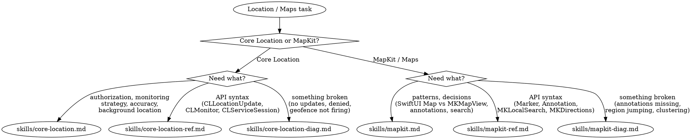
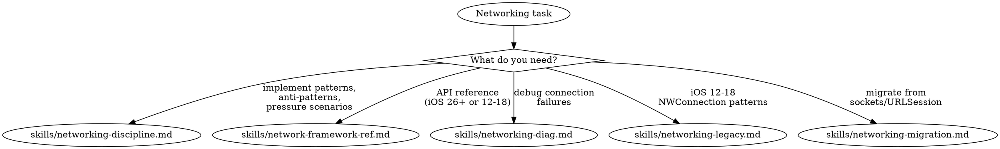
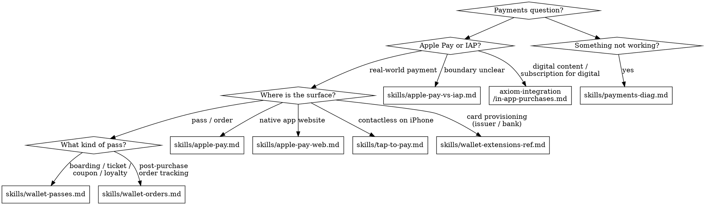
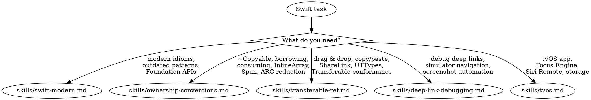

```dot
digraph swiftui {
    start [label="SwiftUI issue" shape=ellipse];
    what [label="What's wrong?" shape=diamond];

    start -> what;
    what -> "skills/debugging.md" [label="view not updating"];
    what -> "skills/nav.md" [label="navigation"];
    what -> "skills/swiftui-performance.md" [label="slow/lag"];
    what -> "skills/layout.md" [label="adaptive layout"];
    what -> "skills/containers-ref.md" [label="stacks/grids/outlines"];
    what -> "skills/architecture.md" [label="feature architecture"];
    what -> "skills/animation-ref.md" [label="animations"];
    what -> "skills/gestures.md" [label="gestures"];
    what -> "skills/search-ref.md" [label="search"];
    what -> "skills/toolbars.md" [label="toolbars / sheet buttons"];
    what -> "skills/presentations.md" [label="sheets/detents/popovers"];
    what -> "skills/26-ref.md" [label="iOS 26 features"];
    what -> "skills/iphone-duo.md" [label="iPhone Duo / foldable"];
    what -> "skills/previews.md" [label="slow previews / building good previews"];
    what -> "skills/previews-ref.md" [label="preview API reference"];
    what -> "skills/debugging.md" [label="preview crashes / won't load"];
    what -> "skills/hot-reload.md" [label="hot reload / live editing"];
    what -> "axiom-macos (skills/swiftui-differences.md)" [label="Table / .inspector\n(large-window density)"];
    what -> "axiom-uikit (skills/uikit-bridging.md)" [label="UIKit interop"];
    what -> "axiom-design (skills/app-composition.md)" [label="app-level (root, auth)"];
    what -> "axiom-swift (skills/transferable-ref.md)" [label="drag/drop, sharing"];
}
```

# Integrated Reference Bundle 04

Combines 12 related source skills from `ios-swift-platform` into one navigable reference file.

## Source map

- `axiom-location/SKILL.reference.md`
- `axiom-macos/SKILL.reference.md`
- `axiom-media/SKILL.reference.md`
- `axiom-modernize/SKILL.reference.md`
- `axiom-networking/SKILL.reference.md`
- `axiom-payments/SKILL.reference.md`
- `axiom-performance/SKILL.reference.md`
- `axiom-resolve-spm/SKILL.reference.md`
- `axiom-swift/SKILL.reference.md`
- `axiom-swift-simplifier/SKILL.reference.md`
- `axiom-swiftui_7820/SKILL.reference.md`
- `axiom-swiftui_7956/SKILL.reference.md`

## Integrated guidance

### Source: `axiom-location`

# Location & Maps

**You MUST use this skill for ANY location services, mapping, geofencing, or Core Location / MapKit work.**

## Quick Reference

| Symptom / Task | Reference |
|----------------|-----------|
| Authorization strategy (When In Use vs Always) | See `skills/core-location.md` |
| Monitoring approach (continuous, significant-change, CLMonitor) | See `skills/core-location.md` |
| Accuracy selection, background location | See `skills/core-location.md` |
| CLLocationUpdate, CLMonitor, CLServiceSession APIs | See `skills/core-location-ref.md` |
| Authorization API patterns, geofencing API | See `skills/core-location-ref.md` |
| Compass heading, heading reference body (`headingBody`) | See `skills/core-location-ref.md` (Part 12) |
| Location updates never arrive | See `skills/core-location-diag.md` |
| Background location stops working | See `skills/core-location-diag.md` |
| Authorization always denied, geofence failures | See `skills/core-location-diag.md` |
| SwiftUI Map, annotations, markers, clustering | See `skills/mapkit.md` |
| MKMapView vs SwiftUI Map decision | See `skills/mapkit.md` |
| Search, directions, routing | See `skills/mapkit.md` |
| MapKit API: Marker, Annotation, MKLocalSearch, MKDirections | See `skills/mapkit-ref.md` |
| Look Around, MKMapSnapshotter, MKMapItem | See `skills/mapkit-ref.md` |
| Annotations not appearing, region jumping | See `skills/mapkit-diag.md` |
| Clustering not working, search failures | See `skills/mapkit-diag.md` |
| Overlay rendering, user location not showing | See `skills/mapkit-diag.md` |

## Decision Tree



1. Authorization strategy, monitoring approach, accuracy? → `skills/core-location.md`
1a. Need specific API syntax (CLLocationUpdate, CLMonitor, CLServiceSession)? → `skills/core-location-ref.md`
1b. Location not working? → `skills/core-location-diag.md`
2. Adding a map, annotations, search, directions? → `skills/mapkit.md`
2a. Need specific MapKit API syntax (Marker, MKLocalSearch, MKDirections)? → `skills/mapkit-ref.md`
2b. Map display broken? → `skills/mapkit-diag.md`
3. Location draining battery? → See axiom-performance (skills/energy.md)
4. Background task scheduling for location? → See axiom-integration
5. Privacy manifest for location? → See axiom-integration

## Conflict Resolution

**location vs axiom-performance**: When location is draining battery:
1. **Try location FIRST** — Excessive accuracy or continuous updates are the #1 cause. `skills/core-location.md` covers accuracy selection and monitoring strategy.
2. **Only use axiom-performance** if location settings are already correct — Profile after ruling out obvious over-tracking.

**location vs axiom-integration**: When implementing background location:
- Background location configuration (Info.plist, capabilities, CLServiceSession) → **use location**
- BGTaskScheduler for periodic location processing → **use axiom-integration**

**location vs axiom-data**: When storing or syncing location data:
- Getting location updates, geofencing → **use location**
- Persisting location history, CloudKit sync → **use axiom-data**

**location vs axiom-build**: When location permissions fail in simulator:
- Authorization dialogs, Info.plist keys → **use location** (`skills/core-location-diag.md`)
- Simulator GPS simulation, `simctl location` → **use axiom-build**

## Critical Patterns

**Core Location** (`skills/core-location.md`):
- Authorization escalation strategy (When In Use first, Always later)
- Monitoring decision tree (continuous vs significant-change vs CLMonitor)
- Accuracy selection with battery impact
- Background location configuration
- Anti-patterns with time costs (premature Always authorization, unnecessary continuous updates)

**Core Location API** (`skills/core-location-ref.md`):
- CLLocationUpdate AsyncSequence (iOS 17+)
- CLMonitor condition-based geofencing (iOS 17+)
- CLServiceSession declarative authorization (iOS 18+)
- Authorization API patterns, background mode configuration

**Core Location Diagnostics** (`skills/core-location-diag.md`):
- Location updates never arrive
- Background location stops working
- Authorization always denied
- Geofence events not triggering
- Location accuracy unexpectedly poor

**MapKit** (`skills/mapkit.md`):
- SwiftUI Map vs MKMapView decision tree
- Annotation patterns (Marker, custom Annotation)
- Search (MKLocalSearch, autocomplete)
- Directions and routing
- Anti-patterns (annotations in view body, no view reuse, setRegion loops)

**MapKit API** (`skills/mapkit-ref.md`):
- SwiftUI Map API (MapCameraPosition, content builders, controls)
- MKMapView delegate patterns
- MKLocalSearch, MKDirections
- Look Around, MKMapSnapshotter
- Clustering configuration

**MapKit Diagnostics** (`skills/mapkit-diag.md`):
- Annotations not appearing (lat/lng swapped, missing delegate)
- Map region jumping/looping (updateUIView guard)
- Clustering not working (missing clusteringIdentifier)
- Search returning no results (resultTypes, region bias)
- Overlay rendering failures

## Anti-Rationalization

| Thought | Reality |
|---------|---------|
| "Just request Always authorization upfront" | 30-60% denial rate. Request When In Use first, escalate later. `skills/core-location.md` covers the strategy. |
| "Continuous updates are fine for my use case" | Continuous updates drain battery even when the app doesn't need sub-second location. Use significant-change or CLMonitor. |
| "I'll use MKMapView, it's more flexible" | SwiftUI Map covers most use cases since iOS 17. MKMapView means UIViewRepresentable boilerplate. `skills/mapkit.md` has the decision tree. |
| "Annotations in the view body is fine for a few items" | Annotations recreate on every view update. Even 50 items cause hitches. Move to model with `@State` or `@Observable`. |
| "I know how geofencing works" | CLMonitor (iOS 17+) replaces legacy region monitoring with conditions. The API changed significantly. |
| "Background location just needs the capability" | It needs Info.plist keys, capability, CLServiceSession (iOS 18+), AND correct authorization level. Missing any one silently fails. |
| "I'll handle location errors later" | Authorization denial is not an error — it's the default state. Handle it from the start. |

## Example Invocations

User: "How do I request location permissions?"
→ Read: `skills/core-location.md`

User: "What's the CLLocationUpdate API?"
→ Read: `skills/core-location-ref.md`

User: "My location updates never arrive"
→ Read: `skills/core-location-diag.md`

User: "How do I add a map with pins?"
→ Read: `skills/mapkit.md`

User: "What's the SwiftUI Map API?"
→ Read: `skills/mapkit-ref.md`

User: "My annotations aren't showing on the map"
→ Read: `skills/mapkit-diag.md`

User: "How do I implement geofencing?"
→ Read: `skills/core-location.md` then `skills/core-location-ref.md`

User: "Location is draining battery"
→ Read: `skills/core-location.md`, then See axiom-performance (skills/energy.md)

User: "How do I add search to my map?"
→ Read: `skills/mapkit.md` then `skills/mapkit-ref.md`

### Source: `axiom-macos`

# macOS Development

**You MUST use this skill for ANY macOS-specific development including windows, menus, sandboxing, distribution, AppKit bridging, and macOS SwiftUI differences.**

## Quick Reference

| Symptom / Task | Reference |
|----------------|-----------|
| Window management (WindowGroup, Window, MenuBarExtra, DocumentGroup) | See `skills/windows.md` |
| Menu bar, commands, keyboard shortcuts | See `skills/menus-and-commands.md` |
| Table, Inspector, NavigationSplitView, focus | See `skills/swiftui-differences.md` |
| App Sandbox, file access, security-scoped bookmarks | See `skills/sandbox-and-file-access.md` |
| Another team's app or app group container access denied without a prompt (`OS27`) | See `skills/sandbox-and-file-access.md` |
| Developer ID, notarization, Sparkle auto-updates | See `skills/direct-distribution.md` |
| NSViewRepresentable, NSHostingController, AppKit bridging, @Observable in AppKit, NSHostingMenu, SwiftUI scenes from AppKit | See `skills/appkit-interop.md` |
| Modernizing AppKit: mouseDown replacement, control events, status-item sessions, state restoration, concentric corners, touch (`OS27`) | See `skills/appkit-modernization.md` |
| Screen recording, sharing, or capture (ScreenCaptureKit) | See `skills/screencapturekit.md` |
| SCStream / SCContentFilter / screenshots / file recording API, clip buffering, recording editor (`OS27`) | See `skills/screencapturekit-ref.md` |
| Bring an iOS app to Mac: Catalyst adoption, Designed for iPad, Mac availability opt-out | See `skills/ios-apps-on-mac.md` |
| Apple Pay on Mac / Catalyst | See `axiom-payments/skills/apple-pay.md` (Catalyst section) |

## Cross-Suite Routes

These topics overlap with macOS development but live in separate suites:

#### SwiftUI (shared iOS/macOS)
- View state, data flow, @Observable → See axiom-swiftui
- Navigation (NavigationStack basics) → See axiom-swiftui (skills/nav.md)
- Layout (ViewThatFits, AnyLayout) → See axiom-swiftui (skills/layout.md)
- Animations → See axiom-swiftui (skills/animation-ref.md)

#### Data & persistence
- SwiftData, Core Data, GRDB → See axiom-data
- CloudKit sync → See axiom-data

#### Concurrency
- Swift 6 concurrency, actors, Sendable → See axiom-concurrency

#### Other
- Accessibility (VoiceOver, Dynamic Type) → See axiom-accessibility
- Networking (URLSession, Network.framework) → See axiom-networking
- Security (Keychain, passkeys, encryption) → See axiom-security

## Conflict Resolution

**axiom-macos vs axiom-swiftui**: When working on a macOS SwiftUI app:
1. **Use axiom-macos** for macOS-only concerns: windows, menus, commands, sandboxing, distribution, Table, Inspector, AppKit bridging
2. **Use axiom-swiftui** for cross-platform SwiftUI: navigation, layout, state management, animations
3. **Both may apply**: A macOS app using NavigationSplitView with Table needs axiom-macos for Table specifics and axiom-swiftui for NavigationSplitView basics

**axiom-macos vs axiom-security**: For sandbox and code signing:
1. **Use axiom-macos** for macOS App Sandbox, security-scoped bookmarks, file access entitlements, Developer ID signing
2. **Use axiom-security** for Keychain storage, encryption, passkeys, certificate management

## Decision Tree



```dot
digraph macos {
    start [label="macOS development task" shape=ellipse];
    what [label="What area?" shape=diamond];

    start -> what;
    what -> "skills/windows.md" [label="windows/scenes"];
    what -> "skills/menus-and-commands.md" [label="menus/commands/shortcuts"];
    what -> "skills/swiftui-differences.md" [label="Table/Inspector/focus/macOS SwiftUI"];
    what -> "skills/sandbox-and-file-access.md" [label="sandbox/file access"];
    what -> "skills/direct-distribution.md" [label="distribution/notarization/updates"];
    what -> "skills/appkit-interop.md" [label="AppKit bridging"];
    what -> "skills/appkit-modernization.md" [label="modernize AppKit\n(input/restoration/27 look)"];
    what -> "skills/ios-apps-on-mac.md" [label="iOS app to Mac\n(Catalyst / Designed for iPad)"];
    what -> "skills/screencapturekit.md" [label="screen capture/\nrecording/sharing"];
    what -> "axiom-swiftui" [label="cross-platform SwiftUI"];
    what -> "axiom-security" [label="Keychain/encryption"];
}
```

> **iOS screen capture?** ScreenCaptureKit is macOS-only. For iOS screen recording, use ReplayKit — see axiom-media.

## Resources

**WWDC**: 2021-10062, 2022-10061, 2022-10075, 2023-10148, 2024-10149, 2026-272, 2026-289

**Docs**: /security/app-sandbox, /swiftui/windowgroup, /swiftui/table

**Skills**: axiom-swiftui, axiom-security, axiom-concurrency, axiom-uikit

### Source: `axiom-media`

# Media

**You MUST use this skill for ANY camera, photo, audio, haptic, or media playback work.**

<!-- AXIOM_AUDITOR_INLINE_BEGIN — auto-maintained by scripts/build-inlined-auditors.ts; do not hand-edit -->
> **Can't launch Axiom agents?** Where this router sends you to an agent, follow its procedure inline. Over MCP, `axiom_get_agent` returns it; elsewhere, read its file below, which needs only file search and read.
>
> Available here: `skills/camera-auditor.md`.
>
> For any other agent, over MCP `axiom_get_agent` returns it too; run its xclog, xcsym and xcprof steps with the `axiom_xclog_*`, `axiom_xcsym_*` and `axiom_xcprof_*` tools. Elsewhere, search Axiom's skills for `skills/<agent>.md`; if there is none, do that work yourself with this suite's skills, using any Axiom tool on your `PATH`.
<!-- AXIOM_AUDITOR_INLINE_END -->

## Quick Reference

| Symptom / Task | Reference |
|----------------|-----------|
| Camera capture, AVCaptureSession | See `skills/camera-capture.md` |
| Slow camera launch / deferred start (iOS 26+), ProRes recording via Pro Video Storage (`OS27`) | See `skills/camera-capture.md` Patterns 8-9 |
| Camera API (RotationCoordinator, etc.) | See `skills/camera-capture-ref.md` |
| Lens aperture / shutter / ISO priority modes, exposure signals, continuous autofocus tracking, low-light video noise reduction, cinematic video metadata capture (`OS27`) | See `skills/camera-capture-ref.md` |
| Center Stage front camera (iPhone 17), dynamic aspect ratio, smart framing, 24/48 MP capture | See `skills/camera-capture-ref.md` |
| iPhone Duo front cameras (virtual front camera, inner/outer ultra-wide), camera direction vs position | See `skills/camera-capture.md` Pattern 6 and `skills/camera-capture-ref.md` (iPhone Duo Front Cameras) |
| Camera freezes, black preview, rotation | See `skills/camera-capture-diag.md` |
| Photo pickers, library access | See `skills/photo-library.md` |
| PHPicker, PhotosPicker, PhotoKit API reference: asset metadata editing (keywords, rating, caption), persistent change observer, background resource upload (`OS27`) | See `skills/photo-library-ref.md` |
| PhotoKit + Swift 6 strict concurrency, `nonisolated` observer, `performChanges` isolation, `_dispatch_assert_queue_fail` | See axiom-concurrency (skills/isolation-inheritance-diag.md) |
| Audio, AVFoundation, spatial audio, async session activation, throwing AVAudioEngine APIs (`OS27`) | See `skills/avfoundation-ref.md` |
| Video write/export/playback, sample-buffer engine, resumable export, Apple Log 2, iOS 27 deprecations (`OS27`) | See `skills/avfoundation-video-ref.md` |
| Audio recognition, ShazamKit | See `skills/shazamkit.md` |
| ShazamKit API reference | See `skills/shazamkit-ref.md` |
| On-device music analysis (key, tempo, structure, loudness), MusicUnderstanding (`OS27`) | See `skills/music-understanding.md` |
| On-device face grouping (cluster faces into people across a library), video highlights/key frames, MediaIntelligence (`OS27`) | See `skills/media-intelligence.md` |
| Haptic feedback, Core Haptics | See `skills/haptics.md` |
| SharePlay coordinated playback, AVDelegatingPlaybackCoordinator, custom-engine sync | See `skills/shareplay-playback.md` |
| SharePlay session lifecycle, activation, non-media state | Use axiom-integration (`skills/shareplay.md`) instead |
| Now Playing metadata, remote commands | See `skills/now-playing.md` |
| Siri playing content in your audio app ("play X in MyApp", like/add-to-playlist by voice) | **Use `axiom-integration` (`skills/siri-audio.md`)** — Audio schema domain + SiriKit media |
| Animated lock-screen artwork (iOS 26+) | See `skills/now-playing.md` Pattern 8 |
| NowPlaying framework (`import NowPlaying`, Swift-native `MediaSession`, `OS27`) | See `skills/now-playing.md` (NowPlaying Framework section) |
| Cast / route media to non-AirPlay devices (Google Cast/Chromecast, DLNA) as system routes, AVSystemRouting (`iOS27`, likely EU-gated) | See `skills/system-media-routing.md` |
| Screen capture / recording / streaming the screen or your own app, ScreenCaptureKit (`OS27` — new on iOS/iPadOS/tvOS/visionOS 27; macOS 12.3+) | See `skills/screen-capture.md` |
| CarPlay HIG, app categories, design rules, entitlements | See `skills/carplay-hig.md` |
| CarPlay templates reference (all 12 templates, availability matrix, depth limits) | See `skills/carplay-templates-ref.md` |
| CarPlay navigation reference (base view, route guidance, cluster/HUD, multitouch, voice prompts, map panels + EV charging iOS 27) | See `skills/carplay-navigation-ref.md` |
| CarPlay Now Playing template customization + sports mode | See `skills/now-playing-carplay.md` |
| MusicKit Now Playing, ApplicationMusicPlayer playback, subscription/authorization | See `skills/now-playing-musickit.md` |
| Enumerate the user's Apple Music **library** — MusicLibraryRequest vs MPMediaQuery, reconciling the two, playlist entries, sync, library identity, per-device `Song.id`, missing `PlayParameters`, MusicKit stops responding after a scan | See `skills/music-library.md` |
| DockKit motorized stands / gimbals, subject tracking, custom motor control | See `skills/dockkit.md` |
| Speech-to-text / transcription (SpeechAnalyzer, mic → transcript) | **Invoke axiom-ai** (`skills/speech.md`) |

## Decision Tree



```dot
digraph media {
    start [label="Media task" shape=ellipse];
    what [label="Which media feature?" shape=diamond];
    auditor [label="camera-auditor agent" shape=box];

    start -> what;
    what -> "skills/camera-capture.md" [label="camera capture"];
    what -> "skills/photo-library.md" [label="photo pickers\n/ library"];
    what -> "skills/avfoundation-ref.md" [label="audio / AVFoundation"];
    what -> "skills/avfoundation-video-ref.md" [label="video write/export\n/ sample-buffer (OS27)"];
    what -> "skills/shazamkit.md" [label="ShazamKit\n/ audio recognition"];
    what -> "skills/music-understanding.md" [label="music analysis\n(key/tempo/structure)"];
    what -> "skills/media-intelligence.md" [label="face grouping /\nvideo highlights (OS27)"];
    what -> "skills/haptics.md" [label="haptic feedback"];
    what -> "skills/now-playing.md" [label="Now Playing\n/ remote commands"];
    what -> "skills/music-library.md" [label="enumerate Apple Music\nlibrary / identity"];
    what -> "skills/system-media-routing.md" [label="cast to non-AirPlay\n(Chromecast/DLNA, iOS27)"];
    what -> "skills/screen-capture.md" [label="screen capture /\nrecording (OS27)"];
    what -> "skills/carplay-hig.md" [label="CarPlay app design\n/ categories / entitlements"];
    what -> "skills/dockkit.md" [label="DockKit stands\n/ gimbals / tracking"];
    what -> auditor [label="camera code audit"];
}
```

1. Camera capture? → `skills/camera-capture.md` (patterns), `skills/camera-capture-ref.md` (API), `skills/camera-capture-diag.md` (debugging)
2. Photo pickers / library? → `skills/photo-library.md`, `skills/photo-library-ref.md`
3. Audio / AVFoundation (audio)? → `skills/avfoundation-ref.md`; video write/export/playback, sample-buffer engine, resumable export, iOS 27 deprecations? → `skills/avfoundation-video-ref.md` (`OS27`)
4. ShazamKit / audio recognition? → `skills/shazamkit.md`, `skills/shazamkit-ref.md`
5. On-device music analysis (key, tempo, structure, pace, instruments, loudness)? → `skills/music-understanding.md` (`OS27`)
6. On-device face grouping (cluster faces into people across a library) or video highlights / key-frame detection? → `skills/media-intelligence.md` (`OS27`)
7. Haptics? → `skills/haptics.md`
8. Now Playing / remote commands? → `skills/now-playing.md`, `skills/now-playing-carplay.md`, `skills/now-playing-musickit.md`
8a. Siri playback in your audio app ("play X in MyApp")? → **axiom-integration** (`skills/siri-audio.md`); Siri's "pause"/"next"/"what song is this?" stay here (remote commands + now-playing metadata)
9. Reading the user's Apple Music **library** (enumerate songs/playlists, library identity, sync)? → `skills/music-library.md` — a different problem from playback; read it before any library walk
10. Cast / route media to non-AirPlay devices (Google Cast/Chromecast, DLNA) as system routes? → `skills/system-media-routing.md` (`iOS27`, likely EU-gated)
11. Screen capture / recording / streaming the screen or your own app (ScreenCaptureKit)? → `skills/screen-capture.md` (`OS27` — new on iOS/iPadOS/tvOS/visionOS 27)
12. CarPlay app design, category selection, entitlement request? → `skills/carplay-hig.md` (start here for any CarPlay work)
13. DockKit motorized stands / gimbals, subject tracking, custom motor control? → `skills/dockkit.md`
14. Want camera code audit? → Launch `camera-auditor` agent (detects deprecated APIs and architectural gaps: missing interruption handlers, runtime-error recovery, audio session deactivation, permission-denied UX, RotationCoordinator on iOS 17+; scores RELIABLE / FRAGILE / BROKEN)

## Cross-Domain Routing

**Camera + permissions** (camera access denied, Info.plist missing):
- Camera code → **stay here** (camera-capture)
- Privacy manifest / Info.plist → **invoke axiom-integration** (privacy-ux reference)
- Build/entitlement errors → **invoke axiom-build**

**ShazamKit + microphone permissions**:
- Microphone NSMicrophoneUsageDescription → **invoke axiom-integration** (privacy-ux reference)
- ShazamKit API and matching → **stay here** (shazamkit)

**Now Playing + background audio**:
- Now Playing metadata/controls → **stay here** (now-playing)
- Background audio mode / BGTaskScheduler → **invoke axiom-integration** (background-processing reference)

**Speech-to-text + audio capture** (transcribing mic or asset audio):
- `SpeechAnalyzer` / `SpeechTranscriber`, the `OS27` input providers, the ~2-analyzer cap on iOS/visionOS; none on macOS → **invoke axiom-ai** (`skills/speech.md`)
- Audio session category/mode, `AVCaptureSession` wiring → **stay here** (avfoundation-ref, camera-capture)
- **The trap**: `CaptureInputSequenceProvider.providerWithSession(...)` (`OS27`) automatically reconfigures your app's default `AVAudioSession`. If this suite's audio-session setup "randomly breaks" after transcription is added, that's the cause — join your own session via `provider(from:in:)`, or `init(session:analyzerFormat:priority:)` from the actor that owns it, and add its `captureAudioDataOutput`.

**Apple Music library + playback + persistence**:
- Enumerating the library, library identity, `PlayParameters` availability, Sync Library hazards → **stay here** (music-library)
- Queuing and playing what you found, Now Playing publishing → **stay here** (now-playing-musickit)
- Storing library rows in your own database (which column is the durable key, migrations for a re-key) → **invoke axiom-data** — but take the identity rules from music-library first; `persistentID` is not a durable key
- `MusicAuthorization` prompt copy / privacy manifest → **invoke axiom-integration** (privacy-ux reference)

**Photo library + privacy**:
- Photo picker (PHPicker, PhotosPicker) → **stay here** (photo-library) — no permissions needed
- Full PHPhotoLibrary access → **stay here** (photo-library-ref) — limited access model
- Privacy manifest for photo usage → **invoke axiom-integration** (privacy-ux reference)

**DockKit + camera / custom inference**:
- DockKit stand control, framing, motor, tracking states → **stay here** (dockkit)
- Underlying AVCaptureSession setup → **stay here** (camera-capture)
- Custom Vision / Core ML inference feeding observations → **invoke axiom-vision**
- Camera permission (NSCameraUsageDescription) → **invoke axiom-integration** (privacy-ux reference)

**MediaIntelligence + Vision** (faces, image analysis):
- Group faces into people across a library, video highlights / key frames → **stay here** (media-intelligence) — clustering identities + on-device video moment detection
- Detect *where* a face is in one image (bounding box, landmarks), OCR, segmentation → **invoke axiom-vision** — per-image detection, a different problem
- System Photos "People" album → that album is system-owned (PhotoKit); MediaIntelligence builds *your own* index over assets you manage → **stay here** (photo-library for the asset access)

## Anti-Rationalization

| Thought | Reality |
|---------|---------|
| "Camera capture is just AVCaptureSession setup" | Camera has interruption handlers, rotation, and threading requirements. |
| "Camera launch is fast enough if I startRunning() early" | Output initialization dominates launch; iOS 26 deferred start halves time-to-preview. |
| "I'll add haptics with a simple API call" | Haptic design has patterns for each interaction type matching HIG. |
| "ShazamKit is just SHSession + a delegate" | iOS 17+ has SHManagedSession which eliminates all AVAudioEngine boilerplate. |
| "Now Playing info is just setting metadata" | Remote commands, artwork handling, and state sync have 15+ gotchas. |
| "I'll use UIImagePickerController for photos" | PHPicker/PhotosPicker are the modern API — no permissions required. |
| "MediaPlayer reports fewer playlist members than MusicKit, so sync is incomplete" | The gap is structural, not a sync signal: it tracks the entries with no local representation — exact on all five playlists inspected, off by one library-wide. A shipped guard built on this premise silently skipped 9 of 15 playlists forever. Read `skills/music-library.md`. |
| "Reading the music library is just a MusicLibraryRequest" | Reading one MusicKit property across a large library leaves every later MusicKit request unresumed for the rest of the run, with no error thrown. Pool starvation is a symptom, not the mechanism — a plain `Thread`, which never touches the pool, loses MusicKit identically. Batching the request is ~100x *slower*, not safer. |
| "`Song.id` is a stable key I can store" | Its *format* differs per device for the same library (`i.…` on one, bare numeric on another). Never parse it, never use it as a cross-device key. |
| "DockKit is just pairing a stand" | Custom control needs system tracking disabled, handles inverted dock states, and two different coordinate origins. |
| "Grouping faces is just Vision face detection" | Vision detects faces in one image; MediaIntelligence clusters them into persistent people (entities) across a whole library, with its own working directory and state. |
| "Casting to Chromecast means bundling the Google Cast SDK" | On iOS 27, AVSystemRouting exposes non-AirPlay routes as system routes — you adopt one Apple API (observe events, start a session, drive playbackControl) instead of a per-vendor SDK. Likely EU-gated — gate and keep a fallback. |
| "I'll sync SharePlay playback by broadcasting the current time over the messenger" | The messenger has no clock. `AVDelegatingPlaybackCoordinatorPlayCommand.hostClockTime` gives you an absolute `CMClockGetHostTimeClock()` start time; hand-rolling reinvents startup barriers, seek ordering, stalls, and interruptions badly. |
| "The playback coordinator handles interruptions for me" | Only `AVPlayerPlaybackCoordinator` does. `AVDelegatingPlaybackCoordinator` adds **no** automatic suspensions — a custom engine begins *and* ends every one, and a suspension never ended hangs the whole group. |
| "ScreenCaptureKit on iPad works like the Mac (enumerate displays/windows)" | On iOS/iPadOS `SCShareableContent` and all `SCContentFilter` initializers are macOS-only — you get a filter ONLY from the system `SCContentSharingPicker`. New on iOS/iPadOS/tvOS/visionOS 27. Also not `ImageRenderer` (that snapshots your own SwiftUI view). |

## Example Invocations

User: "How do I set up a camera preview?"
→ Read: `skills/camera-capture.md`

User: "My camera app takes a second before preview appears"
→ Read: `skills/camera-capture.md` (Pattern 8, deferred start)

User: "Support the Center Stage front camera" / "Capture 48MP photos"
→ Read: `skills/camera-capture-ref.md`

User: "How do I switch cameras on iPhone Duo?" / "Choose a camera by direction instead of position"
→ Read: `skills/camera-capture.md` (Pattern 6) and `skills/camera-capture-ref.md` (iPhone Duo Front Cameras)

User: "Camera freezes when I get a phone call"
→ Read: `skills/camera-capture-diag.md`

User: "How do I let users pick photos in SwiftUI?"
→ Read: `skills/photo-library.md`

User: "Implement haptic feedback for button taps"
→ Read: `skills/haptics.md`

User: "Now Playing info doesn't appear on Lock Screen"
→ Read: `skills/now-playing.md`

User: "How do I identify songs with ShazamKit?"
→ Read: `skills/shazamkit.md`

User: "How do I detect a song's tempo / key / beat grid on-device?" / "Analyze audio loudness or structure"
→ Read: `skills/music-understanding.md`

User: "Group faces into people across my photo library" / "cluster faces on-device" / "find highlights or a thumbnail frame in a video"
→ Read: `skills/media-intelligence.md`

User: "Cast to Chromecast / Google Cast without the Cast SDK" / "support non-AirPlay casting" / "route media to a DLNA device as a system route"
→ Read: `skills/system-media-routing.md`

User: "Record / stream the iPad screen" / "ScreenCaptureKit on iOS" / "screen recording in my app" / "capture just my app's content"
→ Read: `skills/screen-capture.md`

User: "List every song in the user's Apple Music library" / "enumerate their playlists" / "MPMediaQuery vs MusicKit" / "sync Apple Music playlists" / "MediaPlayer and MusicKit report different playlist counts" / "my MusicKit requests stop responding after a library scan" / "store a stable id for each song across devices" / "playlists went empty after the user turned on Sync Library"
→ Read: `skills/music-library.md`

User: "Track a subject with a motorized stand" / "Control a DockKit gimbal"
→ Read: `skills/dockkit.md`

User: "Check my camera code for issues"
→ Launch: `camera-auditor` agent

### Source: `axiom-modernize`

# Modernization Helper Agent

You are an expert at migrating iOS apps to modern iOS 17/18+ patterns.

## Your Mission

Scan the codebase for legacy patterns and provide migration paths:
- `ObservableObject` → `@Observable`
- `@StateObject` → `@State` with Observable
- `@ObservedObject` → Direct property or `@Bindable`
- `@EnvironmentObject` → `@Environment`
- Legacy SwiftUI modifiers → Modern equivalents
- Completion handlers → async/await

## Tool Use Is Mandatory

Run every Glob, Grep, and Read this prompt lists. Do not reason from training data instead of scanning.

- Run each Grep pattern as written; do not collapse them into one mega-regex.
- Run the Read verifications each section calls for.
- "Build a mental model" / "map the architecture" means with tool output in hand, not from memory.

## Files to Scan

**Swift files**: `**/*.swift`
Skip: `*Tests.swift`, `*Previews.swift`, `*/Pods/*`, `*/Carthage/*`, `*/.build/*`, `*/DerivedData/*`, `*/scratch/*`, `*/docs/*`, `*/.claude/*`, `*/.claude-plugin/*`

## Modernization Patterns (iOS 17+ / iOS 18+)

### Pattern 1: ObservableObject → @Observable (HIGH)

**Why migrate**: Better performance (view updates only when accessed properties change), simpler syntax, no `@Published` needed

**Requirement**: iOS 17+

**Detection**:
```
Grep: class.*ObservableObject
Grep: : ObservableObject
Grep: @Published
```

```swift
// ❌ LEGACY (iOS 14-16)
class ContentViewModel: ObservableObject {
    @Published var items: [Item] = []
    @Published var isLoading = false
    @Published var errorMessage: String?
}

// ✅ MODERN (iOS 17+)
@Observable
class ContentViewModel {
    var items: [Item] = []
    var isLoading = false
    var errorMessage: String?

    // Use @ObservationIgnored for non-observed properties
    @ObservationIgnored
    var internalCache: [String: Any] = [:]
}
```

**Migration steps**:
1. Replace `: ObservableObject` with `@Observable` macro
2. Remove all `@Published` property wrappers
3. Add `@ObservationIgnored` to properties that shouldn't trigger updates
4. Update consuming views (see patterns below)

**Do NOT apply this pattern to `GroupSession` (SharePlay/GroupActivities)**

`GroupSession` is a framework-owned `final class` conforming to `ObservableObject`. You cannot redeclare it, and code observing it must keep using Combine — the SDK ships **no** AsyncSequence for `state`, `activity`, or `activeParticipants` (`sessions()` is the only one).

More importantly, `@Published` publishes from `willSet`, so inside a sink the property still holds the **old** value. The standard late-joiner catch-up depends on exactly that timing:

```swift
groupSession.$activeParticipants
    .sink { activeParticipants in
        // groupSession.activeParticipants is still the OLD set here
        let newParticipants = activeParticipants.subtracting(groupSession.activeParticipants)
        // send current state to joiners only
    }
```

Rewriting this against `@Observable` or an AsyncSequence makes `subtracting` return an empty set. There is no crash and no warning — late joiners silently never receive state, and the bug only appears with 3+ participants on a device that joined late. Leave Combine observation of `GroupSession` alone and say why.

### Pattern 2: @StateObject → @State (HIGH)

**Why migrate**: Simpler, consistent with value types, works with @Observable

**Requirement**: iOS 17+ with @Observable model

**Detection**:
```
Grep: @StateObject
```

```swift
// ❌ LEGACY
struct ContentView: View {
    @StateObject private var viewModel = ContentViewModel()

    var body: some View { ... }
}

// ✅ MODERN (with @Observable model)
struct ContentView: View {
    @State private var viewModel = ContentViewModel()

    var body: some View { ... }
}
```

**Note**: Only migrate after the model uses `@Observable`. If model still uses `ObservableObject`, keep `@StateObject`.

### Pattern 3: @ObservedObject → Direct Property or @Bindable (HIGH)

**Why migrate**: Simpler code, explicit binding when needed

**Requirement**: iOS 17+ with @Observable model

**Detection**:
```
Grep: @ObservedObject
```

```swift
// ❌ LEGACY
struct ItemView: View {
    @ObservedObject var item: ItemModel

    var body: some View {
        Text(item.name)
    }
}

// ✅ MODERN - Direct property (read-only access)
struct ItemView: View {
    var item: ItemModel  // No wrapper needed!

    var body: some View {
        Text(item.name)
    }
}

// ✅ MODERN - @Bindable (for two-way binding)
struct ItemEditorView: View {
    @Bindable var item: ItemModel

    var body: some View {
        TextField("Name", text: $item.name)  // Binding works
    }
}
```

**Decision tree**:
- Need binding (`$item.property`)? → Use `@Bindable`
- Just reading properties? → Use plain property (no wrapper)

### Pattern 4: @EnvironmentObject → @Environment (HIGH)

**Why migrate**: Type-safe, works with @Observable

**Requirement**: iOS 17+ with @Observable model

**Detection**:
```
Grep: @EnvironmentObject
Grep: \.environmentObject\(
```

```swift
// ❌ LEGACY - Setting
ContentView()
    .environmentObject(settings)

// ❌ LEGACY - Reading
struct SettingsView: View {
    @EnvironmentObject var settings: AppSettings

    var body: some View { ... }
}

// ✅ MODERN - Setting
ContentView()
    .environment(settings)

// ✅ MODERN - Reading
struct SettingsView: View {
    @Environment(AppSettings.self) var settings

    var body: some View { ... }
}

// ✅ MODERN - With binding
struct SettingsEditorView: View {
    @Environment(AppSettings.self) var settings

    var body: some View {
        @Bindable var settings = settings
        Toggle("Dark Mode", isOn: $settings.darkMode)
    }
}
```

### Pattern 5: onChange(of:perform:) → onChange(of:initial:_:) (MEDIUM)

**Why migrate**: Deprecated modifier, new API has `initial` parameter

**Requirement**: iOS 17+

**Detection**:
```
Grep: \.onChange\(of:.*perform:
```

```swift
// ❌ DEPRECATED
.onChange(of: searchText) { newValue in
    performSearch(newValue)
}

// ✅ MODERN (iOS 17+)
.onChange(of: searchText) { oldValue, newValue in
    performSearch(newValue)
}

// ✅ With initial execution
.onChange(of: searchText, initial: true) { oldValue, newValue in
    performSearch(newValue)
}
```

### Pattern 6: Completion Handlers → async/await (MEDIUM)

**Why migrate**: Cleaner code, better error handling, structured concurrency

**Requirement**: iOS 15+ (widely adopted in iOS 17+)

**Detection**:
```
Grep: completion:\s*@escaping
Grep: completionHandler:
Grep: DispatchQueue\.main\.async
```

```swift
// ❌ LEGACY
func fetchUser(id: String, completion: @escaping (Result<User, Error>) -> Void) {
    URLSession.shared.dataTask(with: url) { data, response, error in
        DispatchQueue.main.async {
            if let error = error {
                completion(.failure(error))
                return
            }
            // Parse and return
            completion(.success(user))
        }
    }.resume()
}

// ✅ MODERN
func fetchUser(id: String) async throws -> User {
    let (data, _) = try await URLSession.shared.data(from: url)
    return try JSONDecoder().decode(User.self, from: data)
}
```

### Pattern 7: withAnimation Closures → Animation Parameter (LOW)

**Why migrate**: Cleaner API, avoids closure

**Requirement**: iOS 17+

**Detection**:
```
Grep: withAnimation.*\{
```

```swift
// ❌ LEGACY
withAnimation(.spring()) {
    isExpanded.toggle()
}

// ✅ MODERN (simple cases)
isExpanded.toggle()
// Apply animation to view:
.animation(.spring(), value: isExpanded)

// Or use new binding animation:
$isExpanded.animation(.spring()).wrappedValue.toggle()
```

### Pattern 8: Swift Language Modernization (LOW)

**Why migrate**: Clearer, more efficient, modern Swift idioms

**Detection**:
```
Grep: Date\(\)
Grep: CGFloat
Grep: replacingOccurrences
Grep: DateFormatter\(\)
Grep: \.filter\(.*\)\.count
Grep: Task\.sleep\(nanoseconds:
```

**Reference**: See `axiom-swift (skills/swift-modern.md)` skill for the full modern API replacement table.

Report matches as LOW priority unless they appear in hot paths (then MEDIUM).

## Audit Process

### Step 1: Find Swift Files

```
Glob: **/*.swift
```

### Step 2: Detect Legacy Patterns

**ObservableObject**:
```
Grep: ObservableObject
Grep: @Published
```

**Property Wrappers**:
```
Grep: @StateObject|@ObservedObject|@EnvironmentObject
```

**Deprecated Modifiers**:
```
Grep: onChange\(of:.*perform:
```

**Completion Handlers**:
```
Grep: completion:\s*@escaping
Grep: completionHandler:
```

### Step 3: Categorize by Priority

**HIGH Priority** (significant benefits):
- ObservableObject → @Observable
- Property wrapper migrations

**MEDIUM Priority** (code quality):
- Deprecated modifiers
- async/await adoption

**LOW Priority** (minor improvements):
- Animation syntax
- Minor API updates

## Output Format

````markdown
# Modernization Analysis Results

## Summary
- **HIGH Priority**: [count] (Significant performance/maintainability gains)
- **MEDIUM Priority**: [count] (Deprecated APIs, code quality)
- **LOW Priority**: [count] (Minor improvements)

## Minimum Deployment Target Impact
- Current patterns support: iOS 14+
- After full modernization: iOS 17+

## HIGH Priority Migrations

### ObservableObject → @Observable

**Files affected**: 5
**Estimated effort**: 2-3 hours

#### Models to Migrate

1. `Models/ContentViewModel.swift:12`
   ```swift
   // Current
   class ContentViewModel: ObservableObject {
       @Published var items: [Item] = []
       @Published var isLoading = false
   }

   // Migrated
   @Observable
   class ContentViewModel {
       var items: [Item] = []
       var isLoading = false
   }
   ```

2. `Models/UserSettings.swift:8`
   [Similar migration...]

#### Views to Update After Model Migration

| File | Change |
|------|--------|
| `Views/ContentView.swift:15` | `@StateObject` → `@State` |
| `Views/ItemList.swift:23` | `@ObservedObject` → plain property |
| `Views/SettingsView.swift:8` | `@EnvironmentObject` → `@Environment` |

### @EnvironmentObject → @Environment

- `Views/RootView.swift:45`
  ```swift
  // Current
  .environmentObject(settings)

  // Migrated
  .environment(settings)
  ```

- `Views/SettingsView.swift:12`
  ```swift
  // Current
  @EnvironmentObject var settings: AppSettings

  // Migrated
  @Environment(AppSettings.self) var settings
  ```

## MEDIUM Priority Migrations

### Deprecated onChange Modifier

- `Views/SearchView.swift:34`
  ```swift
  // Deprecated
  .onChange(of: query) { newValue in
      search(newValue)
  }

  // Modern
  .onChange(of: query) { oldValue, newValue in
      search(newValue)
  }
  ```

### async/await Opportunities

- `Services/NetworkService.swift` - 3 completion handler methods
  - `fetchUser(completion:)` → `fetchUser() async throws`
  - `fetchItems(completion:)` → `fetchItems() async throws`
  - `uploadData(completion:)` → `uploadData() async throws`

## Migration Order

1. **First**: Migrate models to `@Observable`
   - All `ObservableObject` → `@Observable`
   - Remove all `@Published`

2. **Second**: Update view property wrappers
   - `@StateObject` → `@State` (for owned models)
   - `@ObservedObject` → plain or `@Bindable`
   - `@EnvironmentObject` → `@Environment`

3. **Third**: Update view modifiers
   - `.environmentObject()` → `.environment()`
   - Deprecated `onChange` syntax

4. **Fourth**: Adopt async/await (optional, but recommended)

## Breaking Changes Warning

⚠️ **Deployment Target**: Full migration requires iOS 17+

If you need to support iOS 16 or earlier:
- Keep `ObservableObject` for those models
- Use conditional compilation:
  ```swift
  #if os(iOS) && swift(>=5.9)
  @Observable
  class ViewModel { ... }
  #else
  class ViewModel: ObservableObject { ... }
  #endif
  ```

## Verification

After migration:
1. Build and fix any compiler errors
2. Test view updates (properties should still trigger UI refresh)
3. Test bindings (TextField, Toggle still work)
4. Test environment injection
````

## When No Migration Needed

```markdown
# Modernization Analysis Results

## Summary
Codebase is already using modern patterns!

## Verified
- ✅ Using `@Observable` macro
- ✅ Using `@State` with Observable models
- ✅ Using `@Environment` for shared state
- ✅ No deprecated modifiers detected

## Optional Improvements
- Consider adopting iOS 18+ features when available
- Review remaining completion handlers for async/await conversion
```

## Decision Flowchart

```
Is model a class with published properties?
├─ YES: Does it conform to ObservableObject?
│  ├─ YES: Is it a type you declare (not a framework class)?
│  │  ├─ NO → Keep as-is; report why (e.g. GroupSession)
│  │  └─ YES: Target iOS 17+?
│  │     ├─ YES → Migrate to @Observable
│  │     └─ NO → Keep ObservableObject
│  └─ NO: Already modern or not observable
└─ NO: Check if it's a struct (usually fine)

Is view using @StateObject?
├─ YES: Is the model @Observable?
│  ├─ YES → Change to @State
│  └─ NO → Keep @StateObject until model migrated
└─ NO: Check other wrappers

Is view using @ObservedObject?
├─ YES: Is the model @Observable?
│  ├─ YES: Need binding?
│  │  ├─ YES → Use @Bindable
│  │  └─ NO → Remove wrapper, use plain property
│  └─ NO → Keep @ObservedObject
└─ NO: Already modern

Is view using @EnvironmentObject?
├─ YES: Is the model @Observable?
│  ├─ YES → Change to @Environment(Type.self)
│  └─ NO → Keep @EnvironmentObject
└─ NO: Already modern
```

## False Positives to Avoid

**Not issues**:
- Third-party SDK types using ObservableObject
- Models that intentionally support iOS 14-16
- Combine publishers (not the same as @Published)
- Already migrated code using @Observable
- Apple protocol families unrelated to Observation — classes conforming to `AppIntent`, `EntityQuery`, `AppEntity`, `WidgetConfiguration`, `TimelineProvider`, or other App Intents / WidgetKit protocols are NOT `ObservableObject` and should not be flagged for `@Observable` migration
- `GroupSession` and code observing it (SharePlay/GroupActivities) — a framework-owned `ObservableObject` you cannot redeclare, whose `@Published` willSet timing the participant-delta pattern depends on. See Pattern 1. Migrating it silently breaks late-joiner state catch-up.

**Check before reporting**:
- Verify file is in your project, not dependencies
- Check deployment target constraints
- Confirm model is actually used in SwiftUI views
- Confirm the class actually conforms to `ObservableObject` — do not flag classes just because they are classes
- Confirm the type is yours to change — framework classes conforming to `ObservableObject` cannot be migrated regardless of deployment target

## Invocation Examples

Prompts that should launch this agent:

<example>
user: "How do I migrate from ObservableObject to @Observable?"
assistant: [Launches modernization-helper agent]
</example>

<example>
user: "Are there any deprecated APIs in my SwiftUI code?"
assistant: [Launches modernization-helper agent]
</example>

<example>
user: "Update my code to use modern SwiftUI patterns"
assistant: [Launches modernization-helper agent]
</example>

<example>
user: "Should I still use @StateObject?"
assistant: [Launches modernization-helper agent]
</example>

<example>
user: "Modernize my app for iOS 18"
assistant: [Launches modernization-helper agent]
</example>

Explicit command: Users can also invoke this agent directly with `axiom-modernize` or `axiom-modernize`

## Scope

Scans for legacy patterns and provides migration paths with code examples.

### Source: `axiom-networking`

# Networking

**You MUST use this skill for ANY networking work including HTTP requests, WebSockets, TCP connections, or network debugging.**

<!-- AXIOM_AUDITOR_INLINE_BEGIN — auto-maintained by scripts/build-inlined-auditors.ts; do not hand-edit -->
> **Can't launch Axiom agents?** Where this router sends you to an agent, follow its procedure inline. Over MCP, `axiom_get_agent` returns it; elsewhere, read its file below, which needs only file search and read.
>
> Available here: `skills/networking-auditor.md`.
>
> For any other agent, over MCP `axiom_get_agent` returns it too; run its xclog, xcsym and xcprof steps with the `axiom_xclog_*`, `axiom_xcsym_*` and `axiom_xcprof_*` tools. Elsewhere, search Axiom's skills for `skills/<agent>.md`; if there is none, do that work yourself with this suite's skills, using any Axiom tool on your `PATH`.
<!-- AXIOM_AUDITOR_INLINE_END -->

## Quick Reference

| Symptom / Task | Reference |
|----------------|-----------|
| URLSession with structured concurrency | See `skills/networking-discipline.md` |
| Network.framework anti-patterns | See `skills/networking-discipline.md` |
| Deprecated API migration | See `skills/networking-discipline.md` |
| gRPC Swift — typed RPC, streaming, `.proto` codegen (WWDC 2026) | See `skills/networking-discipline.md` |
| Pressure scenarios (reachability, sockets) | See `skills/networking-discipline.md` |
| NetworkConnection (iOS 26+) API reference | See `skills/network-framework-ref.md` |
| NWConnection (iOS 12-18) API reference | See `skills/network-framework-ref.md` |
| TLV framing, Coder protocol | See `skills/network-framework-ref.md` |
| NetworkListener, NetworkBrowser, Wi-Fi Aware | See `skills/network-framework-ref.md` |
| Connection timeouts, TLS failures | See `skills/networking-diag.md` |
| Data not arriving, connection drops | See `skills/networking-diag.md` |
| ATS / HTTP / App Store rejection | See `skills/networking-diag.md` |
| Production crisis diagnosis | See `skills/networking-diag.md` |
| NWConnection patterns (iOS 12-18) | See `skills/networking-legacy.md` |
| UDP batch, NWListener, NWBrowser | See `skills/networking-legacy.md` |
| BSD sockets → NWConnection migration | See `skills/networking-migration.md` |
| Push/calls on networks without internet (Local Push Connectivity, NEAppPushProvider) | **Use axiom-integration (skills/local-push-connectivity.md)** |
| NWConnection → NetworkConnection migration | See `skills/networking-migration.md` |
| URLSession StreamTask → NetworkConnection | See `skills/networking-migration.md` |

## Decision Tree



1. URLSession with structured concurrency? → `skills/networking-discipline.md`
2. Network.framework / NetworkConnection (iOS 26+)? → `skills/network-framework-ref.md`
3. NWConnection (iOS 12-18)? → `skills/networking-legacy.md`
4. Migrating from sockets/URLSession? → `skills/networking-migration.md`
5. Connection issues / debugging? → `skills/networking-diag.md`
6. Typed RPC / streaming against a service you control? → gRPC Swift (`skills/networking-discipline.md`)
7. ATS / HTTP / App Store rejection for networking? → `skills/networking-diag.md` + networking-auditor
8. Certificate pinning, signing API requests, encrypting payloads? → `/skill axiom-security`
9. UIWebView or deprecated API rejection? → networking-auditor (Agent)
10. Want deprecated API / anti-pattern scan? → networking-auditor (Agent)

#### Platform-specific networking
- watchOS low-level-networking limits (TN3135) → See axiom-watchos (skills/background-and-networking.md)

## Pressure Resistance

**When user has invested significant time in custom implementation:**

Do NOT capitulate to sunk cost pressure. The correct approach is:

1. **Diagnose first** — Understand what's actually failing before recommending changes
2. **Recommend correctly** — If standard APIs (URLSession, Network.framework) would solve the problem, say so professionally
3. **Respect but don't enable** — Acknowledge their work while providing honest technical guidance

## Critical Patterns

**Networking** (`skills/networking-discipline.md`):
- URLSession with structured concurrency
- 8 red-flag anti-patterns (SCNetworkReachability, blocking sockets, hardcoded IPs)
- Decision tree for choosing TCP/UDP/TLS patterns
- NetworkConnection patterns (iOS 26+): TLS, UDP, TLV framing, Coder protocol
- 3 pressure scenarios with professional push-back templates
- Pre-shipping checklist

**Network Framework Reference** (`skills/network-framework-ref.md`):
- NetworkConnection (iOS 26+): all 12 WWDC 2025 examples
- NWConnection (iOS 12-18): complete API with examples
- TLV framing, Coder protocol, NetworkListener, NetworkBrowser
- Mobility: viability, better path, Multipath TCP, NWPathMonitor
- Security: TLS, certificate pinning, cipher suites
- Performance: user-space networking, ECN, service class, TCP Fast Open

**Diagnostics** (`skills/networking-diag.md`):
- Systematic decision tree for all connection failure types
- DNS failures, TLS certificate validation, message framing
- TCP congestion, IPv6-only cellular, VPN interference, ATS
- Production crisis scenario with professional communication templates

**Legacy** (`skills/networking-legacy.md`):
- NWConnection with TLS (completion handlers)
- UDP batch (30% CPU reduction)
- NWListener, NWBrowser (Bonjour discovery)

## Automated Scanning

**Networking audit** → Launch `networking-auditor` agent or `/axiom:audit networking` (deprecated APIs, anti-patterns, and completeness gaps — transition handling, TLS coverage, connection cleanup, framework selection)

## Anti-Rationalization

| Thought | Reality |
|---------|---------|
| "URLSession is simple, I don't need a skill" | URLSession with structured concurrency has async/cancellation patterns. `skills/networking-discipline.md` covers them. |
| "I'll debug the connection timeout myself" | Connection failures have 8 causes (DNS, TLS, proxy, cellular). `skills/networking-diag.md` diagnoses systematically. |
| "I just need a basic HTTP request" | Even basic requests need error handling, retry, and cancellation patterns. |
| "My custom networking layer works fine" | Custom layers miss cellular/proxy edge cases. Standard APIs handle them automatically. |

## Example Invocations

User: "My API request is failing with a timeout"
→ Read: `skills/networking-diag.md`

User: "How do I use URLSession with async/await?"
→ Read: `skills/networking-discipline.md`

User: "I need to implement a TCP connection"
→ Read: `skills/network-framework-ref.md`

User: "Should I use NWConnection or NetworkConnection?"
→ Read: `skills/network-framework-ref.md`

User: "My app was rejected for using HTTP connections"
→ Read: `skills/networking-diag.md` (ATS compliance)

User: "App Store says I'm using UIWebView"
→ Invoke: `networking-auditor` agent (deprecated API scan)

User: "Check my networking code for deprecated APIs"
→ Invoke: `networking-auditor` agent

### Source: `axiom-payments`

# Real-World Payments (Apple Pay / Wallet / Tap to Pay)

**You MUST use this skill when accepting ANY real-world payment — physical goods, services, donations, ticketing, loyalty cards, contactless card-present, or post-purchase order tracking. NOT for in-app purchase or digital content.**

## When to Use

Use this skill when you encounter:
- Adding Apple Pay to an iOS / iPadOS / macOS / Catalyst / visionOS / watchOS app
- Adding Apple Pay to a website (Apple Pay JS or W3C Payment Request API)
- Building Wallet passes (boarding passes, event tickets, coupons, loyalty cards, store cards)
- Accepting contactless card payments on iPhone (Tap to Pay on iPhone / ProximityReader)
- Surfacing post-purchase order tracking in Wallet (Orders in Wallet, FinanceKitUI add-order helpers)
- Issuer or bank card provisioning into Wallet (issuer extensions)
- Apple Pay merchant ID, processing certificate, or merchant identity certificate setup
- Pass Type ID or Order Type ID certificates and PKCS #7 signing chains
- Tap to Pay managed entitlement (`com.apple.developer.proximity-reader.payment.acceptance`)
- App Review rejections that mention payments, IAP, Apple Pay, Wallet, or Acceptable Use Guidelines
- Domain verification for Apple Pay on the web (`.well-known/apple-developer-merchantid-domain-association.txt`)
- Sandbox testing with Apple Pay sandbox cards or sandbox tester accounts

## When NOT to Use

| Issue | Correct Skill | Why NOT axiom-payments |
|-------|---------------|------------------------|
| In-app purchase, subscriptions for digital content | **axiom-integration** | StoreKit 2 / digital goods boundary; see `axiom-integration (skills/in-app-purchases.md)` |
| Generic NFC tag reads (Core NFC, non-Wallet) | **axiom-integration** | Different framework; PassKit NFC is Wallet-specific |
| Code signing / provisioning fundamentals | **axiom-security** | Code signing is generic; payment certs are *added* to that flow |
| App Store rejection workflow & appeals | **axiom-shipping** | Rejection workflow lives there; payment-specific rejection patterns route from there into here |
| HIG cross-cutting design guidance | **axiom-design** | Apple Pay / Wallet HIG specifics live here, but design overview lives in axiom-design |
| Consumer banking surface (FinanceKit) | *Out of scope* | This suite uses FinanceKitUI only for Orders. Account aggregation / transaction queries are not covered. |
| PKSecureElementPass, transit cards, car keys | *Out of scope* | Issuer-controlled, not relevant to merchant developers |

## Quick Reference

| Symptom / Task | Reference |
|----------------|-----------|
| Should this be Apple Pay or IAP? | See `skills/apple-pay-vs-iap.md` |
| Selling physical goods, services, or donations | See `skills/apple-pay-vs-iap.md` |
| App was rejected for using IAP for physical goods | See `skills/apple-pay-vs-iap.md` |
| Native Apple Pay (iOS / iPadOS / macOS / Catalyst / visionOS / watchOS) | See `skills/apple-pay.md` |
| PassKit / PKPaymentRequest API surface | See `skills/apple-pay-ref.md` |
| Apple Pay on the web (Apple Pay JS or Payment Request API) | See `skills/apple-pay-web.md` |
| Web ApplePaySession / Payment Request API surface | See `skills/apple-pay-web-ref.md` |
| Domain verification, merchant identity cert, third-party browser support | See `skills/apple-pay-web.md` |
| Tap to Pay on iPhone (ProximityReader) | See `skills/tap-to-pay.md` |
| ProximityReader / PaymentCardReader API surface | See `skills/tap-to-pay-ref.md` |
| Tap to Pay entitlement stuck in "Submitted" | See `skills/tap-to-pay.md` |
| Wallet passes (boarding, event ticket, coupon, loyalty, store card) | See `skills/wallet-passes.md` |
| pass.json schema, semantic tags, barcodes, NFC payloads | See `skills/wallet-passes-ref.md` |
| Poster generic style, featured actions, new barcode types `OS27` | See `skills/wallet-passes-ref.md` |
| Pass Designer app, Pass Builder server package | See `skills/wallet-passes-ref.md` |
| Customer engagement on a paired device (CustomerEngagementSession) `OS27` | See `skills/tap-to-pay-ref.md` |
| Pass signing, manifest hashing, PKCS #7 | See `skills/wallet-passes.md` |
| Pass updates not arriving (web service / APNs) | See `skills/wallet-passes.md` |
| Orders in Wallet, signed order packages, fulfillment status | See `skills/wallet-orders.md` |
| Issuer / bank card provisioning extensions | See `skills/wallet-extensions-ref.md` |
| "No payment sheet appears" / merchant validation 503 / pass won't import | See `skills/payments-diag.md` |
| Sandbox testing failures, prod-vs-sandbox cert mismatch | See `skills/payments-diag.md` |
| Apple Pay button vs Apple Pay Mark confusion | See `skills/apple-pay.md` |
| App Review rejection for Apple Pay / Wallet / Tap to Pay | See `skills/payments-diag.md` |

## Decision Tree



Simplified routing:

1. Is this a digital good or subscription for digital content? → **Use `axiom-integration/skills/in-app-purchases.md` instead.**
2. Selling physical goods / services / donations, or unsure? → `skills/apple-pay-vs-iap.md`
3. Native Apple Pay (iOS / iPadOS / macOS / Catalyst / visionOS / watchOS)? → `skills/apple-pay.md` + `skills/apple-pay-ref.md`
4. Apple Pay on the web? → `skills/apple-pay-web.md` + `skills/apple-pay-web-ref.md`
5. Tap to Pay on iPhone (ProximityReader)? → `skills/tap-to-pay.md` + `skills/tap-to-pay-ref.md`
6. Wallet passes (ticket / coupon / loyalty / store card)? → `skills/wallet-passes.md` + `skills/wallet-passes-ref.md`
7. Orders in Wallet (post-purchase tracking)? → `skills/wallet-orders.md`
8. Issuer / bank card provisioning? → `skills/wallet-extensions-ref.md`
9. Something not working (no sheet / merchant validation fails / pass won't import / Tap to Pay never enables)? → `skills/payments-diag.md`

## Cross-Suite Routing

**Apple Pay vs IAP boundary** (the most common cross-suite question):
- Selling physical goods, services, or donations → **stay here** (`skills/apple-pay-vs-iap.md`)
- Selling digital content, premium app features, subscriptions for digital content → **use axiom-integration** (`skills/in-app-purchases.md`)
- App was rejected for using the wrong one → `skills/apple-pay-vs-iap.md` then `skills/payments-diag.md`

**Payments + App Review rejection**:
- Rejection cites Section 3.1 / 3.2 / Apple Pay AUG → **stay here** (`skills/payments-diag.md`) for the root cause; **also invoke axiom-shipping** (`skills/app-store-diag.md`) for appeal workflow

**Payments + cert management**:
- Merchant Identity Certificate, Pass Type ID Certificate, Order Type ID Certificate, Payment Processing Certificate — operational discipline → **stay here**
- Generic Keychain export / `.p12` mechanics → **also invoke axiom-security** (`skills/keychain-ref.md`)
- Tap to Pay managed entitlement → **stay here** (`skills/tap-to-pay.md`); generic managed-capability mental model → axiom-security (`skills/code-signing.md`)

**Payments + Xcode capability / provisioning**:
- Apple Pay capability checkbox in Xcode, merchant ID selection, Tap to Pay entitlement plumbing in the provisioning profile → **also invoke axiom-build** for capability/profile mechanics; payment-specific guidance stays here

**Payments + HIG**:
- Apple Pay button vs Apple Pay Mark, Wallet pass design specs, Tap to Pay button label → **stay here**
- Cross-cutting design context → **also invoke axiom-design** (`skills/hig.md`)

**Payments + Catalyst / macOS**:
- Apple Pay on Mac and Catalyst (window requirement, web security model, static merchant validation URL) → **stay here** (`skills/apple-pay.md` Catalyst section)
- Generic Catalyst patterns → axiom-macos

**Payments + Apple Watch**:
- WKInterfacePaymentButton, watchOS payment delegate flow → **stay here** (`skills/apple-pay-ref.md` watchOS section)
- Generic watchOS patterns → axiom-watchos

## Anti-Rationalization

| Thought | Reality |
|---------|---------|
| "We sell physical stuff but we'll use IAP — easier integration" | Guaranteed App Review rejection (Section 3.1.1 / 3.1.3(e)). Use Apple Pay for physical goods, services, donations. |
| "Our app is digital content, we'll use Apple Pay because IAP fees are higher" | Guaranteed App Review rejection. Digital content + subscriptions for digital content must use IAP. |
| "I'll just embed our PSP's raw card form on the web — it's faster" | Acceptable Use Guidelines violate parity rule. If you accept any other payment method on the web, you must offer Apple Pay at least as prominently. |
| "Tap to Pay just needs a capability checkbox like other features" | Tap to Pay uses a managed entitlement requested via a separate form. The Xcode capability flow doesn't apply. Two-step request (dev → distribution); rejection or "Submitted" stalls add 1–4 weeks per loop. |
| "We'll roll our own pass signing — it's just zip + sign" | PKCS #7 detached signature, manifest hashing, WWDR Intermediate cert, S/MIME signing-time, PEM/DER format gotchas — most signing failures originate from rolled-from-scratch implementations. Use a server library. |
| "The Apple Pay Mark is just a button graphic" | The Mark is "Apple Pay accepted" signage — never tappable. The Button is API-provided and initiates payment. Using the Mark as a button is an HIG violation and a known conversion killer. |
| "Production cards will work the same as sandbox cards" | Sandbox transactions decline pre-fulfillment by design. Production transactions need production keys + activated certs. Test on real devices with real cards before launch. |
| "Apple Pay merchant ID expires every year" | Merchant IDs never expire. Payment Processing Certificates expire after 25 months. These are different things. |
| "I can call merchant validation from the browser" | The browser must never call `paymentSession`. Server-only call using two-way TLS with the merchant identity cert. Calling from the browser leaks the cert. |
| "FinanceKit will let our app see the user's bank transactions" | Out of scope for this suite. FinanceKit consumer banking surface is not covered. We use FinanceKitUI only for the order-add helpers. |

## Out of Scope

This suite intentionally does **not** cover:

- **In-App Purchase (StoreKit 2)** — Use `axiom-integration/skills/in-app-purchases.md` and `axiom-integration/skills/storekit-ref.md`. The boundary rule lives in `skills/apple-pay-vs-iap.md`.
- **FinanceKit consumer banking** (account aggregation, transaction queries) — not covered. We only use FinanceKitUI for order-add buttons.
- **PKSecureElementPass, transit cards, car keys** — issuer-controlled Wallet surfaces, not merchant-developer territory.
- **Tap to Present ID (`MobileDocumentReader`)** — uses ProximityReader but for identity verification, not payment. Brief cross-ref appears in `skills/tap-to-pay-ref.md`; identity-verification UX as a whole is axiom-integration territory if it lands anywhere.
- **Generic NFC reads (Core NFC)** — different framework. PassKit NFC is Wallet-specific (loyalty / contactless ticket / boarding).

## Example Invocations

User: "Should I use Apple Pay or IAP for my hotel-booking app?"
→ See `skills/apple-pay-vs-iap.md`

User: "How do I set up Apple Pay in my iOS app?"
→ See `skills/apple-pay.md`

User: "What's the structure of PKPaymentRequest?"
→ See `skills/apple-pay-ref.md`

User: "Apple Pay on my website doesn't show the button in Chrome"
→ See `skills/apple-pay-web.md`

User: "Domain verification keeps failing"
→ See `skills/payments-diag.md`

User: "I want to add Tap to Pay on iPhone to my point-of-sale app"
→ See `skills/tap-to-pay.md`

User: "My Tap to Pay entitlement has been Submitted for two weeks"
→ See `skills/tap-to-pay.md` and `skills/payments-diag.md`

User: "How do I build a Wallet pass for my event tickets?"
→ See `skills/wallet-passes.md`

User: "My .pkpass file won't import — Wallet says invalid"
→ See `skills/payments-diag.md`

User: "I want order tracking to appear in Wallet after Apple Pay checkout"
→ See `skills/wallet-orders.md`

User: "App Review rejected my app for using IAP for restaurant delivery"
→ See `skills/apple-pay-vs-iap.md` then `skills/payments-diag.md`

User: "How does Apple Pay differ from In-App Purchase?"
→ See `skills/apple-pay-vs-iap.md`

User: "Implementing card provisioning for our bank's iOS app"
→ See `skills/wallet-extensions-ref.md`

## Resources

**WWDC**: 2020-10662, 2021-10092, 2022-10041, 2023-10114, 2024-10108

**Tech Talks**: 111381 (Apple Pay on the Web), 110336 (Implementing Apple Pay Orders)

**MIG**: Apple Pay Merchant Integration Guide (2026 edition) — operational spine, cited throughout this suite

**Docs**: /passkit, /applepayontheweb, /proximityreader, /walletpasses, /design/human-interface-guidelines/apple-pay, /design/human-interface-guidelines/wallet, /apple-pay/acceptable-use-guidelines-for-websites

**App Review**: Section 3.1 (In-App Purchase), Section 3.1.3(e) (Goods and Services Outside of the App), Section 3.2 (Other Business Model Issues), Section 4.9 (Apple Pay)

**Skills**: axiom-integration (in-app-purchases, storekit-ref), axiom-shipping (app-store-diag, app-review-guidelines), axiom-security (keychain-ref, code-signing), axiom-design (hig, hig-ref), axiom-macos

### Source: `axiom-performance`

# Performance

**You MUST use this skill for ANY performance issue including memory leaks, slow execution, battery drain, or profiling.**

**Bundled tools on Claude Code:** if `command -v <tool>` finds nothing (hooks off or `--bare`), use `<plugin-root>/tools/<tool>` in place of the bare name; `<plugin-root>` is two levels above this skill's `Base directory for this skill:` path.

<!-- AXIOM_AUDITOR_INLINE_BEGIN — auto-maintained by scripts/build-inlined-auditors.ts; do not hand-edit -->
> **Can't launch Axiom agents?** Where this router sends you to an agent, follow its procedure inline. Over MCP, `axiom_get_agent` returns it; elsewhere, read its file below, which needs only file search and read.
>
> Available here: `skills/energy-auditor.md`, `skills/memory-auditor.md`, `skills/swift-performance-analyzer.md`.
>
> For any other agent, over MCP `axiom_get_agent` returns it too; run its xclog, xcsym and xcprof steps with the `axiom_xclog_*`, `axiom_xcsym_*` and `axiom_xcprof_*` tools. Elsewhere, search Axiom's skills for `skills/<agent>.md`; if there is none, do that work yourself with this suite's skills, using any Axiom tool on your `PATH`.
<!-- AXIOM_AUDITOR_INLINE_END -->

## When to Use

Use this router when:
- App feels slow or laggy
- Memory usage grows over time
- Battery drains quickly
- Device gets hot during use
- High energy usage in Battery Settings
- Diagnosing performance with Instruments
- Memory leaks or retain cycles
- App crashes with memory warnings

## Routing Logic

### Memory Issues

**Memory leaks (Swift)** → See skills/memory-debugging.md
- Systematic leak diagnosis
- 5 common leak patterns
- Instruments workflows
- deinit not called

**Memory leak scan** → Launch `memory-auditor` agent or `/axiom:audit memory` (5-phase semantic audit: maps resource ownership, detects 6 leak patterns, reasons about missing cleanup, correlates compound risks, scores lifecycle health)

**Memory leaks (Objective-C blocks)** → See skills/objc-block-retain-cycles.md
- Block retain cycles
- Weak-strong pattern
- Network callback leaks

### Performance Profiling

**Performance profiling (GUI)** → See skills/performance-profiling.md
- Time Profiler (CPU), incl. Top Functions mode for scattered overhead (`OS27`)
- Allocations (memory growth)
- Core Data profiling (N+1 queries)
- Decision trees for tool selection
- Instruments 27 Run Comparisons, Swift executors instrument, Foundation Models instrument; Xcode 27 Organizer (Storage/hitches metrics, Metric Goals, Generate Recommendations)

**Automated profiling (CLI)** → See skills/xctrace-ref.md
- Headless xctrace profiling
- CI/CD integration patterns
- Command-line trace recording
- Programmatic trace analysis

**Run automated profile** → Use `performance-profiler` agent or `/axiom:profile`
- Records trace via xctrace
- Exports and analyzes data
- Reports findings with severity

**Compare two traces / detect regressions** → See skills/trace-comparison.md or `/axiom:compare-traces`
- Did this change slow down a hot path? Function-level CPU-share deltas
- CI gating with `xcprof compare --fail-on-regression` (non-zero exit)
- Regressions vs improvements, severity ranking, exit-code semantics

### Hang/Freeze Issues

**App hangs or freezes** → See skills/hang-diagnostics.md
- UI unresponsive for >1 second
- Main thread blocked (busy or waiting)
- Decision tree: busy vs blocked diagnosis
- Time Profiler vs System Trace selection
- 8 common hang patterns with fixes
- Watchdog terminations

**Corpus/aggregate hang triage (Sentry, ASC)** → `axiom-shipping (skills/production-triage.md)` + `triage-analyzer` agent
- Multiple grouped hang reports from an aggregator, not a single .ips file
- Classify `anr_idle_runloop` vs `anr_main_thread_block` across the corpus
- Flag suspension/idle-runloop false-positives (the #1 hang by user count is often noise)
- Cluster into root-cause families and rank by impact

### App Launch

**Slow app launch** → See skills/app-launch.md
- Slow first frame, frozen first screen, launch regression in Organizer
- Launch-phase model (pre-main / main→first frame / extended launch)
- Cold vs warm vs hot/resume vs notification launch — how to reproduce each
- App Launch instrument workflow, `dyld Activity`, measurement hygiene
- Pre-main fixes: linkage strategy (static vs dynamic vs mergeable, `MERGED_BINARY_TYPE`/`MERGEABLE_LIBRARY`), `+load`, main-thread deferral, priority inversion
- `XCTApplicationLaunchMetric` regression test, `MXAppLaunchMetric` field histograms, custom "app is interactive" signpost
- Push-notification launch path (tap→first pixel / tap→interactive targets)

### Energy Issues

**Battery drain, high energy** → See skills/energy.md
- Power Profiler workflow
- Subsystem diagnosis (CPU/GPU/Network/Location/Display)
- Anti-pattern fixes
- Background execution optimization

**Symptom-based diagnosis** → See skills/energy-diag.md
- "App at top of Battery Settings"
- "Device gets hot"
- "Background battery drain"
- Time-cost analysis for each path

**API reference with code** → See skills/energy-ref.md
- Complete WWDC code examples
- Timer, network, location efficiency
- BGContinuedProcessingTask (iOS 26)
- MetricKit setup

**Energy scan** → Launch `energy-auditor` agent or `/axiom:audit energy` (8 anti-patterns: timer abuse, polling, continuous location, animation leaks, background mode misuse, network inefficiency, GPU waste, disk I/O)

### Timer Safety

**Timer crash patterns (DispatchSourceTimer)** → See `axiom-integration` (skills/timer-patterns.md)
- 4 crash scenarios trapping with `BUG IN CLIENT OF LIBDISPATCH` — EXC_BREAKPOINT (SIGTRAP) on arm64, EXC_BAD_INSTRUCTION on Intel
- RunLoop mode gotcha (Timer stops during scroll)
- SafeDispatchTimer wrapper
- Timer vs DispatchSourceTimer decision

**Timer API reference** → See `axiom-integration` (skills/timer-patterns-ref.md)
- Timer, DispatchSourceTimer, Combine, AsyncTimerSequence APIs
- Lifecycle diagrams
- Platform availability

### Swift Performance

**Swift performance optimization** → See skills/swift-performance.md
- Value vs reference types, copy-on-write
- ARC overhead, generic specialization
- Collection performance

**Swift performance scan** → Launch `swift-performance-analyzer` agent or `/axiom:audit swift-performance` (unnecessary copies, ARC overhead, unspecialized generics, collection inefficiencies, actor isolation costs, memory layout)

**Modern Swift idioms** → See axiom-swift (skills/swift-modern.md)
- Outdated API patterns (Date(), CGFloat, DateFormatter)
- Foundation modernization (URL.documentsDirectory, FormatStyle)
- Claude-specific hallucination corrections

### MetricKit Integration

**MetricKit API reference** → See skills/metrickit-ref.md
- New Swift-first API (`OS27`): MetricManager AsyncSequence streams, typed MetricResult metrics (incl. Metal frame rate, storage), typed diagnostics with termination categories, launch-task tracking
- Per-state metrics (StateReporting framework, `OS27`): split hitch/hang/memory metrics by tab, mode, or experiment
- Crash reporter extensions (CrashReportExtension framework, `OS27`): process crashes at crash time with in-extension symbolication (Part 10)
- MXMetricPayload / MXDiagnosticPayload parsing (legacy, iOS 13–26)
- Field performance data collection
- Integration with crash reporting

### Runtime Console Capture

**Capture simulator console output** → `/axiom:console`
- Capture print(), os_log(), Logger output from simulator
- Structured JSON with level, subsystem, category
- Bounded collection with `--timeout` and `--max-lines`
- Filter by subsystem or regex

### Runtime State Inspection

**LLDB interactive debugging** → See axiom-build (skills/lldb.md)
- Set breakpoints, inspect variables at runtime
- Crash reproduction from crash logs
- Thread state analysis for hangs
- Swift value inspection (po vs v)

**LLDB command reference** → See axiom-build (skills/lldb-ref.md)
- Complete command syntax
- Breakpoint recipes
- Expression evaluation patterns

## Decision Tree

1. Memory climbing + UI stutter/jank? → memory-debugging FIRST (memory pressure causes GC pauses that drop frames), then performance-profiling if memory is fixed but stutter remains
2. Memory leak (Swift)? → memory-debugging
3. Memory leak (Objective-C blocks)? → objc-block-retain-cycles
4. App hang/freeze — is UI completely unresponsive (can't tap, no feedback)?
   - YES → hang-diagnostics (busy vs blocked diagnosis)
   - NO, just slow → performance-profiling (Time Profiler)
   - First launch only? → Also check for synchronous I/O or lazy initialization in hang-diagnostics
   - Multiple grouped hang reports from Sentry/ASC (corpus, not single file)? → `axiom-shipping (skills/production-triage.md)` + `triage-analyzer`
5. Slowdown when multiple async operations complete at once? → Cross-route to `axiom-concurrency` (callback contention, not profiling)
6. Slow app launch / slow first frame / launch regression / slow after push tap? → app-launch
7. Battery drain (know the symptom)? → energy-diag
8. Battery drain (need API reference)? → energy-ref
9. Battery drain (general)? → energy
10. MetricKit setup/parsing? → metrickit-ref
10a. Metrics split by app state (per-tab hitch rate, experiment arms) or StateReporting? → metrickit-ref (Part 1)
10b. Profiling agentic/LLM features (Foundation Models instrument, token metrics)? → performance-profiling, then axiom-ai
10c. Building a crash reporter extension (process crashes at crash time)? → metrickit-ref (Part 10)
11. Profile with GUI (Instruments)? → performance-profiling
12. Profile with CLI (xctrace)? → xctrace-ref
13. Run automated profile now? → performance-profiler agent
14. General slow/lag? → performance-profiling
14a. Slow GRDB/SQLite queries (EXPLAIN QUERY PLAN, index design, cursors)? → See axiom-data (skills/grdb-performance.md)
15. Want proactive memory leak scan? → memory-auditor (Agent)
16. Want energy anti-pattern scan? → energy-auditor (Agent)
17. Want Swift performance audit (ARC, generics, collections)? → swift-performance-analyzer (Agent)
18. Need to inspect variable/thread state at runtime? → See axiom-build (skills/lldb.md)
19. Need exact LLDB command syntax? → See axiom-build (skills/lldb-ref.md)
20. Timer stops during scrolling? → timer-patterns (RunLoop mode)
21. EXC_BREAKPOINT (SIGTRAP) crash with DispatchSourceTimer — `BUG IN CLIENT OF LIBDISPATCH`? → timer-patterns (4 crash patterns)
22. Choosing between Timer, DispatchSourceTimer, Combine timer, async timer? → timer-patterns
23. Need timer API syntax/lifecycle? → timer-patterns-ref
24. Code review for outdated Swift patterns? → swift-modern
25. Claude generating legacy APIs (DateFormatter, CGFloat, DispatchQueue)? → swift-modern
26. Need to see runtime console output before profiling? → axiom-tools (skills/xclog-ref.md) or `/axiom:console`
27. Have an `.ips`, MetricKit, or legacy `.crash` text file to symbolicate/triage? → axiom-tools (skills/xcsym-ref.md) or `/axiom:analyze-crash`

## Anti-Rationalization

| Thought | Reality |
|---------|---------|
| "I know it's a memory leak, let me find it" | Memory leaks have 6 patterns. memory-debugging diagnoses the right one in 15 min vs 2 hours. |
| "I'll just run Time Profiler" | Wrong Instruments template wastes time. performance-profiling selects the right tool first. |
| "Battery drain is probably the network layer" | Energy issues span 8 subsystems. energy skill diagnoses the actual cause. |
| "App feels slow, I'll optimize later" | Performance issues compound. Profiling now saves exponentially more time later. |
| "It's just a UI freeze, probably a slow API call" | Freezes have busy vs blocked causes. hang-diagnostics has a decision tree for both. |
| "Memory is climbing AND scrolling stutters — two separate bugs" | Memory pressure causes GC pauses that drop frames. Fix the leak first, then re-check scroll performance. |
| "It only freezes on first launch, must be loading something" | First-launch hangs have 3 patterns: synchronous I/O, lazy initialization, main thread contention. hang-diagnostics diagnoses which. |
| "Launch feels slow — I'll trim some startup code" | Launch has 3 phases (pre-main / main→first frame / extended) and a watchdog. app-launch tells you which phase to profile, with measurement hygiene so the number means something. |
| "Launch is fine, it's fast on my phone" | Measure on your oldest supported device with a Release build. app-launch has the full hygiene checklist — newest-device numbers hide the regression. |
| "Resume from the app switcher is slow too" | Resume isn't a launch — never measure it as one. app-launch distinguishes cold/warm/hot/notification and how to reproduce each. |
| "Too many frameworks — I'll just statically link everything" | Static copies the library into every binary that links it (app + each extension), duplicates its global state, and breaks on Obj-C categories without `-ObjC`. app-launch has the static/dynamic/mergeable tradeoff and the `DYLD_PRINT_STATISTICS` check that tells you whether pre-main is even your problem. |
| "UI locks up when network requests finish — that's slow" | Multiple callbacks completing at once = main thread contention = concurrency issue. Cross-route to axiom-concurrency. |
| "I'll just add print statements to debug this" | Print-debug cycles cost 3-5 min each (build + run + reproduce). An LLDB breakpoint costs 30 seconds. axiom-build (skills/lldb.md) has the commands. |
| "I can't see what the app is logging" | xclog captures print() + os_log from the simulator with structured JSON. `/axiom:console`. |
| "I'll hand-parse this .ips JSON to see the top frame" | xcsym parses, discovers dSYMs, symbolicates, and categorizes in one call — structured JSON with pattern_tag. `/axiom:analyze-crash`. |
| "I'll just use Timer.scheduledTimer, it's simpler" | Timer stops during scrolling (`.default` mode), retains its target (leak). timer-patterns has the decision tree. |
| "DispatchSourceTimer crashed but it's intermittent, let's ship" | DispatchSourceTimer has 4 crash patterns that are ALL deterministic. timer-patterns diagnoses which one. |
| "Claude already knows modern Swift" | Claude defaults to pre-5.5 patterns (Date(), CGFloat, filter().count). swift-modern has the correction table. |
| "MetricKit is that old MX delegate API" | The 27 cycle rebuilt it: MetricManager AsyncSequence streams, typed metrics, per-state aggregation. metrickit-ref Part 1 has the new surface. |
| "My field metrics are one blended average, can't tell which screen is slow" | StateReporting splits every metric by app state you define (per-tab, per-experiment). metrickit-ref Part 1. |
| "No single function is hot, so the profile is useless" | Scattered overhead (dynamic dispatch, retain/release, existentials) hides in flame graphs. Top Functions mode merges it. performance-profiling. |

## Critical Patterns

**Memory Debugging** (memory-debugging):
- 6 leak patterns: timers, observers, closures, delegates, view callbacks, PhotoKit
- Instruments workflows
- Leak vs caching distinction

**Performance Profiling** (performance-profiling):
- Time Profiler for CPU bottlenecks
- Allocations for memory growth
- Core Data SQL logging for N+1 queries
- Self Time vs Total Time

**Energy Optimization** (energy):
- Power Profiler subsystem diagnosis
- 8 anti-patterns: timers, polling, location, animations, background, network, GPU, disk
- Audit checklists by subsystem
- Pressure scenarios for deadline resistance

## Example Invocations

User: "My app's memory usage keeps growing"
→ See skills/memory-debugging.md

User: "I have a memory leak but deinit isn't being called"
→ See skills/memory-debugging.md

User: "My app feels slow, where do I start?"
→ See skills/performance-profiling.md

User: "My Objective-C block callback is leaking"
→ See skills/objc-block-retain-cycles.md

User: "My app drains battery quickly"
→ See skills/energy.md

User: "Users say the device gets hot when using my app"
→ See skills/energy-diag.md

User: "What's the best way to implement location tracking efficiently?"
→ See skills/energy-ref.md

User: "Profile my app's CPU usage"
→ Use: `performance-profiler` agent (or `/axiom:profile`)

User: "How do I run xctrace from the command line?"
→ See skills/xctrace-ref.md

User: "I need headless profiling for CI/CD"
→ See skills/xctrace-ref.md

User: "My app hangs sometimes"
→ See skills/hang-diagnostics.md

User: "The UI freezes and becomes unresponsive"
→ See skills/hang-diagnostics.md

User: "Main thread is blocked, how do I diagnose?"
→ See skills/hang-diagnostics.md

User: "Triage my Sentry hangs" / "Which ANR reports are real blocks?"
→ See `axiom-shipping (skills/production-triage.md)` + `triage-analyzer` agent (or `/axiom:triage sentry`)

User: "My app takes 3 seconds to launch"
→ See skills/app-launch.md

User: "Xcode Organizer says my launch time regressed"
→ See skills/app-launch.md

User: "How do I reduce pre-main / dyld time?"
→ See skills/app-launch.md

User: "Should I use mergeable libraries / statically link my frameworks?"
→ See skills/app-launch.md

User: "App is slow to come up after tapping a push notification"
→ See skills/app-launch.md

User: "How do I write a launch performance test?"
→ See skills/app-launch.md

User: "How do I set up MetricKit?"
→ See skills/metrickit-ref.md

User: "How do I parse MXMetricPayload?"
→ See skills/metrickit-ref.md

User: "How do I use the new MetricManager / migrate off MXMetricManager?"
→ See skills/metrickit-ref.md (Part 1)

User: "Can I get hitch metrics per tab or per experiment?"
→ See skills/metrickit-ref.md (Part 1, StateReporting)

User: "How do I profile my Foundation Models / agentic feature?"
→ See skills/performance-profiling.md (Foundation Models instrument), then axiom-ai

User: "How do I compare two Instruments runs to verify a fix?"
→ See skills/performance-profiling.md (Run Comparisons) or skills/trace-comparison.md (CLI/CI)

User: "Scan my code for memory leaks"
→ Invoke: `memory-auditor` agent

User: "Check my app for battery drain issues"
→ Invoke: `energy-auditor` agent

User: "Audit my Swift code for performance anti-patterns"
→ Invoke: `swift-performance-analyzer` agent

User: "How do I inspect this variable in the debugger?"
→ Invoke: See axiom-build (skills/lldb.md)

User: "What's the LLDB command for conditional breakpoints?"
→ Invoke: See axiom-build (skills/lldb-ref.md)

User: "I need to reproduce this crash in the debugger"
→ Invoke: See axiom-build (skills/lldb.md)

User: "My list scrolls slowly and memory keeps growing"
→ See skills/memory-debugging.md first, then skills/performance-profiling.md if stutter remains

User: "App freezes for a few seconds on first launch then works fine"
→ See skills/hang-diagnostics.md

User: "UI locks up when multiple API calls return at the same time"
→ Cross-route: `/skill axiom-concurrency` (callback contention)

User: "My timer stops when the user scrolls"
→ Read: `axiom-integration` (skills/timer-patterns.md)

User: "EXC_BREAKPOINT (SIGTRAP) crash in my timer code — BUG IN CLIENT OF LIBDISPATCH"
→ Read: `axiom-integration` (skills/timer-patterns.md)

User: "Should I use Timer or DispatchSourceTimer?"
→ Read: `axiom-integration` (skills/timer-patterns.md)

User: "How do I create an AsyncTimerSequence?"
→ Read: `axiom-integration` (skills/timer-patterns-ref.md)

User: "Review my Swift code for outdated patterns"
→ Invoke: See axiom-swift (skills/swift-modern.md)

User: "Is there a more modern way to do this?"
→ Invoke: See axiom-swift (skills/swift-modern.md)

User: "What is the app logging? I need to see console output"
→ Invoke: `/axiom:console`

User: "Capture the simulator logs while I reproduce this bug"
→ Invoke: `/axiom:console`

### Source: `axiom-resolve-spm`

> **Note:** This audit may use Bash commands to run builds, tests, or CLI tools.
# SPM Conflict Resolver Agent

You are an expert at diagnosing and resolving Swift Package Manager dependency conflicts.

## Your Mission

Analyze Package.swift and Package.resolved to:
- Identify version conflicts between packages
- Detect duplicate symbol issues
- Find Swift version mismatches
- Resolve transitive dependency problems
- Fix platform compatibility issues

## Files to Analyze

**Required**:
- `Package.swift` - Package manifest
- `Package.resolved` - Resolved versions (if exists)

**Also check**:
- `*.xcodeproj/project.pbxproj`, or `project.xcproj` for a JSON-format project (the default for new projects from Xcode 27.2) - Xcode project packages. In `project.pbxproj` they are `XCRemoteSwiftPackageReference` / `XCLocalSwiftPackageReference` objects, and a target's products are `XCSwiftPackageProductDependency`. In `project.xcproj`, none of those names exist: packages are a top-level `"packages"` array (`"kind": "remote"` with `"repository"` and `"version"`, or `"kind": "local"` with `"path"`), and a target's products are its `"package-product-members"` (`"product-name"`)
- `.swiftpm/` - SPM cache/state

### Project Package Relationships

Locate both inner filenames recursively, excluding dependency/cache directories. Check `command -v xcproject`. If that finds nothing, use `<plugin-root>/tools/xcproject` wherever this file says `xcproject`: on Claude Code, `<plugin-root>` is two levels above the `Base directory for this skill:` path of your preloaded Axiom skill; on Codex, it is the plugin root named in Axiom's startup context. Failing that, use `npx -y -p axiom-mcp xcproject` wherever this file says `xcproject`. Then use `xcproject inspect --root .` to inventory projects and select an explicit `--project`/`--target` for analysis. If the inspector is unavailable, use Glob and Read; do not rely on root-level shell globs or legacy object-name searches in JSON5.

Read complete structured values. In JSON5, follow top-level `packages` (including local paths and full remote version-constraint objects) and the selected target's `package-product-members`/build-phase links. Phase entries can be strings or objects. In OpenStep, follow `PBXProject.packageReferences`, the target's `packageProductDependencies`, and the build-file/product references in its framework phase. Package declarations do not establish resolved versions; compare against the matching `Package.resolved` and dependency graph. Structural inspection does not resolve packages.

## Conflict Patterns (Swift 6 / iOS 18+)

### Pattern 1: Version Range Conflict (CRITICAL)

**Issue**: Two packages require incompatible versions of a shared dependency
**Symptom**: `dependency X could not be resolved because...`

**Detection**:
```bash
swift package show-dependencies --format json 2>&1 | grep -i "could not be resolved"
swift package diagnose-api-breaking-changes
```

**Resolution Strategy**:
1. Check if newer versions of conflicting packages exist
2. Widen version range constraints if safe
3. Fork and patch the stricter package
4. Use package trait/platform conditions

```swift
// ❌ Conflict
.package(url: "https://github.com/A/PackageA", from: "1.0.0"),  // Requires Alamofire 5.8+
.package(url: "https://github.com/B/PackageB", from: "2.0.0"),  // Requires Alamofire < 5.5

// ✅ Resolution: Find compatible versions or update PackageB
.package(url: "https://github.com/A/PackageA", from: "1.0.0"),
.package(url: "https://github.com/B/PackageB", from: "3.0.0"),  // Updated to support Alamofire 5.8+
```

### Pattern 2: Duplicate Symbols (CRITICAL)

**Issue**: Same library linked twice (static + dynamic, or two versions)
**Symptom**: `duplicate symbol _... in: ... and ...`

**Detection**:
```bash
# Inspect selected package-product and framework-phase relationships, then Read the graph.
xcproject inspect --project "$PROJECT" --target "$TARGET"

# Check Package.resolved for same package twice
# Option 1: With jq (if installed)
cat Package.resolved | jq '.pins[] | .identity' | sort | uniq -d

# Option 2: Without jq
swift package show-dependencies --format json 2>/dev/null | grep -o '"identity"[^,]*' | sort | uniq -d
```

**Resolution Strategy**:
1. Ensure package is listed only once in Package.swift
2. Check for packages that bundle the same dependency
3. Use `package` vs `target` linking appropriately

```swift
// ❌ Problem: PackageA bundles Alamofire, you also depend on it directly
.package(url: "https://github.com/A/PackageA", from: "1.0.0"),  // Has Alamofire inside
.package(url: "https://github.com/Alamofire/Alamofire", from: "5.8.0"),  // Duplicate!

// ✅ Resolution: Remove direct Alamofire dependency
.package(url: "https://github.com/A/PackageA", from: "1.0.0"),
// Use Alamofire transitively through PackageA
```

### Pattern 3: Swift 6 Language Mode Mismatch (HIGH)

**Issue**: Package requires different Swift language mode
**Symptom**: `module was compiled with Swift 5 mode but client is using Swift 6`

**Detection**:
```bash
grep -r "swiftLanguageMode" Package.swift
grep -r "swift-tools-version" Package.swift
```

**Resolution Strategy**:
1. Update package to Swift 6 compatible version
2. Set explicit language mode for problematic targets
3. Use `.enableExperimentalFeature("StrictConcurrency")` as bridge

```swift
// Package.swift
let package = Package(
    name: "MyApp",
    platforms: [.iOS(.v18)],
    products: [...],
    dependencies: [...],
    targets: [
        .target(
            name: "MyApp",
            dependencies: [...],
            swiftSettings: [
                .swiftLanguageMode(.v6),  // Set explicit mode
                // Or for gradual migration:
                .enableExperimentalFeature("StrictConcurrency")
            ]
        )
    ]
)
```

### Pattern 4: Missing Transitive Dependency (HIGH)

**Issue**: Package.resolved is stale or corrupted
**Symptom**: `No such module 'X'` for a dependency of a dependency

**Detection**:
```bash
# Check if Package.resolved is in sync
swift package resolve 2>&1

# Verify all pins are valid
swift package show-dependencies
```

**Resolution Strategy**:
```bash
# Full reset
rm -rf .build
rm Package.resolved
swift package resolve
```

### Pattern 5: Macro Target Build Failure (MEDIUM)

**Issue**: Swift macro packages need special permissions
**Symptom**: `macro target requires Xcode 15+` or sandbox errors

**Detection**:
```bash
grep -r "macro" Package.swift
grep -r ".macro(" Package.swift
```

**Resolution Strategy**:
1. Ensure Xcode 15+ for macro support
2. Trust the macro package in Xcode
3. Add `--disable-sandbox` for command-line builds if needed

```bash
# Trust macro in Xcode
# Product → Swift Packages → Trust & Enable Package Plugin

# Command line (last resort)
swift build --disable-sandbox
```

### Pattern 6: Platform Version Mismatch (MEDIUM)

**Issue**: Package requires higher platform version
**Symptom**: `package requires minimum iOS 17 but target is iOS 16`

**Detection**:
```bash
grep -r "platforms:" Package.swift
grep -r ".iOS\|.macOS\|.watchOS" Package.swift
```

**Resolution Strategy**:
1. Update your minimum deployment target
2. Use older package version compatible with your target
3. Conditionally include package with platform checks

```swift
// Package.swift
let package = Package(
    name: "MyApp",
    platforms: [
        .iOS(.v18),  // Must meet or exceed dependency requirements
        .macOS(.v15)
    ],
    ...
)
```

## Audit Process

### Step 1: Gather Package Information

```bash
# Read Package.swift
cat Package.swift

# Check resolved versions
cat Package.resolved

# Show dependency tree
swift package show-dependencies --format text

# Check for issues
swift package diagnose-api-breaking-changes 2>&1 || true
```

### Step 2: Identify Conflicts

**Version conflicts**:
```bash
swift package resolve 2>&1 | grep -i "could not be resolved\|conflict\|incompatible"
```

**Build failures**:
```bash
swift build 2>&1 | head -50
```

### Step 3: Analyze Dependency Graph

```bash
# JSON format for programmatic analysis
swift package show-dependencies --format json > deps.json

# Check for shared dependencies
cat deps.json | jq '.dependencies[].dependencies[] | .name' | sort | uniq -c | sort -rn
```

## Output Format

````markdown
# SPM Dependency Analysis

## Summary
- **CRITICAL Conflicts**: [count]
- **HIGH Issues**: [count]
- **MEDIUM Issues**: [count]

## Package Information
- **Swift Tools Version**: 6.0
- **Platform Targets**: iOS 18+, macOS 15+
- **Direct Dependencies**: [count]
- **Total Dependencies**: [count] (including transitive)

## CRITICAL Issues

### Version Range Conflict

**Conflict**: Alamofire version mismatch
- `PackageA` requires: `>= 5.8.0`
- `PackageB` requires: `< 5.5.0`

**Impact**: Build will fail, no version satisfies both constraints

**Resolution Options** (in order of preference):

1. **Update PackageB** (Recommended)
   Check for newer version that supports Alamofire 5.8+:
   ```bash
   # Check latest versions
   git ls-remote --tags https://github.com/Example/PackageB
   ```
   Then update Package.swift:
   ```swift
   .package(url: "https://github.com/Example/PackageB", from: "3.0.0")
   ```

2. **Fork and Patch**
   If no compatible version exists:
   ```bash
   git clone https://github.com/Example/PackageB
   # Update its Package.swift to allow Alamofire 5.8+
   # Push to your fork
   ```
   ```swift
   .package(url: "https://github.com/YourFork/PackageB", branch: "alamofire-5.8")
   ```

3. **Pin to Specific Versions**
   Force specific version of shared dependency:
   ```swift
   .package(url: "https://github.com/Alamofire/Alamofire", exact: "5.4.4")
   ```
   ⚠️ May break features in PackageA

## HIGH Issues

### Swift 6 Language Mode Mismatch

**Package**: OldPackage v1.2.3
**Issue**: Compiled with Swift 5 mode, your target uses Swift 6

**Resolution**:
```swift
// Add to target's swiftSettings
.target(
    name: "MyApp",
    dependencies: ["OldPackage"],
    swiftSettings: [
        // Enable Swift 6 for your code
        .swiftLanguageMode(.v6),
        // OldPackage will use its own mode
    ]
)
```

Or use gradual migration:
```swift
.enableExperimentalFeature("StrictConcurrency")
```

## Resolution Commands

```bash
# Step 1: Clean SPM cache
rm -rf .build
rm -rf ~/Library/Caches/org.swift.swiftpm

# Step 2: Reset Package.resolved
rm Package.resolved

# Step 3: Resolve fresh
swift package resolve

# Step 4: Verify
swift build

# If in Xcode project
# File → Packages → Reset Package Caches
# File → Packages → Resolve Package Versions
```

## Dependency Graph

```
MyApp
├── Alamofire 5.8.0
├── PackageA 2.0.0
│   └── Alamofire 5.8.0 ✓ (matches)
└── PackageB 3.1.0
    └── Alamofire 5.8.0 ✓ (matches)
```

## Verification

After resolution:
```bash
# Clean build
rm -rf .build && swift build

# Run tests
swift test

# Check for warnings
swift build 2>&1 | grep -i warning
```
````

## When No Issues Found

````markdown
# SPM Dependency Analysis

## Summary
No conflicts detected.

## Package Health
- ✅ All version constraints satisfied
- ✅ No duplicate dependencies
- ✅ Swift tools version compatible
- ✅ Platform requirements met

## Dependency Graph
[Show clean dependency tree]

## Recommendations
- Consider updating packages:
  ```bash
  swift package update
  ```
- Check for security advisories:
  ```bash
  swift package diagnose-api-breaking-changes
  ```
````

## Common SPM Commands Reference

```bash
# Resolve dependencies
swift package resolve

# Update all packages
swift package update

# Update specific package
swift package update PackageName

# Show dependencies
swift package show-dependencies
swift package show-dependencies --format json

# Clean build
rm -rf .build

# Reset SPM cache (nuclear option)
rm -rf ~/Library/Caches/org.swift.swiftpm
rm -rf .build
rm Package.resolved
swift package resolve

# Diagnose issues
swift package diagnose-api-breaking-changes

# Edit package locally (for debugging)
swift package edit PackageName
swift package unedit PackageName
```

## Xcode-Specific Commands

```
# In Xcode:
File → Packages → Reset Package Caches
File → Packages → Resolve Package Versions
File → Packages → Update to Latest Package Versions

# Trust macro package:
Product → Swift Packages → Trust & Enable Package Plugin
```

## Invocation Examples

Prompts that should launch this agent:

<example>
user: "SPM won't resolve my dependencies"
assistant: [Launches spm-conflict-resolver agent]
</example>

<example>
user: "I'm getting 'No such module' after adding a package"
assistant: [Launches spm-conflict-resolver agent]
</example>

<example>
user: "Duplicate symbol linker error"
assistant: [Launches spm-conflict-resolver agent]
</example>

<example>
user: "Two packages require different versions of the same dependency"
assistant: [Launches spm-conflict-resolver agent]
</example>

<example>
user: "Package won't build with Swift 6"
assistant: [Launches spm-conflict-resolver agent]
</example>

Explicit command: Users can also invoke this agent directly with `axiom-resolve-spm`

## Scope

Analyzes Package.swift and Package.resolved to diagnose and resolve Swift Package Manager dependency conflicts.

### Source: `axiom-swift`

# Swift Language & Platform

**You MUST use this skill for ANY Swift idiom review, ownership/noncopyable types, Transferable/drag-and-drop, debug deep links, or tvOS development.**

<!-- AXIOM_AUDITOR_INLINE_BEGIN — auto-maintained by scripts/build-inlined-auditors.ts; do not hand-edit -->
> **Can't launch Axiom agents?** Where this router sends you to an agent, follow its procedure inline. Over MCP, `axiom_get_agent` returns it; elsewhere, read its file below, which needs only file search and read.
>
> Available here: `skills/swift-simplifier.md`.
>
> For any other agent, over MCP `axiom_get_agent` returns it too; run its xclog, xcsym and xcprof steps with the `axiom_xclog_*`, `axiom_xcsym_*` and `axiom_xcprof_*` tools. Elsewhere, search Axiom's skills for `skills/<agent>.md`; if there is none, do that work yourself with this suite's skills, using any Axiom tool on your `PATH`.
<!-- AXIOM_AUDITOR_INLINE_END -->

## Quick Reference

| Symptom / Task | Reference |
|----------------|-----------|
| Outdated Swift patterns (Date(), CGFloat, DateFormatter) | See `skills/swift-modern.md` |
| Foundation modernization (FormatStyle, URL.documentsDirectory) | See `skills/swift-modern.md` |
| Common Claude hallucinations in Swift code | See `skills/swift-modern.md` |
| Swift 6.4 idioms — `anyAppleOS`, `weak let`, `~Sendable` (`OS27`) | See `skills/swift-modern.md` |
| Noncopyable types (~Copyable) | See `skills/ownership-conventions.md` |
| borrowing/consuming parameter ownership | See `skills/ownership-conventions.md` |
| InlineArray, Span, value generics; Swift 6.4 `borrow`/`mutate` accessors (`OS27`) | See `skills/ownership-conventions.md` |
| Reducing ARC overhead | See `skills/ownership-conventions.md` |
| Drag and drop (.draggable, .dropDestination) | See `skills/transferable-ref.md` |
| Copy/paste (.copyable, PasteButton) | See `skills/transferable-ref.md` |
| ShareLink, content sharing | See `skills/transferable-ref.md` |
| Custom UTType declarations | See `skills/transferable-ref.md` |
| TransferRepresentation choices | See `skills/transferable-ref.md` |
| Debug-only deep links for simulator testing | See `skills/deep-link-debugging.md` |
| Navigate to specific screens for screenshots | See `skills/deep-link-debugging.md` |
| tvOS Focus Engine, Siri Remote input | See `skills/tvos.md` |
| tvOS storage constraints (no guaranteed-persistent local storage) | See `skills/tvos.md` |
| tvOS text input, AVPlayer tuning | See `skills/tvos.md` |
| TVUIKit components | See `skills/tvos.md` |
| Simplify Swift for clarity (behavior-preserving cleanups) | `swift-simplifier` agent — `/axiom:audit swift-simplify` |

## Decision Tree



1. Outdated Swift patterns / modern API replacements / Claude hallucinations? -> `skills/swift-modern.md`
2. ~Copyable / borrowing / consuming / InlineArray / Span? -> `skills/ownership-conventions.md`
3. Drag and drop / copy/paste / ShareLink / Transferable / UTTypes? -> `skills/transferable-ref.md`
4. Debug deep links / simulator navigation / screenshot automation? -> `skills/deep-link-debugging.md`
5. tvOS development / Focus Engine / Siri Remote / storage / AVPlayer? -> `skills/tvos.md`
6. Swift concurrency (async/await, actors, Sendable) -> `/skill axiom-concurrency`
7. Swift performance (COW, ARC, generics optimization) -> See axiom-performance (skills/swift-performance.md)
8. Codable patterns (JSON, CodingKeys, enum serialization) -> See axiom-data (skills/codable.md)
9. Simplify Swift for clarity (guard/optional cleanups, if/switch expressions, boilerplate)? -> `swift-simplifier` agent (`/axiom:audit swift-simplify`)

## Conflict Resolution

**swift vs concurrency**: When Swift 6 concurrency errors appear:
- **Use concurrency, NOT swift** -- Concurrency errors are actor isolation / Sendable issues. `skills/swift-modern.md` covers concurrency *posture* (defaults), but detailed patterns live in axiom-concurrency.

**swift vs performance**: When optimizing Swift code:
- **Use swift for ownership** if the question is borrowing/consuming/~Copyable/InlineArray/Span -> `skills/ownership-conventions.md`
- **Use performance** if the question is COW, ARC profiling, generic specialization, or Instruments workflows -> axiom-performance

**swift vs swiftui**: When implementing drag and drop or copy/paste:
- **Use swift** for Transferable conformance, representation choices, UTType declarations -> `skills/transferable-ref.md`
- **Use swiftui** for view-level modifiers (.draggable, .dropDestination styling, animations)

**swift vs integration**: When sharing content:
- ShareLink + Transferable -> **use swift** (`skills/transferable-ref.md`)
- UIActivityViewController customization, share extensions -> **use integration**

**swift vs axiom-build**: When tvOS build fails:
- Environment/Xcode issues -> **use axiom-build first**
- tvOS platform-specific code issues (Focus Engine, storage, no WebView) -> **use swift** (`skills/tvos.md`)

## Critical Patterns

**Modern Swift Idioms** (`skills/swift-modern.md`):
- 12+ outdated patterns Claude defaults to (Date(), CGFloat, DateFormatter, DispatchQueue.main.async)
- Foundation modernization (FormatStyle, URL.documentsDirectory, .replacing())
- SwiftUI convenience APIs Claude misses (ContentUnavailableView.search, LabeledContent)
- Swift 6.4 concurrency posture defaults
- 12+ common Claude hallucinations with corrections

**Ownership & Noncopyable Types** (`skills/ownership-conventions.md`):
- borrowing/consuming parameter modifiers with 7 patterns
- ~Copyable types: FileHandle pattern, limitations table, common compiler errors
- InlineArray: fixed-size stack-allocated arrays with value generics
- Span family: safe contiguous memory access replacing UnsafeBufferPointer
- Decision tree for when ownership modifiers help vs when to skip

**Transferable & Sharing** (`skills/transferable-ref.md`):
- Decision tree: CodableRepresentation vs DataRepresentation vs FileRepresentation vs ProxyRepresentation
- Drag and drop, copy/paste, ShareLink with complete SwiftUI API
- Custom UTType declarations (Swift + Info.plist, both required)
- 7 common errors with fixes (representation ordering, missing Info.plist, hit testing)
- UIKit bridging via NSItemProvider

**Debug Deep Links** (`skills/deep-link-debugging.md`):
- Debug-only URL scheme for simulator navigation
- NavigationPath integration for robust routing
- State configuration links (error states, empty states)
- Integration with /axiom:screenshot and simulator-tester agent
- 60-75% faster iteration with visual verification

**tvOS Development** (`skills/tvos.md`):
- Dual focus system (UIKit Focus Engine + SwiftUI @FocusState)
- Siri Remote input (two generations, three input layers)
- Storage constraints (no guaranteed-persistent local storage; iCloud required)
- No WebView (JavaScriptCore only, no DOM)
- AVPlayer tuning, Menu button state machine
- TVUIKit components

## Anti-Rationalization

| Thought | Reality |
|---------|---------|
| "Date() is fine, everyone uses it" | `Date.now` has been the modern pattern since Swift 5.6. `skills/swift-modern.md` lists 12+ patterns Claude gets wrong. |
| "I don't need ownership modifiers" | For most code, correct. But ~Copyable types *require* them, and large value types in hot paths benefit measurably. |
| "Transferable is just Codable for drag and drop" | Transferable has 4 representation types, ordering rules, and Info.plist requirements. Getting it wrong causes silent cross-app failures. |
| "I'll just use the same code as iOS for tvOS" | tvOS has no guaranteed-persistent local storage, no WebView, a dual focus system, and two generations of remote hardware. It compiles fine and fails at runtime. |
| "Debug deep links are overkill" | Manual navigation costs 2-3 minutes per iteration. Deep links cut it to 45 seconds. Over a debugging session, that's hours saved. |
| "CGFloat is what SwiftUI uses" | Swift 5.5+ has implicit Double-CGFloat bridging. Use Double everywhere except optionals, inout, and ObjC-bridged APIs. |
| "I'll add the Info.plist entry later" | Custom UTTypes work in-app without Info.plist but silently fail cross-app. This is the #1 "works in dev, fails in prod" Transferable issue. |
| "FormatStyle is too verbose" | `val.formatted(.number.precision(.fractionLength(2)))` is type-safe and localized. `String(format:)` is neither. |

## Example Invocations

User: "Is this Swift code using modern patterns?"
-> Read: `skills/swift-modern.md`

User: "How do I use borrowing and consuming?"
-> Read: `skills/ownership-conventions.md`

User: "How do I make my model draggable?"
-> Read: `skills/transferable-ref.md`

User: "How do I implement ShareLink with a custom preview?"
-> Read: `skills/transferable-ref.md`

User: "I need debug deep links for simulator testing"
-> Read: `skills/deep-link-debugging.md`

User: "I'm building a tvOS app and focus navigation doesn't work"
-> Read: `skills/tvos.md`

User: "What is InlineArray and when should I use it?"
-> Read: `skills/ownership-conventions.md`

User: "My drag and drop works in-app but not across apps"
-> Read: `skills/transferable-ref.md`

User: "tvOS keeps losing my saved data"
-> Read: `skills/tvos.md`

User: "How do I optimize large struct passing?"
-> Read: `skills/ownership-conventions.md`

User: "I need to fix my async/await code"
-> See `/skill axiom-concurrency`

User: "Check my code for Swift 6 concurrency issues"
-> See `/skill axiom-concurrency`

### Source: `axiom-swift-simplifier`

# Swift Simplifier Agent

You are an expert at making Swift code clearer and more idiomatic **without changing what it does**. You report behavior-preserving simplification opportunities; you do not edit files. Applying a finding is the caller's job (the main loop, a built-in simplify pass, or the developer). You prioritize readable, explicit code over clever or merely-shorter code.

**Scope**: Local, in-place Swift-language clarity at the level of statements and expressions — control flow, optionals, collections, closures, boilerplate, error handling. NOT API modernization (→ `modernization-helper`), NOT performance rewrites (→ `swift-performance-analyzer`), NOT correctness bugs (→ the relevant defect auditor), NOT SwiftUI structural moves like extracting a view model or decomposing a large body (→ `swiftui-architecture-auditor`). Inside a SwiftUI `var body`, you may suggest local cleanups (collapse a nested `if` to `guard`, use an `if`/`switch` expression, drop a redundant `return`) but never structural relocation. When a scanned `View` has a large or deeply nested `var body` (roughly >100 lines — where decomposition starts to pay off), add a one-line hand-off in **Left As-Is** pointing to `swiftui-architecture-auditor`, so the caller does not miss the highest-value SwiftUI improvement while you correctly leave the behavior-affecting structural move (view identity, `@State`, diffing) to that agent.

## Tool Use Is Mandatory

Run every Glob, Grep, and Read this prompt lists. Do not reason from training data instead of scanning.

- Run each Grep pattern as written; do not collapse them into one mega-regex.
- Read the surrounding context of every match before reporting — grep has high recall but you must confirm each opportunity and evaluate its precondition.

## Files to Exclude

Skip: `*Tests.swift`, `*Previews.swift`, `*/Pods/*`, `*/Carthage/*`, `*/.build/*`, `*/DerivedData/*`, `*/scratch/*`, `*/docs/*`, `*/.claude/*`, `*/.claude-plugin/*`

## Phase 1: Scan

Gather the Swift-file universe for the requested scope:
- Whole project: `Glob: **/*.swift` (minus the exclusions above).
- A subsystem/directory or a single file: restrict the Glob to that path.

Then run the detection greps from the catalog below over that file set.

## Phase 2: Verify in Context

For every grep match, Read the surrounding lines. Confirm it is a real opportunity (not a false positive) and determine which safety tag applies — this requires reading the actual code, not the grep line alone.

## Phase 3: Safety / Over-Simplification Gate

This gate is what separates this auditor from a line-golf bot. Reject any candidate that:
- hurts clarity, merges unrelated concerns, or removes a helpful abstraction;
- trades readability for fewer lines;
- cannot meet its precondition (then either attach the precondition as a caveat or drop it).

Assign each surviving finding a safety tag:
- **SAFE** — behavior-preserving as written.
- **PRECONDITION: ⟨condition⟩** — safe only when the stated condition holds; the report MUST state the condition the applier has to verify.
- **ADVISORY** — readability suggestion that can change behavior; report at LOW with an explicit warning, never as behavior-preserving.

## Phase 4: Report

Emit the structured report (format below).

## Detection Catalog

Severity = readability impact (HIGH/MEDIUM/LOW). Each pattern carries its safety tag.

### SAFE

| Pattern | Grep | Rewrite |
|---------|------|---------|
| Long-form optional binding | `if let \w+ = \w+ \{`, `guard let \w+ = \w+ else` | `if let x` / `guard let x` shorthand (Swift 5.7) when RHS is the same identifier |
| Redundant `else` after exit | `\} else \{` near `return`/`throw` | drop `else` when the `if` body always exits |
| Redundant `return` | `return ` in single-expression members/closures | drop `return` (Swift 5.1, SE-0255; closures earlier) |
| `switch` over Optional | `case .some\(`, `case .none` | `if let` / `??` |
| Explicit type → member dot | `Array<\w+>\(\)`, `: Color = Color\(` | leading-dot member syntax where contextual type is known |
| Verbose computed getter | `\{ get \{` | `var x: T { e }` |
| `.description` in interpolation | `\\\(\w+\.description\)` | `\(x)` for CustomStringConvertible |

### PRECONDITION-gated

| Pattern | Grep | Rewrite | PRECONDITION |
|---------|------|---------|--------------|
| Nested `if let` pyramid | `if let .+\{[\s\S]*if let` | comma-form `if let a, let b` (SAFE) or `guard let` | for `guard`: no `else`-branch side effects, an early-exit context exists, no name collision from hoisting |
| Temp-var-then-assign ladder | `var \w+:.*\n.*if `, `switch ` assigning a var | `if`/`switch` **expression** (5.9) | every branch is a single expression, target assigned on every path, no inter-branch statements |
| Nested ternary | `\? .+ \? .+ :` | `switch` expression / if-else | branch mapping is 1:1, no `default` introduced to swallow cases |
| `x != nil ? x! : y` | `!= nil \?`, `\? \w+! :` | `x ?? y` | `x` is a side-effect-free stored/local (no call/computed/subscript) — ternary evals `x` twice, `??` once |
| `.count` zero-checks | `\.count == 0`, `\.count > 0` | `.isEmpty` / `!isEmpty` | receiver is a `Collection`, not a single-pass/side-effecting sequence |
| `.filter{}.count` | `\.filter\s*\{[\s\S]*?\}\.count` | `count(where:)` (Swift 6.0) | predicate pure & non-throwing (unprovable purity → ADVISORY). NOTE overlap with `modernization-helper` Pattern 8 — see Related |
| `.filter{}.first` | `\.filter\s*\{[\s\S]*?\}\.first` | `.first(where:)` | predicate pure & non-throwing (eager full pass vs short-circuit changes invocation count / throw timing) |
| Verbose closure | `\{ \(\w+\) in` | trailing closure / `$0` | single closure arg, no overload ambiguity, not nested-shorthand |
| Redundant `self.` | `self\.\w+` | drop `self.` | not inside `@escaping` closure (may be required / documents capture), no local shadowing a member |
| Redundant type annotation | `let \w+: \w+ =` | drop annotation | does NOT pin a literal type (`Int64`/`Double`/`CGFloat`) or existential/opaque (`any P`/`some P`) |
| `do/catch` that only rethrows | `do \{[\s\S]*?\} catch \{[\s\S]*?throw` | `try` | exactly one `catch`, body is bare `throw`/`throw error`, no transformation, no side effects, AND the function's declared throw type already accepts the rethrown error type — no implicit widening/narrowing across the removed `catch` (typed throws, Swift 6.0) |

### Deployment-floor-aware (Axiom-unique)

| Pattern | Grep | Rewrite | PRECONDITION |
|---------|------|---------|--------------|
| Always-true availability guard | `if #available\(` | unwrap the guard | the guarded floor (e.g. `iOS 26`) is ≤ the project's deployment target. Read `IPHONEOS_DEPLOYMENT_TARGET` (or the package floor); align with Axiom's "latest two OS lines" floor |

### ADVISORY (report at LOW, warn explicitly)

| Pattern | Grep | Note |
|---------|------|------|
| Manual accumulation loop | `for \w+ in .+\{[\s\S]*?append` | suggest `map`/`compactMap`/`reduce` ONLY when the loop is a pure 1-in-1-out transform with no `break`/`continue`/early-`return` and no external mutation; otherwise warn it is NOT behavior-preserving |
| `.filter{}.first` / `.filter{}.count` w/ unprovable purity | (as above) | report as ADVISORY (not PRECONDITION) when predicate purity/non-throwing can't be established |

## Output Format

```markdown
# Swift Simplification Report

## Scope
[file / subsystem / full project — N Swift files scanned]

## Simplification Summary
- SAFE: [count]
- PRECONDITION: [count]
- ADVISORY: [count]
By readability impact — HIGH: [n], MEDIUM: [n], LOW: [n]

## Findings

### [HIGH|MEDIUM|LOW] [SAFE|PRECONDITION: ⟨x⟩|ADVISORY] [Category]
**File**: path/to/file.swift:line
**Before**:
\`\`\`swift
[current code]
\`\`\`
**After**:
\`\`\`swift
[simplified code]
\`\`\`
**Why clearer**: [one line]
[**Verify before applying**: ⟨the precondition⟩ — for PRECONDITION findings]
[**Warning**: this can change behavior because ⟨reason⟩ — for ADVISORY findings]

## Left As-Is
[Tempting changes the gate considered and rejected, with one-line reasons — so the reader can trust the gate ran. Include the large-`body` → `swiftui-architecture-auditor` hand-off here when a scanned `View` body is large or deeply nested.]
```

## Output Limits

If >50 findings in one category: show top 10 by readability impact, give the total count, list the top 3 files. If >100 total: summarize by category, show only HIGH details. Scoping to a file/subsystem is the primary noise control — recommend it when the whole-project report is large.

## False Positives (Not Issues)

- `self.` inside an `@escaping` closure or where it disambiguates a shadowed member — required, leave it.
- Type annotations that pin a numeric literal type or an existential/opaque type — load-bearing, leave them.
- `.filter{}.first` / `.filter{}.count` where the predicate has side effects or can throw — NOT behavior-preserving, report at most as ADVISORY.
- `for` loops with `break`/`continue`/early `return` — no faithful `reduce`/`map` translation.
- `do/catch` that transforms the error, runs side effects, or has multiple clauses — not a bare rethrow.
- `\(x.description)` → `\(x)` only when `x` conforms to `CustomStringConvertible` — Phase 2 must confirm the conformance, not just a `.description` member; a custom non-protocol `description` may differ from `String(describing:)` output.
- Already-idiomatic code; shorthand that would reduce clarity.

## Related

- `axiom-swift` skill — the modern-idiom source this agent draws from; use it to understand or apply a finding.
- `modernization-helper` agent — owns old→new **API** migration (incl. `.filter{}.count` detection, its Pattern 8). Coordinate: simplification of `.filter{}.count` is reported here only as a clarity finding; API-currency migrations belong to modernization-helper.
- `swift-performance-analyzer` agent — owns **speed** rewrites. When a clarity change and a perf change conflict on the same line, defer to it.
- `swiftui-architecture-auditor` agent — owns SwiftUI **structural** moves (extract/decompose). This agent only does local cleanups inside a body.

## Invocation Examples

Prompts that should launch this agent:

<example>
user: "Simplify this Swift file"
assistant: [Launches swift-simplifier agent]
</example>

<example>
user: "Can you make MyService.swift more idiomatic?"
assistant: [Launches swift-simplifier agent]
</example>

<example>
user: "Point swift-simplifier at the Networking subsystem"
assistant: [Launches swift-simplifier agent]
</example>

<example>
user: "Too much boilerplate in this view model — clean it up"
assistant: [Launches swift-simplifier agent]
</example>

Explicit command: Users can also invoke this agent directly with `axiom-swift-simplifier`

## Scope

Reports behavior-preserving Swift 6.4 simplifications — guard/optional cleanups, if/switch expressions, collection idioms, redundant boilerplate, dead availability guards — each tagged by how safe it is to apply. Scoped to a file, a subsystem, or the whole project.

### Source: `axiom-swiftui_7820`

# SwiftUI

**You MUST use this skill for ANY SwiftUI work including views, state, navigation, layout, animations, architecture, gestures, and debugging.**

**Bundled tools on Claude Code:** if `command -v <tool>` finds nothing (hooks off or `--bare`), use `<plugin-root>/tools/<tool>` in place of the bare name; `<plugin-root>` is two levels above this skill's `Base directory for this skill:` path.

<!-- AXIOM_AUDITOR_INLINE_BEGIN — rewritten for Codex by scripts/build-codex.ts; do not hand-edit -->
> **Auditors are skills here.** Where this router says "Launch `some-auditor` agent", invoke the
> matching Codex skill instead — same procedure, no Claude Code agent required.
>
> Available: `axiom-analyze-swiftui-performance`, `axiom-audit-liquid-glass`, `axiom-audit-swiftui-architecture`, `axiom-audit-swiftui-layout`, `axiom-audit-swiftui-nav`, `axiom-audit-textkit`, `axiom-audit-ux-flow`.
>
> The ones that shell out — builds, tests, simulators, crash symbolication — need shell access to run.
<!-- AXIOM_AUDITOR_INLINE_END -->

## Quick Reference

| Symptom / Task | Reference |
|----------------|-----------|
| View not updating | See `skills/debugging.md` |
| View update still broken after debugging | See `skills/debugging-diag.md` |
| Slow previews / building good previews / `@Previewable` / `PreviewModifier` / variant matrix | See `skills/previews.md` |
| Preview API reference (`#Preview`, traits, modes, Development Assets) | See `skills/previews-ref.md` |
| Preview crashes / won't load | See `skills/debugging.md` (Preview Crashes section) |
| Hot reload / live editing / edit the running app on device | See `skills/hot-reload.md` |
| Navigation issues | See `skills/nav.md` |
| Navigation still broken after debugging | See `skills/nav-diag.md` |
| Navigation API reference | See `skills/nav-ref.md` |
| Layout breaks on iPad/rotation | See `skills/layout.md` |
| State lost on resize/rotation (scroll, selection, focus, drafts) | See `skills/layout.md` (State Survives the Transition) |
| Layout API reference | See `skills/layout-ref.md` |
| Performance/lag/slow scroll | See `skills/swiftui-performance.md` |
| Architecture/testability | See `skills/architecture.md` |
| `@State` object rebuilt every view init, or an `init` assignment ignored at runtime | See `skills/architecture.md` (`@State` is a macro now) |
| Animation issues | See `skills/animation-ref.md` |
| Stacks/grids/outlines | See `skills/containers-ref.md` |
| Custom containers / List replacement (iOS 18+) | See `skills/containers-ref.md` Part 7 |
| Search implementation | See `skills/search-ref.md` |
| Toolbars, ToolbarItem, sheet button placement, customization | See `skills/toolbars.md` |
| Navigation subtitle: `navigationSubtitle`, `.title` / `.subtitle` / `.largeTitle` / `.largeSubtitle` placements (iOS 26) | See `skills/toolbars.md` (Pattern 14) |
| Sheets, detents, popovers, fullScreenCover, presentation adaptation | See `skills/presentations.md` |
| Multi-column Table, sortable/resizable columns (iPad/Mac; collapses to first column in compact) | See axiom-macos (skills/swiftui-differences.md) |
| Inspector panel (`.inspector` — trailing column in regular width, sheet in compact) | See axiom-macos (skills/swiftui-differences.md) |
| Gesture conflicts | See `skills/gestures.md` |
| Section index — the vertical A–Z index strip / alphabet scrubber on a list's trailing edge, jump-to-section | See `skills/26-ref.md` (Section Index) |
| List section margins / insets around a `Section` | See `skills/26-ref.md` (Section Margins) |
| Web content — `WebView` / `WebPage`, scroll modifiers, WebView-in-NavigationStack | See `skills/26-ref.md` (WebView & WebPage) |
| iPhone Duo / foldable iPhone: poses, vertical bars, the fold, arrangements, hinge, scene accessories (SwiftUI and UIKit) | See `skills/iphone-duo.md` |
| iOS 26 features | See `skills/26-ref.md` |

## Non-SwiftUI UI Routes

These topics are part of the broader iOS UI domain but live in separate suites:

#### UIKit issues
- Auto Layout conflicts → See axiom-uikit (skills/auto-layout-debugging.md)
- Animation timing → See axiom-uikit (skills/uikit-animation-debugging.md)
- SwiftUI ↔ UIKit bridging → See axiom-uikit (skills/uikit-bridging.md)

#### Design & guidelines
- Liquid Glass adoption → See axiom-design (skills/liquid-glass.md)
- SF Symbols → See axiom-design (skills/sf-symbols.md)
- HIG compliance → See axiom-design (skills/hig.md)
- Typography → See axiom-design (skills/typography-ref.md)
- TextKit/rich text → See axiom-uikit (skills/textkit-ref.md)

#### Other
- tvOS (focus, remote, text input) → See axiom-swift (skills/tvos.md)
- App-level composition (root, auth, scenes) → See axiom-design (skills/app-composition.md)
- Drag/drop, sharing, copy/paste → See axiom-swift (skills/transferable-ref.md)
- VoiceOver, Dynamic Type → `/skill axiom-accessibility`
- UI test flakiness → `/skill axiom-testing`
- UX dead ends, dismiss traps → `axiom-audit-ux-flow`

#### watchOS-specific patterns
- Glanceable UI, watch navigation, Smart Stack widgets → See axiom-watchos

## Conflict Resolution

**axiom-swiftui vs axiom-performance**: When UI is slow (e.g., "SwiftUI List slow"):
1. **Try axiom-swiftui FIRST** — Domain-specific fixes (LazyVStack, view identity, @State optimization) often solve UI performance in 5 minutes
2. **Only use axiom-performance** if domain fixes don't help — Profiling takes longer and may confirm what domain knowledge already knows

## Decision Tree



## Automated Scanning

- Architecture audit → `axiom-audit-swiftui-architecture`
- Performance scan → `axiom-analyze-swiftui-performance`
- Navigation audit → `axiom-audit-swiftui-nav`
- Layout audit → `axiom-audit-swiftui-layout`
- UX flow audit → `axiom-audit-ux-flow`
- Liquid Glass scan → `axiom-audit-liquid-glass` (detects migration opportunities AND adoption-completeness gaps: variant discipline for media surfaces, glass-on-glass nesting, unstyled pre-26 fallbacks, semantic toolbar placement, `Tab(role: .search)`, the `UIDesignRequiresCompatibility` opt-out; scores ADOPTED / PARTIAL / NOT ADOPTED)
- TextKit scan → `axiom-audit-textkit` (detects fallback triggers, glyph APIs that corrupt complex scripts, missing Writing Tools wiring, AND architectural gaps like missing fallback observation, SwiftUI wrappers dropping TextKit 2 properties, missing `isWritingToolsActive` guards; scores MODERN / MIXED / LEGACY)

## Anti-Rationalization

| Thought | Reality |
|---------|---------|
| "Simple SwiftUI layout, no need" | SwiftUI layout has 12 gotchas. `skills/layout.md` covers all of them. |
| "I know how NavigationStack works" | Navigation has state restoration, deep linking, and identity traps. `skills/nav.md` prevents 2-hour debugging. |
| "It's just a view not updating" | View update failures have 4 root causes. `skills/debugging.md` diagnoses in 5 min. |
| "I'll just add .animation()" | Animation issues compound. `skills/animation-ref.md` has the correct patterns. |
| "No architecture needed" | Even small features benefit from separation. `skills/architecture.md` prevents refactoring debt. |
| "I know .searchable" | Search has 6 gotchas. `skills/search-ref.md` covers all of them. |
| "I'll just add a Done button" | Sheets without Cancel break the HIG (updated 2026-03-24). `.cancellationAction` / `.confirmationAction` produce HIG-correct placement automatically — `skills/toolbars.md` Pattern 2 has the rules. |
| "A sheet is a sheet, nothing to configure" | Detents, compact adaptation, background interaction, and iOS 18 sizing decide how it behaves across window shapes. `skills/presentations.md` covers the adaptation traps (landscape sheets silently become full-screen covers). |
| "Previews are slow forever, I'll just use the simulator" | Five concrete fixes in `skills/previews.md`. Rule 4 (auto-refresh off) is 30 seconds and often halves perceived slowness. |
| "`@State` is lazy in Xcode 27, I read the release notes" | Only when the property is `private`/`fileprivate` **and** the deployment target is iOS 17 or later — below 17 the private case silently keeps the old eager behavior. `skills/architecture.md` has the gate, the three TN3211 breaks, and the one that compiles and is wrong at runtime. |
| "I'll just write a wrapper view for `@State` in this preview" | `@Previewable @State` (Xcode 16+) eliminates that boilerplate. `skills/previews-ref.md` has the macro signature. |
| "I'll just rebuild and relaunch every time" | Hot reload edits the running app in place, state preserved. `skills/hot-reload.md` has the InjectionNext + Inject setup and the verify-via-`xclog` loop. |
| "Duo is just a bigger iPhone; my layout already resizes" | Bars move to the side, the fold divides the screen, and the outer display can't open windows. `skills/iphone-duo.md` covers what resizing alone misses. |

### Source: `axiom-swiftui_7956`

## Cursor MCP Tool Boundary

The `xclog`, `xcsym`, and `xcprof` examples below are reference syntax, not executable commands for Cursor. Map each subcommand to the same-named MCP tool—for example, `xclog launch` to `axiom_xclog_launch`, `xcsym crash` to `axiom_xcsym_crash`, and `xcprof record` to `axiom_xcprof_record`—and preserve its arguments as structured fields. Do not run a bare helper binary. If a required MCP tool is unavailable, stop and report that the Axiom MCP integration is missing; do not fall back to a same-named executable.


# SwiftUI

**You MUST use this skill for ANY SwiftUI work including views, state, navigation, layout, animations, architecture, gestures, and debugging.**

## Cursor Subagent Routing

Delegate to the appropriate Cursor subagent when this router calls for a specialized auditor.

## Quick Reference

| Symptom / Task | Reference |
|----------------|-----------|
| View not updating | See `skills/debugging.md` |
| View update still broken after debugging | See `skills/debugging-diag.md` |
| Slow previews / building good previews / `@Previewable` / `PreviewModifier` / variant matrix | See `skills/previews.md` |
| Preview API reference (`#Preview`, traits, modes, Development Assets) | See `skills/previews-ref.md` |
| Preview crashes / won't load | See `skills/debugging.md` (Preview Crashes section) |
| Hot reload / live editing / edit the running app on device | See `skills/hot-reload.md` |
| Navigation issues | See `skills/nav.md` |
| Navigation still broken after debugging | See `skills/nav-diag.md` |
| Navigation API reference | See `skills/nav-ref.md` |
| Layout breaks on iPad/rotation | See `skills/layout.md` |
| State lost on resize/rotation (scroll, selection, focus, drafts) | See `skills/layout.md` (State Survives the Transition) |
| Layout API reference | See `skills/layout-ref.md` |
| Performance/lag/slow scroll | See `skills/swiftui-performance.md` |
| Architecture/testability | See `skills/architecture.md` |
| `@State` object rebuilt every view init, or an `init` assignment ignored at runtime | See `skills/architecture.md` (`@State` is a macro now) |
| Animation issues | See `skills/animation-ref.md` |
| Stacks/grids/outlines | See `skills/containers-ref.md` |
| Custom containers / List replacement (iOS 18+) | See `skills/containers-ref.md` Part 7 |
| Search implementation | See `skills/search-ref.md` |
| Toolbars, ToolbarItem, sheet button placement, customization | See `skills/toolbars.md` |
| Navigation subtitle: `navigationSubtitle`, `.title` / `.subtitle` / `.largeTitle` / `.largeSubtitle` placements (iOS 26) | See `skills/toolbars.md` (Pattern 14) |
| Sheets, detents, popovers, fullScreenCover, presentation adaptation | See `skills/presentations.md` |
| Multi-column Table, sortable/resizable columns (iPad/Mac; collapses to first column in compact) | See axiom-macos (skills/swiftui-differences.md) |
| Inspector panel (`.inspector` — trailing column in regular width, sheet in compact) | See axiom-macos (skills/swiftui-differences.md) |
| Gesture conflicts | See `skills/gestures.md` |
| Section index — the vertical A–Z index strip / alphabet scrubber on a list's trailing edge, jump-to-section | See `skills/26-ref.md` (Section Index) |
| List section margins / insets around a `Section` | See `skills/26-ref.md` (Section Margins) |
| Web content — `WebView` / `WebPage`, scroll modifiers, WebView-in-NavigationStack | See `skills/26-ref.md` (WebView & WebPage) |
| iPhone Duo / foldable iPhone: poses, vertical bars, the fold, arrangements, hinge, scene accessories (SwiftUI and UIKit) | See `skills/iphone-duo.md` |
| iOS 26 features | See `skills/26-ref.md` |

## Non-SwiftUI UI Routes

These topics are part of the broader iOS UI domain but live in separate suites:

#### UIKit issues
- Auto Layout conflicts → See axiom-uikit (skills/auto-layout-debugging.md)
- Animation timing → See axiom-uikit (skills/uikit-animation-debugging.md)
- SwiftUI ↔ UIKit bridging → See axiom-uikit (skills/uikit-bridging.md)

#### Design & guidelines
- Liquid Glass adoption → See axiom-design (skills/liquid-glass.md)
- SF Symbols → See axiom-design (skills/sf-symbols.md)
- HIG compliance → See axiom-design (skills/hig.md)
- Typography → See axiom-design (skills/typography-ref.md)
- TextKit/rich text → See axiom-uikit (skills/textkit-ref.md)

#### Other
- tvOS (focus, remote, text input) → See axiom-swift (skills/tvos.md)
- App-level composition (root, auth, scenes) → See axiom-design (skills/app-composition.md)
- Drag/drop, sharing, copy/paste → See axiom-swift (skills/transferable-ref.md)
- VoiceOver, Dynamic Type → `/skill axiom-accessibility`
- UI test flakiness → `/skill axiom-testing`
- UX dead ends, dismiss traps → Delegate to the `ux-flow-auditor` subagent

#### watchOS-specific patterns
- Glanceable UI, watch navigation, Smart Stack widgets → See axiom-watchos

## Conflict Resolution

**axiom-swiftui vs axiom-performance**: When UI is slow (e.g., "SwiftUI List slow"):
1. **Try axiom-swiftui FIRST** — Domain-specific fixes (LazyVStack, view identity, @State optimization) often solve UI performance in 5 minutes
2. **Only use axiom-performance** if domain fixes don't help — Profiling takes longer and may confirm what domain knowledge already knows

## Decision Tree


## Automated Scanning

- Architecture audit → Delegate to the `swiftui-architecture-auditor` subagent
- Performance scan → Delegate to the `swiftui-performance-analyzer` subagent or `/axiom-audit` swiftui-performance
- Navigation audit → Delegate to the `swiftui-nav-auditor` subagent or `/axiom-audit` swiftui-nav
- Layout audit → Delegate to the `swiftui-layout-auditor` subagent or `/axiom-audit` swiftui-layout
- UX flow audit → Delegate to the `ux-flow-auditor` subagent or `/axiom-audit` ux-flow
- Liquid Glass scan → Delegate to the `liquid-glass-auditor` subagent or `/axiom-audit` liquid-glass (detects migration opportunities AND adoption-completeness gaps: variant discipline for media surfaces, glass-on-glass nesting, unstyled pre-26 fallbacks, semantic toolbar placement, `Tab(role: .search)`, the `UIDesignRequiresCompatibility` opt-out; scores ADOPTED / PARTIAL / NOT ADOPTED)
- TextKit scan → Delegate to the `textkit-auditor` subagent or `/axiom-audit` textkit (detects fallback triggers, glyph APIs that corrupt complex scripts, missing Writing Tools wiring, AND architectural gaps like missing fallback observation, SwiftUI wrappers dropping TextKit 2 properties, missing `isWritingToolsActive` guards; scores MODERN / MIXED / LEGACY)

## Anti-Rationalization

| Thought | Reality |
|---------|---------|
| "Simple SwiftUI layout, no need" | SwiftUI layout has 12 gotchas. `skills/layout.md` covers all of them. |
| "I know how NavigationStack works" | Navigation has state restoration, deep linking, and identity traps. `skills/nav.md` prevents 2-hour debugging. |
| "It's just a view not updating" | View update failures have 4 root causes. `skills/debugging.md` diagnoses in 5 min. |
| "I'll just add .animation()" | Animation issues compound. `skills/animation-ref.md` has the correct patterns. |
| "No architecture needed" | Even small features benefit from separation. `skills/architecture.md` prevents refactoring debt. |
| "I know .searchable" | Search has 6 gotchas. `skills/search-ref.md` covers all of them. |
| "I'll just add a Done button" | Sheets without Cancel break the HIG (updated 2026-03-24). `.cancellationAction` / `.confirmationAction` produce HIG-correct placement automatically — `skills/toolbars.md` Pattern 2 has the rules. |
| "A sheet is a sheet, nothing to configure" | Detents, compact adaptation, background interaction, and iOS 18 sizing decide how it behaves across window shapes. `skills/presentations.md` covers the adaptation traps (landscape sheets silently become full-screen covers). |
| "Previews are slow forever, I'll just use the simulator" | Five concrete fixes in `skills/previews.md`. Rule 4 (auto-refresh off) is 30 seconds and often halves perceived slowness. |
| "`@State` is lazy in Xcode 27, I read the release notes" | Only when the property is `private`/`fileprivate` **and** the deployment target is iOS 17 or later — below 17 the private case silently keeps the old eager behavior. `skills/architecture.md` has the gate, the three TN3211 breaks, and the one that compiles and is wrong at runtime. |
| "I'll just write a wrapper view for `@State` in this preview" | `@Previewable @State` (Xcode 16+) eliminates that boilerplate. `skills/previews-ref.md` has the macro signature. |
| "I'll just rebuild and relaunch every time" | Hot reload edits the running app in place, state preserved. `skills/hot-reload.md` has the InjectionNext + Inject setup and the verify-via-`xclog` loop. |
| "Duo is just a bigger iPhone; my layout already resizes" | Bars move to the side, the fold divides the screen, and the outer display can't open windows. `skills/iphone-duo.md` covers what resizing alone misses. |
