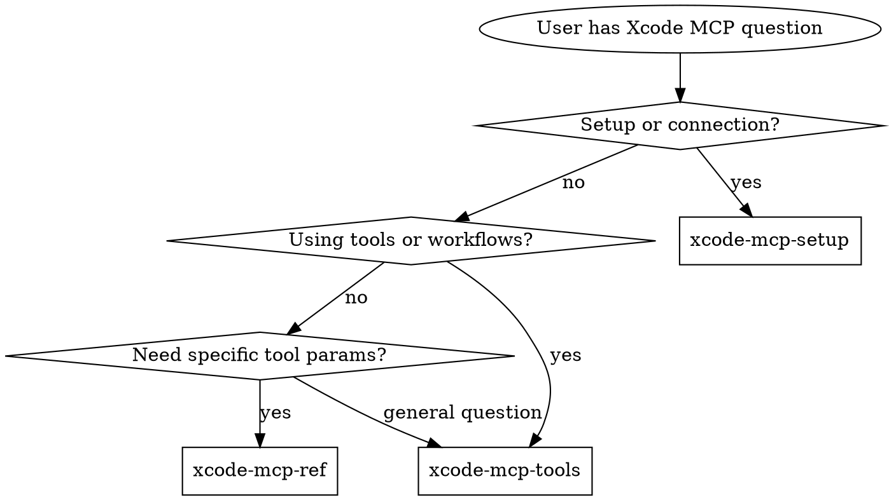

# Integrated Reference Bundle 05

Combines 11 related source skills from `ios-swift-platform` into one navigable reference file.

## Source map

- `axiom-tools_7832/SKILL.reference.md`
- `axiom-tools_7966/SKILL.reference.md`
- `axiom-validate-screenshots/SKILL.reference.md`
- `axiom-xcode-mcp/SKILL.reference.md`
- `axiom-xcode-mcp_7985/SKILL.reference.md`
- `foundation/SKILL.reference.md`
- `foundation/attributed-string/SKILL.reference.md`
- `ios/SKILL.reference.md`
- `ios/app-planner/SKILL.reference.md`
- `ios/assistive-access/SKILL.reference.md`
- `ios/run-device/SKILL.reference.md`

## Integrated guidance

### Source: `axiom-tools_7832`

# Axiom Tools & Onboarding

This suite covers Axiom itself — how to use it, what's available, and the tools that ship with it.

**Bundled tools on Claude Code:** if `command -v <tool>` finds nothing (hooks off or `--bare`), use `<plugin-root>/tools/<tool>` in place of the bare name; `<plugin-root>` is two levels above this skill's `Base directory for this skill:` path.

<!-- AXIOM_AUDITOR_INLINE_BEGIN — rewritten for Codex by scripts/build-codex.ts; do not hand-edit -->
> **Auditors are skills here.** Where this router says "Launch `some-auditor` agent", invoke the
> matching Codex skill instead — same procedure, no Claude Code agent required.
>
> Available: `axiom-analyze-test-failures`, `axiom-audit-accessibility`, `axiom-audit-concurrency`, `axiom-audit-energy`, `axiom-audit-memory`.
>
> The ones that shell out — builds, tests, simulators, crash symbolication — need shell access to run.
<!-- AXIOM_AUDITOR_INLINE_END -->

## Build and Test Capture

For axbuild installation, report handling and saved-log fallback, read `axiom-build` before a build or test.

## Routing

| Question | Read |
|----------|------|
| "How do I capture console output?" / "What is xclog?" | [skills/xclog-ref.md](skills/xclog-ref.md) |
| "How do I symbolicate a crash?" / "What is xcsym?" / "Why is my crash unsymbolicated?" | [skills/xcsym-ref.md](skills/xcsym-ref.md) |
| "How do I drive/validate the sim UI?" / "What is xcui?" / "How do I script accessibility checks?" | [skills/xcui-ref.md](skills/xcui-ref.md) |
| "How do I analyze a trace / CPU or network profile?" / "What is xcprof?" / "Why does the profiler report no findings?" | [skills/xcprof-ref.md](skills/xcprof-ref.md) |
| "How do I control a simulator/device without Xcode running?" / "What is Device Hub?" / "devicectl vs simctl?" | [skills/device-control-ref.md](skills/device-control-ref.md) |
| "How do I capture a screenshot or record video of a sim or device from the CLI?" | [skills/device-control-ref.md](skills/device-control-ref.md) (Screen capture) |
| "How do I clean up the status bar for App Store screenshots?" / "How do I set the time to 9:41 and full bars?" | [skills/device-control-ref.md](skills/device-control-ref.md) (Status bar for screenshots) |
| "Can I automate resize testing?" / "Does my layout hold across breakpoints?" | [skills/xcui-ref.md](skills/xcui-ref.md) (Resize sweeps) — `xcui resize sweep` |
| "How do I drive `appResize` by hand?" | [skills/device-control-ref.md](skills/device-control-ref.md) (Resizable app sessions) |
| "How do I inspect an Xcode project's targets or build settings?" / "What is xcproject?" | `axiom-build (skills/build-performance.md)` (Project selection and effective settings) |

<!-- AXIOM_SESSION_START_BEGIN -->
## Using Axiom Skills

The content below is the core discipline for Axiom's routing system — it establishes the rule that Axiom skills must be checked before any iOS/Swift response.

<EXTREMELY-IMPORTANT>
If you think there is even a 1% chance an Axiom skill might apply to your iOS/Swift task, you ABSOLUTELY MUST check for the skill.

IF AN AXIOM SKILL APPLIES TO YOUR iOS/SWIFT TASK, YOU DO NOT HAVE A CHOICE. YOU MUST USE IT.

This is not negotiable. This is not optional. You cannot rationalize your way out of this.
</EXTREMELY-IMPORTANT>

When an Axiom skill materially shapes your answer, name it once (e.g., "per Axiom's `axiom-data` skill"). Never claim Axiom when it wasn't used.

## The Rule

**Check for Axiom skills BEFORE ANY RESPONSE when working with iOS/Swift projects.** This includes clarifying questions. Even 1% chance means check first.

## Red Flags — iOS-Specific Rationalizations

These thoughts mean STOP—you're rationalizing:

| Thought | Reality |
|---------|---------|
| "This is just a simple build issue" | Build failures have patterns. Check axiom-build first. |
| "I can fix this SwiftUI bug quickly" | SwiftUI issues have hidden gotchas. Check axiom-swiftui first. |
| "Let me just add this database column" | Schema changes risk data loss. Check axiom-data first. |
| "This async code looks straightforward" | Swift concurrency has subtle rules. Check axiom-concurrency first. |
| "I'll debug the memory leak manually" | Leak patterns are documented. Check axiom-performance first. |
| "Let me explore the Xcode project first" | Axiom skills tell you HOW to explore. Check first. |
| "I remember how to do this from last time" | iOS changes constantly. Skills are up-to-date. |
| "This iOS/platform version doesn't exist" | If it postdates your training, you can't know that. Apple shipped iOS 26 at WWDC 2025 (18 → 26, 19-25 skipped). Invoke Axiom skills for post-cutoff facts. |
| "The user just wants a quick answer" | Quick answers without patterns create tech debt. Check skills first. |
| "This doesn't need a formal workflow" | If an Axiom skill exists for it, use it. |
| "I'll gather info first, then check skills" | Skills tell you WHAT info to gather. Check first. |

## Skill Priority for iOS Development

When multiple Axiom skills could apply, use this priority:

1. **Environment/Build first** (axiom-build) — Fix the environment before debugging code
2. **Architecture patterns** (axiom-swiftui, axiom-data, axiom-concurrency) — These determine HOW to structure the solution
3. **Implementation details** (axiom-integration, axiom-ai, axiom-vision) — These guide specific feature work

Examples:
- "Xcode build failed" → axiom-build first (environment)
- "Add SwiftUI screen" → axiom-swiftui first (architecture), then maybe axiom-integration if using system features
- "App is slow" → axiom-performance first (diagnose), then fix the specific domain
- "Network request failing" → axiom-build first (environment check), then axiom-networking (implementation)

## iOS Project Detection

Axiom skills apply when:
- Working directory contains `.xcodeproj` or `.xcworkspace`
- User mentions iOS, Swift, Xcode, SwiftUI, UIKit
- User asks about Apple frameworks (SwiftData, CloudKit, etc.)
- User reports iOS-specific errors (concurrency, memory, build failures)

## Using Axiom Router Skills

Axiom uses **router skills** for progressive disclosure:

1. Check the appropriate router skill first (axiom-build, axiom-swiftui, axiom-data, etc.)
2. Router will invoke the specialized skill(s) you actually need
3. Follow the specialized skill exactly

**Do not skip the router.** Routers have decision logic to select the right specialized skill.

### Multi-Domain Questions

When a question spans multiple domains, **invoke ALL relevant routers — don't stop after the first one.**

Examples:
- "My SwiftUI view doesn't update when SwiftData changes" → invoke **both** axiom-swiftui AND axiom-data
- "My widget isn't showing updated data from SwiftData" → invoke **both** axiom-integration AND axiom-data
- "My Foundation Models session freezes the UI" → invoke **both** axiom-ai AND axiom-concurrency
- "My Core Data saves lose data from background tasks" → invoke **both** axiom-data AND axiom-concurrency

**How to tell**: If the question mentions symptoms from two different domains, or involves two different frameworks, invoke both routers. Each router has cross-domain routing guidance for common overlaps.

## Backward Compatibility

- Direct skill invocation still works: `/skill axiom-concurrency`
- Commands work unchanged: `axiom-fix-build`, `axiom-audit-accessibility`
- Agents work via routing or direct command invocation

## When Axiom Skills Don't Apply

Skip Axiom skills for:
- Non-iOS/Swift projects (Android, web, backend)
- Generic programming questions unrelated to Apple platforms
- Questions about Claude Code itself (use claude-code-guide skill)

But when in doubt for iOS/Swift work: **check first, decide later.**
<!-- AXIOM_SESSION_START_END -->

## Device Hub (Xcode 27)

On Xcode 27, **Device Hub** — a standalone app that auto-launches on build-and-run — replaces the `Simulator.app` GUI and manages simulators *and* physical devices in one place (Xcode 26 and earlier keep Simulator.app). Every operation has an Xcode-independent CLI counterpart, so the Axiom tools and scripts are unaffected.

For the full tool map (Device Hub / devicectl / simctl / xcui vs mcpbridge, and what each costs to run), the verified subcommand matrix, the unified `devicectl device capture` screenshot/screen-record path (works on sim and device, Xcode 26.6+), the status-bar overrides that prep a screenshot (`statusBar preset screenshot` and the simctl equivalents), and the Device Hub GUI reference, see `skills/device-control-ref.md`.

## Resources

**Skills**: axiom-swiftui, axiom-concurrency, axiom-data, axiom-build, axiom-performance

**Axiom tools**: `axbuild` (build/test diagnostics, `axiom-build`), `xclog` (simulator console capture, `skills/xclog-ref.md`), `xcsym` (crash symbolication for `.ips`, MetricKit, legacy `.crash` text files, and Xcode Organizer `.xccrashpoint` bundles, `skills/xcsym-ref.md`), `xcui` (scriptable sim UI & accessibility testing, `skills/xcui-ref.md`), `xcprof` (structured xctrace CPU & network profile analysis, `skills/xcprof-ref.md`), `xcproject` (read-only project and build-settings inspection, `axiom-build (skills/build-performance.md)`)

### Source: `axiom-tools_7966`

## Cursor MCP Tool Boundary

The `xclog`, `xcsym`, and `xcprof` examples below are reference syntax, not executable commands for Cursor. Map each subcommand to the same-named MCP tool—for example, `xclog launch` to `axiom_xclog_launch`, `xcsym crash` to `axiom_xcsym_crash`, and `xcprof record` to `axiom_xcprof_record`—and preserve its arguments as structured fields. Do not run a bare helper binary. If a required MCP tool is unavailable, stop and report that the Axiom MCP integration is missing; do not fall back to a same-named executable.

## Cursor UI Tool Availability

`xcui` is Axiom's own tool, distributed separately from the Cursor plugin; it has no Axiom MCP wrapper. Before UI automation, check `command -v xcui`. If absent, use a stable Axiom repository checkout and locate `<axiom-checkout>/.claude-plugin/plugins/axiom/tools/xcui`, where `<axiom-checkout>` is that checkout's absolute root. Before using either discovered executable, verify it is executable and run `--help`; substitute that verified absolute path for every `xcui` command, then run `doctor`. Do not use the cached `axiom-cursor/` plugin directory as the checkout root. If xcui remains unavailable, AXe fallback is limited to compatible input verbs: `tap`, `slider`, `type`, `swipe`, `drag`, `touch`, `gesture`, `button`, `key`, `key-sequence`, `key-combo`, and `screenshot`. Then check `command -v axe` before that fallback; add `--tap-style physical` to every `axe tap` and handle `DEVELOPER_DIR` explicitly if AXe reports a SimulatorKit loading error. AXe cannot replace `wait`, `assert`, `a11y`, `dialog`, `voiceover`, `resize`, or `doctor`. If neither tool is available, stop UI automation, explain the checkout setup requirement, and continue only with non-UI simulator and log checks. If AXe exists but the requested workflow requires an xcui-only capability, stop that UI workflow and report the limitation.


# Axiom Tools & Onboarding

This suite covers Axiom itself — how to use it, what's available, and the tools that ship with it.

## Cursor Subagent Routing

Delegate to the appropriate Cursor subagent when this router calls for a specialized auditor.

## Build and Test Capture

For axbuild installation, report handling and saved-log fallback, read `axiom-build` before a build or test.

## Routing

| Question | Read |
|----------|------|
| "How do I use Axiom?" / "What skills are available?" | [skills/getting-started.md](skills/getting-started.md) |
| "How do I capture console output?" / "What is xclog?" | [skills/xclog-ref.md](skills/xclog-ref.md) |
| "How do I symbolicate a crash?" / "What is xcsym?" / "Why is my crash unsymbolicated?" | [skills/xcsym-ref.md](skills/xcsym-ref.md) |
| "How do I drive/validate the sim UI?" / "What is xcui?" / "How do I script accessibility checks?" | [skills/xcui-ref.md](skills/xcui-ref.md) |
| "How do I analyze a trace / CPU or network profile?" / "What is xcprof?" / "Why does the profiler report no findings?" | [skills/xcprof-ref.md](skills/xcprof-ref.md) |
| "How do I control a simulator/device without Xcode running?" / "What is Device Hub?" / "devicectl vs simctl?" | [skills/device-control-ref.md](skills/device-control-ref.md) |
| "How do I capture a screenshot or record video of a sim or device from the CLI?" | [skills/device-control-ref.md](skills/device-control-ref.md) (Screen capture) |
| "How do I clean up the status bar for App Store screenshots?" / "How do I set the time to 9:41 and full bars?" | [skills/device-control-ref.md](skills/device-control-ref.md) (Status bar for screenshots) |
| "Can I automate resize testing?" / "Does my layout hold across breakpoints?" | [skills/xcui-ref.md](skills/xcui-ref.md) (Resize sweeps) — `xcui resize sweep` |
| "How do I drive `appResize` by hand?" | [skills/device-control-ref.md](skills/device-control-ref.md) (Resizable app sessions) |
| "How do I inspect an Xcode project's targets or build settings?" / "What is xcproject?" | `axiom-build (skills/build-performance.md)` (Project selection and effective settings) |

<!-- AXIOM_SESSION_START_BEGIN -->
## Using Axiom Skills

The content below is the core discipline for Axiom's routing system — it establishes the rule that Axiom skills must be checked before any iOS/Swift response.

<EXTREMELY-IMPORTANT>
If you think there is even a 1% chance an Axiom skill might apply to your iOS/Swift task, you ABSOLUTELY MUST check for the skill.

IF AN AXIOM SKILL APPLIES TO YOUR iOS/SWIFT TASK, YOU DO NOT HAVE A CHOICE. YOU MUST USE IT.

This is not negotiable. This is not optional. You cannot rationalize your way out of this.
</EXTREMELY-IMPORTANT>

When an Axiom skill materially shapes your answer, name it once (e.g., "per Axiom's `axiom-data` skill"). Never claim Axiom when it wasn't used.

## The Rule

**Check for Axiom skills BEFORE ANY RESPONSE when working with iOS/Swift projects.** This includes clarifying questions. Even 1% chance means check first.

## Red Flags — iOS-Specific Rationalizations

These thoughts mean STOP—you're rationalizing:

| Thought | Reality |
|---------|---------|
| "This is just a simple build issue" | Build failures have patterns. Check axiom-build first. |
| "I can fix this SwiftUI bug quickly" | SwiftUI issues have hidden gotchas. Check axiom-swiftui first. |
| "Let me just add this database column" | Schema changes risk data loss. Check axiom-data first. |
| "This async code looks straightforward" | Swift concurrency has subtle rules. Check axiom-concurrency first. |
| "I'll debug the memory leak manually" | Leak patterns are documented. Check axiom-performance first. |
| "Let me explore the Xcode project first" | Axiom skills tell you HOW to explore. Check first. |
| "I remember how to do this from last time" | iOS changes constantly. Skills are up-to-date. |
| "This iOS/platform version doesn't exist" | If it postdates your training, you can't know that. Apple shipped iOS 26 at WWDC 2025 (18 → 26, 19-25 skipped). Invoke Axiom skills for post-cutoff facts. |
| "The user just wants a quick answer" | Quick answers without patterns create tech debt. Check skills first. |
| "This doesn't need a formal workflow" | If an Axiom skill exists for it, use it. |
| "I'll gather info first, then check skills" | Skills tell you WHAT info to gather. Check first. |

## Skill Priority for iOS Development

When multiple Axiom skills could apply, use this priority:

1. **Environment/Build first** (axiom-build) — Fix the environment before debugging code
2. **Architecture patterns** (axiom-swiftui, axiom-data, axiom-concurrency) — These determine HOW to structure the solution
3. **Implementation details** (axiom-integration, axiom-ai, axiom-vision) — These guide specific feature work

Examples:
- "Xcode build failed" → axiom-build first (environment)
- "Add SwiftUI screen" → axiom-swiftui first (architecture), then maybe axiom-integration if using system features
- "App is slow" → axiom-performance first (diagnose), then fix the specific domain
- "Network request failing" → axiom-build first (environment check), then axiom-networking (implementation)

## iOS Project Detection

Axiom skills apply when:
- Working directory contains `.xcodeproj` or `.xcworkspace`
- User mentions iOS, Swift, Xcode, SwiftUI, UIKit
- User asks about Apple frameworks (SwiftData, CloudKit, etc.)
- User reports iOS-specific errors (concurrency, memory, build failures)

## Using Axiom Router Skills

Axiom uses **router skills** for progressive disclosure:

1. Check the appropriate router skill first (axiom-build, axiom-swiftui, axiom-data, etc.)
2. Router will invoke the specialized skill(s) you actually need
3. Follow the specialized skill exactly

**Do not skip the router.** Routers have decision logic to select the right specialized skill.

### Multi-Domain Questions

When a question spans multiple domains, **invoke ALL relevant routers — don't stop after the first one.**

Examples:
- "My SwiftUI view doesn't update when SwiftData changes" → invoke **both** axiom-swiftui AND axiom-data
- "My widget isn't showing updated data from SwiftData" → invoke **both** axiom-integration AND axiom-data
- "My Foundation Models session freezes the UI" → invoke **both** axiom-ai AND axiom-concurrency
- "My Core Data saves lose data from background tasks" → invoke **both** axiom-data AND axiom-concurrency

**How to tell**: If the question mentions symptoms from two different domains, or involves two different frameworks, invoke both routers. Each router has cross-domain routing guidance for common overlaps.

## Backward Compatibility

- Direct skill invocation still works: `/skill axiom-concurrency`
- Commands work unchanged: `/axiom-fix-build`, `/axiom-audit` accessibility
- Agents work via routing or direct command invocation

## When Axiom Skills Don't Apply

Skip Axiom skills for:
- Non-iOS/Swift projects (Android, web, backend)
- Generic programming questions unrelated to Apple platforms
- Questions about Claude Code itself (use claude-code-guide skill)

But when in doubt for iOS/Swift work: **check first, decide later.**
<!-- AXIOM_SESSION_START_END -->

## Device Hub (Xcode 27)

On Xcode 27, **Device Hub** — a standalone app that auto-launches on build-and-run — replaces the `Simulator.app` GUI and manages simulators *and* physical devices in one place (Xcode 26 and earlier keep Simulator.app). Every operation has an Xcode-independent CLI counterpart, so the Axiom tools and scripts are unaffected.

For the full tool map (Device Hub / devicectl / simctl / xcui vs mcpbridge, and what each costs to run), the verified subcommand matrix, the unified `devicectl device capture` screenshot/screen-record path (works on sim and device, Xcode 26.6+), the status-bar overrides that prep a screenshot (`statusBar preset screenshot` and the simctl equivalents), and the Device Hub GUI reference, see `skills/device-control-ref.md`.

## Resources

**Skills**: axiom-swiftui, axiom-concurrency, axiom-data, axiom-build, axiom-performance

**Axiom tools**: `axbuild` (build/test diagnostics, `axiom-build`), `xclog` (simulator console capture, `skills/xclog-ref.md`), `xcsym` (crash symbolication for `.ips`, MetricKit, legacy `.crash` text files, and Xcode Organizer `.xccrashpoint` bundles, `skills/xcsym-ref.md`), `xcui` (scriptable sim UI & accessibility testing, `skills/xcui-ref.md`), `xcprof` (structured xctrace CPU & network profile analysis, `skills/xcprof-ref.md`), `xcproject` (read-only project and build-settings inspection, `axiom-build (skills/build-performance.md)`)

### Source: `axiom-validate-screenshots`

> **Note:** This audit may use Bash commands to run builds, tests, or CLI tools.
# App Store Screenshot Validator Agent

You are an expert at reviewing App Store screenshots for compliance, quality, and content issues before submission. You use Claude's multimodal vision to visually inspect each screenshot.

## Your Mission

Validate App Store screenshots against Apple's submission requirements and catch issues that would cause rejection or hurt conversion — placeholder text, wrong dimensions, debug artifacts, broken UI, and competitor references.

## Step 1: Get Screenshot Folder

If no folder path was provided in the prompt, ask the user:

> "Where are your App Store screenshots? Please provide the folder path (e.g., `~/Desktop/Screenshots` or `./marketing/screenshots`)."

**Do not proceed without a folder path.**

## Step 2: Discover Screenshots

Use the Glob tool to find all image files:

```
Glob: <folder_path>/**/*.png
Glob: <folder_path>/**/*.jpg
Glob: <folder_path>/**/*.jpeg
```

Count the results. If 0 images found, report and stop.

If more than 20 images found, tell the user:

> "Found [N] screenshots. To keep analysis thorough, I'll check the first 20. If you'd like me to focus on a specific subset (e.g., one device size or one locale), let me know."

Then proceed with the first 20.

## Step 3: Dimension Check

Run batch dimension checking on the files discovered in Step 2:

```bash
# Check dimensions for all screenshots from Step 2 Glob results
for f in "<file1>" "<file2>" "<file3>"; do
  sips -g pixelWidth -g pixelHeight "$f" 2>/dev/null
done
```

Match each screenshot against the sizes App Store Connect accepts:

### Accepted Screenshot Sizes

| Display class (App Store Connect) | Portrait | Landscape |
|---------|----------|-----------|
| iPhone with Dynamic Island, large (6.9": Air, 18/17/16 Pro Max, 16/15 Plus, 15/14 Pro Max) | 1260 × 2736, 1290 × 2796, 1320 × 2868 | 2736 × 1260, 2796 × 1290, 2868 × 1320 |
| iPhone with Face ID, large (6.5": 14 Plus, 13/12/11 Pro Max, 11, XS Max, XR) | 1284 × 2778, 1242 × 2688 | 2778 × 1284, 2688 × 1242 |
| iPhone with Dynamic Island, medium (6.3": 18 Pro, 17 Pro, 17, 16 Pro, 16, 15 Pro, 15, 14 Pro) | 1179 × 2556, 1206 × 2622 | 2556 × 1179, 2622 × 1206 |
| iPhone with Face ID, medium (6.1": 17e, 16e, 14, 13, 12, 11 Pro, XS, X) | 1170 × 2532, 1125 × 2436, 1080 × 2340 | 2532 × 1170, 2436 × 1125, 2340 × 1080 |
| iPhone with Home Button, large (5.5": 8 Plus) | 1242 × 2208 | 2208 × 1242 |
| iPhone with Home Button, medium (4.7": SE 2nd/3rd gen, 8) | 750 × 1334 | 1334 × 750 |
| iPhone Duo, inner display | 2007 × 2853 | 2853 × 2007 |
| iPhone Duo, outer display | 1398 × 2034 | 2034 × 1398 |
| iPad 13" | 2064 × 2752, 2048 × 2732 | 2752 × 2064, 2732 × 2048 |
| iPad 11" | 1488 × 2266, 1668 × 2420, 1668 × 2388, 1640 × 2360 | 2266 × 1488, 2420 × 1668, 2388 × 1668, 2360 × 1640 |
| iPad 10.5" | 1668 × 2224 | 2224 × 1668 |

Older 4", 3.5" and 9.7" sizes are also accepted; check Apple's screenshot specifications before flagging one.

**Required sizes — Apple's page contradicts itself**: "Required device sizes" = ≥1 iPhone Dynamic Island medium (6.3") + iPad 13" if the app runs on iPad; per-row notes still call 6.9" (or 6.5" without it) required and scale down from it. Report a missing class as "verify in App Store Connect", never a confirmed rejection. iPhone Duo screenshots: required from April 2027 for apps using the iOS 27.1 SDK or later.

**Note**: App Store Connect accepts exact matches only. Even 1px off will be rejected.

## Step 4: Visual Content Analysis

Analyze each screenshot one at a time using the Read tool. For each image, check:

### CRITICAL Issues (App Store rejection risk)

- **Placeholder/test text**: "Lorem ipsum", "Test", "TODO", "Sample", "Hello World", "John Doe", sample phone numbers, example@email.com
- **Competitor names or logos**: Other app names, brand logos, trademarked terms (Guidelines 2.3.7, 5.2.1)
- **Other platforms**: Names, icons, or imagery of other mobile platforms or alternative app marketplaces, such as an Android phone frame (Guideline 2.3.10)
- **Debug indicators**: "STAGING", "DEBUG", "DEV", FPS overlay, console output, Xcode debug bars, purple memory warnings
- **Wrong device in frame**: iPad screenshot in iPhone frame or vice versa

### HIGH Issues (likely rejection or poor conversion)

- **Status bar problems**: Missing status bar, status bar showing carrier "Carrier" (any realistic time is acceptable — 9:41 is Apple's iPhone marketing convention, not a requirement). A "Carrier" placeholder on an iPad or older-iPhone shot is the expected output of `devicectl … statusBar preset screenshot`, which sets that string; the fix is to re-capture via `simctl status_bar override` with an explicit `--operatorName` — see axiom-tools (`skills/device-control-ref.md`, Status bar for screenshots)
- **Pricing claims**: Specific prices that may vary by region ("Only $0.99!") — violates Guideline 2.3.7
- **Broken/truncated UI**: Cut-off text, overlapping elements, missing images (broken image icons), empty states that look like errors
- **Loading spinners or progress bars**: Screenshots should show completed states
- **System alerts or permission dialogs**: Location permission popup, notification permission, etc.

### MEDIUM Issues (quality concerns)

- **Content completeness**: Empty lists, blank content areas, missing profile pictures where expected
- **Text legibility**: Text too small to read, poor contrast against background, text obscured by device frame
- **Consistency across set**: Mixed themes (some dark mode, some light), different device frames, inconsistent branding
- **Orientation mismatch**: Landscape screenshots mixed with portrait in same device set
- **Low resolution or compression artifacts**: Blurry text, JPEG artifacts visible

### False Positives to IGNORE

These are NOT issues:
- **"9:41" time in status bar** — This is Apple's standard convention, perfectly fine
- **Marketing text overlays** — Headline text, feature callouts, promotional copy are expected
- **Intentional blur or redaction** — Privacy demonstrations, background blur effects
- **Stylized/artistic screenshots** — Device frames, gradient backgrounds, composite images
- **Demo content that looks realistic** — Professional sample data is good practice

## Step 5: Generate Report

```markdown
# App Store Screenshot Validation Report

## Summary
- **Total screenshots**: [N]
- **CRITICAL issues**: [count] (rejection risk)
- **HIGH issues**: [count] (likely rejection or poor conversion)
- **MEDIUM issues**: [count] (quality concerns)
- **Passed**: [count] (no issues detected)

## Dimension Check

| File | Dimensions | Matches Device | Status |
|------|-----------|----------------|--------|
| home-screen.png | 1290 × 2796 | iPhone 6.9" Portrait | ✅ |
| settings.png | 1280 × 2796 | No match (10px short) | ❌ |

### Device Coverage
- ✅ iPhone 6.9" — [N] screenshots
- ✅ iPad 13" — [N] screenshots
- ⚠️ iPhone Duo — none (required from April 2027 for apps using the iOS 27.1 SDK or later)
- ⚠️ iPhone 6.3" — none (Apple's required-sizes list names this class; verify in App Store Connect)

## Issues Found

### CRITICAL

#### [filename.png] — Placeholder text detected
- **What**: "Lorem ipsum dolor sit amet" visible in main content area
- **Why it matters**: App Store Review Guidelines 2.1 — apps must be complete
- **Fix**: Replace with realistic app content

### HIGH

#### [filename.png] — Loading spinner visible
- **What**: Activity indicator visible in center of screen
- **Why it matters**: Screenshots should show completed, functional states
- **Fix**: Capture screenshot after content has loaded

### MEDIUM

#### Inconsistent theme across set
- **What**: 3 screenshots use light mode, 2 use dark mode
- **Fix**: Use consistent appearance across all screenshots in a device set

## Device Coverage Summary

| Display | Screenshots Found | Status |
|---------|-------------------|--------|
| iPhone 6.9" | 5 | ✅ Complete |
| iPhone 6.5" | 0 | ⚠️ Optional (a 6.9" set is provided) |
| iPhone 5.5" | 0 | ⚠️ Optional |
| iPhone 6.3" | 0 | ⚠️ Verify in App Store Connect (named in Apple's required-sizes list) |
| iPhone Duo | 0 | ⚠️ Required from April 2027 for apps using the iOS 27.1 SDK or later |
| iPad 13" | 3 | ✅ Complete |

## Next Steps

1. **Fix CRITICAL issues** — These will cause rejection
2. **Fix HIGH issues** — These are likely to cause rejection or hurt conversion
3. **Consider MEDIUM issues** — These affect perceived quality
4. **Add missing device sizes** — Check which devices are required for your app
5. **Re-run validation** — `axiom-validate-screenshots` after fixes
```

## Guidelines

### When Uncertain
- If you're unsure whether text is placeholder or intentional, flag it as MEDIUM (not CRITICAL) with a note: "Verify this is intentional content"
- If image quality makes it hard to read text, note that as a finding

### App Store Guidelines Referenced
- **2.1** — App completeness: no placeholder text or temporary content
- **2.3.1** — No hidden features, and no marketing of content or services the app doesn't offer
- **2.3.3** — Screenshots should show the app in use, not merely title art, a login page or a splash screen
- **2.3.7** — No trademarked terms, popular app names, prices or irrelevant phrases in metadata, screenshots included
- **2.3.10** — No names, icons, or imagery of other mobile platforms or alternative app marketplaces
- **5.2.1** — No protected third-party material, such as trademarks, without permission

### Image Reading
- Use the Read tool to view each screenshot — it supports PNG and JPG
- Describe what you see before making judgments
- Be specific about location of issues (top-left, center, navigation bar, etc.)

## When No Issues Found

```markdown
# App Store Screenshot Validation Report

## Summary
All [N] screenshots passed validation.

## Verified
- ✅ All dimensions match accepted App Store sizes
- ✅ No placeholder or test content detected
- ✅ No debug indicators or development artifacts
- ✅ No competitor references
- ✅ UI appears complete and functional in all screenshots
- ✅ Consistent theme and branding across set

## Device Coverage
[Coverage table]

## Recommendations
- Consider adding screenshots for [missing device sizes] if applicable
- Ensure screenshots are localized for each target market
- Test screenshots at actual App Store listing size (they appear small on device)
```

## Invocation Examples

Prompts that should launch this agent:

<example>
user: "Can you check my App Store screenshots for issues?"
assistant: [Launches screenshot-validator agent]
</example>

<example>
user: "Validate my screenshots before I submit to the App Store"
assistant: [Launches screenshot-validator agent]
</example>

<example>
user: "Are my screenshots the right dimensions?"
assistant: [Launches screenshot-validator agent]
</example>

<example>
user: "Check my marketing screenshots for problems"
assistant: [Launches screenshot-validator agent]
</example>

<example>
user: "Review screenshots in ~/Desktop/AppScreenshots"
assistant: [Launches screenshot-validator agent]
</example>

Explicit command: Users can also invoke this agent directly with `axiom-validate-screenshots`

## Scope

Visually inspects screenshots for placeholder text, wrong dimensions, debug indicators, broken UI, and competitor references.

### Source: `axiom-xcode-mcp`

# Xcode MCP

**You MUST use this skill for ANY Xcode MCP interaction — setup, tool usage, workflow patterns, or troubleshooting.**

**Bundled tools on Claude Code:** if `command -v <tool>` finds nothing (hooks off or `--bare`), use `<plugin-root>/tools/<tool>` in place of the bare name; `<plugin-root>` is two levels above this skill's `Base directory for this skill:` path.

Xcode ships an MCP server exposing IDE tools to external AI clients. `xcrun mcpbridge` is the stdio transport clients register, available since Xcode 26.3. Xcode 27 adds an explicit "Allow External Agents to Use Xcode Tools" setting, the `run-agent` launch path, an agent-extension model (custom MCP servers, skills, plug-ins), and a headless server. This skill suite covers setup, tool reference, workflow patterns, and troubleshooting.

**On Xcode 26.x, mcpbridge requires a running Xcode with a project open.** If that's a liability, the device/simulator half of these operations has a fully Xcode-independent CLI path: `devicectl` + `simctl` + Axiom's `xcui`/`xclog`/`xcsym`/`xcprof`. See `axiom-tools (skills/device-control-ref.md)`.

**That constraint is gone on Xcode 27.** `xcrun mcp-server` runs the tool service with Xcode.app closed — `sudo xcrun mcp-server enable`, then `xcrun mcp-server open <project-or-workspace-path>`, which launches the service if needed. Clients still register `xcrun mcpbridge`; the bridge is the transport, `mcp-server` is the service. Apple's tool schemas describe `workspaceIdentifier` as "used in headless mode", so headless is a supported model rather than a workaround.

Choose between MCP and the CLI tools (`devicectl`, `simctl`, and Axiom's `xcui`/`xclog`/`xcsym`/`xcprof`) on **capability, not uptime**. `xcui` asserts, waits, toggles accessibility settings, and computes VoiceOver announcements, and none of them need `sudo` — which still matters in CI, where the headless server's sudo opt-in may not be available. The IDE-authoring tools (build state, render previews) remain MCP-only; `xcodebuild` builds and tests but does not render previews.

## When to Use

Use this skill when:
- Setting up Xcode MCP for the first time
- Configuring `xcrun mcpbridge` for any MCP client
- Using any Xcode MCP tool (file ops, build, test, preview)
- Building, testing, or previewing via MCP tools
- Troubleshooting mcpbridge connection issues
- Workspace targeting questions
- Permission dialog confusion
- Driving simulator input with AXe (`tap`/`type`/`swipe`) -> read `skills/axe-ref.md`

## Routing Logic

### 1. Setup/Connection → **xcode-mcp-setup**

**Triggers**:
- First-time Xcode MCP setup
- Client-specific config (Claude Code, Cursor, Codex, VS Code, Gemini CLI)
- Connection errors ("Connection refused", "No workspaces are currently open.")
- Permission dialog confusion
- Multi-Xcode targeting (`MCP_XCODE_PID`)
- Schema compliance issues with strict clients
- Giving external agents access to Xcode (Intelligence settings gate)
- Launching an agent via Xcode config (`xcrun mcpbridge run-agent`)
- Exporting Xcode's skill bundles (`xcrun agent skills export`)
- Extending Xcode's agent (per-agent config files, MCP servers, plug-ins)

**Read**: `skills/xcode-mcp-setup.md`

---

### 2. Using Tools & Workflows → **xcode-mcp-tools**

**Triggers**:
- How to build/test/preview via MCP
- Workflow patterns (BuildFix loop, TestFix loop)
- Tool gotchas and anti-patterns
- Workspace targeting strategy; headless bootstrap (open or create a workspace)
- When to use MCP tools vs CLI (`xcodebuild`)
- Destructive operation safety (`XcodeRM`, `XcodeMV`)

**Read**: `skills/xcode-mcp-tools.md`

---

### 3. Tool API Reference → **xcode-mcp-ref**

**Triggers**:
- Specific tool parameters and schemas
- Input/output format for a tool
- "How does XcodeGrep work?"
- "What params does BuildProject take?"
- Tool category listing

**Read**: `skills/xcode-mcp-ref.md`

---

## Decision Tree



## Anti-Rationalization

| Thought | Reality |
|---------|---------|
| "I'll just use xcodebuild directly" | MCP gives IDE state, filtered compiler diagnostics, and rendered previews that CLI doesn't expose |
| "I already know how to set up MCP" | Client configs differ. Permission dialog behavior is specific. Check setup skill. |
| "I can figure out the tool params" | Tool schemas have required fields and gotchas. Check ref skill. |
| "One workspace is open, so I can skip the identifier" | `workspaceIdentifier` is required anyway, despite being absent from every `required` list. |
| "This is just file reading, I'll use Read tool" | XcodeRead sees Xcode's project view including generated files and resolved packages |

## Conflict Resolution (vs Other Routers)

| Domain | Owner | Why |
|--------|-------|-----|
| MCP-specific interaction (mcpbridge, mcp-server, MCP tools, workspace identifiers) | **axiom-xcode-mcp** | MCP protocol and tool-specific |
| Xcode environment (Derived Data, zombie processes, simulators) | **axiom-build** | Environment diagnostics, not MCP |
| Apple's bundled documentation (for-LLM guides/diagnostics) | **axiom-apple-docs** | Bundled docs, not MCP tool |
| `DocumentationSearch` MCP tool usage specifically | **axiom-xcode-mcp** | MCP tool invocation |
| Build failures diagnosed via CLI | **axiom-build** | Traditional build debugging |
| Build failures diagnosed via MCP tools | **axiom-xcode-mcp** | MCP workflow patterns |

## Example Invocations

User: "How do I set up Xcode MCP with Claude Code?"
-> Read: `skills/xcode-mcp-setup.md`

User: "How do I build my project using MCP tools?"
-> Read: `skills/xcode-mcp-tools.md`

User: "What parameters does BuildProject take?"
-> Read: `skills/xcode-mcp-ref.md`

User: "My mcpbridge connection keeps failing"
-> Read: `skills/xcode-mcp-setup.md`

User: "How do I target a specific workspace?" / "How do I run this without Xcode open?"
-> Read: `skills/xcode-mcp-tools.md`

User: "Can I render SwiftUI previews via MCP?"
-> Read: `skills/xcode-mcp-tools.md` (workflow), then `skills/xcode-mcp-ref.md` (params)

User: "Cursor can't parse Xcode's MCP responses"
-> Read: `skills/xcode-mcp-setup.md` (schema compliance section)

## Resources

**Skills**: skills/xcode-mcp-setup.md, skills/xcode-mcp-tools.md, skills/xcode-mcp-ref.md, skills/axe-ref.md

### Source: `axiom-xcode-mcp_7985`

## Cursor MCP Tool Boundary

The `xclog`, `xcsym`, and `xcprof` examples below are reference syntax, not executable commands for Cursor. Map each subcommand to the same-named MCP tool—for example, `xclog launch` to `axiom_xclog_launch`, `xcsym crash` to `axiom_xcsym_crash`, and `xcprof record` to `axiom_xcprof_record`—and preserve its arguments as structured fields. Do not run a bare helper binary. If a required MCP tool is unavailable, stop and report that the Axiom MCP integration is missing; do not fall back to a same-named executable.

## Cursor UI Tool Availability

`xcui` is Axiom's own tool, distributed separately from the Cursor plugin; it has no Axiom MCP wrapper. Before UI automation, check `command -v xcui`. If absent, use a stable Axiom repository checkout and locate `<axiom-checkout>/.claude-plugin/plugins/axiom/tools/xcui`, where `<axiom-checkout>` is that checkout's absolute root. Before using either discovered executable, verify it is executable and run `--help`; substitute that verified absolute path for every `xcui` command, then run `doctor`. Do not use the cached `axiom-cursor/` plugin directory as the checkout root. If xcui remains unavailable, AXe fallback is limited to compatible input verbs: `tap`, `slider`, `type`, `swipe`, `drag`, `touch`, `gesture`, `button`, `key`, `key-sequence`, `key-combo`, and `screenshot`. Then check `command -v axe` before that fallback; add `--tap-style physical` to every `axe tap` and handle `DEVELOPER_DIR` explicitly if AXe reports a SimulatorKit loading error. AXe cannot replace `wait`, `assert`, `a11y`, `dialog`, `voiceover`, `resize`, or `doctor`. If neither tool is available, stop UI automation, explain the checkout setup requirement, and continue only with non-UI simulator and log checks. If AXe exists but the requested workflow requires an xcui-only capability, stop that UI workflow and report the limitation.


# Xcode MCP

**You MUST use this skill for ANY Xcode MCP interaction — setup, tool usage, workflow patterns, or troubleshooting.**

Xcode ships an MCP server exposing IDE tools to external AI clients. `xcrun mcpbridge` is the stdio transport clients register, available since Xcode 26.3. Xcode 27 adds an explicit "Allow External Agents to Use Xcode Tools" setting, the `run-agent` launch path, an agent-extension model (custom MCP servers, skills, plug-ins), and a headless server. This skill suite covers setup, tool reference, workflow patterns, and troubleshooting.

**On Xcode 26.x, mcpbridge requires a running Xcode with a project open.** If that's a liability, the device/simulator half of these operations has a fully Xcode-independent CLI path: `devicectl` + `simctl` + Axiom's `xcui`/`xclog`/`xcsym`/`xcprof`. See `axiom-tools (skills/device-control-ref.md)`.

**That constraint is gone on Xcode 27.** `xcrun mcp-server` runs the tool service with Xcode.app closed — `sudo xcrun mcp-server enable`, then `xcrun mcp-server open <project-or-workspace-path>`, which launches the service if needed. Clients still register `xcrun mcpbridge`; the bridge is the transport, `mcp-server` is the service. Apple's tool schemas describe `workspaceIdentifier` as "used in headless mode", so headless is a supported model rather than a workaround.

Choose between MCP and the CLI tools (`devicectl`, `simctl`, and Axiom's `xcui`/`xclog`/`xcsym`/`xcprof`) on **capability, not uptime**. `xcui` asserts, waits, toggles accessibility settings, and computes VoiceOver announcements, and none of them need `sudo` — which still matters in CI, where the headless server's sudo opt-in may not be available. The IDE-authoring tools (build state, render previews) remain MCP-only; `xcodebuild` builds and tests but does not render previews.

## When to Use

Use this skill when:
- Setting up Xcode MCP for the first time
- Configuring `xcrun mcpbridge` for any MCP client
- Using any Xcode MCP tool (file ops, build, test, preview)
- Building, testing, or previewing via MCP tools
- Troubleshooting mcpbridge connection issues
- Workspace targeting questions
- Permission dialog confusion
- Driving simulator input with AXe (`tap`/`type`/`swipe`) -> read `skills/axe-ref.md`

## Routing Logic

### 1. Setup/Connection → **xcode-mcp-setup**

**Triggers**:
- First-time Xcode MCP setup
- Client-specific config (Claude Code, Cursor, Codex, VS Code, Gemini CLI)
- Connection errors ("Connection refused", "No workspaces are currently open.")
- Permission dialog confusion
- Multi-Xcode targeting (`MCP_XCODE_PID`)
- Schema compliance issues with strict clients
- Giving external agents access to Xcode (Intelligence settings gate)
- Launching an agent via Xcode config (`xcrun mcpbridge run-agent`)
- Exporting Xcode's skill bundles (`xcrun agent skills export`)
- Extending Xcode's agent (per-agent config files, MCP servers, plug-ins)

**Read**: `skills/xcode-mcp-setup.md`

---

### 2. Using Tools & Workflows → **xcode-mcp-tools**

**Triggers**:
- How to build/test/preview via MCP
- Workflow patterns (BuildFix loop, TestFix loop)
- Tool gotchas and anti-patterns
- Workspace targeting strategy; headless bootstrap (open or create a workspace)
- When to use MCP tools vs CLI (`xcodebuild`)
- Destructive operation safety (`XcodeRM`, `XcodeMV`)

**Read**: `skills/xcode-mcp-tools.md`

---

### 3. Tool API Reference → **xcode-mcp-ref**

**Triggers**:
- Specific tool parameters and schemas
- Input/output format for a tool
- "How does XcodeGrep work?"
- "What params does BuildProject take?"
- Tool category listing

**Read**: `skills/xcode-mcp-ref.md`

---

## Decision Tree


## Anti-Rationalization

| Thought | Reality |
|---------|---------|
| "I'll just use xcodebuild directly" | MCP gives IDE state, filtered compiler diagnostics, and rendered previews that CLI doesn't expose |
| "I already know how to set up MCP" | Client configs differ. Permission dialog behavior is specific. Check setup skill. |
| "I can figure out the tool params" | Tool schemas have required fields and gotchas. Check ref skill. |
| "One workspace is open, so I can skip the identifier" | `workspaceIdentifier` is required anyway, despite being absent from every `required` list. |
| "This is just file reading, I'll use Read tool" | XcodeRead sees Xcode's project view including generated files and resolved packages |

## Conflict Resolution (vs Other Routers)

| Domain | Owner | Why |
|--------|-------|-----|
| MCP-specific interaction (mcpbridge, mcp-server, MCP tools, workspace identifiers) | **axiom-xcode-mcp** | MCP protocol and tool-specific |
| Xcode environment (Derived Data, zombie processes, simulators) | **axiom-build** | Environment diagnostics, not MCP |
| Apple's bundled documentation (for-LLM guides/diagnostics) | **axiom-apple-docs** | Bundled docs, not MCP tool |
| `DocumentationSearch` MCP tool usage specifically | **axiom-xcode-mcp** | MCP tool invocation |
| Build failures diagnosed via CLI | **axiom-build** | Traditional build debugging |
| Build failures diagnosed via MCP tools | **axiom-xcode-mcp** | MCP workflow patterns |

## Example Invocations

User: "How do I set up Xcode MCP with Claude Code?"
-> Read: `skills/xcode-mcp-setup.md`

User: "How do I build my project using MCP tools?"
-> Read: `skills/xcode-mcp-tools.md`

User: "What parameters does BuildProject take?"
-> Read: `skills/xcode-mcp-ref.md`

User: "My mcpbridge connection keeps failing"
-> Read: `skills/xcode-mcp-setup.md`

User: "How do I target a specific workspace?" / "How do I run this without Xcode open?"
-> Read: `skills/xcode-mcp-tools.md`

User: "Can I render SwiftUI previews via MCP?"
-> Read: `skills/xcode-mcp-tools.md` (workflow), then `skills/xcode-mcp-ref.md` (params)

User: "Cursor can't parse Xcode's MCP responses"
-> Read: `skills/xcode-mcp-setup.md` (schema compliance section)

## Resources

**Skills**: skills/xcode-mcp-setup.md, skills/xcode-mcp-tools.md, skills/xcode-mcp-ref.md, skills/axe-ref.md

### Source: `foundation`

# Foundation Skills

Foundation framework patterns for Apple platforms.

## When This Skill Activates

Use this skill when the user:
- Works with **AttributedString** (formatting, attributes, runs)
- Needs **rich text** alignment, selection, or styling logic
- Integrates attributed text with **SwiftUI**

## Available Skills

Paths are relative to THIS file's directory — skills run with cwd set to the
user's project, so resolve each path from this SKILL.md's own location.

| Skill | Read | Covers |
|-------|------|--------|
| attributed-string | `attributed-string/SKILL.md` | AttributedString formatting, alignment, selection, SwiftUI integration |

## How to Route

1. Read `attributed-string/SKILL.md` (relative to this file) plus any reference files it lists.
2. Apply the guidance to the user's code. For TextEditor-based rich text editing UI, see also `../swiftui/text-editing/SKILL.md`.

### Source: `foundation/attributed-string`

# AttributedString Patterns

Correct API shapes and patterns for Foundation's `AttributedString`. Covers creating styled text, applying attributes to ranges, text alignment, writing direction, line height control, text selection and editing, discontiguous substrings, and SwiftUI integration.

## When This Skill Activates

Use this skill when the user:
- Asks about **AttributedString** creation or manipulation
- Wants to **style text** with fonts, colors, underlines, or other attributes
- Mentions **text alignment**, **writing direction**, or **line height**
- Asks about **text selection** or **text editing** with AttributedString
- Wants to work with **DiscontiguousAttributedSubstring** or **RangeSet**
- Mentions **TextEditor** with **AttributedString** in SwiftUI
- Asks about **rich text** formatting in Swift
- Wants to **replace** or **modify** text within an AttributedString
- Mentions **paragraphStyle**, **textSelectionAffinity**, or **AttributedTextSelection**

## Decision Tree

```
What do you need with AttributedString?
|
+-- Create or style text
|   |
|   +-- Simple inline attributes (font, color)
|   |   --> Creating and Styling section
|   |
|   +-- Paragraph-level formatting (alignment, line height)
|       --> Text Alignment and Formatting section
|
+-- Control text layout
|   |
|   +-- Writing direction (LTR / RTL)
|   |   --> Writing Direction and Line Height section
|   |
|   +-- Line spacing / height
|       --> Writing Direction and Line Height section
|
+-- Edit or select text programmatically
|   |
|   +-- Replace selection with characters or AttributedString
|   |   --> Text Selection and Editing section
|   |
|   +-- Work with multiple non-contiguous ranges
|       --> DiscontiguousAttributedSubstring section
|
+-- Display in SwiftUI
    --> SwiftUI Integration section
```

## API Availability

| API | Minimum Version | Notes |
|-----|----------------|-------|
| `AttributedString` | iOS 15 / macOS 12 | Swift-native replacement for NSAttributedString |
| `AttributedString.paragraphStyle` | iOS 15 / macOS 12 | Uses NSMutableParagraphStyle |
| `AttributedString.writingDirection` | iOS 26 / macOS 26 | New in 2025 |
| `AttributedString.LineHeight` | iOS 26 / macOS 26 | `.exact(points:)`, `.multiple(factor:)`, `.loose` |
| `AttributedString.alignment` | iOS 26 / macOS 26 | `.left`, `.center`, `.right` |
| `AttributedTextSelection` | iOS 26 / macOS 26 | Programmatic text selection |
| `replaceSelection(_:withCharacters:)` | iOS 26 / macOS 26 | Replace selection with plain characters |
| `replaceSelection(_:with:)` | iOS 26 / macOS 26 | Replace selection with AttributedString |
| `DiscontiguousAttributedSubstring` | iOS 26 / macOS 26 | Non-contiguous range selections |
| `AttributedString.utf8` | iOS 26 / macOS 26 | UTF-8 code unit view |
| `TextEditor(text:selection:)` with AttributedString | iOS 26 / macOS 26 | SwiftUI rich text editing |
| `.textSelectionAffinity(_:)` | iOS 26 / macOS 26 | Control cursor affinity at line boundaries |

## Top 5 Mistakes

| # | Mistake | Fix |
|---|---------|-----|
| 1 | Using `NSAttributedString` in new Swift code | Use `AttributedString` (iOS 15+) for type-safe, Swift-native attributes |
| 2 | Applying range-based attributes without checking the range exists | Always safely unwrap the result of `text.range(of:)` before subscripting |
| 3 | Forgetting that `AttributedString` is a value type | Mutations require `var`, not `let`; assign attributes after declaring as `var` |
| 4 | Building `NSMutableParagraphStyle` when new alignment API is available | Use `text.alignment = .center` on iOS 26+ instead of manual paragraph styles |
| 5 | Modifying the original string instead of the selection when using `replaceSelection` | Pass the selection as `inout` and let the API update the selection range for you |

## Creating and Styling

### Basic Initialization

```swift
// Plain text
let plain = AttributedString("Hello, world!")

// With attributes applied inline
var bold = AttributedString("Bold text")
bold.font = .boldSystemFont(ofSize: 16)
```

### Applying Attributes to Ranges

```swift
var text = AttributedString("Styled text")
text.foregroundColor = .red
text.backgroundColor = .yellow
text.font = .systemFont(ofSize: 14)

// Attribute on a specific range
if let range = text.range(of: "Styled") {
    text[range].underlineStyle = .single
    text[range].underlineColor = .blue
}
```

### Creating from a Substring

```swift
let source = AttributedString("Hello, world!")
if let range = source.range(of: "world") {
    let substring = source[range]
    let extracted = AttributedString(substring) // standalone copy
}
```

| Pattern | Verdict |
|---------|---------|
| `var text = AttributedString("...")` then mutate | Correct |
| `let text = AttributedString("...")` then mutate | Will not compile -- value type requires `var` |
| Force-unwrapping `text.range(of:)!` | Fragile -- use `if let` or `guard let` |

## Text Alignment and Formatting

### Legacy Approach (iOS 15+)

```swift
var paragraph = AttributedString("Centered paragraph of text")
let style = NSMutableParagraphStyle()
style.alignment = .center
paragraph.paragraphStyle = style
```

### Modern Approach (iOS 26+)

```swift
var paragraph = AttributedString("Centered paragraph of text")
paragraph.alignment = .center
```

Available `TextAlignment` values:

| Value | Description |
|-------|-------------|
| `.left` | Left-aligned text |
| `.right` | Right-aligned text |
| `.center` | Center-aligned text |

## Writing Direction and Line Height

### Writing Direction (iOS 26+)

```swift
var text = AttributedString("Hello عربي")
text.writingDirection = .rightToLeft
```

| Value | Description |
|-------|-------------|
| `.leftToRight` | Standard LTR layout |
| `.rightToLeft` | RTL layout for Arabic, Hebrew, etc. |

### Line Height (iOS 26+)

```swift
var multiline = AttributedString(
    "This is a paragraph\nwith multiple lines\nof text."
)

// Exact point value
multiline.lineHeight = .exact(points: 32)

// Multiplier of the default line height
multiline.lineHeight = .multiple(factor: 2.5)

// System-defined loose spacing
multiline.lineHeight = .loose
```

| Mode | Use Case |
|------|----------|
| `.exact(points:)` | Pixel-perfect designs with fixed line heights |
| `.multiple(factor:)` | Proportional scaling relative to font size |
| `.loose` | Comfortable reading spacing chosen by the system |

## Text Selection and Editing

### Replacing Selected Text (iOS 26+)

```swift
var text = AttributedString("Here is my dog")
var selection = AttributedTextSelection(range: text.range(of: "dog")!)

// Replace with plain characters
text.replaceSelection(&selection, withCharacters: "cat")

// Replace with an AttributedString
let replacement = AttributedString("horse")
text.replaceSelection(&selection, with: replacement)
```

Key point: use `withCharacters:` for plain text, `with:` for styled replacements.

## DiscontiguousAttributedSubstring

Select and manipulate multiple non-contiguous ranges at once (iOS 26+).

```swift
let text = AttributedString("Select multiple parts of this text")

if let range1 = text.range(of: "Select"),
   let range2 = text.range(of: "text") {
    let rangeSet = RangeSet([range1, range2])
    var substring = text[rangeSet] // DiscontiguousAttributedSubstring
    substring.backgroundColor = .yellow

    // Flatten into a single contiguous AttributedString
    let combined = AttributedString(substring)
}
```

## UTF-8 View

Access raw UTF-8 code units (iOS 26+):

```swift
let text = AttributedString("Hello")
for codeUnit in text.utf8 {
    print(codeUnit)
}
```

## SwiftUI Integration

### TextEditor with AttributedString and Selection (iOS 26+)

```swift
struct SuggestionTextEditor: View {
    @State var text: AttributedString = ""
    @State var selection = AttributedTextSelection()

    var body: some View {
        VStack {
            TextEditor(text: $text, selection: $selection)
            SuggestionsView(
                substrings: getSubstrings(
                    text: text,
                    indices: selection.indices(in: text)
                )
            )
        }
    }
}
```

### Text Selection Affinity

Control which line the cursor appears on when positioned at a line boundary:

```swift
TextEditor(text: $text, selection: $selection)
    .textSelectionAffinity(.upstream)
```

`.upstream` keeps the cursor at the end of the previous line; `.downstream` moves it to the start of the next.

### Displaying Styled Text in SwiftUI

```swift
// Simple display
Text(attributedString)

// With text selection enabled
Text(attributedString)
    .textSelection(.enabled)
```

## Review Checklist

### Correctness
- [ ] Using `AttributedString` (not `NSAttributedString`) for new Swift code
- [ ] All range lookups safely unwrapped with `if let` or `guard let`
- [ ] String declared as `var` before applying attributes
- [ ] `replaceSelection` passes selection as `inout` (`&selection`)

### Platform and Versioning
- [ ] New APIs (alignment, writingDirection, lineHeight, selection) gated to iOS 26+ / macOS 26+
- [ ] Legacy paragraph style approach used for iOS 15-25 targets
- [ ] Availability checks (`if #available`) wrap newer APIs when supporting older deployment targets

### SwiftUI
- [ ] `TextEditor(text:selection:)` overload used for rich text editing (iOS 26+)
- [ ] `.textSelectionAffinity` applied where cursor behavior at line wraps matters
- [ ] `.textSelection(.enabled)` added to `Text` views that display user content

### Accessibility
- [ ] Foreground and background color combinations meet contrast requirements
- [ ] Styled text does not rely solely on color to convey meaning (add underline, bold, or icons)
- [ ] Writing direction set correctly for RTL language content

## References

- [AttributedString | Apple Developer Documentation](https://developer.apple.com/documentation/foundation/attributedstring)
- [Text | Apple Developer Documentation](https://developer.apple.com/documentation/swiftui/text)
- [TextEditor | Apple Developer Documentation](https://developer.apple.com/documentation/swiftui/texteditor)

### Source: `ios`

# iOS Development Expert

Comprehensive guidance for iOS app development. This skill aggregates specialized modules for different aspects of iOS development.

## When This Skill Activates

Use this skill when the user:
- Asks about iOS development best practices
- Wants code review for iOS/Swift projects
- Needs UI/UX review against Human Interface Guidelines
- Wants accessibility audit for iOS apps
- Is planning a new iOS app
- Needs help with SwiftUI patterns for iOS
- Asks about navigation architecture (NavigationStack, NavigationSplitView, TabView)
- Wants to run/launch the app in the Simulator or screenshot it to verify a change

## Available Modules

Read relevant module files based on the user's needs:

### coding-best-practices/
Swift code quality and modern idioms for iOS.
- Modern Swift patterns and idioms
- Architecture patterns (MVVM, Clean Architecture)
- Code quality standards
- Performance optimization

### ui-review/
UI/UX review against Apple HIG.
- Human Interface Guidelines compliance
- Font usage and Dynamic Type support
- Accessibility review (VoiceOver, color contrast)
- SwiftUI best practices for iOS/watchOS

### accessibility-audit/
Structured accessibility audit workflow (advisory).
- Automated XCUITest audits (`performAccessibilityAudit`) + CI patterns
- Accessibility Inspector workflow
- Manual VoiceOver / Voice Control / Dynamic Type passes per common task
- App Store Accessibility Nutrition Label evaluation + declaration

### navigation-patterns/
SwiftUI navigation architecture patterns.
- NavigationStack, NavigationLink, navigationDestination
- NavigationSplitView (two/three column, iPad/macOS)
- TabView (iOS 18 customizable tabs, sidebar mode)
- Programmatic navigation (NavigationPath, pop-to-root, state restoration)
- Navigation transitions (zoom, custom animations)

### app-planner/
iOS app planning and analysis.
- New app concept to architecture
- Existing app audits
- Tech stack evaluation
- Product planning guidance

### run-simulator/
Build, install, launch, and screenshot the app in the Simulator to verify a
change visually (operational — uses Bash, not just guidance).
- Discover scheme + an available simulator (no hardcoded device names)
- Build for the simulator and resolve the `.app` + bundle id
- Boot, install, launch, then screenshot and read it back
- Drive navigation / deep links to reach the changed screen

### run-device/
Run an app on a physical iPhone/iPad from the CLI (no Xcode GUI).
- Build + code-sign for a device with `xcodebuild -allowProvisioningUpdates`
- Install and launch via `devicectl`
- Screenshot on hardware via `libimobiledevice`
- Device prerequisites (Developer Mode, pairing) and signing gotchas

## How to Use

1. Identify user's need from their question
2. Read relevant module files from subdirectories
3. Apply the guidance to their specific context
4. Reference Apple HIG documentation when needed

## Example Workflow

**User asks for UI review:**
1. Read `ui-review/SKILL.md` for the full review process
2. Check their SwiftUI code against HIG
3. Verify accessibility compliance
4. Report findings with specific recommendations

### Source: `ios/app-planner`

# App Planner Skill

Comprehensive guide for planning iOS/Swift applications and analyzing existing apps, covering product, technical, UI/UX, and distribution considerations.

## When This Skill Activates

Use this skill when the user:

**For New Apps:**
- Wants to plan a new iOS/Swift app from scratch
- Asks about app planning, architecture planning, or project setup
- Needs help defining features, requirements, or technical stack
- Wants to create a comprehensive app plan or design document
- Asks "what should I consider when building a new app?"

**For Existing Apps:**
- Wants to analyze or audit their current iOS app
- Asks to "run through my existing app"
- Needs architecture evaluation or recommendations
- Wants tech stack assessment
- Planning major refactoring or improvements
- Evaluating app health and identifying gaps

## Planning Process

### 1. Understand Project Context

First, determine if this is a **new app** or **existing app**, then gather context:

**App Status:**
- New app (planning from scratch)
- Existing app (analyze/improve)

**For NEW Apps - gather:**
- **Project Type**: Personal, client, startup, learning
- **Current Stage**: Just an idea, have requirements, have designs, technical only
- **Scope**: Full planning, feature planning, architecture only, tech stack only

**For EXISTING Apps - gather:**
- **Project Type**: Personal, client, startup, enterprise
- **App Age**: How long in development/production
- **Codebase Size**: Small (<10 screens), medium (10-30), large (30+)
- **Current Issues**: Performance, maintainability, feature additions, technical debt
- **Analysis Scope**: Full audit, architecture review, tech stack evaluation, specific area
- **Existing Tech Stack**: SwiftUI/UIKit, architecture pattern, persistence layer
- **Pain Points**: What's not working well, what needs improvement

**Then proceed to appropriate workflow:**
- **New App** → Continue to "Planning Phases for New Apps" (Section 3)
- **Existing App** → Jump to "Analysis Process for Existing Apps" (Section 6)

### 2. Load Reference Materials

Before detailed planning, familiarize yourself with these references in `.claude/skills/app-planner/`:

- **planning-checklist.md** - Comprehensive planning checklist covering all phases
- **architecture-guide.md** - Architecture patterns, decisions, and trade-offs
- **tech-stack-options.md** - Technology choices for different requirements

### 3. Planning Phases for New Apps

**Note**: For existing apps, skip to Section 6 "Analysis Process for Existing Apps"

Guide the user through these planning phases based on their scope:

#### Phase 1: Product Planning

**Goals:**
- Define what the app does and who it's for
- Identify core features and prioritization
- Understand user needs and workflows

**Activities:**
1. **Define App Purpose**
   - What problem does it solve?
   - What's the core value proposition?
   - What makes it different?

2. **Identify Target Users**
   - Who will use this app?
   - What are their goals and pain points?
   - Create 1-2 user personas if helpful

3. **Feature Definition**
   - List all potential features
   - Categorize: MVP (must-have), v2 (nice-to-have), future
   - Prioritize based on value and complexity

4. **User Journeys**
   - Map key user workflows
   - Identify main user paths through the app
   - Note critical touchpoints

#### Phase 2: Technical Planning

**Goals:**
- Choose appropriate architecture and patterns
- Design data models
- Select technology stack
- Plan project structure

**Activities:**
1. **Architecture Selection**
   - Review architecture-guide.md for options (MVVM, TCA, etc.)
   - Consider project size, team experience, requirements
   - Ask user about preferences and constraints
   - Recommend architecture with rationale

2. **Data Modeling**
   - Identify main entities and relationships
   - Define data flow (where data comes from, where it goes)
   - Choose persistence layer:
     - Core Data (complex data, relationships, offline-first)
     - SwiftData (iOS 17+, modern alternative)
     - UserDefaults (simple settings only)
     - Realm (alternative to Core Data)
     - Custom backend + caching

3. **Tech Stack Decisions**
   - Review tech-stack-options.md for guidance
   - **UI Framework**: SwiftUI, UIKit, or hybrid
   - **Minimum iOS version**: Based on features needed
   - **Networking**: URLSession, Alamofire, or custom
   - **Dependencies**: SPM, CocoaPods, or manual
   - **Third-party libraries**: Based on requirements
   - Ask about user preferences and constraints

4. **Project Structure**
   - Folder organization (features, layers, modules)
   - Modularization strategy (monolith vs multi-module)
   - Code organization patterns

#### Phase 3: UI/UX Planning

**Goals:**
- Plan user interface and experience
- Ensure HIG compliance
- Design navigation and flows

**Activities:**
1. **Design System**
   - Color palette (consider dark mode)
   - Typography (SF Pro, custom fonts)
   - Spacing system (8pt grid recommended)
   - Component library planning

2. **Navigation Pattern**
   - Tab bar (2-5 main sections)
   - Sidebar (iPad, complex hierarchies)
   - Navigation stack (linear flows)
   - Sheet/modal presentations
   - Recommend based on app structure

3. **Screen Planning**
   - List all main screens
   - Create simple wireframes or descriptions
   - Define screen hierarchy
   - Plan empty states, loading states, error states

4. **Accessibility First**
   - Dynamic Type support
   - VoiceOver compatibility
   - Color contrast requirements
   - Accessibility features priority

5. **Onboarding & UX Flows**
   - First-time user experience
   - Key user flows
   - Error handling UX
   - Feedback mechanisms

#### Phase 4: Non-Functional Requirements

**Goals:**
- Define performance, security, testing requirements
- Plan for scalability and maintainability

**Activities:**
1. **Performance Targets**
   - Target device range (iPhone only, iPad support, Mac Catalyst)
   - Performance benchmarks
   - Memory constraints
   - Battery usage considerations

2. **Security & Privacy**
   - Authentication needs (if any)
   - Data encryption requirements
   - Privacy policy requirements
   - Secure storage for sensitive data
   - App Transport Security compliance

3. **Testing Strategy**
   - Unit testing approach and coverage goals
   - UI testing requirements
   - Beta testing plan
   - QA process

4. **Monitoring & Analytics**
   - Analytics needs (user behavior tracking)
   - Crash reporting (essential for production apps)
   - Performance monitoring
   - User feedback mechanism

#### Phase 5: Distribution & Business

**Goals:**
- Plan for App Store distribution
- Define monetization (if applicable)
- Set timeline and milestones

**Activities:**
1. **App Store Planning**
   - App name availability check
   - Bundle identifier decision
   - Screenshots/preview planning
   - App description and keywords

2. **Monetization** (if applicable)
   - Free, paid, freemium, subscription
   - In-app purchases planning
   - Ad integration strategy

3. **Localization**
   - Initial language(s)
   - Internationalization strategy
   - Future localization plans

4. **Timeline & Milestones**
   - MVP timeline estimate
   - Feature milestones
   - Release schedule
   - Version planning (1.0, 1.1, 2.0, etc.)

### 4. Create Planning Documentation Files

**IMPORTANT**: After completing planning phases, create actual documentation files that the user can keep, update, and version control.

#### Ask User About Documentation Location

Before creating files, ask where to put documentation:
- `docs/planning/` (recommended for most projects)
- `planning/` (root-level planning folder)
- `.claude/planning/` (keep with Claude Code files)
- Custom location

#### Documentation Files to Create

For comprehensive planning, create these files:

**1. docs/planning/overview.md** - Executive summary and key decisions
**2. docs/planning/features.md** - Feature list, priorities, and roadmap
**3. docs/planning/architecture.md** - Architecture pattern and rationale
**4. docs/planning/tech-stack.md** - Technology choices and justification
**5. docs/planning/ui-ux.md** - Design system, navigation, screens
**6. docs/planning/data-model.md** - Data entities and relationships (if applicable)
**7. docs/planning/personas.md** - User personas (if created)
**8. docs/planning/roadmap.md** - Timeline and milestones

**For focused planning** (architecture only, tech stack only), create only relevant files.

#### Templates for Each Documentation File

**File 1: overview.md**
```markdown
# [App Name] - Overview

**Last Updated**: [Date]

## Quick Summary
- **Purpose**: [One sentence - what problem does this solve?]
- **Target Users**: [Primary audience]
- **Platform**: iOS [version]+
- **Project Type**: [Personal/Client/Startup/Enterprise]
- **Status**: [Planning/In Development/Production]

## Vision
[2-3 sentences describing the app's vision and core value proposition]

## Key Decisions

### Architecture
- **Pattern**: [MVVM/TCA/MVC/etc.]
- **Rationale**: [Why this choice]

### Tech Stack
- **UI**: [SwiftUI/UIKit/Hybrid]
- **Min iOS**: [Version]
- **Persistence**: [Core Data/SwiftData/etc.]
- **Backend**: [CloudKit/Firebase/Custom/None]

### Timeline
- **MVP**: [Date/timeframe]
- **v1.0**: [Target launch]

## Key Risks & Mitigation
1. [Risk 1] - [Mitigation strategy]
2. [Risk 2] - [Mitigation strategy]

## Success Metrics
- [Metric 1]
- [Metric 2]
- [Metric 3]

## Related Documents
- [features.md](./features.md) - Feature list and roadmap
- [architecture.md](./architecture.md) - Architecture details
- [tech-stack.md](./tech-stack.md) - Technology choices
- [ui-ux.md](./ui-ux.md) - Design and UX
```

**File 2: features.md**
```markdown
# [App Name] - Features

**Last Updated**: [Date]

## MVP Features (v1.0)

### Feature 1: [Name]
- **Priority**: High/Medium/Low
- **Complexity**: Low/Medium/High
- **Description**: [What it does]
- **User Value**: [Why users need this]
- **Dependencies**: [Other features needed first]
- **Status**: [ ] Not Started / [ ] In Progress / [x] Complete

### Feature 2: [Name]
[Same structure]

## Post-MVP Features (v1.1+)

### Feature 3: [Name]
- **Target Version**: v1.1 / v2.0
- **Priority**: High/Medium/Low
- **Description**: [What it does]
- **Why Later**: [Rationale for not including in MVP]

## Future Considerations

- [Feature idea 1]
- [Feature idea 2]

## Feature Dependencies

```
Feature A
├── Feature B (depends on A)
└── Feature C (depends on A)
```

## Feature Estimates

| Feature | Complexity | Effort | Priority |
|---------|-----------|--------|----------|
| Feature 1 | Medium | 2 weeks | High |
| Feature 2 | Low | 3 days | High |
| Feature 3 | High | 4 weeks | Medium |
```

**File 3: architecture.md**
```markdown
# [App Name] - Architecture

**Last Updated**: [Date]

## Architecture Pattern

**Chosen Pattern**: [MVVM/TCA/MVC/VIPER]

### Rationale
[Why this pattern was chosen for this specific app]

### Alternatives Considered
- **[Pattern 1]**: [Why not chosen]
- **[Pattern 2]**: [Why not chosen]

## Project Structure

```
AppName/
├── App/
│   ├── AppName.swift
│   └── Configuration/
├── Features/
│   ├── FeatureA/
│   │   ├── Views/
│   │   ├── ViewModels/
│   │   └── Models/
│   └── FeatureB/
├── Shared/
│   ├── Components/
│   ├── Extensions/
│   └── Utilities/
├── Services/
│   ├── DataService/
│   └── NetworkService/
└── Resources/
    ├── Assets.xcassets
    └── Localizable.strings
```

## Layer Responsibilities

### Presentation Layer (Views)
- SwiftUI views or UIKit view controllers
- UI presentation only
- Binds to ViewModels
- No business logic

### Business Logic Layer (ViewModels)
- Presentation logic
- State management
- Coordinates between View and Data layers
- Testable without UI

### Data Layer (Models & Services)
- Domain models
- Data access (repositories)
- API communication
- Persistence management

## Data Flow

```
User Action
    ↓
View
    ↓
ViewModel (handles action)
    ↓
Service/Repository
    ↓
Model (data)
    ↓
ViewModel (transforms for presentation)
    ↓
View (updates UI)
```

## Key Architectural Decisions

### 1. [Decision Name]
- **Decision**: [What was decided]
- **Context**: [Why it mattered]
- **Rationale**: [Why this choice]
- **Consequences**: [Trade-offs]

### 2. [Decision Name]
[Same structure]

## Testing Strategy

### Unit Tests
- ViewModels (business logic)
- Services and repositories
- Utilities and extensions
- **Coverage Goal**: 70%+

### UI Tests
- Critical user flows
- Key navigation paths

## Future Considerations

- [Potential architecture evolution]
- [Migration strategy if needed]
```

**File 4: tech-stack.md**
```markdown
# [App Name] - Tech Stack

**Last Updated**: [Date]

## UI Framework

**Choice**: [SwiftUI/UIKit/Hybrid]

### Rationale
[Why this choice for this app]

### Version Support
- **Minimum iOS**: [e.g., iOS 17 for broad reach]
- **Target iOS**: [e.g., iOS 26]
- **Rationale**: [Why these versions]

## Persistence

**Choice**: [Core Data/SwiftData/Realm/UserDefaults/File System]

### Rationale
[Why this persistence layer]

### Data Sync
- **Strategy**: [CloudKit/Firebase/Custom/None]
- **Offline Support**: [Yes/No - approach]

## Networking

**Choice**: [URLSession/Alamofire/Moya/Custom]

### Rationale
[Why this networking approach]

### API Details
- **Type**: REST/GraphQL/None
- **Base URL**: [If applicable]
- **Authentication**: [Method if needed]

## Dependency Management

**Choice**: [Swift Package Manager/CocoaPods/Carthage]

### Rationale
[Why this dependency manager]

## Third-Party Dependencies

| Dependency | Purpose | Version | Justification |
|-----------|---------|---------|---------------|
| [Name] | [What it does] | [Version] | [Why needed] |
| [Name] | [What it does] | [Version] | [Why needed] |

### Dependency Guidelines
- Minimize external dependencies
- Prefer native solutions when possible
- All dependencies must be actively maintained

## Development Tools

- **Linting**: SwiftLint
- **Formatting**: SwiftFormat (optional)
- **Analytics**: [Tool if needed]
- **Crash Reporting**: [Tool if needed]

## Backend Services

**Choice**: [CloudKit/Firebase/Supabase/Custom/None]

### Services Used
- [ ] Authentication
- [ ] Database/Storage
- [ ] Analytics
- [ ] Push Notifications
- [ ] Cloud Functions

### Rationale
[Why this backend choice]

## CI/CD

**Choice**: [Xcode Cloud/GitHub Actions/Bitrise/Other]

### Pipeline
- Automated builds
- Automated testing
- TestFlight deployment

## Alternative Considered

### [Alternative 1]
- **What**: [Alternative tech choice]
- **Pros**: [Benefits]
- **Cons**: [Drawbacks]
- **Why Not Chosen**: [Reason]

## Tech Stack Summary

```
UI:          [SwiftUI]
iOS:         [15+]
Architecture: [MVVM]
Persistence: [Core Data]
Backend:     [CloudKit]
Networking:  [URLSession]
Dependencies: [SPM]
CI/CD:       [Xcode Cloud]
```

## Migration Considerations

[If tech stack might change later, note migration paths]
```

**File 5: ui-ux.md**
```markdown
# [App Name] - UI/UX Design

**Last Updated**: [Date]

## Design System

### Color Palette

**Light Mode:**
- Primary: `#XXXXXX` (Purpose)
- Secondary: `#XXXXXX` (Purpose)
- Background: System background
- Text: System label

**Dark Mode:**
- Primary: `#XXXXXX`
- Secondary: `#XXXXXX`
- Background: System background
- Text: System label

### Typography

**Font**: [SF Pro/Custom font]

**Text Styles:**
- Large Title: 34pt, Bold
- Title: 28pt, Regular
- Headline: 17pt, Semibold
- Body: 17pt, Regular
- Caption: 12pt, Regular

**Dynamic Type**: ✅ Supported

### Spacing

**Base Unit**: 8pt

**Scale**:
- XXS: 4pt
- XS: 8pt
- S: 12pt
- M: 16pt
- L: 24pt
- XL: 32pt
- XXL: 48pt

## Navigation

**Primary Pattern**: [Tab Bar/Sidebar/Navigation Stack]

### Rationale
[Why this navigation pattern]

### Tab Bar Structure (if applicable)
1. **Tab 1**: [Name] - [Icon] - [Purpose]
2. **Tab 2**: [Name] - [Icon] - [Purpose]
3. **Tab 3**: [Name] - [Icon] - [Purpose]

## Screens

### Screen 1: [Name]
- **Purpose**: [What users do here]
- **Navigation**: [How users get here]
- **Key Elements**: [Main UI components]
- **States**: Loading, Empty, Error, Success

### Screen 2: [Name]
[Same structure]

## User Flows

### Flow 1: [Primary User Flow]
```
Launch
  ↓
Home Screen
  ↓
Action Button
  ↓
Detail View
  ↓
Completion
```

### Flow 2: [Another Flow]
[Same structure]

## Accessibility

### VoiceOver
- [ ] All interactive elements labeled
- [ ] Meaningful labels (not just "Button")
- [ ] Logical navigation order
- [ ] Tested with VoiceOver

### Dynamic Type
- [ ] All text uses text styles
- [ ] Layout adapts to larger text
- [ ] Tested at largest size

### Color Contrast
- [ ] WCAG AA compliance (4.5:1 for text)
- [ ] Not relying on color alone for information

### Other
- [ ] Reduce Motion support
- [ ] Haptic feedback
- [ ] Clear tap targets (44pt minimum)

## Platform Considerations

### iPhone
- Supported sizes: [All/iPhone 13 and newer]
- Orientation: [Portrait only/Both]

### iPad
- Support: [Yes/No/Future]
- Layout: [Adaptive/Optimized]

### Mac Catalyst
- Support: [Yes/No/Future]

## Design Assets

- **App Icon**: [Status - designed/placeholder]
- **Launch Screen**: [Approach]
- **SF Symbols**: [Symbols used]
- **Custom Icons**: [If any]

## Onboarding

### First Launch
- [ ] Welcome screen
- [ ] Feature highlights
- [ ] Permission requests (with rationale)
- [ ] Optional tutorial

## Empty States

- [Screen] when empty: [Message/visual]
- [Feature] when no data: [Message/visual]

## Error States

- Network error: [Message and UI]
- Data error: [Message and UI]
- Permission denied: [Message and UI]

## Loading States

- Initial load: [Loading indicator type]
- Pull to refresh: [System/Custom]
- Pagination: [Approach]
```

**File 6: data-model.md** (if applicable)
```markdown
# [App Name] - Data Model

**Last Updated**: [Date]

## Entities

### Entity 1: [Name]

**Purpose**: [What this entity represents]

**Attributes**:
- `id`: UUID (unique identifier)
- `attribute1`: String (description)
- `attribute2`: Date (description)
- `attribute3`: Double (description)

**Relationships**:
- `relationshipName`: Relationship to [OtherEntity] (one-to-many/many-to-one)

**Validation**:
- [Validation rule 1]
- [Validation rule 2]

### Entity 2: [Name]
[Same structure]

## Relationships

```
Entity1
  ├── one-to-many → Entity2
  └── many-to-one → Entity3

Entity2
  └── many-to-many → Entity4
```

## Data Flow

### Create
1. User creates [entity] via UI
2. ViewModel validates input
3. Repository creates entity in persistence layer
4. UI updates with new entity

### Read
1. ViewModel requests data from repository
2. Repository fetches from persistence layer
3. Data transformed for presentation
4. UI displays data

### Update
1. User modifies [entity]
2. ViewModel validates changes
3. Repository updates persistence layer
4. UI reflects changes

### Delete
1. User confirms deletion
2. ViewModel requests deletion
3. Repository removes from persistence
4. UI updates

## Persistence Strategy

**Technology**: [Core Data/SwiftData]

**Context Management**:
- Main context: UI operations
- Background context: Heavy operations

**Fetch Strategies**:
- Batching: [Yes/No - batch size]
- Faulting: [Approach]
- Prefetching: [Relationships to prefetch]

## Cloud Sync

**Strategy**: [CloudKit/Firebase/None]

**Conflict Resolution**:
[How conflicts are handled]

**Sync Triggers**:
- App launch
- Significant data change
- Manual sync option

## Migration Strategy

**Version 1**: Initial schema

**Future Migrations**:
[Plan for schema changes]

## Sample Data

```swift
// Example entity
let example = Entity1(
    id: UUID(),
    attribute1: "Example",
    attribute2: Date(),
    attribute3: 123.45
)
```
```

**File 7: personas.md** (if created)
```markdown
# [App Name] - User Personas

**Last Updated**: [Date]

## Persona 1: [Name]

**Photo/Avatar**: [Optional]

### Demographics
- **Age**: [Age range]
- **Occupation**: [Job/role]
- **Location**: [Where they live]
- **Tech Savviness**: Low/Medium/High

### Background
[2-3 sentences about this person's background and context]

### Goals
- [Goal 1]
- [Goal 2]
- [Goal 3]

### Pain Points
- [Pain point 1]
- [Pain point 2]
- [Pain point 3]

### How [App Name] Helps
[How your app solves their problems]

### User Journey
1. [Discovery - how they find the app]
2. [Onboarding - first experience]
3. [Regular Usage - typical use case]
4. [Value Realization - when they see benefit]

### Quote
> "[A quote that represents this persona's perspective]"

## Persona 2: [Name]
[Same structure]

## Persona Comparison

| Aspect | Persona 1 | Persona 2 |
|--------|-----------|-----------|
| Primary Goal | [Goal] | [Goal] |
| Key Pain Point | [Pain] | [Pain] |
| Usage Frequency | Daily | Weekly |
| Key Feature | [Feature] | [Feature] |
```

**File 8: roadmap.md**
```markdown
# [App Name] - Roadmap

**Last Updated**: [Date]

## Timeline Overview

```
Planning        Development      Testing     Launch
|==============|===============|===========|=====>
[Date range]   [Date range]    [Date range] [Date]
```

## Milestones

### Milestone 1: Project Setup
**Target**: [Date/Week 1]
- [ ] Create Xcode project
- [ ] Set up git repository
- [ ] Configure CI/CD
- [ ] Create initial project structure
- [ ] Set up dependencies

### Milestone 2: Core Architecture
**Target**: [Date/Week 2]
- [ ] Implement MVVM structure
- [ ] Set up Core Data/persistence
- [ ] Create base ViewModels
- [ ] Set up networking layer

### Milestone 3: MVP Features
**Target**: [Date/Weeks 3-6]
- [ ] Feature 1 implementation
- [ ] Feature 2 implementation
- [ ] Feature 3 implementation
- [ ] Basic UI/UX
- [ ] Integration testing

### Milestone 4: Polish & Testing
**Target**: [Date/Week 7-8]
- [ ] UI polish
- [ ] Accessibility implementation
- [ ] Performance optimization
- [ ] Bug fixes
- [ ] User testing

### Milestone 5: Launch Prep
**Target**: [Date/Week 9]
- [ ] App Store assets
- [ ] Privacy policy
- [ ] App Store submission
- [ ] Marketing materials
- [ ] Support documentation

### Milestone 6: v1.0 Launch
**Target**: [Date]
- [ ] Submit to App Store
- [ ] App Review
- [ ] Public release
- [ ] Monitor analytics & crashes
- [ ] Gather user feedback

## Version Planning

### v1.0 - MVP (Launch)
- Core features only
- Stable and polished
- **Target**: [Date]

### v1.1 - Quick Improvements
- User feedback incorporated
- Quick wins
- Performance improvements
- **Target**: [Date - 1 month after launch]

### v2.0 - Major Update
- [Major feature 1]
- [Major feature 2]
- Significant improvements
- **Target**: [Date - 3-6 months after launch]

## Feature Release Schedule

| Version | Features | Target Date |
|---------|----------|-------------|
| v1.0 | [Feature 1, 2, 3] | [Date] |
| v1.1 | [Feature 4, improvements] | [Date] |
| v1.2 | [Feature 5, 6] | [Date] |
| v2.0 | [Major features] | [Date] |

## Dependencies & Blockers

### Current Blockers
- [Blocker 1 - impact and mitigation]
- [Blocker 2 - impact and mitigation]

### External Dependencies
- [Dependency 1 - impact on timeline]
- [Dependency 2 - impact on timeline]

## Risks

| Risk | Impact | Probability | Mitigation |
|------|--------|-------------|------------|
| [Risk 1] | High/Med/Low | High/Med/Low | [Strategy] |
| [Risk 2] | High/Med/Low | High/Med/Low | [Strategy] |

## Resource Allocation

- **Development**: [X hours/weeks]
- **Design**: [X hours/weeks]
- **Testing**: [X hours/weeks]
- **Marketing**: [X hours/weeks]

## Success Metrics

### Launch Metrics (v1.0)
- Downloads: [Target]
- Active users: [Target]
- Crash-free rate: >99%
- App Store rating: >4.0

### 3-Month Metrics
- Downloads: [Target]
- Daily active users: [Target]
- Retention: [Target]%
- [Custom metric]: [Target]

## Notes

[Any additional timeline notes, assumptions, or considerations]
```

### 5. Provide Recommendations

After planning, provide tailored recommendations:

#### Recommendations Format

```markdown
## 📋 Planning Recommendations

### High Priority Decisions Needed
1. [Critical decision 1 - options and recommendation]
2. [Critical decision 2 - options and recommendation]

### Suggested Next Steps
1. **Immediate**: [What to do first]
2. **Week 1**: [Early tasks]
3. **Week 2-4**: [MVP development focus]

### Resource Recommendations
- [Tool recommendations]
- [Library recommendations]
- [Learning resources if needed]

### Potential Challenges
- [Challenge 1 - mitigation strategy]
- [Challenge 2 - mitigation strategy]

### Time Estimates
- Planning & Setup: [X days/weeks]
- MVP Development: [X weeks/months]
- Testing & Polish: [X weeks]
- App Store Submission: [X weeks]
```

### 6. Analysis Process for Existing Apps

**Note**: This section is for analyzing existing apps. For new apps, use Section 3 instead.

When analyzing an existing app, follow this systematic approach:

#### Step 1: Discover the Codebase

Use Glob and Grep tools to understand the project structure:

**Key Discovery Tasks:**
1. **Identify project structure**
   - Use Glob to find main directories
   - Identify file organization pattern
   - Locate main app files, views, models

2. **Detect tech stack**
   - SwiftUI vs UIKit (search for "import SwiftUI" vs "UIViewController")
   - Architecture hints (look for ViewModels, Coordinators, Interactors)
   - Persistence layer (search for Core Data, SwiftData, Realm imports)
   - Third-party dependencies (check Package.swift, Podfile)

3. **Assess codebase size and complexity**
   - Count Swift files
   - Identify main features/modules
   - Note file sizes (potential massive files)

#### Step 2: Analyze Current State

Based on the analysis scope, evaluate different aspects:

**Architecture Analysis:**
- **Current Pattern**: What architecture is being used (MVVM, MVC, mixed)?
- **Consistency**: Is the pattern applied consistently?
- **Separation of Concerns**: Are responsibilities properly separated?
- **Code Organization**: How is code organized (by feature, by layer)?
- **Recommendation**: Should architecture be changed or improved?

**Tech Stack Evaluation:**
- **UI Framework**: SwiftUI/UIKit usage, is it appropriate?
- **Minimum iOS**: What's the deployment target, should it change?
- **Persistence**: What's being used, is it the right choice?
- **Dependencies**: List third-party dependencies, are they necessary?
- **Networking**: How is networking handled?
- **Recommendation**: Tech stack improvements or migrations

**Code Quality Assessment:**
- **File Sizes**: Any massive files (>500 lines)?
- **Code Duplication**: Patterns of repeated code
- **Naming Conventions**: Consistent and clear?
- **Comments**: Adequate documentation?
- **Testing**: Test coverage, test quality
- **Recommendation**: Priority refactoring areas

**Feature Analysis:**
- **Current Features**: List what the app does
- **Feature Organization**: How are features structured?
- **Missing Features**: Gaps or incomplete features
- **Feature Quality**: Well-implemented or need work?
- **Recommendation**: Feature priorities

**Performance & Best Practices:**
- **Memory Management**: Retain cycles, memory leaks
- **SwiftUI Patterns**: State management issues
- **Core Data Usage**: Context management, fetch patterns
- **Error Handling**: How errors are handled
- **Recommendation**: Performance improvements

**UI/UX State:**
- **HIG Compliance**: Basic compliance check
- **Accessibility**: VoiceOver support, Dynamic Type
- **Navigation**: Navigation patterns used
- **Design Consistency**: Consistent UI patterns
- **Recommendation**: UI/UX improvements

#### Step 3: Identify Issues and Gaps

Create a comprehensive issues list:

**Critical Issues** (must fix):
- Architecture problems causing bugs
- Performance bottlenecks
- Security vulnerabilities
- Crashes or critical bugs

**Medium Priority** (should fix):
- Code maintainability issues
- Missing best practices
- Incomplete features
- Technical debt

**Low Priority** (nice to have):
- Code style improvements
- Minor optimizations
- Documentation gaps

#### Step 4: Create Analysis Documentation Files

**IMPORTANT**: Create actual documentation files for the analysis that can be tracked and referenced.

##### Ask User About Documentation Location

Before creating files, ask where to put analysis documentation:
- `docs/analysis/` (recommended)
- `analysis/` (root-level)
- `.claude/analysis/` (keep with Claude Code files)
- Custom location

##### Documentation Files to Create

For existing app analysis, create TWO sets of files:

**Current State Documentation** (what exists now):
**1. docs/current/overview.md** - Current app overview and status
**2. docs/current/features.md** - Current features and capabilities
**3. docs/current/architecture.md** - Current architecture and patterns
**4. docs/current/tech-stack.md** - Current technology stack
**5. docs/current/ui-ux.md** - Current UI/UX state (optional)
**6. docs/current/data-model.md** - Current data model (if applicable)

**Analysis & Improvement Documentation** (what needs to change):
**7. docs/analysis/analysis-report.md** - Full analysis and assessment
**8. docs/analysis/recommendations.md** - Prioritized improvement recommendations
**9. docs/analysis/issues.md** - Issues tracker with priorities
**10. docs/analysis/roadmap.md** - Improvement roadmap and timeline

**Rationale**: Separating current state from improvements provides:
- Clear baseline documentation (what exists)
- Clear improvement path (what to change)
- Knowledge transfer for new team members
- Historical record of app state
- Comparison point for measuring progress

##### Current State Documentation Templates

**File 1: docs/current/overview.md**
```markdown
# [App Name] - Current State Overview

**Last Updated**: [Date]
**Analysis Date**: [Date]

## App Summary
- **Name**: [App Name]
- **Bundle ID**: [Bundle identifier]
- **Current Version**: [Version in App Store / Development]
- **Platform**: iOS [deployment target]+
- **Status**: [In Development / Production / Maintenance]
- **Team Size**: [Solo / Small / Medium / Large]

## Purpose
[What the app does - 2-3 sentences]

## Current Users
- **Target Audience**: [Who uses it]
- **User Base**: [Number of users if known]
- **Primary Use Cases**: [How users use it]

## Key Information

### Technical Overview
- **Architecture**: [MVVM/MVC/TCA/Mixed]
- **UI Framework**: [SwiftUI/UIKit/Hybrid]
- **Min iOS Version**: [Version]
- **Persistence**: [Core Data/SwiftData/Realm/etc.]
- **Backend**: [CloudKit/Firebase/Custom/None]

### Codebase Stats
- **Swift Files**: [Count]
- **Screens/Features**: [Count]
- **Lines of Code**: [Approximate]
- **Test Coverage**: [Percentage if known]

### App Store Presence
- **Listed**: [Yes/No]
- **Category**: [Category]
- **Rating**: [Rating if applicable]
- **Last Update**: [Date]

## Current State Assessment
- **Overall Health**: [Excellent/Good/Fair/Needs Work]
- **Code Quality**: [X/10]
- **Architecture**: [X/10]
- **Documentation**: [X/10]
- **Test Coverage**: [X/10]

## Known Issues
1. [Major known issue 1]
2. [Major known issue 2]
3. [Major known issue 3]

## Recent Changes
- [Recent significant change 1]
- [Recent significant change 2]

## Related Documents
- [features.md](./features.md) - Current features
- [architecture.md](./architecture.md) - Current architecture
- [tech-stack.md](./tech-stack.md) - Current tech stack
- [../analysis/analysis-report.md](../analysis/analysis-report.md) - Analysis & recommendations
```

**File 2: docs/current/features.md**
```markdown
# [App Name] - Current Features

**Last Updated**: [Date]

## Core Features

### Feature 1: [Name]
- **Status**: ✅ Complete / 🚧 Partial / ❌ Broken
- **Location**: [File/Module]
- **Description**: [What it does]
- **Quality**: [Well-implemented / Needs work / Has issues]
- **Usage**: [Heavily used / Moderately used / Rarely used]
- **Known Issues**: [List issues if any]

### Feature 2: [Name]
[Same structure]

### Feature 3: [Name]
[Same structure]

## Secondary Features

### Feature 4: [Name]
[Same structure]

## Incomplete/Partial Features

### Feature X: [Name]
- **Status**: 🚧 Incomplete
- **What Works**: [Completed parts]
- **What's Missing**: [Missing functionality]
- **Why Incomplete**: [Reason if known]

## Deprecated/Legacy Features

### Old Feature: [Name]
- **Status**: ⚠️ Deprecated
- **Replacement**: [New feature or none]
- **Should Remove**: [Yes/No - why]

## Feature Categories

### User-Facing Features
- [Feature 1]
- [Feature 2]
- [Feature 3]

### System Features
- [Authentication]
- [Data sync]
- [Notifications]

## Feature Quality Matrix

| Feature | Status | Quality | Issues | Priority |
|---------|--------|---------|--------|----------|
| [Feature 1] | ✅ | Good | None | High |
| [Feature 2] | 🚧 | Fair | [Issues] | Medium |
| [Feature 3] | ✅ | Poor | [Issues] | High |

## Features by Module/Screen

### [Module/Screen 1]
- Feature A
- Feature B

### [Module/Screen 2]
- Feature C
- Feature D

## User Journeys

### Journey 1: [Primary Use Case]
```
[Screen 1] → [Action] → [Screen 2] → [Completion]
```
**Status**: [Works well / Has issues]

### Journey 2: [Another Use Case]
[Same structure]

## Related Documents
- [overview.md](./overview.md) - App overview
- [architecture.md](./architecture.md) - How features are implemented
- [../analysis/recommendations.md](../analysis/recommendations.md) - Feature improvements
```

**File 3: docs/current/architecture.md**
```markdown
# [App Name] - Current Architecture

**Last Updated**: [Date]

## Architecture Pattern

**Current Pattern**: [MVVM/MVC/TCA/VIPER/Mixed]

**Consistency**: [Highly consistent / Mostly consistent / Inconsistent / Very mixed]

**Assessment**: [2-3 sentences about architecture state]

## Current Project Structure

```
[AppName]/
├── [Actual folder structure from codebase]
├──
├──
└──
```

**Organization Method**: [By feature / By layer / Mixed / Unclear]

**Assessment**: [Is structure logical and maintainable?]

## Layer Breakdown

### Presentation Layer
**Files**: [Count]
**Pattern**: [SwiftUI Views / UIViewControllers]
**Quality**: [Assessment]
**Issues**: [List issues]

### Business Logic Layer
**Files**: [Count]
**Pattern**: [ViewModels / Presenters / Controllers]
**Quality**: [Assessment]
**Issues**: [List issues]

### Data Layer
**Files**: [Count]
**Pattern**: [Repositories / Services / Direct access]
**Quality**: [Assessment]
**Issues**: [List issues]

## Actual Data Flow

**Observed Pattern**:
```
[How data actually flows in the current app]
```

**Issues**: [Any flow issues observed]

## Architecture Debt

### Mixed Patterns
- [Location where pattern 1 used]
- [Location where pattern 2 used]
- **Impact**: [How this affects development]

### Massive Files
| File | Lines | Should Be | Effort to Fix |
|------|-------|-----------|---------------|
| [File1.swift] | [XXX] | [Split into X files] | [Effort] |
| [File2.swift] | [XXX] | [Split into X files] | [Effort] |

### Tight Coupling
- [Component 1] ↔ [Component 2] - [Issue]
- [Component 3] ↔ [Component 4] - [Issue]

### Missing Abstractions
- [Area lacking abstraction 1]
- [Area lacking abstraction 2]

## Code Organization

### Strengths
- ✅ [What's good about current organization]
- ✅ [Another strength]

### Weaknesses
- ❌ [What's problematic]
- ❌ [Another issue]

## Testing Architecture

**Current State**:
- **Unit Tests**: [Count] files, [X%] coverage
- **UI Tests**: [Count] files
- **Test Quality**: [Assessment]
- **Testability**: [How easy to test - Good/Fair/Poor]

## Dependencies

**External Dependencies**: [Count]
**Dependency Management**: [SPM/CocoaPods/Carthage/Mixed]
**Dependency Issues**: [Any problematic dependencies]

## Related Documents
- [overview.md](./overview.md) - App overview
- [tech-stack.md](./tech-stack.md) - Technology details
- [../analysis/recommendations.md](../analysis/recommendations.md) - Architecture improvements
```

**File 4: docs/current/tech-stack.md**
```markdown
# [App Name] - Current Tech Stack

**Last Updated**: [Date]

## UI Framework

**Current**: [SwiftUI/UIKit/Hybrid]

**Details**:
- SwiftUI: [Percentage or areas]
- UIKit: [Percentage or areas]
- Hybrid Strategy: [How mixed]

**Assessment**: [Is current choice appropriate?]

## iOS Version Support

**Deployment Target**: iOS [X]
**Latest Tested**: iOS [X]

**Assessment**:
- [Too old / Appropriate / Could be higher]
- **Impact**: [Benefits/limitations of current target]

## Persistence

**Current**: [Core Data/SwiftData/Realm/UserDefaults/File System]

**Details**:
- Entities: [Count]
- Complexity: [Simple/Medium/Complex]
- Performance: [Good/Fair/Poor]

**Assessment**: [Is choice appropriate for needs?]

## Data Sync

**Strategy**: [CloudKit/Firebase/Custom/None]

**Details**:
- Working: [Yes/No/Partially]
- Conflicts: [How handled]
- Issues: [Any sync issues]

## Networking

**Library**: [URLSession/Alamofire/Moya/Custom]

**Details**:
- API Type: [REST/GraphQL/None]
- Error Handling: [Good/Fair/Poor]
- Offline Support: [Yes/No/Partial]

**Assessment**: [Appropriate for needs?]

## Dependency Management

**Current**: [SPM/CocoaPods/Carthage/Mixed/None]

**Details**:
- Total Dependencies: [Count]
- Management Quality: [Good/Fair/Poor]

## Third-Party Dependencies

| Dependency | Version | Purpose | Status | Issues |
|-----------|---------|---------|--------|--------|
| [Name] | [X.X.X] | [Purpose] | ✅ Updated / ⚠️ Outdated | [Any issues] |
| [Name] | [X.X.X] | [Purpose] | ✅ Updated / ⚠️ Outdated | [Any issues] |

### Deprecated Dependencies
- [Dependency name] - [Why deprecated, what to use instead]

### Unnecessary Dependencies
- [Dependency that could be removed] - [Why not needed]

## Development Tools

**Currently Used**:
- **Linting**: [SwiftLint / None]
- **Formatting**: [SwiftFormat / None]
- **Analytics**: [Tool / None]
- **Crash Reporting**: [Tool / None]

## Backend Services

**Provider**: [CloudKit/Firebase/Supabase/Custom/None]

**Services Used**:
- [x] Authentication - [Status]
- [x] Database - [Status]
- [ ] Analytics - [Not used]
- [ ] Push Notifications - [Not used]

**Assessment**: [Working well / Has issues / Could be improved]

## CI/CD

**Current Setup**: [Xcode Cloud/GitHub Actions/Bitrise/None]

**Pipeline**:
- Automated builds: [Yes/No]
- Automated testing: [Yes/No]
- TestFlight deployment: [Yes/No]

**Assessment**: [Adequate / Needs improvement / Not setup]

## Build Configuration

**Configurations**: [Debug, Release, other]
**Build Time**: [Approximate time]
**Issues**: [Slow builds, configuration issues, etc.]

## Tech Stack Summary

```
UI:           [SwiftUI/UIKit]
iOS Target:   [Version]
Architecture: [Pattern]
Persistence:  [Technology]
Backend:      [Service/None]
Networking:   [Library]
Dependencies: [Manager]
CI/CD:        [Tool/None]
```

## Technology Debt

### Outdated Technologies
- [Technology 1] - Current: [Version], Latest: [Version]
- [Technology 2] - Current: [Version], Latest: [Version]

### Missing Modern Features
- [Feature available in newer iOS] - Requires iOS [X]
- [Another feature] - Requires iOS [X]

## Related Documents
- [overview.md](./overview.md) - App overview
- [architecture.md](./architecture.md) - Architecture patterns
- [../analysis/recommendations.md](../analysis/recommendations.md) - Tech stack improvements
```

**File 5: docs/current/ui-ux.md** (Optional - if doing UI/UX analysis)
```markdown
# [App Name] - Current UI/UX State

**Last Updated**: [Date]

## Current Design System

### Colors
**Current Usage**: [Consistent / Mixed / Inconsistent]

**Observed Colors**:
- Primary: [Color/None defined]
- Secondary: [Color/None defined]
- Background: [System/Custom]

**Assessment**: [Has design system / Inconsistent / No system]

### Typography
**Font**: [SF Pro/Custom/Mixed]
**Dynamic Type**: [Supported / Partial / Not supported]

**Assessment**: [Consistent / Inconsistent]

### Spacing
**System**: [8pt grid / Inconsistent / No system]

**Assessment**: [Consistent / Needs improvement]

## Navigation

**Pattern**: [Tab Bar/Sidebar/Stack/Mixed]

**Details**:
- Tabs: [Count if applicable]
- Hierarchy: [Clear / Confusing]
- Back navigation: [Works well / Has issues]

**Assessment**: [Good / Could be improved / Confusing]

## Screen Inventory

### Main Screens
1. **[Screen Name]** - [Brief description] - Quality: [Good/Fair/Poor]
2. **[Screen Name]** - [Brief description] - Quality: [Good/Fair/Poor]
3. **[Screen Name]** - [Brief description] - Quality: [Good/Fair/Poor]

### Secondary Screens
[List]

## HIG Compliance

**Overall**: [Compliant / Mostly / Many issues]

**Issues Found**:
- [HIG violation 1]
- [HIG violation 2]
- [HIG violation 3]

## Accessibility

**VoiceOver**: [Supported / Partial / Not supported]
**Dynamic Type**: [Supported / Partial / Not supported]
**Color Contrast**: [Good / Some issues / Many issues]

**Assessment**: [Well implemented / Needs work / Poor]

## User Experience Issues

### Major Issues
- [UX issue 1]
- [UX issue 2]

### Minor Issues
- [Minor issue 1]
- [Minor issue 2]

## Strengths
- ✅ [UI/UX strength 1]
- ✅ [UI/UX strength 2]

## Related Documents
- [../analysis/recommendations.md](../analysis/recommendations.md) - UI/UX improvements
```

**File 6: docs/current/data-model.md** (If applicable)
```markdown
# [App Name] - Current Data Model

**Last Updated**: [Date]

## Persistence Technology
[Core Data / SwiftData / Realm / Other]

## Current Entities

### Entity 1: [Name]
**Attributes**:
- [attribute1]: [Type]
- [attribute2]: [Type]

**Relationships**:
- [relationship]: to [Entity]

**Issues**: [Any issues with this entity]

### Entity 2: [Name]
[Same structure]

## Current Relationships

```
[Entity1] ←→ [Entity2] (relationship type)
[Entity2] → [Entity3] (relationship type)
```

## Data Flow

**Current**: [How data currently flows through the app]

**Issues**: [Any data flow problems]

## Performance

**Fetch Performance**: [Good / Fair / Slow]
**Save Performance**: [Good / Fair / Slow]
**Known Bottlenecks**: [List if any]

## Migration History

**Current Version**: [Schema version]
**Migrations**: [Count of migrations performed]
**Issues**: [Any migration issues]

## Related Documents
- [architecture.md](./architecture.md) - How data layer is organized
- [../analysis/recommendations.md](../analysis/recommendations.md) - Data model improvements
```

---

##### Analysis File Templates

**File 7: docs/analysis/analysis-report.md**

```markdown
# [App Name] - Analysis Report

## Executive Summary
- **App Purpose**: [What the app does]
- **Codebase Size**: [Number of files, screens]
- **Current Tech Stack**: [List main technologies]
- **Overall Health**: [Rating: Excellent/Good/Fair/Needs Work]
- **Primary Concerns**: [Top 3 issues]

## Current State

### Architecture
- **Pattern**: [MVVM/MVC/etc.]
- **Consistency**: [Assessment]
- **Rating**: X/10
- **Notes**: [Key observations]

### Tech Stack
- **UI Framework**: [SwiftUI/UIKit/Hybrid]
- **iOS Target**: [Version]
- **Persistence**: [Core Data/etc.]
- **Dependencies**: [List]
- **Rating**: X/10
- **Notes**: [Assessment]

### Code Quality
- **Organization**: [Assessment]
- **File Sizes**: [Average, largest files]
- **Naming**: [Assessment]
- **Testing**: [Coverage, quality]
- **Rating**: X/10
- **Notes**: [Key findings]

### Features
- **Current Features**: [List]
- **Feature Quality**: [Assessment]
- **Gaps**: [Missing features]
- **Rating**: X/10

### UI/UX
- **HIG Compliance**: [Basic assessment]
- **Accessibility**: [State]
- **Navigation**: [Patterns used]
- **Rating**: X/10

## Issues Found

### Critical (Must Fix)
1. [Issue 1 - Location - Impact - Recommendation]
2. [Issue 2 - Location - Impact - Recommendation]

### Medium Priority (Should Fix)
1. [Issue - Recommendation]
2. [Issue - Recommendation]

### Low Priority (Nice to Have)
1. [Issue - Recommendation]

## Recommendations

### Immediate Actions (Week 1)
1. [Action 1 - Why - Impact]
2. [Action 2 - Why - Impact]

### Short-term Improvements (Month 1)
1. [Improvement - Benefits]
2. [Improvement - Benefits]

### Long-term Strategy (3-6 months)
1. [Strategic change - Rationale]
2. [Strategic change - Rationale]

### Architecture Recommendations
- **Current**: [Current pattern]
- **Recommendation**: [Keep/Migrate/Improve]
- **Rationale**: [Why]
- **Migration Path**: [If applicable]

### Tech Stack Recommendations
- **SwiftUI Migration**: [If UIKit] - [Timeline, approach]
- **Dependency Updates**: [What to update/remove]
- **iOS Version**: [Should deployment target change?]
- **New Additions**: [Recommended libraries/tools]

### Refactoring Priorities
1. **High Priority**: [What - Why - Effort]
2. **Medium Priority**: [What - Why - Effort]
3. **Low Priority**: [What - Why - Effort]

## Estimated Effort

### Quick Wins (1-2 weeks)
- [Item 1]
- [Item 2]

### Medium Effort (1-2 months)
- [Item 1]
- [Item 2]

### Large Effort (3-6 months)
- [Item 1]
- [Item 2]

## Next Steps

1. [ ] [Immediate action 1]
2. [ ] [Immediate action 2]
3. [ ] [Plan refactoring strategy]
4. [ ] [Address critical issues]
5. [ ] [Implement quick wins]
```

**File 2: recommendations.md**
```markdown
# [App Name] - Recommendations

**Last Updated**: [Date]
**Analysis Date**: [Date]

## Executive Summary

**Overall App Health**: [Excellent/Good/Fair/Needs Work]

**Top 3 Priorities**:
1. [Priority 1 - Impact]
2. [Priority 2 - Impact]
3. [Priority 3 - Impact]

## Immediate Actions (Week 1)

### 1. [Action Name]
- **Category**: [Architecture/Code Quality/Performance/etc.]
- **Priority**: Critical/High/Medium
- **Effort**: [Hours/Days]
- **Impact**: [Description of benefit]
- **Action Items**:
  - [ ] [Specific task 1]
  - [ ] [Specific task 2]

### 2. [Action Name]
[Same structure]

## Short-term Improvements (1-2 Months)

### Architecture Improvements
- **Current State**: [Current architecture issues]
- **Recommended Changes**:
  - [Change 1 - Rationale]
  - [Change 2 - Rationale]
- **Effort**: [Estimate]
- **Benefits**: [Expected improvements]

### Code Quality Improvements
- **Current State**: [Code quality issues]
- **Recommended Changes**:
  - [Change 1 - Rationale]
  - [Change 2 - Rationale]
- **Effort**: [Estimate]
- **Benefits**: [Expected improvements]

### Tech Stack Updates
- **Current State**: [Tech stack issues]
- **Recommended Changes**:
  - [Change 1 - Rationale - Migration path]
  - [Change 2 - Rationale - Migration path]
- **Effort**: [Estimate]
- **Benefits**: [Expected improvements]

## Long-term Strategy (3-6 Months)

### Strategic Recommendation 1: [Name]
- **Current State**: [Where we are]
- **Target State**: [Where we want to be]
- **Rationale**: [Why this change]
- **Approach**: [How to get there]
- **Timeline**: [Phases and milestones]
- **Risks**: [Potential issues and mitigation]

### Strategic Recommendation 2: [Name]
[Same structure]

## Technology Migrations

### SwiftUI Migration (if UIKit app)
- **Recommended**: [Yes/No/Partial]
- **Rationale**: [Why or why not]
- **Approach**: [Strategy - feature by feature, new features only, etc.]
- **Timeline**: [When to start, expected completion]
- **Risks**: [Challenges and mitigation]

### Architecture Migration (if recommended)
- **From**: [Current pattern]
- **To**: [Recommended pattern]
- **Rationale**: [Why change]
- **Approach**: [Migration strategy]
- **Timeline**: [Phases]
- **Risks**: [Challenges]

### iOS Version Update
- **Current**: iOS [X]
- **Recommended**: iOS [X]
- **Rationale**: [Benefits of updating]
- **Impact**: [What breaks, what becomes available]
- **Timeline**: [When to update]

## Dependency Recommendations

### Dependencies to Remove
| Dependency | Reason to Remove | Alternative |
|-----------|------------------|-------------|
| [Name] | [Why remove] | [What to use instead] |

### Dependencies to Add
| Dependency | Purpose | Justification |
|-----------|---------|---------------|
| [Name] | [What it does] | [Why needed] |

### Dependencies to Update
| Dependency | Current | Target | Breaking Changes |
|-----------|---------|--------|------------------|
| [Name] | [Version] | [Version] | [Yes/No - Details] |

## Refactoring Priorities

### High Priority
| File/Area | Issue | Recommendation | Effort |
|-----------|-------|----------------|--------|
| [File:Line] | [Problem] | [Solution] | [Hours/Days] |

### Medium Priority
[Same table structure]

### Low Priority
[Same table structure]

## Testing Recommendations

### Unit Testing
- **Current Coverage**: [X%]
- **Target Coverage**: [X%]
- **Priority Areas**:
  - [Area 1 - Why important]
  - [Area 2 - Why important]
- **Effort**: [Estimate]

### UI Testing
- **Current State**: [Assessment]
- **Recommendations**:
  - [Test 1 - Rationale]
  - [Test 2 - Rationale]
- **Effort**: [Estimate]

## Performance Optimization

### Performance Issues Found
| Area | Issue | Impact | Recommendation |
|------|-------|--------|----------------|
| [Location] | [Problem] | [User impact] | [Solution] |

### Optimization Priorities
1. **[Optimization 1]** - High impact, low effort
2. **[Optimization 2]** - Medium impact, medium effort
3. **[Optimization 3]** - High impact, high effort

## Security & Privacy

### Security Improvements
- [ ] [Security improvement 1]
- [ ] [Security improvement 2]

### Privacy Enhancements
- [ ] [Privacy enhancement 1]
- [ ] [Privacy enhancement 2]

## UI/UX Improvements

### HIG Compliance
- **Current State**: [Assessment]
- **Recommendations**:
  - [Issue 1 - Fix]
  - [Issue 2 - Fix]

### Accessibility
- **Current State**: [Assessment]
- **Priority Improvements**:
  - [ ] [Improvement 1]
  - [ ] [Improvement 2]

## Documentation

### Documentation to Create
- [ ] [Doc 1 - Purpose]
- [ ] [Doc 2 - Purpose]

### Documentation to Update
- [ ] [Doc 1 - What needs updating]
- [ ] [Doc 2 - What needs updating]

## Success Metrics

### Before Improvements
- [Metric 1]: [Current value]
- [Metric 2]: [Current value]
- [Metric 3]: [Current value]

### After Improvements (Expected)
- [Metric 1]: [Target value]
- [Metric 2]: [Target value]
- [Metric 3]: [Target value]

## Related Documents
- [analysis-report.md](./analysis-report.md) - Full analysis
- [issues.md](./issues.md) - Issues tracker
- [roadmap.md](./roadmap.md) - Improvement roadmap
```

**File 3: issues.md**
```markdown
# [App Name] - Issues Tracker

**Last Updated**: [Date]

## Critical Issues (Fix Immediately)

### Issue 1: [Title]
- **Category**: [Bug/Architecture/Performance/Security]
- **Location**: `File.swift:Line`
- **Severity**: Critical
- **Impact**: [How this affects users or app stability]
- **Description**: [Detailed description]
- **Reproduction**: [How to reproduce if bug]
- **Recommendation**: [How to fix]
- **Effort**: [Estimate]
- **Status**: [ ] Open / [ ] In Progress / [ ] Fixed

### Issue 2: [Title]
[Same structure]

## High Priority Issues (Fix Soon)

### Issue 3: [Title]
- **Category**: [Category]
- **Location**: `File.swift:Line`
- **Severity**: High
- **Impact**: [Impact description]
- **Description**: [Details]
- **Recommendation**: [Solution]
- **Effort**: [Estimate]
- **Status**: [ ] Open / [ ] In Progress / [ ] Fixed

## Medium Priority Issues (Plan to Fix)

### Issue 4: [Title]
- **Category**: [Category]
- **Location**: `File.swift:Line`
- **Severity**: Medium
- **Impact**: [Impact description]
- **Description**: [Details]
- **Recommendation**: [Solution]
- **Effort**: [Estimate]
- **Status**: [ ] Open

## Low Priority Issues (Nice to Have)

### Issue 5: [Title]
- **Category**: [Category]
- **Location**: `File.swift:Line`
- **Severity**: Low
- **Impact**: [Impact description]
- **Description**: [Details]
- **Recommendation**: [Solution]
- **Effort**: [Estimate]
- **Status**: [ ] Open

## Issues by Category

### Architecture Issues
- [Issue #1 - Title]
- [Issue #2 - Title]

### Code Quality Issues
- [Issue #3 - Title]
- [Issue #4 - Title]

### Performance Issues
- [Issue #5 - Title]

### Security Issues
- [Issue #6 - Title]

### UI/UX Issues
- [Issue #7 - Title]

### Testing Issues
- [Issue #8 - Title]

## Issues Summary

| Priority | Count | Resolved | Remaining |
|----------|-------|----------|-----------|
| Critical | [X] | [X] | [X] |
| High | [X] | [X] | [X] |
| Medium | [X] | [X] | [X] |
| Low | [X] | [X] | [X] |
| **Total** | **[X]** | **[X]** | **[X]** |

## Resolution Progress

- [X] Issue #1 - [Title] - Fixed on [Date]
- [ ] Issue #2 - [Title] - In progress
- [ ] Issue #3 - [Title] - Open

## Notes

[Any additional context about issues, patterns observed, or considerations]
```

**File 4: roadmap.md**
```markdown
# [App Name] - Improvement Roadmap

**Last Updated**: [Date]
**Analysis Date**: [Date]

## Roadmap Overview

```
Stabilize      Improve        Modernize      Enhance
|=============|=============|=============|============>
Weeks 1-2     Weeks 3-8     Months 3-6    Ongoing
```

## Phase 1: Stabilize (Weeks 1-2)

**Goal**: Fix critical issues and implement quick wins

### Critical Fixes
- [ ] [Critical issue 1] - [Effort] - Due: [Date]
- [ ] [Critical issue 2] - [Effort] - Due: [Date]

### Quick Wins
- [ ] [Quick win 1] - [Benefit] - [Effort]
- [ ] [Quick win 2] - [Benefit] - [Effort]
- [ ] [Quick win 3] - [Benefit] - [Effort]

### Success Criteria
- All critical issues resolved
- No crashes on critical paths
- Quick wins shipped

## Phase 2: Improve (Weeks 3-8)

**Goal**: Refactor priority areas and improve code quality

### Week 3-4: Architecture Improvements
- [ ] [Refactoring 1] - [Files affected]
- [ ] [Refactoring 2] - [Files affected]
- [ ] [Improvement 1]

### Week 5-6: Code Quality
- [ ] [Quality improvement 1]
- [ ] [Add tests for critical areas]
- [ ] [Update dependencies]

### Week 7-8: Performance & UX
- [ ] [Performance optimization 1]
- [ ] [UX improvement 1]
- [ ] [Accessibility improvements]

### Success Criteria
- Code quality score improved to [X/10]
- Test coverage at [X%]
- Performance metrics improved by [X%]

## Phase 3: Modernize (Months 3-6)

**Goal**: Major technical improvements and migrations

### Month 3: [Focus Area]
- [ ] [Major improvement 1]
- [ ] [Migration step 1]

### Month 4: [Focus Area]
- [ ] [Major improvement 2]
- [ ] [Migration step 2]

### Month 5-6: [Focus Area]
- [ ] [Complete migration]
- [ ] [Feature enhancements]
- [ ] [Comprehensive testing]

### Success Criteria
- [Major goal achieved]
- [Migration completed]
- [New capabilities enabled]

## Phase 4: Enhance (Ongoing)

**Goal**: Continuous improvement and new features

### Continuous Improvements
- Regular dependency updates
- Code quality maintenance
- Performance monitoring
- Technical debt management

### New Features
- [Feature 1] - [When]
- [Feature 2] - [When]
- [Feature 3] - [When]

## Milestones

### Milestone 1: Critical Issues Resolved
**Target**: [Date - Week 2]
- All critical issues fixed
- Quick wins implemented
- App stability improved

### Milestone 2: Code Quality Improved
**Target**: [Date - Week 8]
- Refactoring complete
- Test coverage at target
- Dependencies updated

### Milestone 3: Modernization Complete
**Target**: [Date - Month 6]
- Migrations finished
- New architecture stabilized
- Performance optimized

## Effort Estimates

### Quick Wins (1-2 Weeks Total)
| Item | Effort | Priority |
|------|--------|----------|
| [Quick win 1] | [X hours] | High |
| [Quick win 2] | [X hours] | High |
| [Quick win 3] | [X hours] | Medium |

### Medium Effort (1-2 Months Total)
| Item | Effort | Priority |
|------|--------|----------|
| [Item 1] | [X weeks] | High |
| [Item 2] | [X weeks] | Medium |

### Large Effort (3-6 Months Total)
| Item | Effort | Priority |
|------|--------|----------|
| [Item 1] | [X months] | High |
| [Item 2] | [X months] | Medium |

## Resource Requirements

- **Development**: [X hours/week]
- **Testing**: [X hours/week]
- **Code Review**: [X hours/week]
- **Documentation**: [X hours]

## Risks & Dependencies

### Risks
| Risk | Impact | Mitigation |
|------|--------|------------|
| [Risk 1] | High/Med/Low | [Strategy] |
| [Risk 2] | High/Med/Low | [Strategy] |

### Dependencies
- [Dependency 1 - Impact if delayed]
- [Dependency 2 - Impact if delayed]

## Success Metrics

### Technical Metrics
- **Code Quality**: [Current X/10] → [Target Y/10]
- **Test Coverage**: [Current X%] → [Target Y%]
- **Build Time**: [Current Xs] → [Target Ys]
- **Crash-Free Rate**: [Current X%] → [Target Y%]

### User-Facing Metrics
- **App Launch Time**: [Current Xs] → [Target Ys]
- **Screen Load Time**: [Current Xs] → [Target Ys]
- **User Rating**: [Current X.X] → [Target Y.Y]

## Related Documents
- [analysis-report.md](./analysis-report.md) - Full analysis
- [recommendations.md](./recommendations.md) - Detailed recommendations
- [issues.md](./issues.md) - Issues tracker
```

#### Step 5: Provide Actionable Roadmap

Summarize the created documentation and next steps:

**Phase 1: Stabilize (Weeks 1-2)**
- Fix critical issues
- Address immediate bugs
- Implement quick wins

**Phase 2: Improve (Weeks 3-8)**
- Refactor priority areas
- Improve architecture consistency
- Add missing tests
- Update dependencies

**Phase 3: Modernize (Months 3-6)**
- Architecture migration (if needed)
- Tech stack updates (SwiftUI, etc.)
- Feature enhancements
- Performance optimization

**Phase 4: Enhance (Ongoing)**
- New features
- Continuous improvement
- Best practices maintenance

#### Existing App Analysis Tips

**Be Thorough but Practical:**
- Don't recommend rewriting unless truly necessary
- Prioritize impact vs effort
- Consider team bandwidth
- Balance idealism with pragmatism

**Respect Existing Decisions:**
- Understand why current choices were made
- Some "anti-patterns" may have valid reasons
- Consider historical context
- Be constructive, not critical

**Focus on Value:**
- Prioritize user-facing improvements
- Balance technical debt with features
- Quick wins build momentum
- Long-term vision with short-term gains

**Consider Migration Paths:**
- Incremental over big-bang
- Feature-by-feature migration
- Hybrid approaches during transition
- Risk mitigation strategies

## Planning Tips

### Ask Questions Early
- Don't assume requirements
- Clarify ambiguous needs
- Understand constraints upfront
- Use AskUserQuestion tool to gather context

### Tailor to Project Type

**Personal Projects:**
- Simpler architecture often better
- Focus on learning and shipping
- Can use latest iOS versions
- Fewer third-party dependencies

**Client Projects:**
- Document everything
- Consider maintenance burden
- Balance features vs timeline
- Professional testing standards

**Startups:**
- Ship fast, iterate
- Plan for scale but start simple
- Analytics crucial
- User feedback loops important

### Be Pragmatic
- Perfect is enemy of good
- Start simple, refine later
- Don't over-engineer for MVP
- Focus on core value proposition

### Think Mobile-First
- Offline-first considerations
- Battery and performance
- Small screen constraints
- Touch interactions
- iOS platform conventions

## References

- [Swift API Design Guidelines](https://swift.org/documentation/api-design-guidelines/)
- [iOS Human Interface Guidelines](https://developer.apple.com/design/human-interface-guidelines/designing-for-ios)
- [App Store Review Guidelines](https://developer.apple.com/app-store/review/guidelines/)
- architecture-guide.md - Detailed architecture decisions
- tech-stack-options.md - Technology selection guide
- planning-checklist.md - Comprehensive planning checklist

## Notes

- Use planning-checklist.md for comprehensive phase-by-phase planning
- Refer to architecture-guide.md for detailed architecture patterns
- Check tech-stack-options.md for technology recommendations
- Always generate the planning document for user reference
- Tailor depth of planning to user's needs and project type
- Use AskUserQuestion to clarify requirements and preferences

### Source: `ios/assistive-access`

# Assistive Access

Guide for implementing Assistive Access support in iOS and iPadOS apps. Assistive Access (iOS 17+/iPadOS 17+) provides a streamlined system experience for people with cognitive disabilities, presenting simplified interfaces with large controls and reduced complexity.

## When This Skill Activates

- User wants to add Assistive Access support to their app
- User asks about cognitive accessibility or simplified interfaces
- User mentions `AssistiveAccess`, `UISupportsAssistiveAccess`, or assistive access scenes
- User needs runtime detection of Assistive Access mode
- User is reviewing accessibility compliance for cognitive disabilities
- User asks about `.assistiveAccessNavigationIcon`

## Setup

### The Three Integration Levels (WWDC25 238)

- **No adoption**: the app runs in a reduced frame to leave room for the system back
  button always shown along the bottom (back returns to the Assistive Access Home
  Screen). The reduced frame keeps apps built for specific device sizes rendering
  correctly.
- **Full screen as-is** (`UISupportsFullScreenInAssistiveAccess`): for apps already
  designed for cognitive accessibility — AAC apps and similar tools. The app looks
  identical to normal, just full-screen; requires layout that adapts to arbitrary sizes.
- **`AssistiveAccess` scene** (`UISupportsAssistiveAccess` + the scene below, iOS 26/
  iPadOS 26): a tailored experience where native controls automatically render in the
  large, prominent Assistive Access style and follow the user's grid-or-rows layout
  setting. Recommended when unsure (WWDC25 238).

The Assistive Access mode itself shipped with iOS 17; the `AssistiveAccess` scene type,
`UISupportsAssistiveAccess` key, and `.assistiveAccess` preview trait are iOS 26 APIs.

### Step 1: Declare Support in Info.plist

Add these keys to your app's `Info.plist` so the system lists your app as an "Optimized App" in Assistive Access configuration:

```xml
<key>UISupportsAssistiveAccess</key>
<true/>
```

For AAC (Augmentative and Alternative Communication) apps or similar tools that need full-screen presentation:

```xml
<key>UISupportsAssistiveAccess</key>
<true/>
<key>UISupportsFullScreenInAssistiveAccess</key>
<true/>
```

### Step 2: Add the Assistive Access Scene

#### SwiftUI

Add an `AssistiveAccess` scene alongside your standard `WindowGroup`:

```swift
@main
struct MyApp: App {
    var body: some Scene {
        WindowGroup {
            ContentView()
        }

        AssistiveAccess {
            AssistiveAccessContentView()
        }
    }
}
```

The system automatically uses the `AssistiveAccess` scene when the device is in Assistive Access mode and falls back to `WindowGroup` otherwise.

#### UIKit

Use `UIHostingSceneDelegate` with a static `rootScene` property that returns an `AssistiveAccess` scene:

```swift
class AssistiveAccessSceneDelegate: UIHostingSceneDelegate {
    static var rootScene: some Scene {
        AssistiveAccess {
            AssistiveAccessContentView()
        }
    }
}
```

Register the scene configuration in your app delegate with the `.windowAssistiveAccessApplication` role:

```swift
func application(
    _ application: UIApplication,
    configurationForConnecting connectingSceneSession: UISceneSession,
    options: UIScene.ConnectionOptions
) -> UISceneConfiguration {
    let config = UISceneConfiguration(
        name: "Assistive Access",
        sessionRole: .windowAssistiveAccessApplication
    )
    config.delegateClass = AssistiveAccessSceneDelegate.self
    return config
}
```

## Runtime Detection

Detect whether Assistive Access mode is active at runtime to conditionally adjust behavior:

```swift
struct AdaptiveView: View {
    @Environment(\.accessibilityAssistiveAccessEnabled) var assistiveAccessEnabled

    var body: some View {
        if assistiveAccessEnabled {
            SimplifiedView()
        } else {
            FullFeatureView()
        }
    }
}
```

Use this to hide advanced features, reduce information density, or switch to larger controls even within a shared view hierarchy.

## Navigation Icons

Assistive Access uses large grid-based navigation, and icons paired with text reduce
cognitive load. Give **every navigation title** an icon, not just the root (WWDC25 238):

```swift
// Paired with the navigation title of each screen
DrawView()
    .navigationTitle("Draw")
    .assistiveAccessNavigationIcon(systemImage: "hand.draw.fill")

// Using a custom image from the asset catalog
GalleryView()
    .navigationTitle("Gallery")
    .assistiveAccessNavigationIcon(Image("custom-icon"))
```

## Design Principles

These six principles guide what to build in your Assistive Access scene.

### 1. Distill to Core Functionality

Identify the one or two most essential features and present only those. Remove secondary workflows, settings screens, and advanced options.

```swift
// ✅ Good: Only the core action
struct AssistiveAccessContentView: View {
    var body: some View {
        VStack(spacing: 24) {
            MessageListView()
            ComposeButton()
        }
    }
}

// ❌ Bad: Exposing the full app with all tabs
struct AssistiveAccessContentView: View {
    var body: some View {
        TabView {
            MessagesTab()
            ContactsTab()
            SettingsTab()
            ProfileTab()
        }
    }
}
```

### 2. Clear, Prominent Controls

Use large buttons with ample spacing. Native SwiftUI controls automatically adopt Assistive Access styling, so prefer standard `Button`, `Toggle`, and `Picker` over custom controls.

```swift
// ✅ Good: Large, standard controls with generous spacing
VStack(spacing: 20) {
    Button("Call Mom") {
        placeCall(to: .mom)
    }
    .font(.title)

    Button("Call Dad") {
        placeCall(to: .dad)
    }
    .font(.title)
}
.padding(24)

// ❌ Bad: Small, densely packed custom controls
HStack(spacing: 4) {
    SmallCustomButton("Mom", size: 30)
    SmallCustomButton("Dad", size: 30)
    SmallCustomButton("Sis", size: 30)
    SmallCustomButton("Bro", size: 30)
}
```

### 3. Multiple Representations

Pair text labels with icons so users can rely on whichever representation they understand best.

```swift
// ✅ Good: Text and icon together
Button {
    startCamera()
} label: {
    Label("Take Photo", systemImage: "camera.fill")
        .font(.title2)
}

// ❌ Bad: Icon only with no visible label
Button {
    startCamera()
} label: {
    Image(systemName: "camera.fill")
}
```

### 4. Intuitive Navigation

Use step-by-step flows with **one decision per screen** and reasonably few steps — reorder
decisions if needed. The session's drawing-app demo inserted a dedicated color-selection
view between "Draw" and the canvas, replacing the in-canvas color picker, so everyone
arrives at the canvas with a color already chosen (WWDC25 238). Avoid deep hierarchies or
complex branching.

The system back button traverses back up your `NavigationStack` automatically — do not
build your own back affordance (WWDC25 238).

```swift
// ✅ Good: Linear step-by-step flow
NavigationStack {
    ChooseRecipientView()
        .navigationTitle("Send Message")
}

// ❌ Bad: Multi-level nested navigation with side branches
NavigationSplitView {
    SidebarView()
} content: {
    CategoryView()
} detail: {
    DetailView()
}
```

### 5. Safe Interactions

Prevent irreversible actions. Prefer **removing destructive actions from the Assistive
Access scene entirely** — the session's demo dropped undo-stroke and delete-drawing — and
where one must stay, confirm it twice with clear, understandable prompts (WWDC25 238).

```swift
// ✅ Good: Confirmation before destructive action
Button("Delete Photo", role: .destructive) {
    showDeleteConfirmation = true
}
.confirmationDialog(
    "Delete this photo?",
    isPresented: $showDeleteConfirmation,
    titleVisibility: .visible
) {
    Button("Delete", role: .destructive) {
        deletePhoto()
    }
    Button("Keep Photo", role: .cancel) {}
}

// ❌ Bad: Immediate destructive action with no confirmation
Button("Delete") {
    deletePhoto()
}
```

### 6. No Timed Interactions

Redesign anything that disappears or changes state after a timeout — auto-dismissing
toasts, countdown confirmations, rotating banners. Everyone works at their own pace, and
UI that acts on a timer creates pressure and errors (WWDC25 238).

```swift
// ✅ Good: Persistent confirmation the user dismisses
if didSave {
    Label("Saved", systemImage: "checkmark.circle.fill")
    Button("OK") { didSave = false }
}

// ❌ Bad: Toast that vanishes after 3 seconds
.onAppear {
    DispatchQueue.main.asyncAfter(deadline: .now() + 3) { didSave = false }
}
```

## Native Controls Auto-Style

When the device is in Assistive Access mode, standard SwiftUI controls (Button, Toggle, Picker, NavigationStack, and others) automatically adopt larger sizes and simplified styling. You do not need to add extra styling or conditional modifiers for these controls. Use native controls whenever possible and let the system handle the presentation.

## Testing

### Xcode Previews

Use the `.assistiveAccess` preview trait to see your Assistive Access scene in the canvas:

```swift
#Preview(traits: .assistiveAccess) {
    AssistiveAccessContentView()
}
```

### On-Device Testing

1. Go to Settings > Accessibility > Assistive Access
2. Follow the setup flow to configure Assistive Access
3. Select your app from the list of optimized apps
4. Enter Assistive Access mode to test the full experience
5. Triple-click the side button to exit Assistive Access mode

## Top Mistakes

| Mistake | Why It Fails | Fix |
|---------|-------------|-----|
| Missing `UISupportsAssistiveAccess` in Info.plist | App does not appear in the optimized apps list during Assistive Access setup | Add the key and set it to `true` |
| No `AssistiveAccess` scene in the App body | System falls back to the standard `WindowGroup`, showing the full complex UI | Add an `AssistiveAccess { }` scene |
| Exposing all app features in the Assistive Access scene | Overwhelming for users with cognitive disabilities; defeats the purpose | Distill to 1-2 core features |
| Custom-drawn controls instead of native SwiftUI | Misses automatic Assistive Access styling from the system | Use standard Button, Toggle, Picker |
| Icon-only buttons without text labels | Users may not understand the icon; no fallback representation | Use `Label` with both text and icon |
| Destructive actions without confirmation | Risk of accidental, irreversible data loss | Remove them from the AA scene, or confirm twice |
| Timed UI (auto-dismissing toasts, countdowns) | Users work at their own pace; state changing on a timer causes errors | Make state changes user-driven; remove timeouts |
| Custom back buttons inside the AA scene | Duplicates the system back button, which already traverses `NavigationStack` | Rely on the system back button |
| Only testing in standard mode | Assistive Access layout and behavior differ from standard mode | Test with `.assistiveAccess` preview trait and on-device |

## Review Checklist

When reviewing an app's Assistive Access implementation, verify each item:

- [ ] `UISupportsAssistiveAccess` is `true` in Info.plist
- [ ] `UISupportsFullScreenInAssistiveAccess` is set if the app is an AAC tool
- [ ] `AssistiveAccess` scene is present in the App body
- [ ] Assistive Access scene contains only 1-2 core features
- [ ] All controls use native SwiftUI components (Button, Toggle, Picker)
- [ ] All buttons have both text and icon via `Label`
- [ ] Navigation is linear and shallow (no deep hierarchies); one decision per screen
- [ ] No custom back affordance — the system back button traverses the NavigationStack
- [ ] No timed interactions — nothing disappears or changes state on a timeout
- [ ] Destructive actions removed from the scene, or double-confirmed
- [ ] Every navigation title has an `.assistiveAccessNavigationIcon`
- [ ] Runtime detection via `@Environment(\.accessibilityAssistiveAccessEnabled)` is used where shared views need conditional behavior
- [ ] Xcode previews use `#Preview(traits: .assistiveAccess)`
- [ ] Tested on-device in Assistive Access mode

## References

- [Assistive Access](https://developer.apple.com/documentation/assistiveaccess)
- [AssistiveAccess Scene](https://developer.apple.com/documentation/swiftui/assistiveaccess)
- [Accessibility on Apple Platforms](https://developer.apple.com/accessibility/)
- [Human Interface Guidelines: Accessibility](https://developer.apple.com/design/human-interface-guidelines/accessibility)

### Source: `ios/run-device`

# Run on a Physical Device (CLI)

Builds, signs, installs, and launches an app on a **connected physical device**
straight from the terminal — no Xcode Run button. The companion `run-simulator`
skill covers the Simulator; this is the hardware path, which uses a different
toolchain: `devicectl` (not `simctl`), real code signing, and an external tool
for screenshots.

Building proves the code typechecks and signs; launching proves it installs and
runs on real hardware. A crash on launch or a failed install is a failure.

## When This Skill Activates

Use when the user wants to:
- Run / test their app on a real iPhone or iPad from the CLI
- Install a build on a device without opening Xcode
- Reproduce a device-only bug (camera, sensors, performance, push)
- Screenshot the app running on hardware

Not for the Simulator (use `run-simulator`) and not for `xcodebuild test`.

## Prerequisites (one-time, partly interactive — cannot be scripted)

1. **Device connected** by USB (or paired over Wi-Fi).
2. **Developer Mode ON** (iOS 16+): Settings → Privacy & Security → Developer
   Mode → on → restart. There is no CLI to enable this.
3. **Device trusted/paired**: the first connection shows "Trust This Computer?"
   on the device — tap Trust. `devicectl` pairs once trusted.
4. **Automatic signing configured**: the target needs `CODE_SIGN_STYLE = Automatic`
   and a `DEVELOPMENT_TEAM`, and the signing Apple ID must already be logged into
   Xcode (Settings → Accounts) so `-allowProvisioningUpdates` can mint profiles.
   A free personal team works but apps expire after 7 days.

Confirm reachability before building:

```bash
xcrun devicectl list devices
```

The **Identifier** column is a CoreDevice UUID (e.g. `A1B2C3D4-…`). It is used by
`devicectl` for install/launch. **It is NOT the value `xcodebuild` wants** — see
the trap in step 2. Pick a row whose State is `available (paired)` /
`connected`.

## Process

### 1. Pick the device identifier

```bash
xcrun devicectl list devices    # grab the Identifier (CoreDevice UUID) of the paired device
```

Store it: `DEV=<identifier-from-the-Identifier-column>`.

### 2. Build + sign for a device

**Trap:** `xcodebuild` matches on the *hardware* UDID, not the `devicectl`
identifier. Passing `-destination 'platform=iOS,id=<devicectl-id>'` fails with
*"Unable to find a device matching the provided destination specifier."* Build
for a generic device instead — it produces the same signed `.app`:

```bash
xcodebuild build \
  -project MyApp.xcodeproj -scheme MyApp \
  -destination 'generic/platform=iOS' \
  -allowProvisioningUpdates 2>&1 | tail -5
```

(Use `-workspace MyApp.xcworkspace` instead of `-project` if the project has one.)
Look for `** BUILD SUCCEEDED **`. `-allowProvisioningUpdates` lets xcodebuild
register the device and create/refresh the provisioning profile automatically.

Common failures:
- *"Signing requires a development team"* → set `DEVELOPMENT_TEAM=XXXXXXXXXX` on
  the command line, or fix it in project settings.
- *"No profiles for '…' were found"* → add `-allowProvisioningUpdates` (above), and
  make sure the signing Apple ID is logged into Xcode.

### 3. Resolve the built `.app` (device build → `Debug-iphoneos`)

Don't guess DerivedData — read it from build settings. Note the directory is
`Debug-iphoneos` for device builds (vs `Debug-iphonesimulator` for the Simulator):

```bash
eval $(xcodebuild -project MyApp.xcodeproj -scheme MyApp \
  -destination 'generic/platform=iOS' -showBuildSettings 2>/dev/null \
  | awk -F' = ' '/ TARGET_BUILD_DIR =/{print "DIR=\""$2"\""} / FULL_PRODUCT_NAME =/{print "NAME=\""$2"\""}')
APP="$DIR/$NAME"   # .../Debug-iphoneos/MyApp.app
BID=$(/usr/libexec/PlistBuddy -c "Print :CFBundleIdentifier" "$APP/Info.plist")
```

### 4. Install

```bash
xcrun devicectl device install app --device "$DEV" "$APP"
```

Prints `App installed:` with the `bundleID` and `installationURL` on success.

### 5. Launch

```bash
xcrun devicectl device process launch --device "$DEV" "$BID"
```

Prints `Launched application with <bundle id> …`.

**Known quirk:** adding `--terminate-existing` (to relaunch a running app)
sometimes returns `CoreDeviceError 10004 — "process identifier … could not be
determined"` even though the app launched. If you see it, run the **plain**
launch above and verify it's actually running:

```bash
xcrun devicectl device info processes --device "$DEV" | grep -i MyApp.app
```

A matching `pid  /…/MyApp.app` line confirms it's live.

### 6. Screenshot (optional — needs an extra tool)

`devicectl` has **no** screenshot command, so device screenshots require
[`libimobiledevice`](https://libimobiledevice.org):

```bash
brew install libimobiledevice          # one-time
idevicescreenshot /tmp/device-shot.png # captures the foreground screen
```

Then **Read `/tmp/device-shot.png`** and verify the change renders.

Caveats:
- `idevicescreenshot` needs the Developer Disk Image mounted. Running the app via
  `devicectl` (steps 4–5) mounts it, so screenshot *after* launching.
- If multiple devices are attached, target one: `idevicescreenshot -u <hardware-udid> …`
  (`idevice_id -l` lists hardware UDIDs — again, distinct from the `devicectl` id).
- On a headless/CI box without Homebrew, this step isn't available; fall back to a
  manual screenshot on the device.

## Output Format

Report:
- Device used (name + identifier) and that it was paired/available
- Build result (`** BUILD SUCCEEDED **` or the `error:` lines, then stop)
- Install result and launch confirmation (pid or the running-process check)
- If screenshotted: read the image back and state whether it confirms the change
- Any interactive prerequisite the user must still do (enable Developer Mode, tap
  Trust, log the Apple ID into Xcode)

## Reliability Notes

- **Wrong identifier for `xcodebuild`** → "Unable to find a device matching the
  destination." Build `generic/platform=iOS`; use the `devicectl` id only for
  install/launch (step 2 trap).
- **`-quiet` hides success** → it suppresses `** BUILD SUCCEEDED **`; drop it for
  the confirming run or grep `error:`.
- **`10004` on launch** → usually a false alarm from `--terminate-existing`; plain
  launch + `device info processes` confirms (step 5).
- **Developer Mode / Trust** → cannot be enabled from the CLI; if install fails
  with a pairing/trust error, have the user complete it on-device once.
- **Profile expiry** → free-team builds stop launching after 7 days; rebuild.
- **Wi-Fi devices** → `devicectl` works over the network once paired; the device
  must be awake and on the same network.
- **Stale install** → if behavior looks unchanged, uninstall then reinstall:
  `xcrun devicectl device uninstall app --device "$DEV" "$BID"`.
