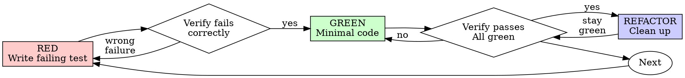

# Integrated Reference Bundle 04

Combines 12 related source skills from `testing-debugging-ci` into one navigable reference file.

## Source map

- `tdd-test-engineer/SKILL.reference.md`
- `test-driven-development/SKILL.reference.md`
- `testing/SKILL.reference.md`
- `testing/characterization-test-generator/SKILL.reference.md`
- `testing/coverage-ratchet/SKILL.reference.md`
- `testing/fitness-functions/SKILL.reference.md`
- `testing/flow-walkthrough/SKILL.reference.md`
- `testing/integration-test-scaffold/SKILL.reference.md`
- `testing/mutation-testing/SKILL.reference.md`
- `testing/snapshot-test-setup/SKILL.reference.md`
- `testing/tdd-bug-fix/SKILL.reference.md`
- `testing/tdd-feature/SKILL.reference.md`

## Integrated guidance

### Source: `tdd-test-engineer`

# TDD Test Engineer

Make behavior executable before changing implementation.

## Grok Build Mode

- Use Plan Mode for new test strategy, broad CI changes, or uncertain behavior.
- Use subagents for test work:
  - `behavior`: expected behavior and edge cases.
  - `fixtures`: setup/data/mocking strategy.
  - `failure`: reproduce current bug or CI failure.
  - `coverage`: missing test surfaces.
- Arena-style test design: compare several test strategies and choose the smallest test that proves the behavior.
- Human-in-the-loop: get approval before deleting or weakening tests.

## Workflow

1. Identify the behavior or bug.
2. Find existing test style and commands.
3. Write or propose a failing test first.
4. Run the narrow test and capture failure.
5. Implement the smallest fix.
6. Re-run the narrow test, then broader checks if cheap.
7. Summarize the regression protected.

## Test Quality Rules

- Prefer behavior assertions over implementation details.
- Avoid sleeps; use deterministic waiting or mocks.
- Keep fixtures small.
- Do not snapshot volatile output without normalization.
- Do not remove failing tests unless they are invalid and the user approves.

## Example Prompts

```text
Use tdd-test-engineer. Add a failing regression test for this bug before fixing it.
```

```text
Use subagents to inspect flaky test causes: timing, shared state, network, fixture leakage. Propose the smallest deterministic fix.
```

### Source: `test-driven-development`

# Test-Driven Development (TDD)

## Overview

Write the test first. Watch it fail. Write minimal code to pass.

**Core principle:** If you didn't watch the test fail, you don't know if it tests the right thing.

**Violating the letter of the rules is violating the spirit of the rules.**

## When to Use

**Always:**
- New features
- Bug fixes
- Refactoring
- Behavior changes

**Exceptions (ask your human partner):**
- Throwaway prototypes
- Generated code
- Configuration files

Thinking "skip TDD just this once"? Stop. That's rationalization.

## The Iron Law

```
NO PRODUCTION CODE WITHOUT A FAILING TEST FIRST
```

Write code before the test? Delete it. Start over.

**No exceptions:**
- Don't keep it as "reference"
- Don't "adapt" it while writing tests
- Don't look at it
- Delete means delete

Implement fresh from tests. Period.

## Red-Green-Refactor



### RED - Write Failing Test

Write one minimal test showing what should happen.

<Good>
```typescript
test('retries failed operations 3 times', async () => {
  let attempts = 0;
  const operation = () => {
    attempts++;
    if (attempts < 3) throw new Error('fail');
    return 'success';
  };

  const result = await retryOperation(operation);

  expect(result).toBe('success');
  expect(attempts).toBe(3);
});
```
Clear name, tests real behavior, one thing
</Good>

<Bad>
```typescript
test('retry works', async () => {
  const mock = jest.fn()
    .mockRejectedValueOnce(new Error())
    .mockRejectedValueOnce(new Error())
    .mockResolvedValueOnce('success');
  await retryOperation(mock);
  expect(mock).toHaveBeenCalledTimes(3);
});
```
Vague name, tests mock not code
</Bad>

**Requirements:**
- One behavior
- Clear name
- Real code (no mocks unless unavoidable)

### Verify RED - Watch It Fail

**MANDATORY. Never skip.**

```bash
npm test path/to/test.test.ts
```

Confirm:
- Test fails (not errors)
- Failure message is expected
- Fails because feature missing (not typos)

**Test passes?** You're testing existing behavior. Fix test.

**Test errors?** Fix error, re-run until it fails correctly.

### GREEN - Minimal Code

Write simplest code to pass the test.

<Good>
```typescript
async function retryOperation<T>(fn: () => Promise<T>): Promise<T> {
  for (let i = 0; i < 3; i++) {
    try {
      return await fn();
    } catch (e) {
      if (i === 2) throw e;
    }
  }
  throw new Error('unreachable');
}
```
Just enough to pass
</Good>

<Bad>
```typescript
async function retryOperation<T>(
  fn: () => Promise<T>,
  options?: {
    maxRetries?: number;
    backoff?: 'linear' | 'exponential';
    onRetry?: (attempt: number) => void;
  }
): Promise<T> {
  // YAGNI
}
```
Over-engineered
</Bad>

Don't add features, refactor other code, or "improve" beyond the test.

### Verify GREEN - Watch It Pass

**MANDATORY.**

```bash
npm test path/to/test.test.ts
```

Confirm:
- Test passes
- Other tests still pass
- Output pristine (no errors, warnings)

**Test fails?** Fix code, not test.

**Other tests fail?** Fix now.

**"Other tests" means the project's suite, not just your file.** A
green run of the test you wrote is not a green suite. Before you call
the change done, run the project's test command (bare `pytest`,
`npm test`, `cargo test` — whatever the repo uses) even when your task
named only one test file. A scope statement in your task bounds the
deliverable, not your verification. Any failure that run shows —
including one you didn't cause — goes in your report by name; a red
test you watched scroll past and didn't mention is a report falsified
by omission.

### REFACTOR - Clean Up

After green only:
- Remove duplication
- Improve names
- Extract helpers

Keep tests green. Don't add behavior.

### Repeat

Next failing test for next feature.

## Good Tests

| Quality | Good | Bad |
|---------|------|-----|
| **Minimal** | One thing. "and" in name? Split it. | `test('validates email and domain and whitespace')` |
| **Clear** | Name describes behavior | `test('test1')` |
| **Shows intent** | Demonstrates desired API | Obscures what code should do |

When writing or changing any test, read [writing-good-tests.md](writing-good-tests.md) for the rules that keep tests honest:
- Name the production change that would make the test fail — before writing it
- Assert on real behavior, never on mock behavior
- Keep test-only code in test utilities, out of production classes
- Understand a dependency's side effects before mocking it

## Common Rationalizations

| Excuse | Reality |
|--------|---------|
| "Too simple to test" | Simple code breaks. Test takes 30 seconds. |
| "I'll test after" | Tests written after pass immediately — which proves nothing. They may test the wrong thing, test the implementation instead of the behavior, or miss the edge case you forgot. You never watched it fail, so you never proved it can catch the bug. Test-first forces that failure. |
| "Tests after achieve same goals (spirit not ritual)" | Tests-after answer "what does this do?"; tests-first answer "what should this do?" Tests written after are biased by the code you already wrote — you verify the cases you remembered, not the ones you'd have discovered. Coverage without proof the tests work. |
| "Already manually tested" | Manual testing is ad-hoc: no record of what you covered, no way to re-run it when the code changes, easy to forget cases under pressure. "Worked when I tried it" ≠ comprehensive. Automated tests run the same way every time. |
| "Deleting X hours is wasteful" | Sunk cost fallacy — that time is already spent either way. The real choice: rewrite with TDD (high confidence) vs. keep it and bolt tests on after (low confidence, likely bugs). Keeping code you can't trust is the waste. |
| "Keep as reference, write tests first" | You'll adapt it. That's testing after. Delete means delete. |
| "Need to explore first" | Fine. Throw away exploration, start with TDD. |
| "Test hard = design unclear" | Listen to test. Hard to test = hard to use. |
| "TDD will slow me down" | TDD IS the pragmatic path: catches bugs before commit, prevents regressions, lets you refactor without fear. "Pragmatic" shortcuts mean debugging in production — slower, not faster. |
| "Manual test faster" | Manual doesn't prove edge cases. You'll re-test every change. |
| "Existing code has no tests" | You're improving it. Add tests for existing code. |

## Red Flags - STOP and Start Over

- Code before test
- Test after implementation
- Test passes immediately
- Can't explain why test failed
- Tests added "later"
- Rationalizing "just this once"
- "I already manually tested it"
- "Tests after achieve the same purpose"
- "It's about spirit not ritual"
- "Keep as reference" or "adapt existing code"
- "Already spent X hours, deleting is wasteful"
- "TDD is dogmatic, I'm being pragmatic"
- "This is different because..."

**All of these mean: Delete code. Start over with TDD.**

## Example: Bug Fix

**Bug:** Empty email accepted

**RED**
```typescript
test('rejects empty email', async () => {
  const result = await submitForm({ email: '' });
  expect(result.error).toBe('Email required');
});
```

**Verify RED**
```bash
$ npm test
FAIL: expected 'Email required', got undefined
```

**GREEN**
```typescript
function submitForm(data: FormData) {
  if (!data.email?.trim()) {
    return { error: 'Email required' };
  }
  // ...
}
```

**Verify GREEN**
```bash
$ npm test
PASS
```

**REFACTOR**
Extract validation for multiple fields if needed.

## Verification Checklist

Before marking work complete:

- [ ] Every new function/method has a test
- [ ] Watched each test fail before implementing
- [ ] Each test failed for expected reason (feature missing, not typo)
- [ ] Wrote minimal code to pass each test
- [ ] All tests pass
- [ ] Output pristine (no errors, warnings)
- [ ] Tests use real code (mocks only if unavoidable)
- [ ] Edge cases and errors covered

Can't check all boxes? You skipped TDD. Start over.

## When Stuck

| Problem | Solution |
|---------|----------|
| Don't know how to test | Write wished-for API. Write assertion first. Ask your human partner. |
| Test too complicated | Design too complicated. Simplify interface. |
| Must mock everything | Code too coupled. Use dependency injection. |
| Test setup huge | Extract helpers. Still complex? Simplify design. |

## Debugging Integration

Bug found? Write failing test reproducing it. Follow TDD cycle. Test proves fix and prevents regression.

Never fix bugs without a test.

## Final Rule

```
Production code → test exists and failed first
Otherwise → not TDD
```

No exceptions without your human partner's permission.

### Source: `testing`

# Testing & TDD Skills

Test-driven development workflows and testing infrastructure for Apple platform apps. Works with both new and existing codebases.

## When This Skill Activates

Use this skill when the user:
- Wants to do TDD (test-driven development) with AI-generated code
- Needs to add tests before refactoring existing code
- Wants to fix a bug using the red-green-refactor cycle
- Needs test infrastructure (factories, mocks, contracts)
- Asks about snapshot/visual regression testing
- Wants to ensure AI-generated code is correct via tests
- Wants deterministic gates around agent-written code (architecture invariants, coverage floors, mutation audits)

## Available Skills

### For Existing Codebases

**characterization-test-generator/**
Capture current behavior of existing code before refactoring. Generates tests that document what code actually does (not what it should do), giving you a safety net for AI-assisted refactoring.

**tdd-bug-fix/**
Reproduce-first bug fix workflow. Write a failing test that demonstrates the bug, then fix it. Ensures the bug never regresses — critical when AI generates fixes.

**tdd-refactor-guard/**
Pre-refactor safety checklist. Verifies test coverage exists before allowing AI to touch existing code. Prevents the "refactor without a safety net" problem.

### For New Code

**tdd-feature/**
Red-green-refactor scaffold for new features. Generates the failing test first, then guides implementation to make it pass, then refactors. The core TDD workflow.

**test-contract/**
Protocol/interface test suites. Define the contract (e.g., "any DataStore must handle empty state, single item, 100 items, and errors"), and it generates a test suite any implementation must pass.

### Infrastructure

**snapshot-test-setup/**
SwiftUI visual regression testing using swift-snapshot-testing. Generates snapshot test boilerplate, configuration, and CI integration.

**test-data-factory/**
Test fixture factories for your models. Makes writing tests faster by eliminating boilerplate data setup. Supports Builder pattern and static factory methods.

**integration-test-scaffold/**
Cross-module test harness with mock servers, in-memory stores, and test configuration. For testing networking + persistence + business logic together.

**flow-walkthrough/**
Drive each user flow in the Simulator (XCUITest + per-step screenshots), audit the navigation graph for dead-ends, and run a human discoverability check.

### Deterministic Gates

**fitness-functions/**
Architecture fitness functions — tests that enforce a project's hard rules (module import boundaries, offline guarantees, count/copy contracts) from inside its own test target. Turns prose constraints into exit codes.

**coverage-ratchet/**
Coverage floor that only rises: a committed baseline the app target's line coverage may never drop below, gated by a generated xccov script. Includes an advisory CRAP report (complexity × uncovered).

**mutation-testing/**
EXPERIMENTAL, advisory-only muter setup scoped to engine targets — surviving mutants reveal covered-but-unasserted code. Never a merge gate; includes the manual deliberate-break fallback.

## How to Use

1. Identify whether user is working on **new code** or **existing code**
2. Read the relevant skill's SKILL.md for detailed workflow
3. Detect project context (testing framework, architecture, existing tests)
4. Generate tests following the skill's workflow
5. Verify tests compile and run

## Relationship to test-generator

The `generators/test-generator/` skill generates test boilerplate (unit, integration, UI tests). These testing skills are complementary — they focus on **workflows and methodology** (TDD cycle, characterization testing, contracts) rather than just test file generation.

Cross-reference:
- Use `test-generator` for "add tests to this class"
- Use `testing/tdd-feature` for "I want to TDD this new feature"
- Use `testing/characterization-test-generator` for "I need to safely refactor this"
- Use `testing/tdd-bug-fix` for "fix this bug and make sure it never comes back"

### Source: `testing/characterization-test-generator`

# Characterization Test Generator

Generate tests that document what existing code **actually does** — not what it should do. These tests capture current behavior so you can refactor with confidence, especially when using AI to modify code.

## When This Skill Activates

Use this skill when the user:
- Says "I need to refactor this" or "help me refactor"
- Wants to "add tests before changing code"
- Asks for "characterization tests" or "golden master tests"
- Says "I want to safely modify this class/module"
- Mentions "legacy code" or "untested code"
- Wants AI to refactor but is worried about breaking things

## Why This Matters for AI-Generated Code

AI refactoring is powerful but risky:
- AI doesn't remember **why** code works a certain way
- AI may "improve" code and break subtle behavior
- Characterization tests freeze current behavior as a regression suite
- If any test fails after refactoring, you know something changed

## Process

### Phase 1: Discover Code Under Test

```
Glob: **/*.swift (in the target module)
Grep: "class |struct |enum |protocol |func " (public API surface)
```

Identify:
- [ ] Public types and their public methods
- [ ] Input types and return types
- [ ] Side effects (network, disk, UserDefaults, notifications)
- [ ] Dependencies (injected or created internally)
- [ ] State mutations (properties that change)

### Phase 2: Classify Behavior

For each public method, classify:

| Category | Example | Test Strategy |
|----------|---------|---------------|
| Pure computation | `calculate(a, b) -> c` | Input/output pairs |
| State mutation | `addItem(_:)` modifies array | Before/after state checks |
| Async operation | `fetchData() async -> [Item]` | Mock dependencies, verify results |
| Side effect | `save()` writes to disk | Verify mock was called |
| Event emission | `delegate?.didUpdate()` | Capture delegate calls |
| Error path | Throws on invalid input | Verify correct error type |

### Phase 3: Generate Tests

#### Test Naming Convention

Characterization tests should be clearly labeled:

```swift
import Testing
@testable import YourApp

@Suite("Characterization: ItemManager")
struct ItemManagerCharacterizationTests {
    // Tests document CURRENT behavior, not ideal behavior
}
```

#### Template: Pure Computation

```swift
@Test("current behavior: calculates total with tax")
func calculatesTotal() {
    let calculator = PriceCalculator()

    let result = calculator.total(subtotal: 100.0, taxRate: 0.08)

    // Document actual behavior — even if the rounding seems wrong
    #expect(result == 108.0)
}
```

#### Template: State Mutation

```swift
@Test("current behavior: addItem appends and sorts by date")
func addItemSortsbyDate() {
    let manager = ItemManager()
    let older = Item(title: "A", date: .distantPast)
    let newer = Item(title: "B", date: .now)

    manager.addItem(older)
    manager.addItem(newer)

    // Document actual ordering behavior
    #expect(manager.items.first?.title == "A")
    #expect(manager.items.last?.title == "B")
    #expect(manager.items.count == 2)
}
```

#### Template: Async with Dependencies

```swift
@Test("current behavior: loadItems returns cached data when offline")
func loadItemsOffline() async throws {
    let mockNetwork = MockNetworkClient(shouldFail: true)
    let mockCache = MockCache(items: [Item.sample])
    let service = ItemService(network: mockNetwork, cache: mockCache)

    let items = try await service.loadItems()

    // Document: falls back to cache when network fails
    #expect(items.count == 1)
    #expect(items.first?.title == Item.sample.title)
}
```

#### Template: Side Effects

```swift
@Test("current behavior: save writes to UserDefaults")
func saveWritesToDefaults() {
    let defaults = MockUserDefaults()
    let settings = SettingsManager(defaults: defaults)

    settings.setTheme(.dark)
    settings.save()

    // Document: saves as string, not as enum raw value
    #expect(defaults.lastSetValue as? String == "dark")
    #expect(defaults.lastSetKey == "app_theme")
}
```

#### Template: Error Paths

```swift
@Test("current behavior: throws on empty title")
func throwsOnEmptyTitle() {
    let validator = ItemValidator()

    #expect(throws: ValidationError.emptyField("title")) {
        try validator.validate(Item(title: "", date: .now))
    }
}
```

#### Template: Edge Cases

```swift
@Test("current behavior: handles nil optional gracefully")
func handlesNilOptional() {
    let parser = DataParser()

    let result = parser.parse(data: nil)

    // Document: returns empty array on nil, doesn't crash
    #expect(result.isEmpty)
}

@Test("current behavior: handles empty collection")
func handlesEmptyCollection() {
    let aggregator = StatsAggregator()

    let stats = aggregator.compute(values: [])

    // Document: returns zeroes, not NaN or crash
    #expect(stats.average == 0.0)
    #expect(stats.count == 0)
}
```

### Phase 4: Fill in Actual Values

This is the key step. For each test:

1. **Read the source code** to understand what the method actually returns
2. **Trace the logic** for the given inputs
3. **Write the assertion with the actual value**

```swift
// ❌ Wrong — this is what you WANT it to do
#expect(result == expectedCorrectValue)

// ✅ Right — this is what it ACTUALLY does
#expect(result == actualCurrentValue)  // Note: off-by-one, but current behavior
```

**Add comments for surprising behavior:**
```swift
// CHARACTERIZATION: This returns 11 not 10 due to inclusive range.
// Don't "fix" this until intentionally changing behavior.
#expect(range.count == 11)
```

### Phase 5: Verify and Lock

1. **Run all characterization tests** — they must ALL pass
2. **If any fail**, adjust assertions to match actual behavior
3. **Tag them:**

```swift
@Suite("Characterization: ItemManager")
@Tag(.characterization)
struct ItemManagerCharacterizationTests { ... }

// Define the tag
extension Tag {
    @Tag static var characterization: Self
}
```

4. **Run selectively:**
```bash
# Run only characterization tests
xcodebuild test -scheme YourApp \
  -only-testing "YourAppTests/ItemManagerCharacterizationTests"
```

## Output Format

```markdown
## Characterization Tests Generated

**Module**: [Module name]
**Classes tested**: [List]
**Tests generated**: [Count]

### Coverage Summary

| Class | Methods Covered | Edge Cases | Notes |
|-------|----------------|------------|-------|
| ItemManager | 5/7 | 3 | 2 private methods skipped |
| PriceCalculator | 3/3 | 2 | All public API covered |

### Files Created
- `Tests/CharacterizationTests/ItemManagerCharacterizationTests.swift`
- `Tests/CharacterizationTests/PriceCalculatorCharacterizationTests.swift`

### Surprising Behaviors Found
- `PriceCalculator.total()` rounds DOWN, not to nearest cent
- `ItemManager.sort()` is unstable — equal dates may reorder

### Ready to Refactor
All [X] characterization tests passing. Safe to refactor with AI.
Run `xcodebuild test` after each change to verify no behavior changed.
```

## When NOT to Use This

- Code is already well-tested (check coverage first)
- You're deleting the code entirely (no need to characterize)
- The code is trivially simple (single-line computed properties)
- You **want** to change the behavior (use `tdd-bug-fix` instead)

## References

- Michael Feathers, *Working Effectively with Legacy Code* — coined "characterization test"
- `generators/test-generator/` — for standard test generation (not characterization)
- `testing/tdd-refactor-guard/` — pre-refactor checklist that uses these tests

### Source: `testing/coverage-ratchet`

# Coverage Ratchet

A build/test gate proves the tests that exist pass. It says nothing about whether tests were *written* — a phase with no test task ships green on build success alone. The coverage ratchet closes that hole deterministically: line coverage is measured on every verify, compared against a committed baseline, and may never drop. It only rises.

## Why a Ratchet, Not a Target

An absolute threshold ("80%") fails one of two ways on a real codebase: it fails day one (so it gets disabled), or it gets set below current reality (so it gates nothing). A ratchet starts *from wherever the project actually is* and only tightens. Nobody argues with "don't get worse."

## When This Skill Activates

Use this skill when:
- A project has a test target but coverage has never been measured
- Agent-written features keep arriving with build-passing, test-free code
- Setting up the deterministic gauntlet (with `testing/fitness-functions/` and `swift/code-size/`)

## Setup

1. Copy `templates/coverage-gate.sh` into the project (e.g. `Scripts/coverage-gate.sh`), make it executable, and fill in the config block (scheme, destination, app target name).
2. Bootstrap the baseline:

```bash
Scripts/coverage-gate.sh --init     # runs tests with coverage, writes .coverage-baseline
```

3. Commit both the script and `.coverage-baseline`.

`.coverage-baseline` holds a single decimal fraction (e.g. `0.6231`) — the app target's line coverage. Trailing whitespace ignored; nothing else in the file.

## The Gate

```bash
Scripts/coverage-gate.sh            # exit 0 = pass, exit 1 = coverage dropped
```

- Runs the test suite with coverage enabled, extracts the app target's line coverage from the `xccov` JSON report.
- **Fails** if `current < baseline − 0.0025` (the epsilon absorbs measurement jitter from unchanged code).
- **Suggests a ratchet-up** when `current > baseline + 0.01`: update `.coverage-baseline` to the new number in the same commit as the tests that earned it. That's the ratchet clicking forward.
- Fails **loudly** on an unexpected report shape or a missing target — a broken measurement must never read as a pass.

Ratchet-up etiquette: raising the baseline is routine and encouraged; *lowering* it requires a written reason in the commit message (e.g. deleting a well-covered module) — treat it like widening a fitness-function allowlist.

## CRAP Report (Advisory)

`templates/crap-report.sh` combines per-function cyclomatic complexity (SwiftLint JSON output) with per-function coverage (the same xccov report) into the CRAP score — Change Risk Anti-Patterns:

```
CRAP(f) = complexity(f)² × (1 − coverage(f))³ + complexity(f)
```

A complex *and* untested function scores explosively; simple-and-tested stays near its complexity. The report prints the top 20 — the exact functions where a test is worth the most. **Advisory only, never a gate**: the name-join between the two tools is heuristic.

## Common Pitfalls

| Pitfall | Problem | Solution |
|---------|---------|----------|
| Absolute threshold on existing code | Fails day one or gates nothing | Ratchet from measured reality |
| Gating total project coverage | Test-target/generated code pollutes the number | Gate the app target's own lineCoverage |
| Silent pass on tool failure | Broken measurement reads as green | Script fails loudly on unexpected JSON |
| Chasing the number with assertion-free tests | Coverage without verification | Pair with mutation spot-checks (`testing/mutation-testing/`) |
| Never ratcheting up | Baseline fossilizes at day-one level | Raise it in the same commit as new tests |

## References

- `testing/mutation-testing/` — do the covering tests actually assert anything (advisory)
- `swift/code-size/` — the complexity half; small functions are coverable functions
- `testing/fitness-functions/` — architecture invariants as tests
- `generators/ci-cd-setup/` — CI wiring for the gate

### Source: `testing/fitness-functions`

# Architecture Fitness Functions

A fitness function is an ordinary test that enforces an architectural rule instead of a behavior. It lives in the app's own test target, runs under every existing test gate forever, and turns "the agent said it's fine" into an exit code. This is the gauntlet's answer for invariants no unit test of behavior can see: a file quietly importing a framework it must not touch, a registry drifting from its documented size, user-facing copy breaking its format contract.

## When This Skill Activates

Use this skill when:
- A project hard rule exists only in prose — CLAUDE.md constraints, file-header comments, review checklists ("deck games must run fully offline", "only the sync layer may import CloudKit")
- A code review keeps re-checking the same structural rule by hand
- An `/apple:review` structural finding is being graduated into permanent enforcement
- A count, boundary, or content format was broken silently once already

## Why a Test, Not a Lint Rule

A per-line regex (SwiftLint `custom_rules`) can flag a *line*. A fitness function can assert a *set*: "the files importing MusicKit are exactly these four", "the mode registry has exactly 21 entries", "every case's copy fits the format". Sets, counts, and cross-file facts need code, and putting that code in the test target means no new tooling, no CI wiring — it rides the `test` gate that already exists.

## The Three Patterns

### Pattern 1: Import-Boundary Allowlist Scan

Enforces "only these files may import X." The test walks the shipped source tree and compares the *actual* importer set against an allowlist — so a fifth importer fails a test, not a code review.

Key rules (learned in production):
- **Resolve the source root from `#filePath`**, never a hardcoded path — the test stays correct wherever the repo is checked out.
- **Match exact trimmed lines** (`line == "import X"`), not `contains` — comments documenting the contract itself must not count as hits.
- **Compare full sets, not counts** — the failure message then names the drifted file.
- **Exclude non-shipping directories deliberately** (DEBUG-only spikes, generated code) and say why in a comment: the guarantee is about what ships.
- **The allowlist is a fence, not a headcount.** Widening it is a legitimate, *documented* decision: when a new file genuinely belongs inside the boundary, the test failing is the system working — record why in the allowlist comment, then add it.
- **Add a companion API-surface scan** for bypass routes the import check can't see. An import-only check misses a file calling the underlying API directly (every file already imports Foundation, which is enough to reach `URLSession` without importing the fenced framework). Scan for the raw API strings (`URLSession(`, `URLSession.shared`) outside the boundary too.

Template: `templates/ImportBoundaryTests.swift`

### Pattern 2: Runtime Sentinel

Enforces "this code path never *attempts* X" — stronger than "happens to succeed without X." The canonical case is an offline guarantee: register a `URLProtocol` subclass that intercepts, counts, and fails every network request, drive the real production path, and assert the counter stayed at zero.

Key rules:
- Register the sentinel per-test and unregister in `defer`.
- The sentinel **fails** requests loudly (never lets them reach the network) — a regression fails in CI instead of silently succeeding against a live server.
- Assert `interceptedRequestCount == 0`: the contract is *zero attempts*, not zero successes.
- Drive the real path (real service, real composition), with only storage in-memory.

Template: `templates/NetworkSentinelTests.swift`

### Pattern 3: Contract Pins

Pins facts that must change *deliberately*, never by drift.

**Count pins** — registry and configuration sizes:

```swift
// Phase 3.5 added 3 modes — 9 modes, 5 streaming.
// Phase 3.8 added the four reunion music games — 15 modes, 9 streaming.
// Phase 3.10 added the DJ-host quartet — 18 modes, 10 streaming.
#expect(PartyOccasion.bigParty.modes.count == 18)
#expect(PartyOccasion.bigParty.modes.filter(\.usesDJEngine).count == 10)
```

The comment trail is mandatory: each pinned number carries its history, so updating the pin is a reviewed decision with a written reason, not a chore silenced with an edit.

**Copy-contract pins** — structural rules on user-facing content, iterated over `CaseIterable` so new cases are covered automatically:

```swift
@Test func everyModeHasExactlyThreeBeats() {
    for mode in GameMode.allCases {
        #expect(mode.howItPlaysBeats.count == 3, "\(mode.rawValue) has \(mode.howItPlaysBeats.count) beats, expected 3")
    }
}
```

Plus a few **verbatim exemplars** pinned with exact equality — a future content pass must change those deliberately, not by accident.

Template: `templates/ContractPinTests.swift`

## Process

### Phase 1: Identify the Invariant

Read CLAUDE.md / APP.md / file-header comments for hard rules currently enforced by nothing. Good candidates state a *set or bound*: "only", "never", "exactly", "at most", "every".

### Phase 2: Pick the Pattern

| The rule is about… | Pattern |
|---|---|
| Which files may use a framework/API | 1 — import-boundary scan (+ API-surface companion) |
| What a code path may *do* at runtime | 2 — runtime sentinel |
| A size, format, or exact content | 3 — contract pins |

### Phase 3: Write the Suite

Copy the matching template into the existing unit-test target and adapt. One suite per invariant; name it after the guarantee (`OfflineGuaranteeTests`), not the mechanism. Every failure message must tell the fixer **which side to change** — the code or the contract — and where the contract is documented.

### Phase 4: Prove It Red (Deliberate-Break Drill)

A fitness function that has never failed is unverified. Before committing:

1. Introduce the violation for real (add the forbidden import to one file; change a pinned count).
2. Run the suite — it MUST fail, with a message that names the offender.
3. Revert. Run again — green.

Record the red/green pair in the commit message or PR. Repeat the drill whenever the suite's scanning logic (not its data) changes.

### Phase 5: Commit

The suite ships in the normal test target. No special CI wiring — every existing `test` gate now enforces the rule.

## Output Format

```markdown
## Fitness Function: [invariant]

- **Rule source**: CLAUDE.md hard rule N / [file header]
- **Pattern**: import-boundary | runtime sentinel | contract pin
- **Suite**: Tests/[Name]Tests.swift
- **Deliberate-break drill**: [what was broken] → failed with "[message]" → reverted → green
```

## Common Pitfalls

| Pitfall | Problem | Solution |
|---------|---------|----------|
| `contains("import X")` matching | Comments about the rule count as violations | Compare exact trimmed lines |
| Hardcoded source paths | Breaks on other checkouts/CI | Derive root from `#filePath` |
| Pinning counts without history | Updating the pin becomes a mindless chore | Comment trail explaining every number |
| Import check only | Direct API calls bypass the fence | Add the API-surface companion scan |
| Never proven red | Scan bug silently passes everything | Deliberate-break drill before commit |
| Allowlist grows without comment | Fence decays into a headcount | Each entry documents why it's inside the boundary |

## References

- `testing/tdd-bug-fix/` — prove-red discipline for behavioral bugs
- `testing/test-contract/` — runtime behavioral invariants across implementations
- `swift/code-size/` — the complexity/size half of the deterministic gauntlet
- `testing/coverage-ratchet/` — coverage floor that only rises

### Source: `testing/flow-walkthrough`

# Flow Walkthrough Skill

Task lists, compilers, and code review verify that *screens exist and compile*. They are structurally blind to whether the **flow between screens actually works for a human with a goal** — the transitions, the return paths, the dead-ends, the discoverability. This skill closes that gap.

## Why this exists (the three failure classes)

Real UX bugs fail at three different layers, and **no single mechanism catches all three** — so this skill uses three:

| Failure class | Example | Caught by |
|---|---|---|
| **Dead-end / missing path** | A saved record can only be *viewed*, never reopened to edit; `Done` calls `popToRoot()` and orphans an in-progress entity | **Layer 1** — static nav-graph audit (no build) |
| **Reachability regression** | "Run round" no longer reaches the capture screen after a refactor; a `Done` lands on the wrong screen | **Layer 2** — automated flow driving (XCUITest) |
| **Discoverability** | "How do I even select a contestant?" — the only affordance is a bare row tap | **Layer 3** — human checklist (a UI test taps the row and *passes*) |

> The trap: a UI test happily taps a hidden control and reports PASS. Automation proves a path *works*; only a human judges whether it is *findable*. That residue is why Layer 3 is mandatory, not optional.

## Input: the `<flows>` from PLAN.md

`/apple:plan` emits a `<flows>` block — end-to-end journeys, each a testable script. If `PLAN.md` has no `<flows>`, derive them from the phase's `<mvp-features>`/views and **write them back into PLAN.md first** (a flow that isn't written down can't be checked). A good flow names, for every persisted entity created: the step that **reopens it editable**, and the single **least-discoverable action**.

## The method

### Layer 1 — Static navigation-graph audit (no build required)

Grep the navigation surface and reason over it. Do this first; it's free and catches the highest-severity class.

1. **Build the graph.** Find entry points and edges:
   - `Grep`: `NavigationStack`, `navigationDestination`, `NavigationLink`, `\.sheet`, `\.fullScreenCover`, `router.push`, `enum Route`, `dismiss()`, `popToRoot`, `@Query`.
2. **Assert reachability & return paths.** For every screen: how do you get in, and does every `Done`/`Back`/`dismiss` land somewhere intentional? Flag any `popToRoot()` that discards an in-progress or just-saved entity.
3. **CRUD-completeness.** For every `@Model` with a **Create** path, is there a **Read** *and* an **Update/reopen** path from the persistence surface (a list/history)? A list that only opens a read-only detail is a dead-end for editing — flag it.
4. **Entry-point sanity.** Does "New X" always create a *fresh* entity with no way back to the previous one except an incomplete list? Flag create-only loops.
5. **Nested navigation containers.** For every `NavigationLink`/`navigationDestination` destination, check whether the destination view declares its own `NavigationView`/`NavigationStack` — a pushed view must never wrap one. This renders a second nav bar under the parent's and its leading bar items displace the back button. It's a cross-file bug: each file looks correct alone (and previews fine in isolation), so single-file review never catches it — only this pairwise check does.

Output each finding as `DEAD-END` / `NO-EDIT-PATH` / `ORPHANS-ENTITY` / `NESTED-NAV` with the file:line and the missing arrow.

### Layer 2 — Automated flow driving (XCUITest + per-step screenshots)

Turn each `<flow>` into a UI test that taps through it and screenshots every step, so the agent can *see* the transitions and assert the destinations.

1. **Ensure a UITest target exists.** If none, add one (xcodegen: a `type: bundle.ui-testing` target; or `xcodebuild`). Keep the generated tests — they become the Phase 5 regression suite.
2. **Generate one test method per flow** from `<steps>`. After each step, attach a screenshot:
   ```swift
   func snap(_ name: String) {
       let s = XCTAttachment(screenshot: XCUIScreen.main.screenshot())
       s.name = name; s.lifetime = .keepAlways; add(s)
   }
   ```
   Launch with any needed args (e.g. a `-uiTestSeed` launch argument that seeds SwiftData and, in DEBUG, flips entitlement flags so gated flows are reachable without a real purchase). Assert the **destination** of each step (`XCTAssert(app.staticTexts["Results"].waitForExistence(timeout: 2))`), especially after `Done`/`Back` — that is what catches wrong-destination bugs.
3. **Run and extract:**
   ```bash
   xcodebuild test -project <App>.xcodeproj -scheme <App> \
     -destination 'platform=iOS Simulator,name=<device>' \
     -resultBundlePath .planning/walkthrough/<flowId>.xcresult
   # export per-step screenshots for the agent to read:
   xcrun xcresulttool export attachments \
     --path .planning/walkthrough/<flowId>.xcresult \
     --output-path .planning/walkthrough/<flowId>/   # adapt flag to installed Xcode
   ```
   (The `xcresulttool` attachment-export subcommand name shifts across Xcode versions — check `xcrun xcresulttool --help` and adapt.)
4. **Read the screenshots** in order → a "filmstrip." Confirm each step lands where the flow says it should. A failed assertion or a wrong screen = a flow bug with visual proof.
5. **One unseeded pass (fresh-install reality).** Every seeded run hides zero states — run at least one pass with NO seed argument that visits each top-level screen and screenshots it, in light mode. Assert each zero state renders something intentional (an empty-state view, a hint), not a blank expanse. A user's first launch is unseeded; if every automated capture is seeded, blank first-run screens ship unseen.

### Layer 3 — Human discoverability pass (the irreducible residue)

For each flow, emit a short script the human runs and rates — this is the only thing that catches "I couldn't find how to do X":

```
Flow F1 — Run a contest (as a host)
  1. Tap "Start a Contest"        → were you sure what to tap? (1–5)
  2. Add two contestants          → was adding the *second* obvious? (1–5)
  3. Run each contestant's round  → did you know rows were tappable? (1–5)
  4. Done on results              → did you land back where you expected? (Y/N)
  Where did you hesitate? ______
```

Keep it to the 2–4 flows that matter; ask for a hesitation note, not just scores — the note is where the real bug hides.

## Output: `.planning/WALKTHROUGH.md`

```markdown
# Flow Walkthrough — Phase [N]

## Layer 1 — Navigation graph (static)
- 🔴 NO-EDIT-PATH: ContestHistoryView:19 opens read-only ResultsView; a saved Contest can't be reopened to edit. → route to editable setup.
- 🔴 ORPHANS-ENTITY: ResultsView "Done" calls router.popToRoot() → dumps user home, loses the contest. → dismiss() one level.

## Layer 2 — Driven flows (filmstrips in ./walkthrough/)
| Flow | Result | Note |
|------|--------|------|
| F1 create→run→results→reopen | ❌ DEAD-END at step 6 | reopen lands on read-only results |
| F2 add second contestant | ✅ reaches capture | |

## Layer 3 — Human discoverability checklist
[the per-flow scripts above, for the user to fill in]

## Verdict
[N] dead-ends (fix before phase-complete), [N] reachability failures, discoverability pending human pass.
```

Store screenshots under `.planning/walkthrough/<flowId>/`. Fix all Layer-1 dead-ends and Layer-2 failures before the phase is marked complete (same gate discipline as visual-qa).

## Honest limits
- **Tests can't judge feel or findability.** A green Layer-2 run with an unrated Layer-3 checklist is *not* a pass.
- **Seeding is required for gated/late-state flows.** Provide a DEBUG `-uiTestSeed` path (insert sample models, set entitlement flags) so reopen/edit/results flows are reachable without manually rebuilding state each run. Remove or guard it behind the launch arg so it never affects release.
- **Discoverability findings are design changes,** not bugs to "fix in code" blindly — surface them, let the human decide.

## Cadence & integration
- **Run per flow-slice, not per-phase.** Right after you build the create→edit→results loop, walk *that* loop — don't wait for the whole phase. Bugs are cheapest the minute they're introduced.
- **Complements, doesn't replace, `visual-qa`** (which is static/code-level: colors, touch targets, view states). This skill is about *flow*, that one is about *screens*.
- **Feeds Phase 5.** The generated XCUITests are kept as the regression suite; hand them to `testing/tdd-feature`/`test-spec` rather than re-writing.
- **Pairs with a nav-graph review lens.** If `/apple:review` gains a flow/dead-end agent, Layer 1 can run there too; this skill is the runnable, screenshot-producing counterpart.
```

### Source: `testing/integration-test-scaffold`

# Integration Test Scaffold

Generate test infrastructure for testing multiple modules working together — networking + persistence + business logic — without hitting real servers or databases.

## When This Skill Activates

Use this skill when the user:
- Wants to "test the full stack" or "integration test"
- Needs a mock server or mock API
- Wants to test networking + caching together
- Asks about "end-to-end tests without real servers"
- Needs to test data flow across layers (API → Repository → ViewModel)
- Mentions "test harness" or "test environment"

## Why Integration Tests

```
Unit tests:         Test ONE thing in isolation (fast, focused)
Integration tests:  Test MULTIPLE things together (realistic, catches wiring bugs)

Unit test passes:   PriceCalculator works alone ✅
Integration test:   PriceCalculator + API + Cache work together ✅
                    (Catches: wrong data format, missing mapping, race conditions)
```

## Process

### Phase 1: Map the Integration Boundaries

Identify what modules interact:

```
Grep: "import |@testable import" to find module dependencies
Read: source files to understand data flow
```

Common integration boundaries:
- **Network → Parser → Repository** (API data flow)
- **Repository → ViewModel → View** (UI data flow)
- **UserAction → Service → Storage → Notification** (write flow)

### Phase 2: Configuration Questions

Ask via AskUserQuestion:

1. **What layers to integrate?**
   - Network + Repository
   - Repository + ViewModel
   - Full stack (Network → ViewModel)
   - Custom combination

2. **Mock strategy?**
   - URLProtocol-based mock server (intercepts real URLSession)
   - Protocol-based mock (swap implementation)
   - In-memory database (SwiftData/CoreData)

### Phase 3: Generate Mock Server

#### URLProtocol Mock Server

```swift
// Tests/Infrastructure/MockURLProtocol.swift

final class MockURLProtocol: URLProtocol {
    /// Map of URL path → (status code, response data)
    static var mockResponses: [String: (Int, Data)] = [:]
    /// Captured requests for verification
    static var capturedRequests: [URLRequest] = []
    /// Simulated delay
    static var responseDelay: TimeInterval = 0

    static func reset() {
        mockResponses = [:]
        capturedRequests = []
        responseDelay = 0
    }

    override class func canInit(with request: URLRequest) -> Bool {
        true  // Intercept all requests
    }

    override class func canonicalRequest(for request: URLRequest) -> URLRequest {
        request
    }

    override func startLoading() {
        Self.capturedRequests.append(request)

        let path = request.url?.path ?? ""
        let (statusCode, data) = Self.mockResponses[path] ?? (404, Data())

        let response = HTTPURLResponse(
            url: request.url!,
            statusCode: statusCode,
            httpVersion: nil,
            headerFields: ["Content-Type": "application/json"]
        )!

        if Self.responseDelay > 0 {
            Thread.sleep(forTimeInterval: Self.responseDelay)
        }

        client?.urlProtocol(self, didReceive: response, cacheStoragePolicy: .notAllowed)
        client?.urlProtocol(self, didLoad: data)
        client?.urlProtocolDidFinishLoading(self)
    }

    override func stopLoading() {}
}
```

#### Mock Server Helper

```swift
// Tests/Infrastructure/MockServer.swift

struct MockServer {
    /// Register a successful JSON response for a path
    static func respondWith<T: Encodable>(
        _ value: T,
        for path: String,
        statusCode: Int = 200
    ) {
        let data = try! JSONEncoder().encode(value)
        MockURLProtocol.mockResponses[path] = (statusCode, data)
    }

    /// Register a raw data response
    static func respondWith(
        data: Data,
        for path: String,
        statusCode: Int = 200
    ) {
        MockURLProtocol.mockResponses[path] = (statusCode, data)
    }

    /// Register an error response
    static func respondWithError(
        for path: String,
        statusCode: Int = 500
    ) {
        let error = ["error": "Server Error"]
        let data = try! JSONEncoder().encode(error)
        MockURLProtocol.mockResponses[path] = (statusCode, data)
    }

    /// Create a URLSession configured to use mock responses
    static func session() -> URLSession {
        let config = URLSessionConfiguration.ephemeral
        config.protocolClasses = [MockURLProtocol.self]
        return URLSession(configuration: config)
    }
}
```

### Phase 4: Generate In-Memory Store

#### SwiftData In-Memory

```swift
// Tests/Infrastructure/InMemoryModelContainer.swift

import SwiftData

enum TestModelContainer {
    @MainActor
    static func create(for types: any PersistentModel.Type...) -> ModelContainer {
        let schema = Schema(types)
        let config = ModelConfiguration(isStoredInMemoryOnly: true)
        return try! ModelContainer(for: schema, configurations: config)
    }
}

// Usage in tests:
@Test("saves and fetches items")
@MainActor
func savesAndFetches() async throws {
    let container = TestModelContainer.create(for: Item.self)
    let context = container.mainContext

    let item = Item(title: "Test")
    context.insert(item)
    try context.save()

    let fetched = try context.fetch(FetchDescriptor<Item>())
    #expect(fetched.count == 1)
}
```

#### UserDefaults In-Memory

```swift
// Tests/Infrastructure/MockUserDefaults.swift

final class MockUserDefaults: UserDefaults {
    private var storage: [String: Any] = [:]

    override func object(forKey defaultName: String) -> Any? {
        storage[defaultName]
    }

    override func set(_ value: Any?, forKey defaultName: String) {
        storage[defaultName] = value
    }

    override func removeObject(forKey defaultName: String) {
        storage.removeValue(forKey: defaultName)
    }

    override func bool(forKey defaultName: String) -> Bool {
        storage[defaultName] as? Bool ?? false
    }

    override func string(forKey defaultName: String) -> String? {
        storage[defaultName] as? String
    }

    func reset() {
        storage.removeAll()
    }
}
```

### Phase 5: Generate Test Environment

#### Dependency Container for Tests

```swift
// Tests/Infrastructure/TestEnvironment.swift

@testable import YourApp

struct TestEnvironment {
    let session: URLSession
    let container: ModelContainer
    let defaults: MockUserDefaults
    let apiClient: APIClient
    let repository: ItemRepository
    let viewModel: ItemListViewModel

    @MainActor
    static func create() -> TestEnvironment {
        let session = MockServer.session()
        let container = TestModelContainer.create(for: Item.self)
        let defaults = MockUserDefaults()

        let apiClient = APIClient(session: session)
        let repository = ItemRepository(
            apiClient: apiClient,
            modelContext: container.mainContext
        )
        let viewModel = ItemListViewModel(repository: repository)

        return TestEnvironment(
            session: session,
            container: container,
            defaults: defaults,
            apiClient: apiClient,
            repository: repository,
            viewModel: viewModel
        )
    }
}
```

### Phase 6: Generate Integration Tests

#### Full Stack Test: API → Repository → ViewModel

```swift
import Testing
import SwiftData
@testable import YourApp

@Suite("Integration: Item Data Flow")
struct ItemDataFlowIntegrationTests {

    @Test("fetches items from API and displays in ViewModel")
    @MainActor
    func fetchAndDisplay() async throws {
        // Arrange
        MockURLProtocol.reset()
        let env = TestEnvironment.create()
        let items = [
            APIItem(id: "1", title: "First", description: "Desc 1"),
            APIItem(id: "2", title: "Second", description: "Desc 2")
        ]
        MockServer.respondWith(items, for: "/api/items")

        // Act
        await env.viewModel.loadItems()

        // Assert — verify end-to-end
        #expect(env.viewModel.items.count == 2)
        #expect(env.viewModel.items.first?.title == "First")
        #expect(env.viewModel.state == .loaded)
    }

    @Test("caches items and serves from cache when offline")
    @MainActor
    func cacheAndOffline() async throws {
        MockURLProtocol.reset()
        let env = TestEnvironment.create()

        // First load — from API
        MockServer.respondWith([APIItem(id: "1", title: "Cached")], for: "/api/items")
        await env.viewModel.loadItems()
        #expect(env.viewModel.items.count == 1)

        // Second load — API fails, should use cache
        MockServer.respondWithError(for: "/api/items")
        await env.viewModel.loadItems()
        #expect(env.viewModel.items.count == 1)
        #expect(env.viewModel.items.first?.title == "Cached")
    }

    @Test("saves item through full stack")
    @MainActor
    func saveFullStack() async throws {
        MockURLProtocol.reset()
        let env = TestEnvironment.create()
        MockServer.respondWith(APIItem(id: "new", title: "New Item"), for: "/api/items")

        // Act
        try await env.viewModel.addItem(title: "New Item")

        // Assert — saved to local store
        let descriptor = FetchDescriptor<Item>()
        let stored = try env.container.mainContext.fetch(descriptor)
        #expect(stored.count == 1)

        // Assert — API was called
        let postRequests = MockURLProtocol.capturedRequests.filter { $0.httpMethod == "POST" }
        #expect(postRequests.count == 1)
    }

    @Test("handles API error gracefully")
    @MainActor
    func apiErrorGraceful() async throws {
        MockURLProtocol.reset()
        let env = TestEnvironment.create()
        MockServer.respondWithError(for: "/api/items", statusCode: 500)

        await env.viewModel.loadItems()

        #expect(env.viewModel.state == .error)
        #expect(env.viewModel.items.isEmpty)
    }
}
```

#### Request Verification Tests

```swift
@Suite("Integration: API Request Formation")
struct APIRequestFormationTests {

    @Test("sends correct headers")
    @MainActor
    func correctHeaders() async throws {
        MockURLProtocol.reset()
        let env = TestEnvironment.create()
        MockServer.respondWith([APIItem](), for: "/api/items")

        await env.viewModel.loadItems()

        let request = MockURLProtocol.capturedRequests.first
        #expect(request?.value(forHTTPHeaderField: "Content-Type") == "application/json")
        #expect(request?.value(forHTTPHeaderField: "Accept") == "application/json")
    }

    @Test("includes auth token in request")
    @MainActor
    func authToken() async throws {
        MockURLProtocol.reset()
        let env = TestEnvironment.create()
        env.defaults.set("test-token", forKey: "auth_token")
        MockServer.respondWith([APIItem](), for: "/api/items")

        await env.viewModel.loadItems()

        let request = MockURLProtocol.capturedRequests.first
        #expect(request?.value(forHTTPHeaderField: "Authorization") == "Bearer test-token")
    }
}
```

## File Structure

```
Tests/
├── Infrastructure/           # Shared test infrastructure
│   ├── MockURLProtocol.swift
│   ├── MockServer.swift
│   ├── TestModelContainer.swift
│   ├── MockUserDefaults.swift
│   └── TestEnvironment.swift
├── IntegrationTests/         # Integration test suites
│   ├── ItemDataFlowTests.swift
│   ├── AuthFlowTests.swift
│   └── SyncFlowTests.swift
├── Factories/                # Test data (from test-data-factory)
│   └── ...
└── UnitTests/                # Unit tests (from test-generator)
    └── ...
```

## Output Format

```markdown
## Integration Test Scaffold

### Infrastructure Created
| Component | File | Purpose |
|-----------|------|---------|
| Mock Server | MockURLProtocol.swift | Intercepts URLSession |
| Server Helper | MockServer.swift | Register mock responses |
| In-Memory Store | TestModelContainer.swift | SwiftData in-memory |
| Mock Defaults | MockUserDefaults.swift | UserDefaults substitute |
| Test Environment | TestEnvironment.swift | Wires everything together |

### Integration Tests Generated
| Test Suite | Tests | Layers Covered |
|-----------|-------|---------------|
| ItemDataFlowTests | 4 | API → Repo → VM |
| AuthFlowTests | 3 | Auth → API → Keychain |

### Verified Scenarios
- [x] Happy path: fetch → cache → display
- [x] Offline: cache fallback when API fails
- [x] Write: save through full stack
- [x] Error: graceful degradation on server error
- [x] Request: correct headers and auth tokens
```

## References

- `testing/test-data-factory/` — factories used in integration tests
- `testing/test-contract/` — protocol contracts tested at integration level
- `generators/networking-layer/` — networking code being tested
- `generators/persistence-setup/` — persistence code being tested

### Source: `testing/mutation-testing`

# Mutation Testing (Experimental)

**Status: EXPERIMENTAL — advisory report only. Never wire this as a merge gate.**

Coverage proves a line *ran* under test; mutation testing proves a test would *notice if the line were wrong*. Muter mutates the source (flips `>` to `<`, `&&` to `||`, deletes statements), reruns the suite per mutant, and reports the mutants that **survived** — code that is covered but effectively unasserted. It is the truest answer to "did the agent write real tests or coverage theater," and also the slowest and most fragile tool in the gauntlet, which is why it stays advisory.

## When This Skill Activates

Use this skill when:
- Coverage is healthy but bugs still slip through covered code
- Auditing agent-written test suites for assertion-free tests
- A periodic (nightly/weekly) quality audit of engine/logic targets

Do NOT use as a per-commit or merge-blocking check — a full mutation run multiplies the suite's runtime by the mutant count.

## Setup

1. Install muter and confirm it runs against the current Xcode before investing further:

```bash
brew install muter-mutation-testing/formulae/muter
muter --version
```

2. Copy `templates/muter.conf.yml` to the repo root as `muter.conf.yml` and scope it (see below).
3. First run:

```bash
muter run    # writes an HTML/console report of surviving mutants
```

## Scoping: Engines Only

Mutation-test the code where logic density is highest and the suite claims real coverage — engine/store/service types. Exclude UI, generated code, and test files: mutating a SwiftUI `body` mostly produces noise, and every excluded file cuts the runtime multiplier.

```yaml
mutateSourcesInDirectories:
  - App/Engines
  - App/Stores
excludeList:
  - "*View.swift"
  - "*Preview*"
```

## Reading the Report

- **Killed mutant** — a test failed: the suite genuinely asserts this behavior.
- **Survived mutant** — every test passed with the code broken: coverage without verification. Each survivor is a concrete, located prompt: *write the assertion that kills it*.
- Mutation score (killed ÷ total) is a trend number for the same scope over time; do not chase an absolute score.

## Caveats (Why This Stays Advisory)

- **Toolchain fragility**: muter rewrites source and drives xcodebuild; new Xcode releases can break it until the project catches up. Always verify a plain `muter run` completes on the current toolchain before trusting results.
- **Swift Testing detection**: muter's kill detection matured on XCTest. Verify it detects Swift Testing (`#expect`) failures in YOUR project: run one mutant cycle on a file whose suite you trust, and confirm survivors/kills match expectations.
- **Runtime**: suite time × mutants. Scope hard, run nightly or on demand.

## Deterministic Fallback: Manual Mutation Spot-Checks

When muter can't run (toolchain break, CI limits), the drill from `testing/fitness-functions/` scales down to single mutations by hand:

1. Pick a critical function; invert one condition (or return a constant).
2. Run its suite — a test MUST fail. If nothing fails, the suite has an assertion gap: write the missing test now.
3. Revert. Two or three spot-checks per engine per release is a meaningful audit.

## Common Pitfalls

| Pitfall | Problem | Solution |
|---------|---------|----------|
| Wiring as a merge gate | Runtime + fragility block everyone | Nightly/on-demand advisory report |
| Mutating the whole app | Hours of UI-noise mutants | Scope to engine/store directories |
| Chasing a score | Score varies with scope, not quality | Track survivors fixed, not the percentage |
| Trusting an unverified run | Kill detection may miss the test framework | Calibrate on a suite you trust first |

## References

- `testing/coverage-ratchet/` — the cheap proxy this tool audits
- `testing/fitness-functions/` — deliberate-break drill (the manual fallback)
- `testing/tdd-feature/` — writing the assertions that kill survivors

### Source: `testing/snapshot-test-setup`

# Snapshot Test Setup

Generate SwiftUI snapshot/visual regression tests using Point-Free's swift-snapshot-testing library. Catches unintended UI changes by comparing rendered views against reference images.

## When This Skill Activates

Use this skill when the user:
- Wants "snapshot tests" or "visual regression tests"
- Says "I want to catch UI regressions"
- Asks about "screenshot testing" or "preview testing"
- Wants to verify SwiftUI views don't change unexpectedly
- Mentions "swift-snapshot-testing" or "Point-Free"

## Why Snapshot Tests

```
Without snapshots:        With snapshots:
Change a modifier         Change a modifier
  → Looks fine locally      → Snapshot test fails
  → Push to main            → Shows exact visual diff
  → User reports UI bug     → Fix before merging
  → Embarrassing             → Confidence in UI changes
```

## Pre-Setup Checks

### 1. Project Context

```
Glob: **/Package.swift or **/*.xcodeproj
Grep: "swift-snapshot-testing" (already added?)
Grep: "SnapshotTesting" in test files
```

### 2. Configuration Questions

Ask via AskUserQuestion:

1. **Package manager?**
   - Swift Package Manager
   - CocoaPods
   - Tuist

2. **Platform?**
   - iOS
   - macOS
   - Both

3. **What to test?**
   - Specific views (user provides names)
   - All screens
   - Component library

## Setup Process

### Step 1: Add Dependency

#### Swift Package Manager

```swift
// Package.swift
dependencies: [
    .package(
        url: "https://github.com/pointfreeco/swift-snapshot-testing",
        from: "1.17.0"
    )
]

// Test target
.testTarget(
    name: "YourAppTests",
    dependencies: [
        "YourApp",
        .product(name: "SnapshotTesting", package: "swift-snapshot-testing")
    ]
)
```

#### Xcode Project

1. File → Add Package Dependencies
2. URL: `https://github.com/pointfreeco/swift-snapshot-testing`
3. Add `SnapshotTesting` to your test target

### Step 2: Create Snapshot Test Base

```swift
import Testing
import SnapshotTesting
import SwiftUI
@testable import YourApp

// MARK: - Snapshot Configuration

enum SnapshotConfig {
    // iOS devices to test
    static let iPhoneConfigs: [String: ViewImageConfig] = [
        "iPhone_SE": .iPhoneSe,
        "iPhone_16": .iPhone13,       // Similar dimensions
        "iPhone_16_Pro_Max": .iPhone13ProMax
    ]

    // macOS window sizes
    static let macOSConfigs: [String: CGSize] = [
        "compact": CGSize(width: 400, height: 600),
        "regular": CGSize(width: 800, height: 600),
        "wide": CGSize(width: 1200, height: 800)
    ]

    // Color schemes to test
    static let colorSchemes: [ColorScheme] = [.light, .dark]
}
```

### Step 3: Generate Snapshot Tests

#### iOS View Snapshot

```swift
@Suite("Snapshots: HomeView")
struct HomeViewSnapshotTests {

    // perceptualPrecision < 1.0 absorbs GPU/anti-aliasing noise across runs
    // on the same pinned simulator — 0.98 catches real layout/color changes
    // while ignoring sub-perceptual rendering jitter.
    @Test("matches reference - light mode")
    func lightMode() {
        let view = HomeView(items: Item.sampleList)

        assertSnapshot(
            of: UIHostingController(rootView: view),
            as: .image(on: .iPhone13, perceptualPrecision: 0.98)
        )
    }

    @Test("matches reference - dark mode")
    func darkMode() {
        let view = HomeView(items: Item.sampleList)
            .environment(\.colorScheme, .dark)

        assertSnapshot(
            of: UIHostingController(rootView: view),
            as: .image(on: .iPhone13, perceptualPrecision: 0.98)
        )
    }

    @Test("matches reference - empty state")
    func emptyState() {
        let view = HomeView(items: [])

        assertSnapshot(
            of: UIHostingController(rootView: view),
            as: .image(on: .iPhone13, perceptualPrecision: 0.98)
        )
    }

    @Test("matches reference - accessibility Dynamic Type")
    func dynamicTypeAccessibility() {
        let view = HomeView(items: Item.sampleList)
            .environment(\.dynamicTypeSize, .accessibility3)

        assertSnapshot(
            of: UIHostingController(rootView: view),
            as: .image(on: .iPhone13, perceptualPrecision: 0.98)
        )
    }
}
```

#### macOS View Snapshot

```swift
@Suite("Snapshots: SettingsView")
struct SettingsViewSnapshotTests {

    @Test("matches reference - standard size")
    func standardSize() {
        let view = SettingsView()
            .frame(width: 500, height: 400)

        assertSnapshot(
            of: NSHostingController(rootView: view),
            as: .image(size: CGSize(width: 500, height: 400))
        )
    }

    @Test("matches reference - dark mode")
    func darkMode() {
        let view = SettingsView()
            .frame(width: 500, height: 400)
            .environment(\.colorScheme, .dark)

        assertSnapshot(
            of: NSHostingController(rootView: view),
            as: .image(size: CGSize(width: 500, height: 400))
        )
    }
}
```

#### Component Snapshot (Reusable)

```swift
@Suite("Snapshots: ItemCard")
struct ItemCardSnapshotTests {

    @Test("default state")
    func defaultState() {
        let view = ItemCard(item: .sample)
            .frame(width: 300)

        assertSnapshot(of: view, as: .image)
    }

    @Test("selected state")
    func selectedState() {
        let view = ItemCard(item: .sample, isSelected: true)
            .frame(width: 300)

        assertSnapshot(of: view, as: .image)
    }

    @Test("long title wraps")
    func longTitle() {
        let item = Item(title: "This is a very long title that should wrap to multiple lines")
        let view = ItemCard(item: item)
            .frame(width: 300)

        assertSnapshot(of: view, as: .image)
    }
}
```

### Step 4: Recording Reference Images

First run records reference images (golden masters):

```bash
# Record all snapshots (first run)
xcodebuild test -scheme YourApp \
  -destination 'platform=iOS Simulator,name=iPhone 16'
```

Reference images land in `__Snapshots__/` directories next to test files:

```
Tests/SnapshotTests/
├── __Snapshots__/
│   └── HomeViewSnapshotTests/
│       ├── lightMode.1.png
│       ├── darkMode.1.png
│       ├── emptyState.1.png
│       └── dynamicTypeXXL.1.png
├── HomeViewSnapshotTests.swift
└── ItemCardSnapshotTests.swift
```

### Step 5: Re-record When Intentional Changes

When you intentionally change a view:

```swift
// Temporarily set record mode
@Test("matches reference - light mode")
func lightMode() {
    withSnapshotTesting(record: .all) {
        let view = HomeView(items: Item.sampleList)
        assertSnapshot(
            of: UIHostingController(rootView: view),
            as: .image(on: .iPhone13)
        )
    }
}
```

## Gate Wiring (the deterministic UI gate)

Snapshot suites are the UI half of the deterministic gauntlet (code half:
`testing/fitness-functions`, `swift/code-size`, `testing/coverage-ratchet`).
They use the same install trick as fitness functions: **they are ordinary
tests in the existing unit-test target**, so they ride every `test` gate that
already exists — no new CI plumbing to *run* them. What makes them a *gate*
rather than a capability:

- **A pixel diff is a FAIL, not a discussion.** SwiftShip's `<check
  type="snapshot">` runs the suite scoped to a task's touched screens
  (`-only-testing`); the phase does not close on a red diff.
- **The re-record ratchet.** `__Snapshots__/` baselines are committed;
  re-recording is a *stated decision* — the commit message says which screens
  changed and why. Record mode (`withSnapshotTesting(record: .all)`) is never
  committed enabled; a committed record-mode test asserts nothing.
- **Determinism guards.** Pin one simulator model/OS as the snapshot
  destination and document it in the suite header (baselines from other
  devices/OS versions will diff). Use `perceptualPrecision: 0.98`. Require a
  **double-run green** before committing new baselines — a suite that flakes
  between two identical runs is not a gate. OS/simulator bumps legitimately
  require re-records: that's a stated-intent event like any other.
- **New or changed screen ⇒ snapshot in the same task.** A view task without
  a snapshot for its touched screens leaves the gate blind exactly where the
  change happened.
- **Environment assembly:** reuse the project's preview harness (the struct
  its `#Preview`s already use to inject state/environment) rather than
  building a parallel one — the DEBUG-only harness is visible to test builds,
  and reuse keeps snapshots rendering exactly what previews render.

## What to Snapshot

### High Value (Always Snapshot)
- Screens with multiple states (empty, loaded, error), reusable components across configurations, light/dark mode, Dynamic Type at accessibility sizes

### Medium Value (Selectively Snapshot)
- Navigation flows (each step)
- Onboarding screens
- Paywall/subscription views
- Settings screens

### Low Value (Skip)
- Views that are 100% system components (plain List, NavigationStack)
- Views that change frequently during active development
- Views dependent on live data

## CI Integration

### GitHub Actions

```yaml
- name: Run Snapshot Tests
  run: |
    xcodebuild test \
      -scheme YourApp \
      -destination 'platform=iOS Simulator,name=iPhone 16,OS=18.0' \
      -only-testing "YourAppTests/Snapshots" \
      -resultBundlePath TestResults.xcresult

- name: Upload Failed Snapshots
  if: failure()
  uses: actions/upload-artifact@v4
  with:
    name: failed-snapshots
    path: "**/Failures/**"
```

### Xcode Cloud

```bash
# ci_scripts/ci_post_xcodebuild.sh
if [ "$CI_XCODEBUILD_ACTION" = "test" ]; then
    # Upload snapshot failures as artifacts
    if [ -d "$CI_DERIVED_DATA_PATH" ]; then
        find "$CI_DERIVED_DATA_PATH" -name "Failures" -type d \
            -exec cp -r {} "$CI_RESULT_BUNDLE_PATH/" \;
    fi
fi
```

## Output Format

```markdown
## Snapshot Tests Setup

### Dependency Added
swift-snapshot-testing 1.17.0 via SPM

### Tests Generated
| View | Configurations | Tests |
|------|---------------|-------|
| HomeView | light, dark, empty, XXL type | 4 |
| SettingsView | light, dark | 2 |
| ItemCard | default, selected, long title | 3 |
| **Total** | | **9** |

### Files Created
- `Tests/SnapshotTests/HomeViewSnapshotTests.swift`
- `Tests/SnapshotTests/SettingsViewSnapshotTests.swift`
- `Tests/SnapshotTests/ItemCardSnapshotTests.swift`

### Next Steps
1. Run tests once to record reference images
2. Commit `__Snapshots__/` directories to git
3. Add snapshot test step to CI pipeline
```

## References

- [swift-snapshot-testing](https://github.com/pointfreeco/swift-snapshot-testing)
- `generators/test-generator/` — for unit/integration test generation
- `testing/tdd-feature/` — for TDD workflow with UI features
- `testing/fitness-functions/` — the code half of the deterministic gauntlet (same ride-the-test-gate trick)

### Source: `testing/tdd-bug-fix`

# TDD Bug Fix

Fix bugs the right way: reproduce first, fix second, verify always. Especially critical when using AI to generate fixes — the test ensures the AI actually solved the problem.

## When This Skill Activates

Use this skill when the user:
- Reports a bug and wants it fixed
- Says "this is broken" or "this doesn't work"
- Asks to "fix and add a test" or "fix with TDD"
- Wants to ensure a bug doesn't come back
- Is skeptical of AI-generated fixes ("how do I know it's actually fixed?")

## Why TDD for Bug Fixes

```
Without TDD:           With TDD:
Bug reported           Bug reported
  → AI generates fix     → Write failing test (RED)
  → Deploy               → AI generates fix (GREEN)
  → Hope it works        → Test passes — confirmed fixed
  → Bug returns later    → Test prevents regression forever
```

## Process

### Phase 1: Understand the Bug

Gather information:

1. **What's the expected behavior?**
2. **What's the actual behavior?**
3. **Steps to reproduce?**
4. **Which code is involved?**

```
Grep: "[relevant keyword]" to find the source
Read: the suspected file(s)
```

Identify:
- [ ] The function/method where the bug lives
- [ ] The input that triggers the bug
- [ ] The incorrect output/behavior
- [ ] The correct expected output/behavior

### Phase 2: RED — Write the Failing Test

Write a test that **fails because of the bug**. This proves the bug exists.

#### Template: Logic Bug

```swift
import Testing
@testable import YourApp

@Suite("Bug Fix: [Brief description]")
struct BugFix_DescriptionTests {

    @Test("should [expected behavior] — was [actual behavior]")
    func reproduceBug() {
        // Arrange — set up the conditions that trigger the bug
        let calculator = PriceCalculator()

        // Act — perform the operation that's broken
        let result = calculator.applyDiscount(price: 100, percent: 50)

        // Assert — what it SHOULD return (this will FAIL now)
        #expect(result == 50.0)  // Currently returns 0.5 (bug: divides by 100 twice)
    }
}
```

#### Template: Async Bug

```swift
@Test("should return cached items when network fails — was crashing")
func reproduceBug() async throws {
    let mockNetwork = MockNetworkClient(shouldFail: true)
    let mockCache = MockCache(items: [.sample])
    let service = DataService(network: mockNetwork, cache: mockCache)

    // This should return cached data, but currently crashes
    let items = try await service.fetchItems()

    #expect(items.count == 1)
}
```

#### Template: State Bug

```swift
@Test("should update count after deletion — was showing stale count")
func reproduceBug() {
    let manager = ItemManager()
    manager.addItem(Item(title: "Test"))

    manager.deleteItem(at: 0)

    #expect(manager.count == 0)     // Currently still returns 1
    #expect(manager.items.isEmpty)  // Currently still contains item
}
```

#### Template: Edge Case Bug

```swift
@Test("should handle empty input — was crashing with index out of range")
func reproduceBug() {
    let parser = CSVParser()

    // This crashes with empty string
    let result = parser.parse("")

    #expect(result.rows.isEmpty)
    #expect(result.columns.isEmpty)
}
```

#### Template: UI State Bug

```swift
@Test("should show error state when API fails — was showing infinite spinner")
func reproduceBug() async {
    let failingAPI = MockAPI(shouldFail: true)
    let viewModel = ListViewModel(api: failingAPI)

    await viewModel.loadData()

    #expect(viewModel.state == .error)  // Currently stuck on .loading
    #expect(viewModel.isLoading == false)
}
```

**Run the test — it MUST fail.** If it passes, you haven't reproduced the bug.

```bash
xcodebuild test -scheme YourApp \
  -only-testing "YourAppTests/BugFix_DescriptionTests"
```

### Phase 3: GREEN — Fix the Bug

Now fix the code to make the test pass. The fix should be **minimal** — only change what's needed.

#### Fix Guidelines

- **Minimal, targeted fix** — change only what's needed; don't refactor or fix unrelated issues (file those separately)
- **AI should target the specific test** — give Claude the failing test as context

```
Prompt to Claude: "Here's a failing test that reproduces a bug.
Fix the source code to make this test pass without breaking
any existing tests."
```

**Run the test — it MUST pass now.**

```bash
# Run the bug fix test
xcodebuild test -scheme YourApp \
  -only-testing "YourAppTests/BugFix_DescriptionTests"

# Run ALL tests to check for regressions
xcodebuild test -scheme YourApp
```

### Phase 4: REFACTOR (Optional)

If the fix introduced duplication or the code could be cleaner:

1. **Refactor only with all tests passing**
2. **Run tests after each change**
3. **Keep the bug fix test** — it's now a permanent regression test

### Phase 5: Verify Completeness

Checklist before marking the bug as fixed:

- [ ] Failing test written that reproduces the bug
- [ ] Fix implemented — test now passes
- [ ] All existing tests still pass (no regressions)
- [ ] Edge cases covered (empty, nil, boundary values)
- [ ] Test is clearly named and documents the bug
- [ ] Fix is minimal — no unrelated changes

## Multiple Related Bugs

If a bug has multiple symptoms, write multiple tests:

```swift
@Suite("Bug Fix: Discount calculation errors")
struct BugFix_DiscountCalculationTests {

    @Test("50% discount on $100 should be $50")
    func fiftyPercentDiscount() {
        let calc = PriceCalculator()
        #expect(calc.applyDiscount(price: 100, percent: 50) == 50.0)
    }

    @Test("discount on $0 should return $0")
    func zeroPrice() {
        let calc = PriceCalculator()
        #expect(calc.applyDiscount(price: 0, percent: 50) == 0.0)
    }
}
```

## Output Format

```markdown
## Bug Fix: [Description]

### Bug Summary
- **Expected**: [What should happen]
- **Actual**: [What was happening]
- **Root cause**: [Why it was broken]

### Test (RED)
```swift
// Failing test that reproduces the bug
```

### Fix (GREEN)
**File**: `path/to/file.swift:XX`
```swift
// Before (buggy)
// After (fixed)
```

### Verification
- [x] Bug test fails before fix
- [x] Bug test passes after fix
- [x] All existing tests still pass
- [x] Edge cases covered: [list]

### Regression Prevention
Test added: `Tests/BugFixes/BugFix_DescriptionTests.swift`
This test will catch any future regression of this bug.
```

## Common Pitfalls

| Pitfall | Problem | Solution |
|---------|---------|----------|
| Test passes before fix | You didn't reproduce the bug | Make assertions more specific |
| Fix breaks other tests | Fix was too broad | Revert and use smaller, targeted change |
| Test is too specific | Brittle, breaks on unrelated changes | Test behavior, not implementation details |
| Skipping the red step | No proof the test catches the bug | Always verify test fails first |

## References

- `testing/tdd-feature/` — for new features (not bug fixes)
- `testing/characterization-test-generator/` — for capturing existing behavior first
- `generators/test-generator/` — for general test generation

### Source: `testing/tdd-feature`

# TDD Feature

Build new features using the red-green-refactor cycle. Tests define the spec, AI generates the implementation, tests verify correctness.

## When This Skill Activates

Use this skill when the user:
- Wants to "TDD a new feature" or "build test-first"
- Says "I want tests before code"
- Asks for "red-green-refactor" workflow
- Wants AI to generate code that's provably correct
- Is building a new module, service, or feature from scratch

## Why TDD for New Features with AI

```
Traditional:     AI generates code → You hope it's correct → Ship → Find bugs
TDD with AI:     You write tests (spec) → AI generates code to pass → Proven correct
```

The test is your **acceptance criteria in code form**. AI excels at going from failing test to passing implementation — it's a concrete, unambiguous target.

## Process

### Phase 1: Define the Feature

Before writing any code or tests, understand:

1. **What does this feature do?** (user story or requirement)
2. **What are the inputs?** (parameters, user actions, data)
3. **What are the outputs?** (return values, state changes, UI updates)
4. **What are the edge cases?** (empty, nil, error, boundary)
5. **What dependencies does it need?** (network, storage, other services)

### Phase 2: Design the API Surface

Sketch the public interface before writing tests:

```swift
// Example: Designing a FavoriteManager
protocol FavoriteManaging {
    func add(_ item: Item) async throws
    func remove(_ item: Item) async throws
    func isFavorite(_ item: Item) -> Bool
    var favorites: [Item] { get }
    var count: Int { get }
}
```

This doesn't need to compile yet — it's the contract you'll test against.

### Phase 3: RED — Write Failing Tests

Write tests for each behavior. Start with the simplest case and build up.

#### Order of Tests (Simple → Complex)

1. **Construction** — can you create the object?
2. **Happy path** — does the basic operation work?
3. **State verification** — does state update correctly?
4. **Edge cases** — empty, nil, boundaries
5. **Error handling** — what fails and how?
6. **Integration** — does it work with dependencies?

#### Template: Feature Test Suite

```swift
import Testing
@testable import YourApp

@Suite("FavoriteManager")
struct FavoriteManagerTests {

    // 1. Construction
    @Test("starts with empty favorites")
    func startsEmpty() {
        let manager = FavoriteManager()
        #expect(manager.favorites.isEmpty)
        #expect(manager.count == 0)
    }

    // 2. Happy path
    @Test("can add a favorite")
    func addFavorite() async throws {
        let manager = FavoriteManager()
        let item = Item(id: "1", title: "Test")

        try await manager.add(item)

        #expect(manager.count == 1)
        #expect(manager.isFavorite(item))
    }

    // 3. State verification
    @Test("can remove a favorite")
    func removeFavorite() async throws {
        let manager = FavoriteManager()
        let item = Item(id: "1", title: "Test")
        try await manager.add(item)

        try await manager.remove(item)

        #expect(manager.count == 0)
        #expect(!manager.isFavorite(item))
    }

    // 4. Edge cases
    @Test("adding duplicate does not increase count")
    func addDuplicate() async throws {
        let manager = FavoriteManager()
        let item = Item(id: "1", title: "Test")

        try await manager.add(item)
        try await manager.add(item)

        #expect(manager.count == 1)
    }

    @Test("removing non-existent item does nothing")
    func removeNonExistent() async throws {
        let manager = FavoriteManager()
        let item = Item(id: "1", title: "Test")

        try await manager.remove(item)

        #expect(manager.count == 0)
    }

    // 5. Error handling
    @Test("throws when storage is full")
    func storageFullError() async {
        let manager = FavoriteManager(maxCapacity: 2)
        let items = (1...3).map { Item(id: "\($0)", title: "Item \($0)") }

        await #expect(throws: FavoriteError.capacityExceeded) {
            for item in items {
                try await manager.add(item)
            }
        }
    }

    // 6. Ordering
    @Test("favorites are in insertion order")
    func insertionOrder() async throws {
        let manager = FavoriteManager()
        let items = ["C", "A", "B"].map { Item(id: $0, title: $0) }

        for item in items {
            try await manager.add(item)
        }

        #expect(manager.favorites.map(\.title) == ["C", "A", "B"])
    }
}
```

**Run tests — they should ALL fail** (the type doesn't even exist yet).

### Phase 4: GREEN — Implement to Pass

Now implement the feature. Pass the **tests as context to AI**:

```
Prompt to Claude: "Here are my failing tests for FavoriteManager.
Implement the FavoriteManager class to make all tests pass.
Follow the protocol FavoriteManaging."
```

#### Implementation Rules

- **One test at a time** — make the first test pass, then the second, etc.
- **Write the simplest code** that passes each test
- **Don't anticipate future tests** — only satisfy current failing tests
- **Run tests after each change**

```bash
xcodebuild test -scheme YourApp \
  -only-testing "YourAppTests/FavoriteManagerTests"
```

### Phase 5: REFACTOR

With all tests green, clean up the implementation:

- Extract helper methods
- Improve naming
- Remove duplication
- Optimize performance (if tests cover perf requirements)

**Run tests after every refactor step.** If any test fails, you've changed behavior — revert.

### Phase 6: Integration

Once the unit is solid, write integration tests:

```swift
@Suite("FavoriteManager Integration")
struct FavoriteManagerIntegrationTests {

    @Test("persists favorites across sessions")
    func persistence() async throws {
        let store = InMemoryStore()

        // Session 1: Add favorite
        let manager1 = FavoriteManager(store: store)
        try await manager1.add(Item(id: "1", title: "Test"))

        // Session 2: Verify it persists
        let manager2 = FavoriteManager(store: store)
        await manager2.loadFavorites()

        #expect(manager2.count == 1)
    }
}
```

## TDD Rhythm

```
RED    → Write one failing test (30 seconds - 2 minutes)
GREEN  → Make it pass with simplest code (1 - 5 minutes)
REFACTOR → Clean up while tests stay green (1 - 3 minutes)
REPEAT → Next test
```

**Cadence matters.** If you're spending more than 5 minutes on GREEN, the test might be too big. Break it into smaller tests.

## Test Categories by Feature Type

### ViewModel Feature

```swift
@Suite("SearchViewModel")
struct SearchViewModelTests {
    @Test("starts in idle state")
    @Test("searching updates state to loading")
    @Test("successful search shows results")
    @Test("empty search shows empty state")
    @Test("failed search shows error")
    @Test("debounces rapid input")
    @Test("cancels previous search on new input")
}
```

### Data Layer Feature

```swift
@Suite("ItemRepository")
struct ItemRepositoryTests {
    @Test("fetches items from remote")
    @Test("caches fetched items locally")
    @Test("returns cached items when offline")
    @Test("syncs local changes to remote")
    @Test("handles conflict resolution")
    @Test("deletes expire cached items")
}
```

### Business Logic Feature

```swift
@Suite("SubscriptionManager")
struct SubscriptionManagerTests {
    @Test("free user has basic access")
    @Test("pro user has full access")
    @Test("expired subscription reverts to free")
    @Test("family member inherits subscription")
    @Test("trial period grants pro access")
    @Test("grace period maintains access after lapse")
}
```

## Output Format

```markdown
## TDD Feature: [Feature Name]

### API Design
```swift
// Protocol / public interface
```

### Tests Written (RED)
1. `startsEmpty` — Initial state
2. `addFavorite` — Happy path
3. `removeFavorite` — State change
4. `addDuplicate` — Edge case
5. `removeNonExistent` — Edge case
6. `storageFullError` — Error handling

### Implementation (GREEN)
**File**: `Sources/Features/FavoriteManager.swift`
All [X] tests passing.

### Refactoring Done
- Extracted storage logic to private method
- Renamed internal property for clarity

### Next Steps
- [ ] Add integration tests with persistence
- [ ] Wire up to ViewModel
- [ ] Add UI for favorite toggle
```

## Common Pitfalls

| Pitfall | Problem | Solution |
|---------|---------|----------|
| Writing too many tests before implementing | Overwhelming; can't see progress | Write 2-3 tests, implement, repeat |
| Tests that test implementation | Brittle; break on refactor | Test behavior and outcomes only |
| Skipping the refactor step | Accumulating technical debt | Refactor every 3-5 green cycles |
| AI implementing beyond the tests | Untested code in production | Only implement what tests require |
| Not running tests after each change | Silent regressions | `xcodebuild test` after every edit |

## References

- Kent Beck, *Test-Driven Development: By Example*
- `testing/test-contract/` — for protocol-level test suites
- `testing/test-data-factory/` — for reducing test setup boilerplate
- `generators/test-generator/` — for standalone test generation
